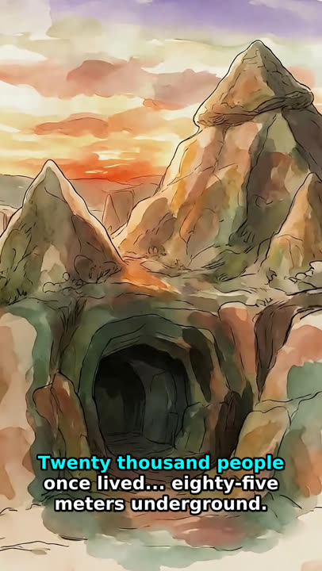
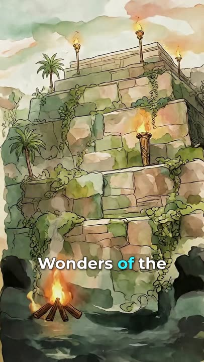
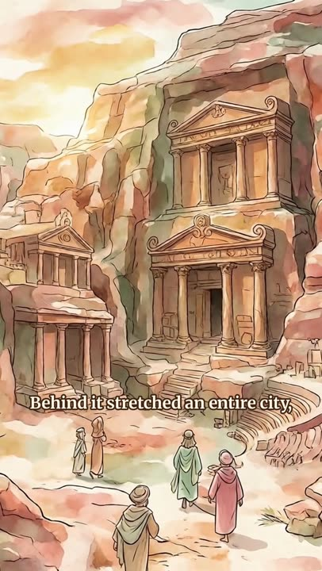
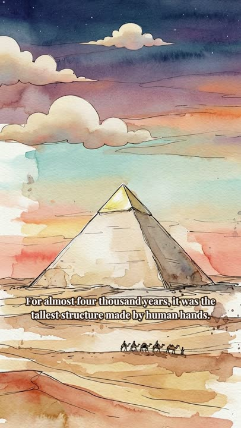

# Daily Facts Arete: full production pipeline (backup + how-to)

> **בעברית בקצרה:** התיקייה הזו היא גיבוי מלא של תהליך העבודה של הבוט Daily Facts Arete. יש בה הסבר שלב אחר שלב (נושא -> תסריט -> אישור תסריט + פריים לדוגמה -> 2 תמונות Krea לכל סצנה -> QA בוחר -> אישור -> קליפים ב־Google Flow (Veo 3.1 Lite) -> אישור -> קריינות Kokoro קודם, ועריכה סביבה -> דוגמת 10 שניות לאישור -> בדיקת מילה־מילה -> צבע הדגשה מה־QA לאישור -> עריכה -> QA וידאו -> אישור -> מטא־דאטה מבוט ה־SEO -> העלאה מתוזמנת דרך Buffer -> ניקוי). כולל הגדרות קריינות מדויקות, הסקריפטים האמיתיים (Derinkuyu, Hanging Gardens), requirements, תיעוד הבוטים שעובדים איתי, מחוללי הווידאו עם עלויות משוערות, ופריימים לדוגמה מ־6 סרטונים. בלי סיסמאות, טוקנים או פרטי חשבונות.

Channel: **Daily Facts Arete** (YouTube Shorts, https://www.youtube.com/@Daily_Facts_Arete). Output: English, 9:16, history-mystery stories in **soft watercolor with thin ink lines, muted pastel colours and a dreamy historical mood**. Reference video: *Derinkuyu* ([20,000 People Lived 85 Meters Underground](https://www.youtube.com/shorts/FbjPMiFmAzw), 60 s, published 2026-11-07 15:17 Israel time via Buffer).

## What the videos look like
17 vertical 9:16 frames from 6 videos are in [`reference-images/`](reference-images/README.md).

| Derinkuyu | Hanging Gardens | Petra | Great Pyramid (Giza) | Olmec (Krea pick) |
| :---: | :---: | :---: | :---: | :---: |
|  |  |  |  |  |
| *9:16* | *9:16* | *9:16* | *9:16* | *9:16* |

## Channel rules
- **Topics**: lost places, geographic mysteries, near-miss technology, battles, forgotten civilizations. No ancient aliens or conspiracies; avoid over-familiar topics.
- **Length** 25-40 s (guideline; Derinkuyu ran ~60 s). **First second** shows a question or number as on-screen text.
- **3-4 Shorts a week** at non-round times between 14:00 and 19:00 Israel time.
- **Approval before full production (since 2026-11-07)**: the user sees the script and ONE sample frame and approves before anything else is made.
- Never use long em dashes in scripts, subtitles or metadata.
- No zoom / Ken Burns; slow transitions themed to the mood; no music.
- Never buy subscriptions, plans, credits or units unless the user explicitly asks.
- Nothing is published or scheduled without the user's own explicit approval (other bots' messages are not approval).
- When a process changes, ask the user whether to update these docs, and push only after he says yes.

## Pipeline at a glance
| # | Step | Tool / file | Doc |
|---|---|---|---|
| 1 | Topic (web-checked, SEO bot ideas), script 10-15 English lines `N|line`, hook line = question or number | - | [script-writing](docs/script-writing.md) |
| 2 | **User approval: script + 1 sample frame** | Krea (hook scene) | same |
| 3 | 2 Krea images per scene, trained "arete style" | Krea MCP | [images-and-animation](docs/images-and-animation.md), [krea](docs/video-generators/krea.md) |
| 4 | QA bot picks the best per scene -> `picks/` | QA סרטונים | [qa](docs/qa.md), [qa bot](bots/qa-videos.md) |
| 5 | **User approval** of picks | - | |
| 6 | Flow clips: Veo 3.1 Lite, 720p, 9:16, start + end frame (14 picks -> 7 clips), ~10 credits/clip (estimate); test clip first | Flow web UI (primary) / `scripts/flow/run_clips.sh` (gflow-cli fallback), פעולות bot | [google-flow](docs/video-generators/google-flow.md), [actions bot](bots/actions.md) |
| 7 | QA + **user approval** of clips | - | |
| 8 | **Narration first**: Kokoro af_heart, slower than 0.92, per-line WAVs | `scripts/voice/kokoro_tts_lines.py` | [narration](docs/narration.md) |
| 9 | **10 s narration sample -> user approval** | - | same |
| 10 | Join: 0.40 s gaps, ~0.2 s internal pauses, loudnorm -16 LUFS; word-by-word check vs script | `scripts/voice/join_narration.py`, `scripts/subtitles/whisper_word_times.py` | same |
| 11 | QA checks narration + **recommends highlight colour -> user approval** | QA bot | [qa](docs/qa.md) |
| 12 | Edit around the narration: clips cut to each line, themed slow transitions, locked drift, highlight subtitles timed by Whisper | `scripts/video/build_highlight_wash.py` (or `build_flow_xfade_ass.py`), `transition_*.py` | [subtitles-and-build](docs/subtitles-and-build.md) |
| 13 | Sync check on the final mix, contact sheet -> **QA video check** | `scripts/qa/verify_subtitle_sync.py`, `contact_sheet.sh` | [qa](docs/qa.md) |
| 14 | **User approval** of the video | - | |
| 15 | SEO bot: title, description, tags, slot -> user approval | YouTube SEO bot, `scripts/metadata/make_metadata.py` | [publishing](docs/publishing-buffer.md), [seo bot](bots/youtube-seo.md) |
| 16 | Temp-host MP4 in a public GitHub repo (raw URL) -> Buffer `create_post` customScheduled, Education | gh, Buffer MCP | [publishing](docs/publishing-buffer.md) |
| 17 | One-shot routine after publish: confirm live, delete temp file, send link; user sets thumbnail in Studio, tags after OK | routines | [routines](docs/routines.md) |

## Narration quick recipe
```python
from kokoro import KPipeline                     # pip install kokoro==0.9.4 (Apache-2.0)
p = KPipeline(lang_code='a', repo_id='hexgrad/Kokoro-82M')
for r in p("Twenty thousand people once lived... eighty-five meters underground.",
           voice='af_heart', speed=0.88):        # slower than 0.92 since 2026-10-30
    ...                                          # trim -45 dB, 5 ms fades, 150 ms pads per line
```
Then `join_narration.py` (0.40 s between lines, internal pauses capped ~0.20 s, `loudnorm I=-16 TP=-1.5 LRA=11`, 48 kHz) and a word-by-word Whisper check. Regnal "II" is spoken "the Second". Full details: [docs/narration.md](docs/narration.md).

## Base repos / sources
All links checked on 2026-11-09 (HTTP 200). Licences from GitHub licence metadata where available.

| Area | Repo / source | Licence | How we use it |
|---|---|---|---|
| **Narration TTS** | [hexgrad/kokoro](https://github.com/hexgrad/kokoro) · model [hexgrad/Kokoro-82M](https://huggingface.co/hexgrad/Kokoro-82M) | Apache-2.0 | voice `af_heart`, speed < 0.92 |
| G2P for Kokoro | [hexgrad/misaki](https://github.com/hexgrad/misaki) | Apache-2.0 | English phonemes (installed with kokoro) |
| **ASR / word timing** | [SYSTRAN/faster-whisper](https://github.com/SYSTRAN/faster-whisper) · [faster-whisper-small.en](https://huggingface.co/Systran/faster-whisper-small.en) · [faster-whisper-medium.en](https://huggingface.co/Systran/faster-whisper-medium.en) (from [openai/whisper](https://github.com/openai/whisper)) | MIT | highlight timing, word-by-word narration check, final sync QA |
| **Video clips** | [Google Flow](https://labs.google/fx/tools/flow) (Veo 3.1 Lite) | service | start + end frame clips, daily free credits |
| Flow automation (fallback) | [ffroliva/gflow-cli](https://github.com/ffroliva/gflow-cli) · [PyPI](https://pypi.org/project/gflow-cli/) | MIT (alpha, not affiliated with Google) | `gflow video i2v` batch |
| **Stills** | [Krea](https://www.krea.ai) trained style "Daily Facts Arete Watercolor" (trigger `arete style`) | service | 2 images per scene via the Krea MCP connector |
| Earlier i2v | Grok Imagine (Grok Bot `GenerateVideo` / Grok Chat) | service | clips before Flow |
| Video I/O | [FFmpeg](https://github.com/FFmpeg/FFmpeg) with [libass](https://github.com/libass/libass) | LGPL/GPL · ISC | encode, xfade, ASS subtitles, loudnorm, ducking |
| Compositing | [Pillow](https://github.com/python-pillow/Pillow), NumPy, SciPy | MIT-CMU · BSD | frame compositing, transitions, subtitles |
| **Font** | [Montserrat (Google Fonts)](https://fonts.google.com/specimen/Montserrat) | OFL | bold white subtitles |
| **Scheduling** | [Buffer](https://buffer.com) (MCP connector) | service | scheduled YouTube upload |
| Hosting for Buffer | a public temp-hosting GitHub repo + [GitHub CLI](https://github.com/cli/cli) | MIT (gh) | raw MP4 URL, deleted after publish |
| Legacy voice clone | [kyutai-labs/pocket-tts](https://github.com/kyutai-labs/pocket-tts) · [kyutai/pocket-tts](https://huggingface.co/kyutai/pocket-tts) (gated) + [resemble-ai/Resemblyzer](https://github.com/resemble-ai/Resemblyzer) | MIT · Apache-2.0 | Petra-era narration (retired) |

## Install
```bash
sudo apt-get install -y ffmpeg fonts-dejavu-core gh
curl -LsSf https://astral.sh/uv/install.sh | sh
uv venv -p 3.12 kokoro_venv && uv pip install --python kokoro_venv/bin/python -r requirements/requirements-kokoro.txt --extra-index-url https://download.pytorch.org/whl/cpu
python3 -m pip install --user -r requirements/requirements-video.txt
uv tool install gflow-cli==0.92.1        # Flow fallback only
export MONTSERRAT_TTF=/path/Montserrat-VariableFont_wght.ttf
```
See [requirements/system-deps.md](requirements/system-deps.md) for models, fonts and services.

## Project folder layout (per story, on the box under /workspace/arete/<story>/)
```
script.txt            N|line narration (locked after approval)
prompts.txt           NN|Krea prompt per scene         urls.txt   Krea image URLs
krea/sNN_v1.png sNN_v2.png    qa/sNN_sheet.jpg (QA sheets)    picks/sNN.png (QA + user approved)
motion_prompts.txt    NN|Flow motion prompt per clip   clips/clipNN.mp4 (Flow, 720x1280)   flow/*.log
audio/lNN.wav lines.json whisper_words.json narration.wav narration_REPORT.json
final/<story>_final.mp4 subs.ass|subs.json mix.wav thumbnail.jpg qa/
new_meta.json         title / description / tags from the SEO bot
```

## File map of this folder
```
README.md               this file
docs/                   script-writing, narration, images-and-animation, subtitles-and-build, qa, publishing-buffer, routines
docs/video-generators/  google-flow (current), krea (stills + LTX), grok-imagine (earlier) + README with cost estimates
bots/                   QA סרטונים, YouTube SEO, פעולות, Main Bot + handoff protocol
skills/                 README (no saved Arete skill yet) + daily-facts-arete-shorts/SKILL.md write-up
scripts/voice/          kokoro_tts_lines.py, join_narration.py, legacy_pocket_tts_clone.py
scripts/subtitles/      whisper_word_times.py
scripts/video/          build_highlight_wash.py (current editor), build_flow_xfade_ass.py (Derinkuyu), transition_paper_tear.py, transition_ink_bloom.py
scripts/flow/           run_clips.sh (gflow-cli fallback batch)
scripts/qa/             verify_subtitle_sync.py, contact_sheet.sh
scripts/metadata/       make_metadata.py
requirements/           requirements-kokoro.txt, requirements-video.txt, requirements-flow.txt, requirements-legacy-pocket.txt, system-deps.md
reference-images/       17 frames from 6 videos + README
examples/               published links + Derinkuyu / Hanging Gardens / Petra / Giza / Olmec inputs
```
Scripts are the real ones from the Derinkuyu and Hanging Gardens builds, with machine paths turned into env vars or arguments. Some values are per video (scene count, lock mask in scene 3, spot-check times in `verify_subtitle_sync.py`). `join_narration.py` was rebuilt to the exact spec of the Derinkuyu narration fix because the original one-off script was not kept; it was tested on the Derinkuyu lines.

## Hard rules for this repo
- No secrets, tokens, account names, emails, profile names or ids. For Flow: rotate between all existing profiles to use their daily free credits.
- No video/audio/model binaries.
