# The Lost Hike at Dyatlov Pass

**Format:** 10 parts · vertical 9:16 · English on-screen text · target video settings per part: Video, Audio On, 480p, 10 seconds.

Each part below has its own script beat, opening and ending image, and animation prompt. The image links open the generated frame files. In Grok Imagine, assign the opening image as **First frame** and the ending image as **Last frame**. Review every part before submitting it for generation.

## Part 1 — DYATLOV PASS — 1959

**Visual:** A simple Soviet Union map, the Urals marked; the black character points to the location with a ruler.

**Caption / narration:** “November 1959. A group of nine students sets out toward the frozen mountains.”

**Frames:** [Opening](images/part-01-opening.png) · [Ending](images/part-01-ending.png)

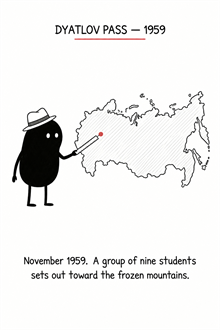 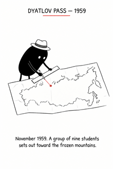

**Animation prompt (English):**

Animate smoothly from the opening image to the ending image in the same minimalist hand-drawn line-art style. Slowly push in from the Soviet Union map toward the Ural marker. The black character points with the ruler as a thin route line begins to appear. Keep the map simple and the muted-red marker restrained, with no sudden cuts or extra labels. Use soft map-paper movement and a quiet ambient tone, with no dialogue or music. Duration about 10 seconds.

**Text preservation — important:** Keep the title “DYATLOV PASS — 1959” and the caption “November 1959. A group of nine students sets out toward the frozen mountains.” completely static, sharp, and readable throughout. Treat them as fixed overlays: do not move, animate, morph, blur, fade, cover, or distort the text.

## Part 2 — THE TRIP BEGINS

**Visual:** Nine students in winter clothes with large backpacks gather before setting out across snowy Ural ridges.

**Caption / narration:** “They plan a 300-kilometer route and expect to return within three weeks.”

**Frames:** [Opening](images/part-02-opening.png) · [Ending](images/part-02-ending.png)

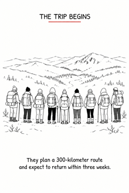 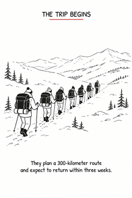

**Animation prompt (English):**

Animate smoothly from the opening image to the ending image in the same minimalist hand-drawn line-art style. The nine hikers pause together, then begin walking in single file along the snowy trail toward the distant mountains. Use gentle forward camera movement and light drifting snow; keep all nine hikers and their winter gear consistent, with no sudden cuts or extra people. Use quiet mountain wind and soft snow underfoot, with no dialogue or music. Duration about 10 seconds.

**Text preservation — important:** Keep the title “THE TRIP BEGINS” and the caption “They plan a 300-kilometer route and expect to return within three weeks.” completely static, sharp, and readable throughout. Treat them as fixed overlays: do not move, animate, morph, blur, fade, cover, or distort the text.

## Part 3 — THE FIRST NIGHT

**Visual:** A small red tent on a snowy mountainside near the summit; the black character arrives with a cooking pan and settles beside a small fire.

**Caption / narration:** “On February 1, 1959, they set up camp on a mountainside, not far from the summit.”

**Frames:** [Opening](images/part-03-opening.png) · [Ending](images/part-03-ending.png)

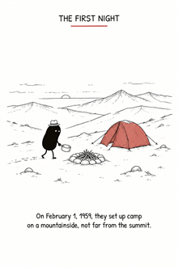 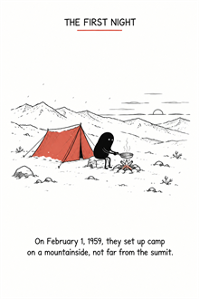

**Animation prompt (English):**

Animate smoothly from the opening image to the ending image in the same minimalist hand-drawn line-art style. The black character approaches the small red tent, sits beside the campfire, and places the pan over the flames. Let the fire flicker gently, a little steam rise, and a few snowflakes drift by. Keep the mountain, tent, and framing consistent, with no cuts or sudden camera movement. Use soft mountain wind and a faint fire crackle, with no dialogue or music. Duration about 10 seconds.

**Text preservation — important:** Keep the title “THE FIRST NIGHT” and the caption “On February 1, 1959, they set up camp on a mountainside, not far from the summit.” completely static, sharp, and readable throughout. Treat them as fixed overlays: do not move, animate, morph, blur, fade, cover, or distort the text.

## Part 4 — SOMETHING IS WRONG

**Visual:** The black character watches the horizon as dark clouds gather over the snowy mountain and tent.

**Caption / narration:** “That night, something made them cut open the tent from the inside and flee into the snow.”

**Frames:** [Opening](images/part-04-opening.png) · [Ending](images/part-04-ending.png)

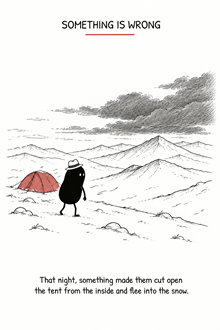 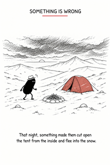

**Animation prompt (English):**

Animate smoothly from the opening image to the ending image in the same minimalist hand-drawn line-art style. Dark clouds gradually roll closer over the mountains, wind picks up and blows loose snow across the slope, and the character turns toward the tent with growing concern. Let the tent fabric flutter subtly as the character takes a cautious step back. Keep the scene restrained and mysterious, with no sudden cuts or dramatic effects. Use subtle mountain wind and faint windblown snow, with no dialogue or music. Duration about 10 seconds.

**Text preservation — important:** Keep the title “SOMETHING IS WRONG” and the caption “That night, something made them cut open the tent from the inside and flee into the snow.” completely static, sharp, and readable throughout. Treat them as fixed overlays: do not move, animate, morph, blur, fade, cover, or distort the text.

## Part 5 — THE COLD

**Visual:** Two hikers shiver barefoot in the snow; the black character covers its face in distress.

**Caption / narration:** “Some were found barefoot and shivering in temperatures of minus 30 degrees.”

**Frames:** [Opening](images/part-05-opening.png) · [Ending](images/part-05-ending.png)

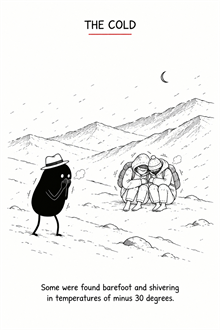 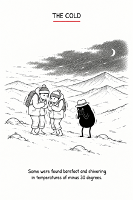

**Animation prompt (English):**

Animate smoothly from the opening image to the ending image in the same minimalist hand-drawn line-art style. The two hikers shiver and draw closer against the wind; faint breath puffs appear as loose snow moves across the slope. The black character slowly raises both hands to cover its face. Keep the scene respectful and non-graphic, with no injuries or sudden camera moves. Use subtle cold mountain wind and faint snow, with no dialogue or music. Duration about 10 seconds.

**Text preservation — important:** Keep the title “THE COLD” and the caption “Some were found barefoot and shivering in temperatures of minus 30 degrees.” completely static, sharp, and readable throughout. Treat them as fixed overlays: do not move, animate, morph, blur, fade, cover, or distort the text.

## Part 6 — THE CEDAR TREE

**Visual:** Three forms are respectfully covered by snow near a cedar tree; the black character stands at a distance, then approaches with its head lowered.

**Caption / narration:** “Three of them were found dead near a cedar tree, far from the tent.”

**Frames:** [Opening](images/part-06-opening.png) · [Ending](images/part-06-ending.png)

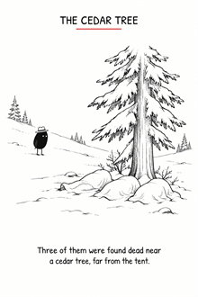 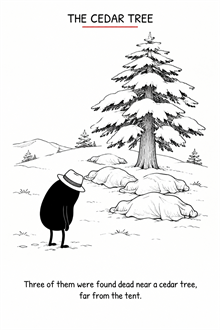

**Animation prompt (English):**

Animate smoothly from the opening image to the ending image in the same minimalist hand-drawn line-art style. Let a few snowflakes drift beneath the cedar branches while the black character slowly takes a step closer and lowers its head. Keep the three forms fully covered and the scene non-graphic, respectful, and still, with no sudden cuts or dramatic movement. Use very soft winter wind, with no dialogue or music. Duration about 10 seconds.

**Text preservation — important:** Keep the title “THE CEDAR TREE” and the caption “Three of them were found dead near a cedar tree, far from the tent.” completely static, sharp, and readable throughout. Treat them as fixed overlays: do not move, animate, morph, blur, fade, cover, or distort the text.

## Part 7 — WHAT WAS IN THE TENT

**Visual:** A torn tent and a flashlight reveal shoes, coats, and equipment left behind.

**Caption / narration:** “Shoes, coats, and equipment were found inside the tent, as if they had fled in a hurry.”

**Frames:** [Opening](images/part-07-opening.png) · [Ending](images/part-07-ending.png)

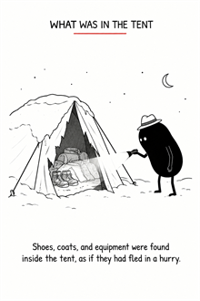 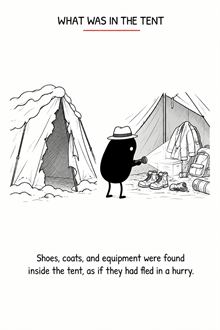

**Animation prompt (English):**

Animate smoothly from the opening image to the ending image in the same minimalist hand-drawn line-art style. The black character slowly sweeps a flashlight beam from the torn tent entrance across the abandoned shoes, coats, and equipment, revealing more of the interior. Keep the tent and objects still, the light movement gentle, and the mood investigative rather than frightening, with no sudden cuts. Use quiet wind and a faint fabric rustle, with no dialogue or music. Duration about 10 seconds.

**Text preservation — important:** Keep the title “WHAT WAS IN THE TENT” and the caption “Shoes, coats, and equipment were found inside the tent, as if they had fled in a hurry.” completely static, sharp, and readable throughout. Treat them as fixed overlays: do not move, animate, morph, blur, fade, cover, or distort the text.

## Part 8 — THE INVESTIGATION

**Visual:** A route map on an investigation table develops diverging arrows; the black character looks frustrated by the unresolved evidence.

**Caption / narration:** “Investigators could not explain the injuries, some of which seemed like the result of a powerful impact.”

**Frames:** [Opening](images/part-08-opening.png) · [Ending](images/part-08-ending.png)

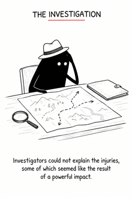 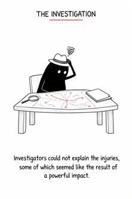

**Animation prompt (English):**

Animate smoothly from the opening image to the ending image in the same minimalist hand-drawn line-art style. On the map, a few route arrows gradually branch in different directions. The black character studies the markings, then puts one hand to its head in frustration. Keep the magnifying glass and folder in place; do not depict injuries or add clues that imply a confirmed cause. No sudden cuts. Use quiet room tone with faint wind outside, with no dialogue or music. Duration about 10 seconds.

**Text preservation — important:** Keep the title “THE INVESTIGATION” and the caption “Investigators could not explain the injuries, some of which seemed like the result of a powerful impact.” completely static, sharp, and readable throughout. Treat them as fixed overlays: do not move, animate, morph, blur, fade, cover, or distort the text.

## Part 9 — WHO THEY WERE

**Visual:** The black character looks at a board of nine smiling student portraits.

**Caption / narration:** “Each was an engineering student, an experienced hiker, and full of hope.”

**Frames:** [Opening](images/part-09-opening.png) · [Ending](images/part-09-ending.png)

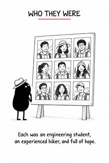 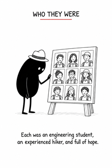

**Animation prompt (English):**

Animate smoothly from the opening image to the ending image in the same minimalist hand-drawn line-art style. The black character slowly steps closer to the board of nine portraits and rests a hand beside it. Keep every portrait stable, kind, and undistorted; use a very gentle camera push-in to create a respectful moment of remembrance. No extra writing or sudden cuts. Use a soft, unobtrusive ambient tone, with no dialogue or music. Duration about 10 seconds.

**Text preservation — important:** Keep the title “WHO THEY WERE” and the caption “Each was an engineering student, an experienced hiker, and full of hope.” completely static, sharp, and readable throughout. Treat them as fixed overlays: do not move, animate, morph, blur, fade, cover, or distort the text.

## Part 10 — THE OPEN QUESTION

**Visual:** The black character stands alone on a snowy Ural summit at sunset, facing the horizon.

**Caption / narration:** “To this day, no one knows for certain what happened that night; the case remains unresolved.”

**Frames:** [Opening](images/part-10-opening.png) · [Ending](images/part-10-ending.png)

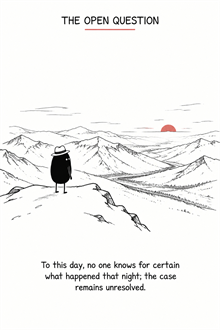 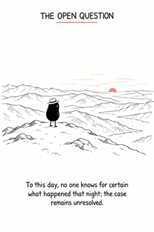

**Animation prompt (English):**

Animate smoothly from the opening image to the ending image in the same minimalist hand-drawn line-art style. The muted-red sun slowly lowers behind the distant Ural peaks as the camera gently pulls back, leaving the black character alone on the summit looking toward the horizon. Keep the ending contemplative and unresolved; do not introduce a theory, new objects, or other people. Use faint mountain wind, with no dialogue or music. Duration about 10 seconds.

**Text preservation — important:** Keep the title “THE OPEN QUESTION” and the caption “To this day, no one knows for certain what happened that night; the case remains unresolved.” completely static, sharp, and readable throughout. Treat them as fixed overlays: do not move, animate, morph, blur, fade, cover, or distort the text.

## Closing note

This is based on a real event. Avalanche and infrasound explanations are hypotheses, not a definitive conclusion. Present the ending as unresolved unless the script is updated with a sourced correction.

## Production checks

- The source script says “November 1959” in Part 1 and “February 1, 1959” in Part 3; verify the chronology before final export.
- Ten 10-second clips would total about 100 seconds before transitions. To keep the complete film near 60 seconds, shorten or trim clips during editing.
- Use the separate [general workflow](WORKFLOW.md) for the reusable production process; this file contains the story-specific script and prompts.
