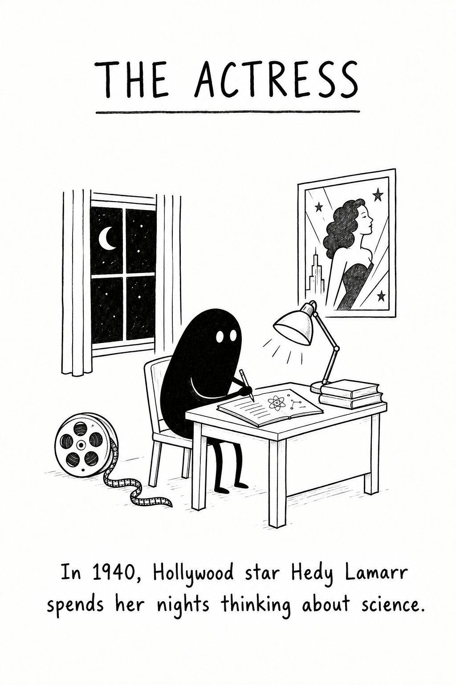
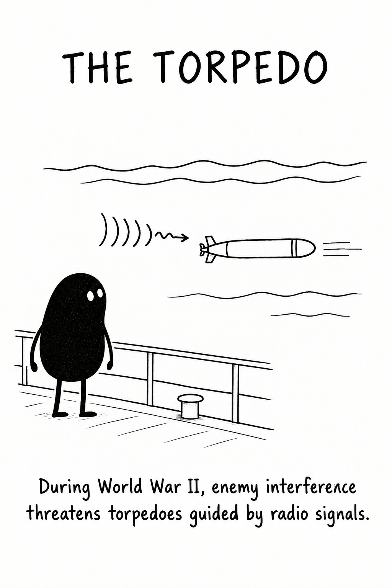
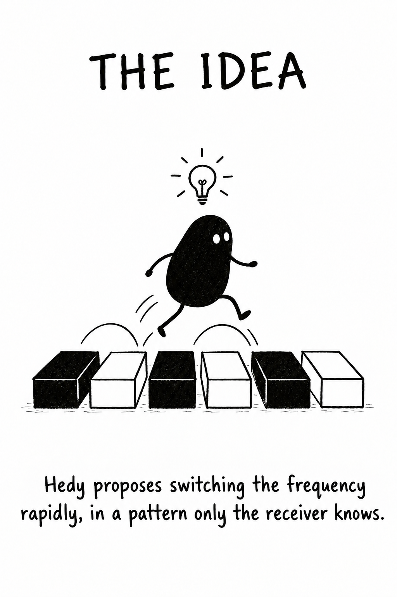
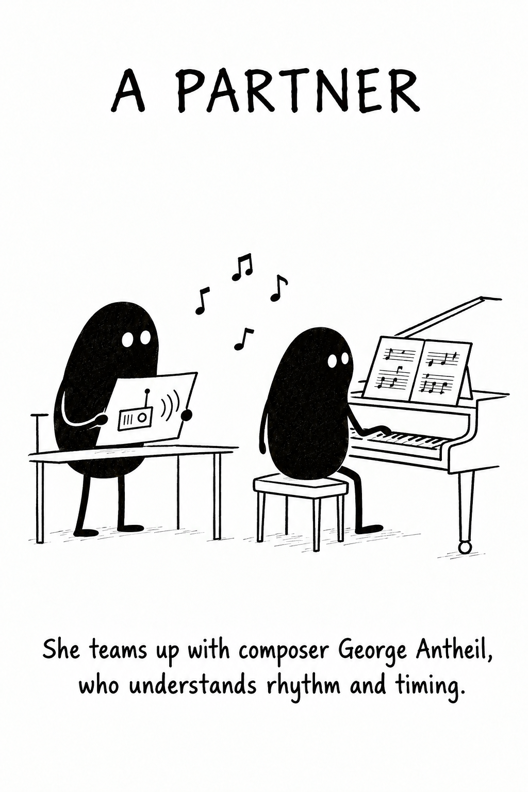
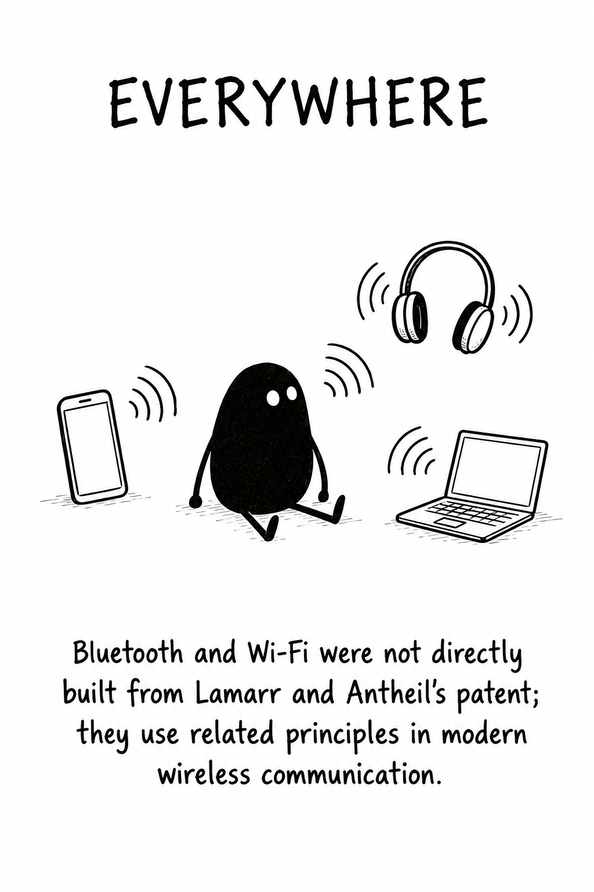
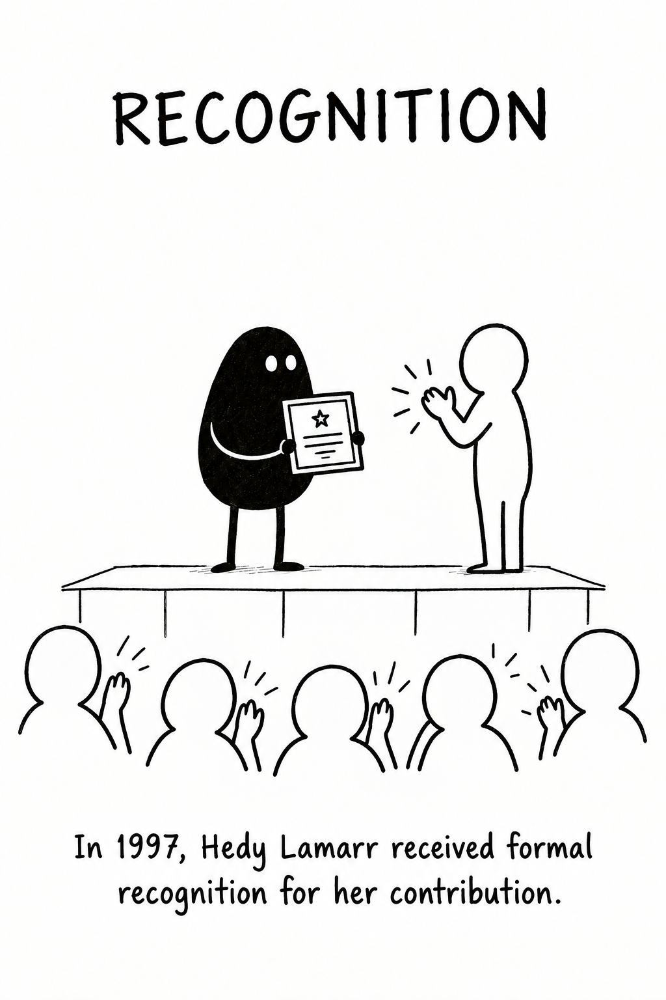

# The Voice That Hopped Frequencies

**Story:** Hedy Lamarr and George Antheil's frequency-hopping idea  
**Format:** 10 parts · vertical 9:16 illustrations · English on-screen text  
**Character reference:** [Character sheet](images/character-sheet.png)

The character sheet defines the recurring black bean-shaped mascot. Keep it hatless in every illustration. Images for Parts 1 and 2 are included below. Images for Parts 3–10 are still to be created.

## Character consistency instructions

- Use the [character sheet](images/character-sheet.png) as the required visual reference whenever generating or editing an image for this story.
- Preserve the mascot's silhouette, proportions, solid-black bean-shaped body, two small white eyes, and thin flexible arms and legs.
- The mascot has no hat, clothing, accessories, mouth, or nose. Do not add these features, even if another reference image contains them.
- Treat the character sheet as a design reference, not as scene content. Show only the pose and setting required by the current part.
- Check every generated image against the character sheet before approval. If the character design drifts, regenerate the image before continuing.

## Part 1 — The Actress

**Script:** ב-1940 מתעוררת בהוליווד שחקנית צעירה בשם היידי לאמאר, שמנצלת כל רגע פנוי כדי לחשוב על רעיונות מדעיים בלילות.

**On-screen caption:** In 1940, Hollywood star Hedy Lamarr spends her nights thinking about science.

## Part 2 — One Frequency

**Script:** היידי לומדת על ההנדסה מאחורי מערכות רדיו ומבינה שאותות יכולים להיחסם בקלות כשהם נשלחים על תדר אחד קבוע.

**On-screen caption:** A signal on a single fixed frequency is easy to jam and easy to block.

## Part 3 — The Torpedo

**Script:** מלחמת העולם השנייה מתחוללת, וטורפדו שמונחה בקו רדיו נתקל בבעיה: האויב יכול להפריע לאותות ולהטעות את הטורפדו.

**On-screen caption:** During World War II, enemy interference threatened torpedoes guided by radio signals.

## Part 4 — The Idea

**Script:** היידי מציעה שיטה שבה האות ישנה תדר באופן מהיר ומתואם, ורק המקלט שיודע את הרצף יוכל לקלוט אותו.

**On-screen caption:** Hedy proposes rapidly switching frequencies in a synchronized pattern known to the receiver.

## Part 5 — A Partner

**Script:** היידי פונה למוזיקאי ג'ורג' אנטייל, שמבין את העיקרון מתוך עולם הקצב, ויחד הם מתחילים לתכנן את המערכת.

**On-screen caption:** She teams up with composer George Antheil, who understands rhythm and timing.

## Part 6 — The Patent

**Script:** בשנת 1942 מקבלים השניים פטנט על שיטת קפיצת התדרים, אבל הצבא לא מיישם אותה מיד והרעיון נשאר בארון.

**On-screen caption:** In 1942, they received a patent, but the military did not put the idea into use right away.

## Part 7 — The Hidden Gift

**Script:** שנים לאחר מכן, מהנדסים מכירים בערך של הרעיון, וקפיצת התדרים הופכת לאחד העקרונות המשמשים בתקשורת אלחוטית מודרנית.

**On-screen caption:** Years later, engineers recognized its value. Frequency hopping became one of several principles used in modern wireless communication.

## Part 8 — Everywhere

**Script:** Bluetooth ו-Wi-Fi לא נבנו ישירות על הפטנט של לאמאר ואנטייל, אך משתמשים בעקרונות דומים בתקשורת אלחוטית.

**On-screen caption:** Bluetooth and Wi-Fi were not directly built from Lamarr and Antheil's patent; they use related principles in modern wireless communication.

## Part 9 — Recognition

**Script:** בשנת 1997 מקבלת היידי לאמאר הכרה רשמית על תרומתה, ומגלה שהרעיון שנולד בלילות בהוליווד השפיע על חיי מיליונים.

**On-screen caption:** In 1997, Hedy Lamarr received formal recognition for her contribution.

## Part 10 — The Signal Continues

**Script:** היידי מתבוננת בעולם מלא בתקשורת אלחוטית, ומבינה שההמצאה שלה, שנולדה במלחמה, עדיין נושאת מסרים ומשנה את הדרך שבה אנשים מתחברים.

**On-screen caption:** An idea born in wartime still shapes how people connect today.

## Historical note

Hedy Lamarr and George Antheil patented their frequency-hopping system in 1942. It was not immediately adopted by the military. Bluetooth and Wi-Fi were not directly derived from their patent; they use related principles in wireless communication.
