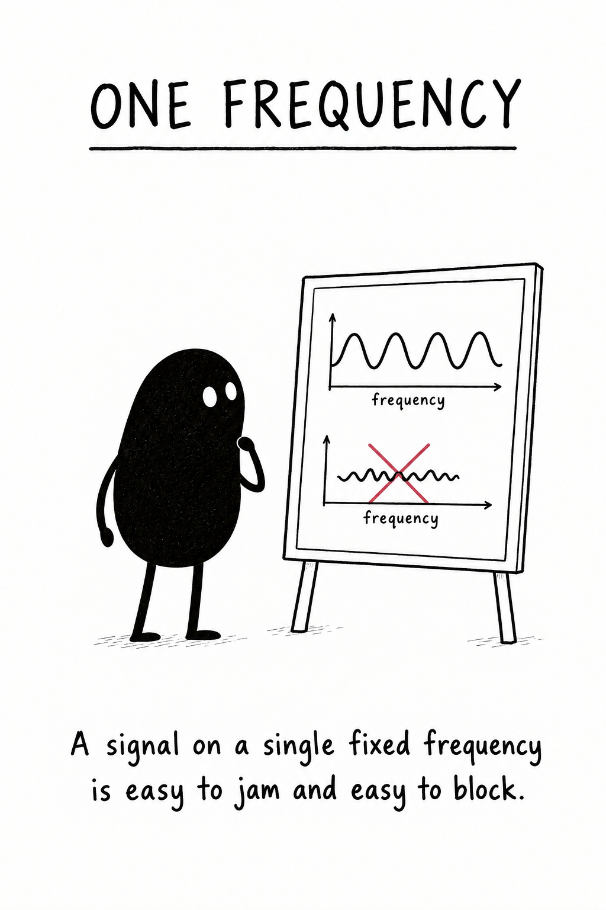
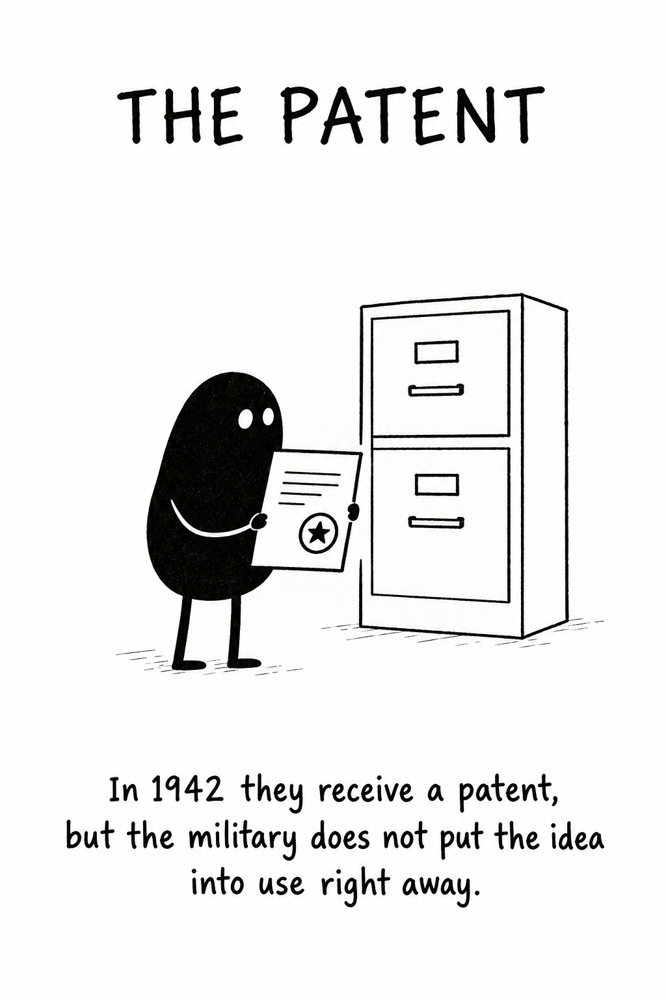
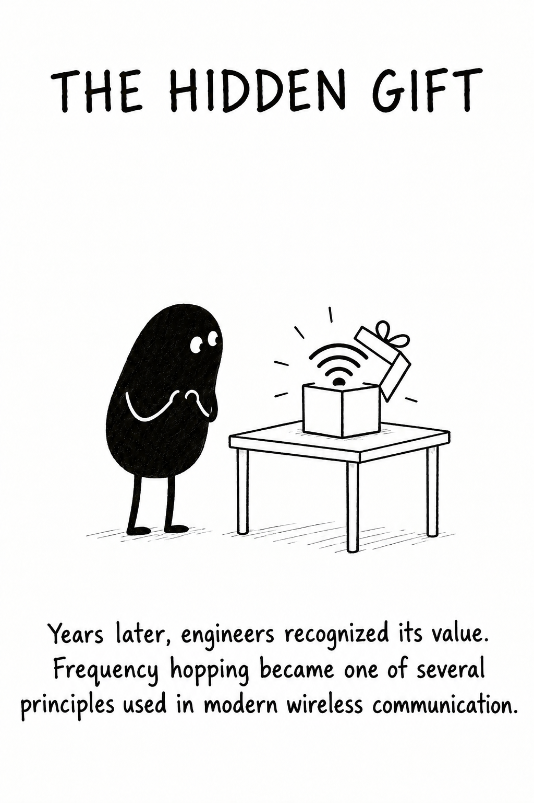
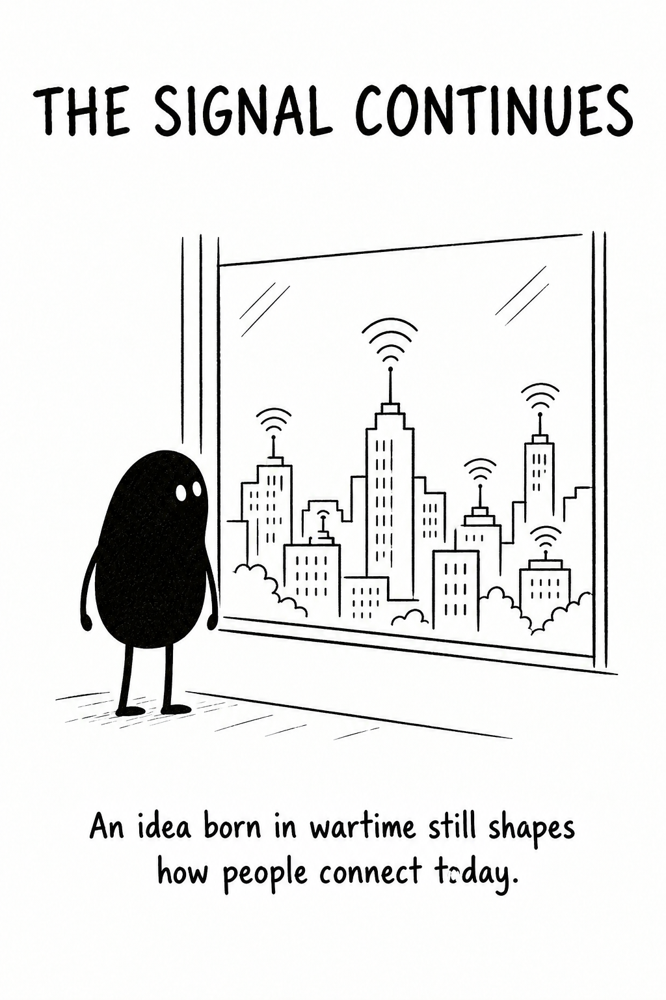

# The Voice That Hopped Frequencies

**Story:** Hedy Lamarr and George Antheil's frequency-hopping idea  
**Format:** 10 parts · vertical 9:16 illustrations · English on-screen text  
**Character reference:** [Character sheet](images/character-sheet.png)

The character sheet defines the recurring black bean-shaped mascot. Keep it hatless in every illustration. All 10 illustrations are included below.

## Character consistency instructions

- Use the [character sheet](images/character-sheet.png) as the required visual reference whenever generating or editing an image for this story.
- Preserve the mascot's silhouette, proportions, solid-black bean-shaped body, two small white eyes, and thin flexible arms and legs.
- The mascot has no hat, clothing, accessories, mouth, or nose. Do not add these features, even if another reference image contains them.
- Treat the character sheet as a design reference, not as scene content. Show only the pose and setting required by the current part.
- Check every generated image against the character sheet before approval. If the character design drifts, regenerate the image before continuing.

## Part 1 — The Actress

**Script:** ב-1940 מתעוררת בהוליווד שחקנית צעירה בשם היידי לאמאר, שמנצלת כל רגע פנוי כדי לחשוב על רעיונות מדעיים בלילות.

**On-screen caption:** In 1940, Hollywood star Hedy Lamarr spends her nights thinking about science.


**Animation prompt (English):**

```text
Animate a vertical 9:16 minimalist hand-drawn line-art scene on a pure white background. The solid black bean character with white eyes writes slowly on the notepad with its thin arm, and the lamp glow softly pulses. The film reel in the background turns very slowly. The character blinks, then looks up thoughtfully. Draw a thin, hand-scribbled underline beneath the title THE ACTRESS from left to right as a separate graphic stroke. Keep the title and caption exactly unchanged, static, sharp, and readable throughout; do not fade, move, morph, or distort any text. No talking, dialogue, narration, or voiceover. Smooth, calm, cozy motion with soft easing and a slow camera push-in.
```

## Part 2 — One Frequency

**Script:** היידי לומדת על ההנדסה מאחורי מערכות רדיו ומבינה שאותות יכולים להיחסם בקלות כשהם נשלחים על תדר אחד קבוע.

**On-screen caption:** A signal on a single fixed frequency is easy to jam and easy to block.



**Animation prompt (English):**

```text
Animate a vertical 9:16 minimalist hand-drawn line-art scene on a pure white background. The wavy line on the frequency axis draws itself smoothly from left to right. The crossed-out wave flickers briefly, then the cross mark draws itself in. The solid black bean character with white eyes taps the diagram with its hand, creating a small bounce. Draw a thin, hand-scribbled underline beneath the title ONE FREQUENCY from left to right as a separate graphic stroke. Keep the title and caption exactly unchanged, static, sharp, and readable throughout; do not fade, move, morph, or distort any text. No talking, dialogue, narration, or voiceover. Focused, clean motion with smooth easing.
```

## Part 3 — The Torpedo

**Script:** מלחמת העולם השנייה מתחוללת, וטורפדו שמונחה בקו רדיו נתקל בבעיה: האויב יכול להפריע לאותות ולהטעות את הטורפדו.

**On-screen caption:** During World War II, enemy interference threatened torpedoes guided by radio signals.


**Animation prompt (English):**

```text
Animate a vertical 9:16 minimalist hand-drawn line-art scene on a pure white background. The torpedo outline glides slowly through the wavy ocean lines from left to right, and the ocean waves ripple gently. The small enemy signal arrow pulses and moves toward the torpedo with a tense, slow approach. The solid black bean character with white eyes leans forward on the deck with a subtle concerned sway. Draw a thin, hand-scribbled underline beneath the title THE TORPEDO from left to right as a separate graphic stroke. Keep the title and caption exactly unchanged, static, sharp, and readable throughout; do not fade, move, morph, or distort any text. No talking, dialogue, narration, or voiceover. Tense but smooth motion with careful easing.
```

## Part 4 — The Idea

**Script:** היידי מציעה שיטה שבה האות ישנה תדר באופן מהיר ומתואם, ורק המקלט שיודע את הרצף יוכל לקלוט אותו.

**On-screen caption:** Hedy proposes rapidly switching frequencies in a synchronized pattern known to the receiver.


**Animation prompt (English):**

```text
Animate a vertical 9:16 minimalist hand-drawn line-art scene on a pure white background. The signal waves jump between the frequency blocks one after another in a rhythmic sequence, like notes being played. The solid black bean character with white eyes draws each wave with its arm in a smooth, flowing motion. The lightbulb icon above its head flickers on with a soft glow. Draw a thin, hand-scribbled underline beneath the title THE IDEA from left to right as a separate graphic stroke. Keep the title and caption exactly unchanged, static, sharp, and readable throughout; do not fade, move, morph, or distort any text. No talking, dialogue, narration, or voiceover. Bright, energetic yet smooth motion.
```

## Part 5 — A Partner

**Script:** היידי פונה למוזיקאי ג'ורג' אנטייל, שמבין את העיקרון מתוך עולם הקצב, ויחד הם מתחילים לתכנן את המערכת.

**On-screen caption:** She teams up with composer George Antheil, who understands rhythm and timing.


**Animation prompt (English):**

```text
Animate a vertical 9:16 minimalist hand-drawn line-art scene on a pure white background. The two bean characters move their arms in a gentle rhythm, as if playing the piano together. The musical notes float upward and drift slowly between the characters, fading out gracefully. The sketch of the radio on the second character's paper gradually draws itself. Draw a thin, hand-scribbled underline beneath the title A PARTNER from left to right as a separate graphic stroke. Keep the title and caption exactly unchanged, static, sharp, and readable throughout; do not fade, move, morph, or distort any text. No talking, dialogue, narration, or voiceover. Warm, rhythmic, collaborative motion with soft easing.
```

## Part 6 — The Patent

**Script:** בשנת 1942 מקבלים השניים פטנט על שיטת קפיצת התדרים, אבל הצבא לא מיישם אותה מיד והרעיון נשאר בארון.

**On-screen caption:** In 1942, they received a patent, but the military did not put the idea into use right away.



**Animation prompt (English):**

```text
Animate a vertical 9:16 minimalist hand-drawn line-art scene on a pure white background. The solid black bean character with white eyes lifts the patent document slightly, and the small stamp presses down with a gentle thump and a faint ink mark appearing. The filing cabinet drawer slides closed slowly. The character makes a small, thoughtful head tilt. Draw a thin, hand-scribbled underline beneath the title THE PATENT from left to right as a separate graphic stroke. Keep the title and caption exactly unchanged, static, sharp, and readable throughout; do not fade, move, morph, or distort any text. No talking, dialogue, narration, or voiceover. Quiet, understated motion with slow, steady easing.
```

## Part 7 — The Hidden Gift

**Script:** שנים לאחר מכן, מהנדסים מכירים בערך של הרעיון, וקפיצת התדרים הופכת לאחד העקרונות המשמשים בתקשורת אלחוטית מודרנית.

**On-screen caption:** Years later, engineers recognized its value. Frequency hopping became one of several principles used in modern wireless communication.



**Animation prompt (English):**

```text
Animate a vertical 9:16 minimalist hand-drawn line-art scene on a pure white background. The small gift box lid lifts slowly, and a wave icon rises gently out of the box, floating upward and fading into soft light. The solid black bean character with white eyes turns toward the gift and blinks warmly. Draw a thin, hand-scribbled underline beneath the title THE HIDDEN GIFT from left to right as a separate graphic stroke. Keep the title and caption exactly unchanged, static, sharp, and readable throughout; do not fade, move, morph, or distort any text. No talking, dialogue, narration, or voiceover. Warm, gentle, hopeful motion with smooth easing.
```

## Part 8 — Everywhere

**Script:** Bluetooth ו-Wi-Fi לא נבנו ישירות על הפטנט של לאמאר ואנטייל, אך משתמשים בעקרונות דומים בתקשורת אלחוטית.

**On-screen caption:** Bluetooth and Wi-Fi were not directly built from Lamarr and Antheil's patent; they use related principles in modern wireless communication.


**Animation prompt (English):**

```text
Animate a vertical 9:16 minimalist hand-drawn line-art scene on a pure white background. The thin wireless wave lines connecting the devices pulse outward softly, one after another, like signals spreading. The small devices gently bob up and down. The solid black bean character with white eyes looks from one device to another and gives a small nod. Draw a thin, hand-scribbled underline beneath the title EVERYWHERE from left to right as a separate graphic stroke. Keep the title and caption exactly unchanged, static, sharp, and readable throughout; do not fade, move, morph, or distort any text. No talking, dialogue, narration, or voiceover. Connected, rhythmic, smooth motion with light easing.
```

## Part 9 — Recognition

**Script:** בשנת 1997 מקבלת היידי לאמאר הכרה רשמית על תרומתה, ומגלה שהרעיון שנולד בלילות בהוליווד השפיע על חיי מיליונים.

**On-screen caption:** In 1997, Hedy Lamarr received formal recognition for her contribution.



**Animation prompt (English):**

```text
Animate a vertical 9:16 minimalist hand-drawn line-art scene on a pure white background. The solid black bean character with white eyes raises its arm and receives the plaque with a small bow. The small white silhouettes in the audience clap their hands in a gentle rhythmic motion. A few small sparkle lines appear and fade near the plaque. Draw a thin, hand-scribbled underline beneath the title RECOGNITION from left to right as a separate graphic stroke. Keep the title and caption exactly unchanged, static, sharp, and readable throughout; do not fade, move, morph, or distort any text. No talking, dialogue, narration, or voiceover. Celebratory but restrained motion with smooth easing.
```

## Part 10 — The Signal Continues

**Script:** היידי מתבוננת בעולם מלא בתקשורת אלחוטית, ומבינה שההמצאה שלה, שנולדה במלחמה, עדיין נושאת מסרים ומשנה את הדרך שבה אנשים מתחברים.

**On-screen caption:** An idea born in wartime still shapes how people connect today.


**Animation prompt (English):**

```text
Animate a vertical 9:16 minimalist hand-drawn line-art scene on a pure white background. The solid black bean character with white eyes stands by the window and slowly turns its head toward the city. The faint wireless wave lines rising from the rooftops pulse softly and drift upward, fading gently into the sky. The camera makes a slow pull-back, revealing more of the quiet city. Draw a thin, hand-scribbled underline beneath the title THE SIGNAL CONTINUES from left to right as a separate graphic stroke. Keep the title and caption exactly unchanged, static, sharp, and readable throughout; do not fade, move, morph, or distort any text. No talking, dialogue, narration, or voiceover. Reflective, calm motion with long easing and generous pauses.
```

## Historical note

Hedy Lamarr and George Antheil patented their frequency-hopping system in 1942. It was not immediately adopted by the military. Bluetooth and Wi-Fi were not directly derived from their patent; they use related principles in wireless communication.
