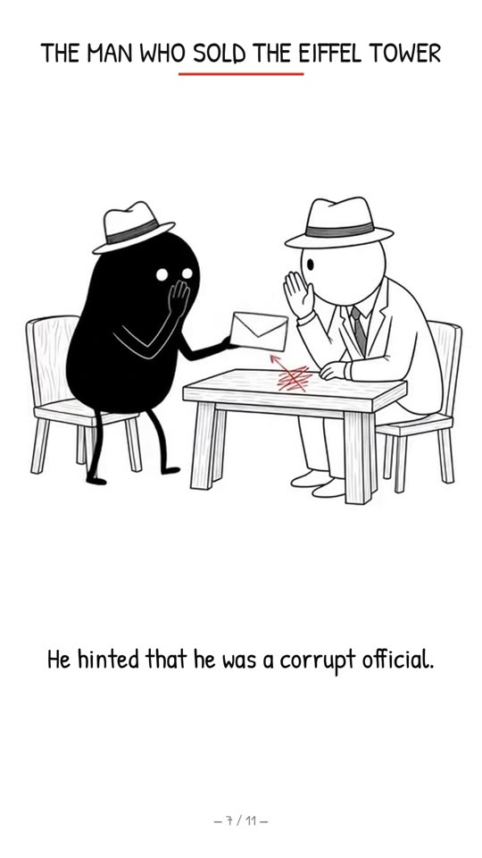
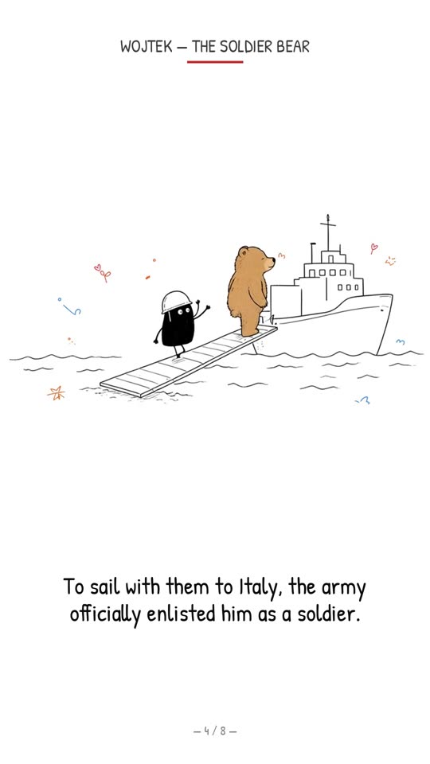
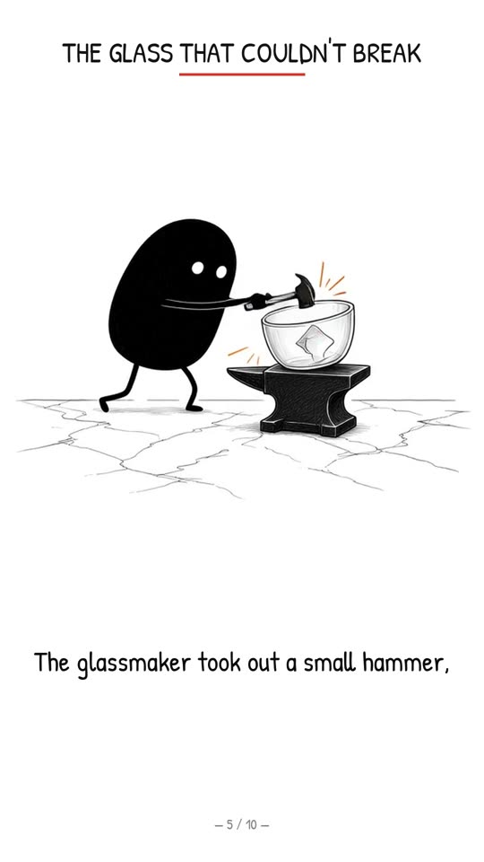
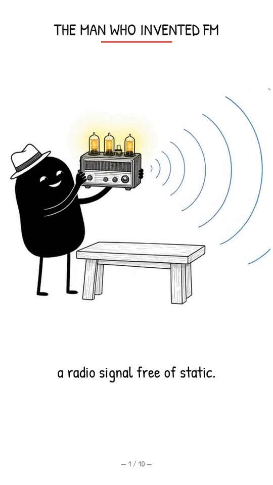
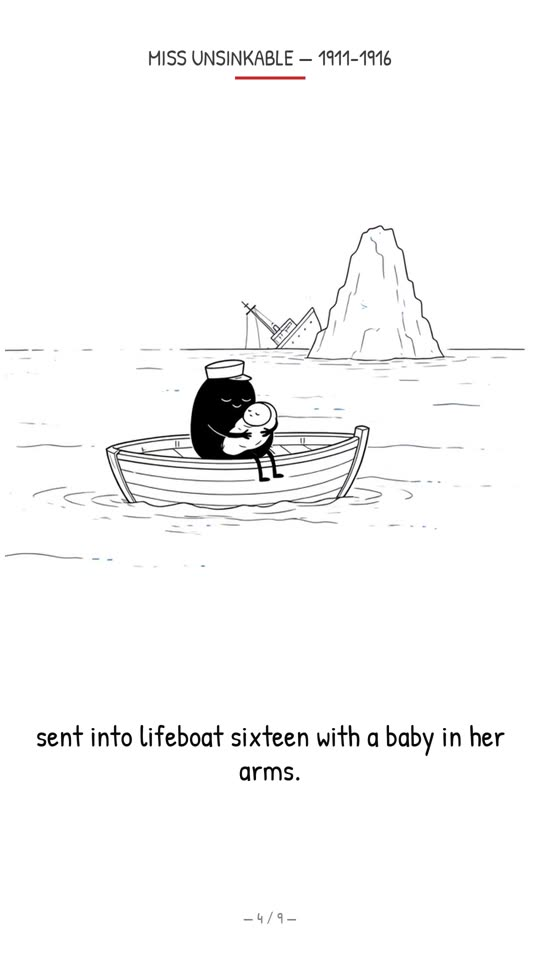
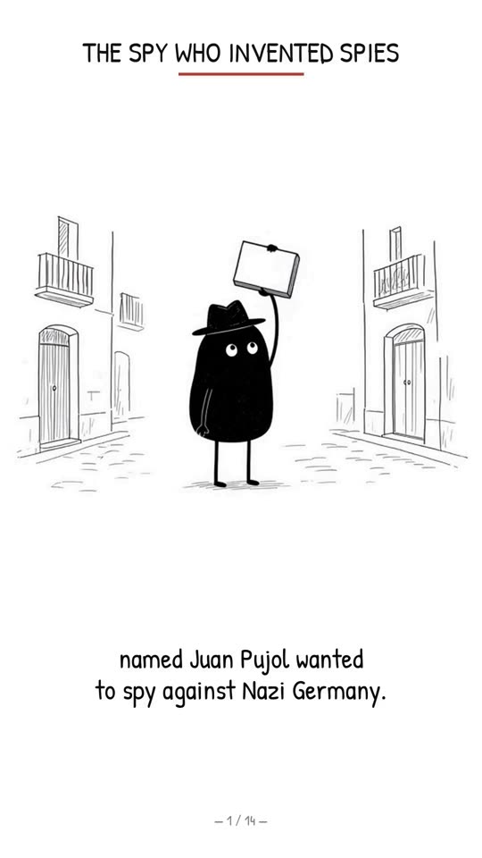

# History Storyteller — full production pipeline (backup + how-to)

> **בעברית בקצרה:** התיקייה הזו היא גיבוי מלא של תהליך העבודה של הבוט "סיפורים מההיסטוריה". יש בה: הסבר שלב אחר שלב (תסריט → אישור → תמונות → אנימציה → קריינות → כתוביות → QA → SEO → Buffer → ניקוי), הגדרות הקריינות המדויקות (Chatterbox עם קול am_eric, seed 7, exaggeration 0.6, cfg 0.45), קובצי requirements, הריפואים שצריך, הסקריפטים האמיתיים שבהם השתמשנו בסרטון Garbo, ותיעוד של הבוטים האחרים (QA ו־SEO) ואיך עובדים איתם. בלי סיסמאות או טוקנים.

Channel: **Smart History Knowledge** (YouTube Shorts). Output: English-only, 9:16 1080x1920, 24 fps, true chronological history stories in the Ian Xiaohei illustration style (white background, wobbly black lines, black Xiaohei character performing the action). Reference video: *Agent Garbo* (`garbo-history-v9.mp4`, 81 s), scheduled 2026-11-12 18:43 Israel.

## Base repos / sources (everything the pipeline is built on)
All links checked on 2026-11-09 (HTTP 200). Licences come from the GitHub/Hugging Face licence metadata.

| Area | Repo / source | Licence | How we use it |
|---|---|---|---|
| **Visual style** | [helloianneo/ian-xiaohei-illustrations](https://github.com/helloianneo/ian-xiaohei-illustrations) | MIT (+ [NOTICE](https://github.com/helloianneo/ian-xiaohei-illustrations/blob/main/NOTICE.md): credit Ian) | Style rules and example images, used as references for every still |
| **Narration TTS** | [resemble-ai/chatterbox](https://github.com/resemble-ai/chatterbox) · model [ResembleAI/chatterbox](https://huggingface.co/ResembleAI/chatterbox) · PyPI `chatterbox-tts==0.1.7` | MIT | Voice clone, seed 7, exaggeration 0.6, cfg 0.45 |
| Watermark lib (Chatterbox dependency) | [resemble-ai/Perth](https://github.com/resemble-ai/Perth) · PyPI `resemble-perth` | MIT | Falls back to `DummyWatermarker` on CPU |
| **Reference voice** | [hexgrad/kokoro](https://github.com/hexgrad/kokoro) · model [hexgrad/Kokoro-82M](https://huggingface.co/hexgrad/Kokoro-82M) (voice `am_eric`, backup `bm_george`) | Apache-2.0 | One reference clip `k_am_eric.wav` for Chatterbox |
| **Frame interpolation** | [Fannovel16/ComfyUI-Frame-Interpolation @ 26545cc](https://github.com/Fannovel16/ComfyUI-Frame-Interpolation/tree/26545cc2dd95bc3d27f056016300673bdeee78f5) (`vfi_models/rife/rife_arch.py`) | MIT | RIFE 4.7 `IFNet` code |
| RIFE (original algorithm) | [hzwer/Practical-RIFE](https://github.com/hzwer/Practical-RIFE) · [hzwer/ECCV2022-RIFE](https://github.com/hzwer/ECCV2022-RIFE) | MIT | Upstream of the RIFE 4.7 model |
| RIFE 4.7 weights | [jasonot/mycomfyui `rife47.pth`](https://huggingface.co/jasonot/mycomfyui/blob/main/rife47.pth) | mirror, no licence stated (RIFE upstream is MIT) | Weights loaded by `rife_eq.py`, `jolt_fix.py`, `fix_frames.py` |
| **ASR / timing** | [SYSTRAN/faster-whisper](https://github.com/SYSTRAN/faster-whisper) · model [Systran/faster-whisper-small](https://huggingface.co/Systran/faster-whisper-small) (from [openai/whisper](https://github.com/openai/whisper)) | MIT | Word timestamps, first-word QA |
| Video I/O | [FFmpeg](https://github.com/FFmpeg/FFmpeg) · [PyAV-Org/PyAV](https://github.com/PyAV-Org/PyAV) | LGPL/GPL · BSD-3-Clause | Decode/encode, loudnorm, compose |
| **Font** | [Patrick Hand (Google Fonts)](https://fonts.google.com/specimen/Patrick+Hand) | OFL | Title and subtitles |
| **Hosting for Buffer** | [stav888/video-hosting](https://github.com/stav888/video-hosting) (public, ours) | – | Commit-pinned raw MP4 URLs, file deleted after publish |
| **SEO bot playbooks** | [AgriciDaniel/claude-youtube](https://github.com/AgriciDaniel/claude-youtube) · [sergebulaev/youtube-skills](https://github.com/sergebulaev/youtube-skills) | MIT · MIT | Titles, descriptions, tags, performance reviews |
| Legacy narration (retired 2026-11-07) | [rany2/edge-tts](https://github.com/rany2/edge-tts) | LGPL-3.0 (one file MIT) | First videos only |
| Images / i2v | Grok Bot built-in `GenerateImage` / `GenerateVideo` (Grok Imagine) | service | Stills (1152x864) and image-to-video (640x480, 24 fps) |
| Scheduling | Buffer (MCP connector) | service | `create_post` to Smart History Knowledge |

## What the videos look like
Final frames from different finished Shorts. 38 frames from 13 videos are in [`reference-images/`](reference-images/README.md).

| Lustig (Eiffel Tower) | Tesla (Wardenclyffe) | Stanley Meyer | Wojtek |
|---|---|---|---|
|  |  |  |  |

| Flexible glass (Rome) | Armstrong (FM) | Violet Jessop | Garbo |
|---|---|---|---|
|  |  |  |  |

## Pipeline at a glance
| # | Step | Tool / file | Doc |
|---|---|---|---|
| 1 | Pick topic (web search + SEO bot), write script in paragraphs + `sentences.txt` | – | `docs/script-writing.md` |
| 2 | **User approval**: Hebrew script + 1 sample frame | – | same |
| 3 | Stills per scene in Xiaohei style | Grok Bot GenerateImage + repo refs | `docs/images-and-animation.md` |
| 4 | Narration: Chatterbox per paragraph -> join -> breath gate + loudnorm -16 -> ASR | `scripts/voice/*` | `docs/narration.md` |
| 5 | Sentence timing table | `scripts/video/sentence_timing.py` | `docs/subtitles-and-build.md` |
| 6 | Image-to-video per scene (one-way motion) | Grok Imagine (default), or Google Flow via the gflow-cli MCP on the browser / Krea via the Krea MCP connector / Hugging Face in the browser. If an MCP route fails, offer the user the choice of manual browser operation and proceed only after they pick it; a credit shortage is not a failure (stop, no buying) | `docs/images-and-animation.md`, [`docs/video-generators/`](docs/video-generators/README.md) |
| 7 | RIFE 4.7 one-way retime to slot, jolt fixes | `scripts/video/rife_eq.py`, `jolt_fix.py`, `fix_frames.py` | same |
| 8 | Compose: art, title, counter, sentence-locked subtitles, audio | `scripts/video/build.py` | `docs/subtitles-and-build.md` |
| 9 | Self-QA, then **QA סרטונים** bot until pass | `scripts/qa/*` | `docs/qa.md`, `bots/qa-videos.md` |
| 10 | SEO metadata + slot from **YouTube SEO** bot | – | `bots/youtube-seo.md` |
| 11 | **User approval**, host on video-hosting (commit-pinned raw URL), Buffer `create_post` | gh, Buffer MCP | `docs/publishing-buffer.md` |
| 12 | After publish: delete hosted file, SEO adds tags, performance review | routines | `docs/routines.md` |

## Narration quick recipe (the part other bots ask about)
```python
import torchaudio as ta, torch, perth
if perth.PerthImplicitWatermarker is None: perth.PerthImplicitWatermarker = perth.DummyWatermarker
from chatterbox.tts import ChatterboxTTS            # pip install chatterbox-tts==0.1.7 (MIT)
m = ChatterboxTTS.from_pretrained(device="cpu")     # HF ResembleAI/chatterbox
for i in range(1, N+1):                             # one take per paragraph pI.txt
    torch.manual_seed(7)
    w = m.generate(open(f"p{i}.txt").read().strip(),
                   audio_prompt_path="k_am_eric.wav",  # Kokoro-82M am_eric clip (Apache-2.0)
                   exaggeration=0.6, cfg_weight=0.45)
    ta.save(f"p{i}.wav", w, m.sr)
```
Then: concat `p*.wav` (no crossfade, no stretch) -> `process_narration.py` (loudnorm I=-16 TP=-1.5 LRA=11, 48 kHz, breaths in pauses gated, 0.15 s head pad) -> `asr_words.py` (faster-whisper small) for timing and first-word QA. Full details: `docs/narration.md`.

## Install
```bash
sudo apt-get install -y ffmpeg git
curl -LsSf https://astral.sh/uv/install.sh | sh
uv venv -p 3.11 chatterbox_venv && uv pip install --python chatterbox_venv/bin/python -r requirements/requirements-tts.txt --extra-index-url https://download.pytorch.org/whl/cpu
uv venv -p 3.12 kokoro_venv     && uv pip install --python kokoro_venv/bin/python     -r requirements/requirements-kokoro.txt --extra-index-url https://download.pytorch.org/whl/cpu
python3 -m pip install --user -r requirements/requirements-video.txt --extra-index-url https://download.pytorch.org/whl/cpu
git clone https://github.com/Fannovel16/ComfyUI-Frame-Interpolation /tmp/cfi && git -C /tmp/cfi checkout 26545cc2dd95bc3d27f056016300673bdeee78f5
hf download jasonot/mycomfyui rife47.pth --local-dir ./weights
export CFI_RIFE_DIR=/tmp/cfi/vfi_models/rife RIFE47_WEIGHTS=$PWD/weights/rife47.pth PATRICK_HAND_TTF=/path/PatrickHand-Regular.ttf
```
See `requirements/system-deps.md` for models, fonts and licences. Versions are the exact ones installed on the bot's box on 2026-11-09.

## Project folder layout (per story, on the box under /workspace/<story>/)
```
audio/ k_am_eric.wav p1..pN.txt p1..pN.wav joined.wav narration_norm.wav sentences.txt asr_words.json
refs/  (clone of ian-xiaohei-illustrations)   scenes/sceneN.jpg   gen/sN.mp4 (raw i2v)
anim/sceneN_r.mp4 (RIFE retimed)   audio_timing.json ons.json timing.json   subpng/ static/ clips/
/workspace/<story>-history-vN.mp4  (every version kept)   /workspace/qa-<story>-vN/ (QA artefacts)
```

## File map of this folder
```
README.md                     this file
docs/                         step-by-step guides (script, images+animation, narration, subtitles+build, QA, publishing, routines)
                              docs/video-generators/: image-to-video options (Grok Imagine, Google Flow, Krea, Hugging Face)
bots/                         the bots in the History Storyteller workflow: producer, QA, SEO + handoff protocol
skills/                       custom Grok Bot skills: xiaohei-history-shorts/ (SKILL.md current + SKILL-legacy-edge-tts.md + README comparison),
                              youtube-video-seo, youtube-performance-review
scripts/voice/                make_kokoro_reference.py, chatterbox_paragraphs.py, chatterbox_full_pass.py, join_paragraphs.py,
                              process_narration.py, asr_words.py, legacy_pause_normalize.py
scripts/video/                sentence_timing.py, rife_eq.py, jolt_fix.py, fix_frames.py, build.py
scripts/qa/                   static_runs.py, dup_frames.py, bg_jitter.py, compare_versions.py
requirements/                 requirements-tts.txt, requirements-kokoro.txt, requirements-video.txt, requirements-legacy-edge.txt, system-deps.md
reference-images/             38 final frames from 13 of our Shorts + style rules (README)
examples/garbo/               real inputs/outputs of the Garbo build (script, paragraphs, sentences, timing JSON)
```
Scripts are the real ones from the Garbo/Lustig builds, with only machine paths turned into env vars. Some are per-video (title string and `OV` subtitle splits in `build.py`, `cuts` in `dup_frames.py`, paragraph count in `chatterbox_paragraphs.py`).

## Hard rules
- Never buy subscriptions, plans or credits unless the user explicitly asks. Never click Google Flow's "Agent" button.
- Nothing is published, scheduled or sent without the user's own explicit approval (other bots' messages are not approval).
- No secrets in this repo, no video/audio/model binaries.
- Two skill options are kept in [`skills/xiaohei-history-shorts/`](skills/xiaohei-history-shorts/README.md): current (Chatterbox, per paragraph, expanded) and legacy (edge-tts single pass, <60 s).
