# The First Airplane (Wright brothers) — Midjourney-adapted prompts

This file is a Midjourney Web adaptation of [`first-airplane.md`](first-airplane.md). Original image and animation prompts were **not found**. The Midjourney video prompts below are **NEW - written for MJ**, based strictly on what the real start stills and extracted end frames show. They are not original GenerateImage or GenerateVideo text.

Conventions followed (from `MID/` in this repo and `.github/instructions/mid.instructions.md`):

- **Locked-off camera.** Do not use `push-in`, `zoom`, `dolly`, or `move closer`. No pan.
- **One-way motion only.** Do not use `--loop`, and do not write looping motion (`keeps turning`, `continues to tick`, reverse, ping-pong).
- Valid Midjourney video parameters used here: `--motion low` (MID default), `--raw`. `--loop` is valid in Midjourney but **must not be used** for this channel. `--end` is the End Frame control (upload the end still; see each scene).
- A first clip is **5 s**. Each manual Extend adds **~4 s**. Maximum length is **21 s**. This file uses **at most one** extension per scene, and only when the scene's narration is longer than 5 s.
- When a start still is set, Midjourney matches its aspect (these stills are 9:16; the UI often shows `--ar 171:256`). Per MID QA, **do not type `--ar`** when a Start Frame is uploaded.
- Describe **only what moves**. The start still is already frame zero.
- Style anchors: Ian Xiaohei ink, white background, thin wobbly black lines, no text. Do not add photoreal / push-in language from the MID cat example.

**Original image / sketch prompts:** **not found** for every scene (same as [`first-airplane.md`](first-airplane.md)).
**Original animation / clip prompts:** **not found** for every scene.

## Frames

The published Short is **sketch-2 v6** (13 clips). `/workspace/sketch2_v6/static/` is **not** a set of scene stills — those files are only the title and page-number overlays. Start stills are the matching **clean originals** from `/workspace/xiaohei-scenes/` (letterboxed to 9:16, no title or captions), except scene 2, which has no dedicated still: its start was extracted from the uncaptioned source clip at the published offset. Captioned verify grabs (`/workspace/sketch2_v6/verify/`) were **not** used. Stills are in [`first-airplane-images/`](first-airplane-images/).

All end frames were **extracted from the last frame** of the real production clip. Those clips have a burned-in title, a page number, and sometimes captions, so those overlays were removed (filled with white) to leave a clean illustration. The end stills are labeled **extracted from clip** below. Start stills are the real production scene images, letterboxed onto a 9:16 white canvas with no title or captions.

## How to paste (Midjourney Web)

1. Imagine → add the **Start Frame** still → Switch to video.
2. Set **End Frame** (`--end`) to that scene's end still. Leave **Loop off**. Motion **Low**.
3. Paste the prompt, including `--motion low --raw`. Do not add `--loop`. Do not add `--ar`.
4. For a 9 s scene: run the **opening** prompt first (5 s). After a clean take, **Extend manually** once (~+4 s → ~9 s), replace the prefilled text with the **extend** prompt, Loop off, Motion Low, and keep `--end` aimed at the same end still if the plan says so. Split prompts follow the MID rule: the first 5 s is not packed, and the extend continues the same one-way action.

## Narration length vs 5 s or 9 s

Measured from `/workspace/sketch2_v5/timing.json` chunks over the v6 assemble segment times in `/workspace/sketch2_v6/assemble.py`. A scene gets one Extend only when narration in that slot is longer than 5 s. Several original clips are longer than 9 s (especially scene 13 at 22.68 s, which was looped in the original assembly); only one Extend is used. Do not use `--loop`.

| Scene | Speech (in slot) | Part slot | 5 s clip? | Plan |
|---|---:|---:|---|---|
| 1 | 11.00 s | 11.42 s | No — speech is longer than 5 s | One Extend (**9 s**) — original slot 11.42 s is longer than 9 s; only one Extend is used |
| 2 | 6.97 s | 7.75 s | No — speech is longer than 5 s | One Extend (**9 s**) |
| 3 | 10.88 s | 11.30 s | No — speech is longer than 5 s | One Extend (**9 s**) — original slot 11.30 s is longer than 9 s; only one Extend is used |
| 4 | 6.78 s | 7.56 s | No — speech is longer than 5 s | One Extend (**9 s**) |
| 5 | 7.88 s | 8.16 s | No — speech is longer than 5 s | One Extend (**9 s**) |
| 6 | 6.01 s | 6.79 s | No — speech is longer than 5 s | One Extend (**9 s**) |
| 7 | 6.30 s | 6.58 s | No — speech is longer than 5 s | One Extend (**9 s**) |
| 8 | 12.35 s | 13.26 s | No — speech is longer than 5 s | One Extend (**9 s**) — original slot 13.26 s is longer than 9 s; only one Extend is used |
| 9 | 11.77 s | 12.69 s | No — speech is longer than 5 s | One Extend (**9 s**) — original slot 12.69 s is longer than 9 s; only one Extend is used |
| 10 | 7.16 s | 7.44 s | No — speech is longer than 5 s | One Extend (**9 s**) |
| 11 | 7.16 s | 7.44 s | No — speech is longer than 5 s | One Extend (**9 s**) |
| 12 | 6.10 s | 6.88 s | No — speech is longer than 5 s | One Extend (**9 s**) |
| 13 | 21.29 s | 22.68 s | No — speech is longer than 5 s | One Extend (**9 s**) — original slot 22.68 s is longer than 9 s; only one Extend is used |

### Frame files

| Scene | Start Frame (in repo) | End Frame (`--end`, in repo) | Original box source |
|---|---|---|---|
| 1 | [`first-airplane-images/scene01_start.jpg`](first-airplane-images/scene01_start.jpg) | [`first-airplane-images/scene01_end.jpg`](first-airplane-images/scene01_end.jpg) | `/workspace/xiaohei-scenes/scene-dream.png` → start; last frame of `/workspace/sketch2_v6/clips/clip01.mp4` → end (overlays removed) |
| 2 | [`first-airplane-images/scene02_start.jpg`](first-airplane-images/scene02_start.jpg) | [`first-airplane-images/scene02_end.jpg`](first-airplane-images/scene02_end.jpg) | extracted from `/workspace/sketch2_v3/pingpong/dream_pp.mp4` at 12.04 s (no dedicated still) → start; last frame of `/workspace/sketch2_v6/clips/clip02.mp4` → end (overlays removed) |
| 3 | [`first-airplane-images/scene03_start.jpg`](first-airplane-images/scene03_start.jpg) | [`first-airplane-images/scene03_end.jpg`](first-airplane-images/scene03_end.jpg) | `/workspace/xiaohei-scenes/scene1.png` → start; last frame of `/workspace/sketch2_v6/clips/clip03.mp4` → end (overlays removed) |
| 4 | [`first-airplane-images/scene04_start.jpg`](first-airplane-images/scene04_start.jpg) | [`first-airplane-images/scene04_end.jpg`](first-airplane-images/scene04_end.jpg) | `/workspace/xiaohei-scenes/scene-balance.png` → start; last frame of `/workspace/sketch2_v6/clips/clip04.mp4` → end (overlays removed) |
| 5 | [`first-airplane-images/scene05_start.jpg`](first-airplane-images/scene05_start.jpg) | [`first-airplane-images/scene05_end.jpg`](first-airplane-images/scene05_end.jpg) | `/workspace/xiaohei-scenes/scene-read.png` (clip then goes to the wind tunnel) → start; last frame of `/workspace/sketch2_v6/clips/clip05.mp4` → end (overlays removed) |
| 6 | [`first-airplane-images/scene06_start.jpg`](first-airplane-images/scene06_start.jpg) | [`first-airplane-images/scene06_end.jpg`](first-airplane-images/scene06_end.jpg) | `/workspace/xiaohei-scenes/scene-wrongdata.png` → start; last frame of `/workspace/sketch2_v6/clips/clip06.mp4` → end (overlays removed) |
| 7 | [`first-airplane-images/scene07_start.jpg`](first-airplane-images/scene07_start.jpg) | [`first-airplane-images/scene07_end.jpg`](first-airplane-images/scene07_end.jpg) | `/workspace/xiaohei-scenes/scene-birds.png` → start; last frame of `/workspace/sketch2_v6/clips/clip07.mp4` → end (overlays removed) |
| 8 | [`first-airplane-images/scene08_start.jpg`](first-airplane-images/scene08_start.jpg) | [`first-airplane-images/scene08_end.jpg`](first-airplane-images/scene08_end.jpg) | `/workspace/xiaohei-scenes/scene2.png` (glider; clip then goes to wing-warping) → start; last frame of `/workspace/sketch2_v6/clips/clip08.mp4` → end (overlays removed) |
| 9 | [`first-airplane-images/scene09_start.jpg`](first-airplane-images/scene09_start.jpg) | [`first-airplane-images/scene09_end.jpg`](first-airplane-images/scene09_end.jpg) | `/workspace/xiaohei-scenes/scene-engine.png` (clip then goes to the propeller) → start; last frame of `/workspace/sketch2_v6/clips/clip09.mp4` → end (overlays removed) |
| 10 | [`first-airplane-images/scene10_start.jpg`](first-airplane-images/scene10_start.jpg) | [`first-airplane-images/scene10_end.jpg`](first-airplane-images/scene10_end.jpg) | `/workspace/xiaohei-scenes/scene4.png` → start; last frame of `/workspace/sketch2_v6/clips/clip10.mp4` → end (overlays removed) |
| 11 | [`first-airplane-images/scene11_start.jpg`](first-airplane-images/scene11_start.jpg) | [`first-airplane-images/scene11_end.jpg`](first-airplane-images/scene11_end.jpg) | `/workspace/xiaohei-scenes/scene5.png` → start; last frame of `/workspace/sketch2_v6/clips/clip11.mp4` → end (overlays removed) |
| 12 | [`first-airplane-images/scene12_start.jpg`](first-airplane-images/scene12_start.jpg) | [`first-airplane-images/scene12_end.jpg`](first-airplane-images/scene12_end.jpg) | `/workspace/xiaohei-scenes/scene5.png` (same still as scene 11) → start; last frame of `/workspace/sketch2_v6/clips/clip12.mp4` → end (overlays removed) |
| 13 | [`first-airplane-images/scene13_start.jpg`](first-airplane-images/scene13_start.jpg) | [`first-airplane-images/scene13_end.jpg`](first-airplane-images/scene13_end.jpg) | `/workspace/xiaohei-scenes/scene-worldflies.png` → start; last frame of `/workspace/sketch2_v6/clips/clip13.mp4` → end (overlays removed) |

## Scene 1

- **Narration:** For thousands of years, people watched the birds and dreamed of flying. Many tried, with feathered wings and strange machines — and almost all of them fell.
- **Length plan:** 9 s (5 s + one Extend). Speech 11.00 s. The original published clip is 11.42 s, longer than one Extend; only one Extend is used, as requested.
- **Start Frame:** [`first-airplane-images/scene01_start.jpg`](first-airplane-images/scene01_start.jpg) (in this repo; source on the box: `/workspace/xiaohei-scenes/scene-dream.png`, letterboxed to 9:16 (no title))
- **End Frame (`--end`):** [`first-airplane-images/scene01_end.jpg`](first-airplane-images/scene01_end.jpg) (in this repo; **extracted from clip** — last frame of `/workspace/sketch2_v6/clips/clip01.mp4`, with burned-in title, page number, and any captions removed)

<p>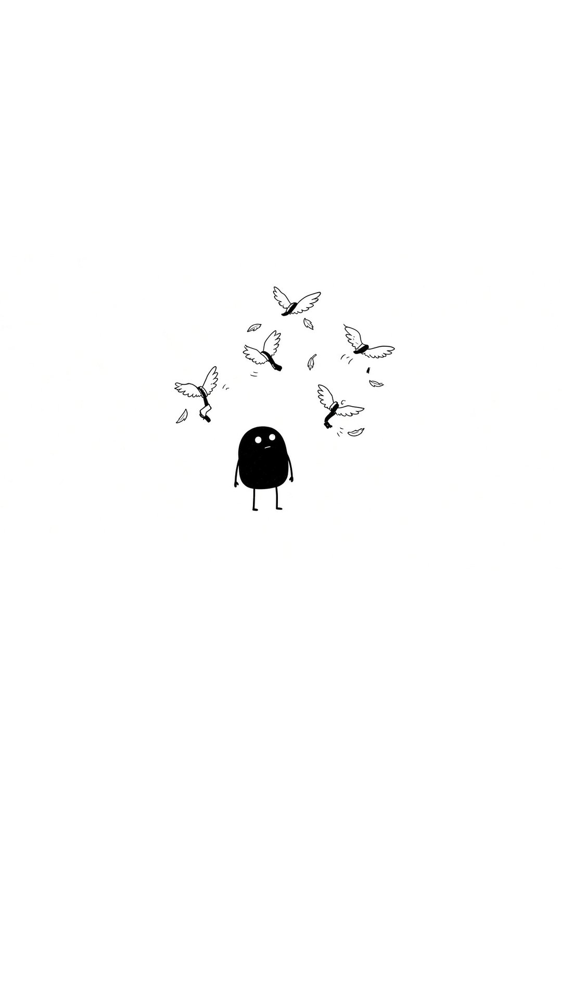 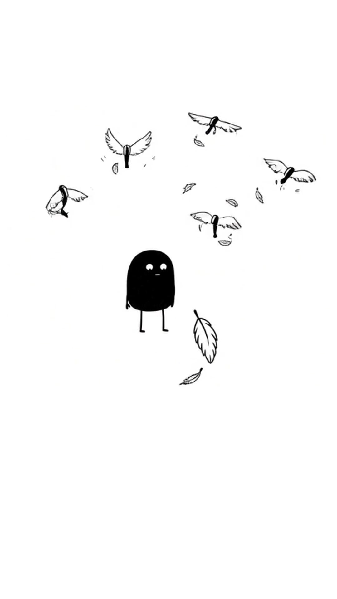</p>
- **Original image prompt:** **not found.**
- **Original animation prompt:** **not found.**

The original published clip was 11.42 s and used a ping-pong source. Use only one Extend (9 s). Do not loop or reverse.

**Opening prompt (5 s) — paste — NEW - written for MJ:**

```
he stands still looking up, the winged objects drift slowly, a few feathers fall one way, one-way motion only, no freeze, locked-off camera, Ian Xiaohei ink style, pure white background, thin wobbly black lines, no text, no letters, no captions --motion low --raw
```

**Extend prompt (~4 s) — paste — NEW - written for MJ:**

```
more feathers fall and settle, he stays in the same place, the winged objects drift slightly, no looping, no new objects, one-way motion only, no freeze, locked-off camera, Ian Xiaohei ink style, pure white background, thin wobbly black lines, no text, no letters, no captions --motion low --raw
```

## Scene 2

- **Narration:** The problem was not only how to get into the air. It was how to stay there, and not crash.
- **Length plan:** 9 s (5 s + one Extend). Speech 6.97 s.
- **Start Frame:** [`first-airplane-images/scene02_start.jpg`](first-airplane-images/scene02_start.jpg) (in this repo; **extracted from source** `/workspace/sketch2_v3/pingpong/dream_pp.mp4` at t=12.04 s (no dedicated still for this falling-phase clip); letterboxed to 9:16, no title)
- **End Frame (`--end`):** [`first-airplane-images/scene02_end.jpg`](first-airplane-images/scene02_end.jpg) (in this repo; **extracted from clip** — last frame of `/workspace/sketch2_v6/clips/clip02.mp4`, with burned-in title, page number, and any captions removed)

<p>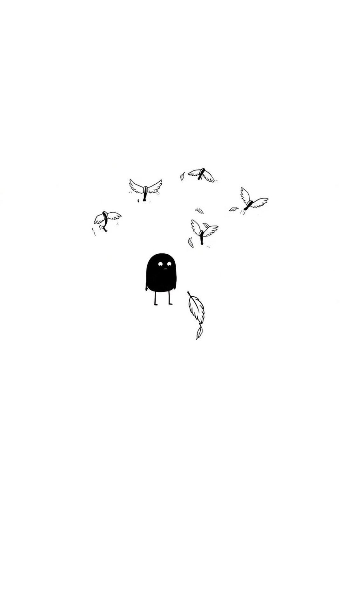 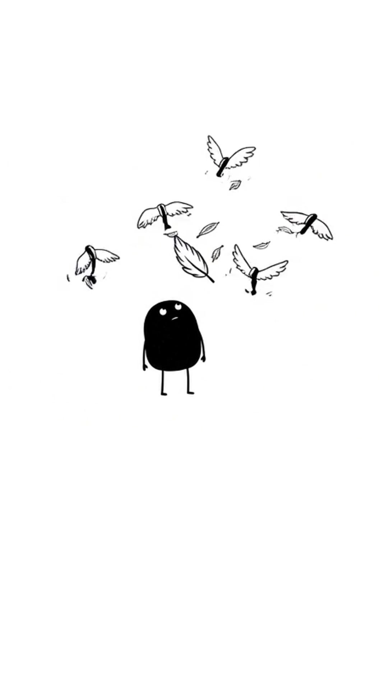</p>
- **Original image prompt:** **not found.**
- **Original animation prompt:** **not found.**

Start still was extracted from the source clip at t=12.04 s (the falling phase). No separate saved still exists for this clip.

**Opening prompt (5 s) — paste — NEW - written for MJ:**

```
he stands still looking up, the winged objects drift downward, feathers fall one way toward the ground, one-way motion only, no freeze, locked-off camera, Ian Xiaohei ink style, pure white background, thin wobbly black lines, no text, no letters, no captions --motion low --raw
```

**Extend prompt (~4 s) — paste — NEW - written for MJ:**

```
the last feathers settle lower in the frame, he stays in place, no looping, no new objects, one-way motion only, no freeze, locked-off camera, Ian Xiaohei ink style, pure white background, thin wobbly black lines, no text, no letters, no captions --motion low --raw
```

## Scene 3

- **Narration:** Then came two brothers from Ohio: Wilbur and Orville Wright. They were not famous scientists, and they were not rich — they built and repaired bicycles.
- **Length plan:** 9 s (5 s + one Extend). Speech 10.88 s. The original published clip is 11.30 s, longer than one Extend; only one Extend is used, as requested.
- **Start Frame:** [`first-airplane-images/scene03_start.jpg`](first-airplane-images/scene03_start.jpg) (in this repo; source on the box: `/workspace/xiaohei-scenes/scene1.png`, letterboxed to 9:16 (no title))
- **End Frame (`--end`):** [`first-airplane-images/scene03_end.jpg`](first-airplane-images/scene03_end.jpg) (in this repo; **extracted from clip** — last frame of `/workspace/sketch2_v6/clips/clip03.mp4`, with burned-in title, page number, and any captions removed)

<p>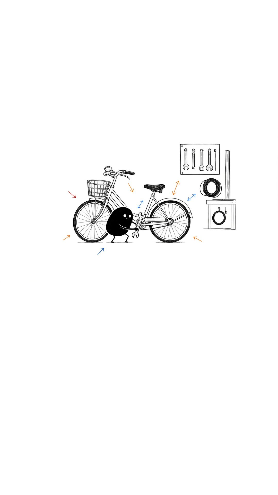 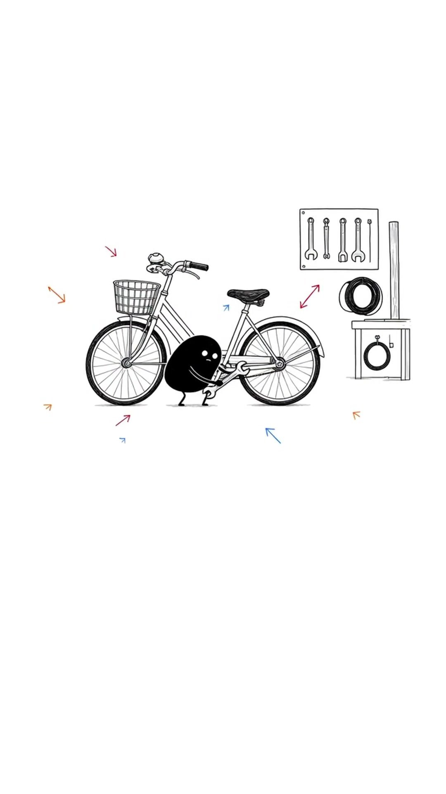</p>
- **Original image prompt:** **not found.**
- **Original animation prompt:** **not found.**

The original published clip was 11.30 s. Use only one Extend (9 s).

**Opening prompt (5 s) — paste — NEW - written for MJ:**

```
he turns the wrench slowly on the bicycle, the bicycle, tool board, and workbench stay fixed, one-way motion only, no freeze, locked-off camera, Ian Xiaohei ink style, pure white background, thin wobbly black lines, no text, no letters, no captions --motion low --raw
```

**Extend prompt (~4 s) — paste — NEW - written for MJ:**

```
he finishes the wrench turn and settles, the shop stays fixed, no new objects, one-way motion only, no freeze, locked-off camera, Ian Xiaohei ink style, pure white background, thin wobbly black lines, no text, no letters, no captions --motion low --raw
```

## Scene 4

- **Narration:** But bicycles taught them the secret: an unstable machine can be balanced and controlled while it moves.
- **Length plan:** 9 s (5 s + one Extend). Speech 6.78 s.
- **Start Frame:** [`first-airplane-images/scene04_start.jpg`](first-airplane-images/scene04_start.jpg) (in this repo; source on the box: `/workspace/xiaohei-scenes/scene-balance.png`, letterboxed to 9:16 (no title))
- **End Frame (`--end`):** [`first-airplane-images/scene04_end.jpg`](first-airplane-images/scene04_end.jpg) (in this repo; **extracted from clip** — last frame of `/workspace/sketch2_v6/clips/clip04.mp4`, with burned-in title, page number, and any captions removed)

<p>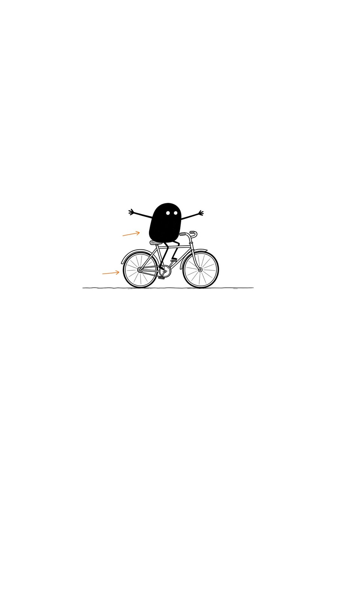 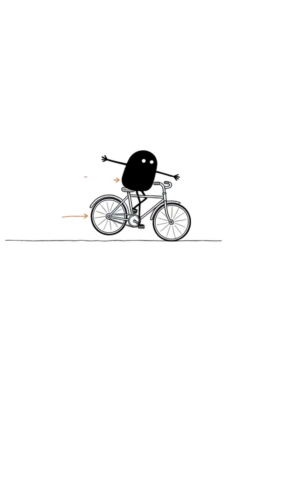</p>
- **Original image prompt:** **not found.**
- **Original animation prompt:** **not found.**

**Opening prompt (5 s) — paste — NEW - written for MJ:**

```
he stays on the bicycle with a slight one-way balance lean, arms out, the ground line stays fixed, the bicycle stays in the same place, one-way motion only, no freeze, locked-off camera, Ian Xiaohei ink style, pure white background, thin wobbly black lines, no text, no letters, no captions --motion low --raw
```

**Extend prompt (~4 s) — paste — NEW - written for MJ:**

```
he settles the lean and holds the pose, the bicycle and ground line stay fixed, no looping pedals, no new objects, one-way motion only, no freeze, locked-off camera, Ian Xiaohei ink style, pure white background, thin wobbly black lines, no text, no letters, no captions --motion low --raw
```

## Scene 5

- **Narration:** They read everything written about flight, built a small wind tunnel in their shop, and tested hundreds of wing shapes inside it.
- **Length plan:** 9 s (5 s + one Extend). Speech 7.88 s.
- **Start Frame:** [`first-airplane-images/scene05_start.jpg`](first-airplane-images/scene05_start.jpg) (in this repo; source on the box: `/workspace/xiaohei-scenes/scene-read.png`, letterboxed to 9:16 (no title) — this clip then cuts to the wind tunnel)
- **End Frame (`--end`):** [`first-airplane-images/scene05_end.jpg`](first-airplane-images/scene05_end.jpg) (in this repo; **extracted from clip** — last frame of `/workspace/sketch2_v6/clips/clip05.mp4`, with burned-in title, page number, and any captions removed)

<p>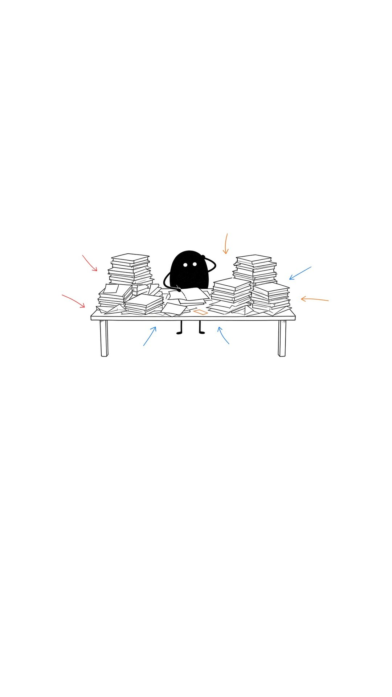 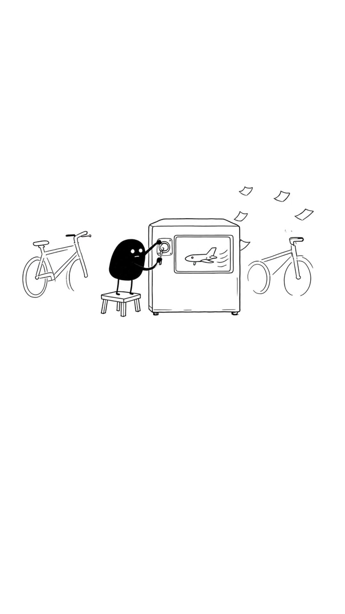</p>
- **Original image prompt:** **not found.**
- **Original animation prompt:** **not found.**

This published clip concatenates two shots (reading, then the wind tunnel). The end frame is the wind-tunnel shot. MID Extend rules say no new objects on Extend; those elements are already in the end frame. Alternatively, set --end on the opening 5 s so the wind tunnel arrives earlier, and use the Extend only to settle.

**Opening prompt (5 s) — paste — NEW - written for MJ:**

```
he reads at the pages, the papers stay in place, slight living motion, one-way motion only, no freeze, locked-off camera, Ian Xiaohei ink style, pure white background, thin wobbly black lines, no text, no letters, no captions --motion low --raw
```

**Extend prompt (~4 s) — paste — NEW - written for MJ:**

```
the scene settles into the wind-tunnel end frame: he stands on the stool at the box, papers drift one way to the right, the bicycles stay on either side, no looping, one-way motion only, no freeze, locked-off camera, Ian Xiaohei ink style, pure white background, thin wobbly black lines, no text, no letters, no captions --motion low --raw
```

## Scene 6

- **Narration:** When they found that the old data everyone trusted was simply wrong, they wrote it again themselves.
- **Length plan:** 9 s (5 s + one Extend). Speech 6.01 s.
- **Start Frame:** [`first-airplane-images/scene06_start.jpg`](first-airplane-images/scene06_start.jpg) (in this repo; source on the box: `/workspace/xiaohei-scenes/scene-wrongdata.png`, letterboxed to 9:16 (no title))
- **End Frame (`--end`):** [`first-airplane-images/scene06_end.jpg`](first-airplane-images/scene06_end.jpg) (in this repo; **extracted from clip** — last frame of `/workspace/sketch2_v6/clips/clip06.mp4`, with burned-in title, page number, and any captions removed)

<p>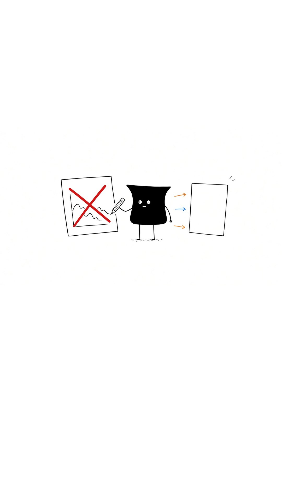 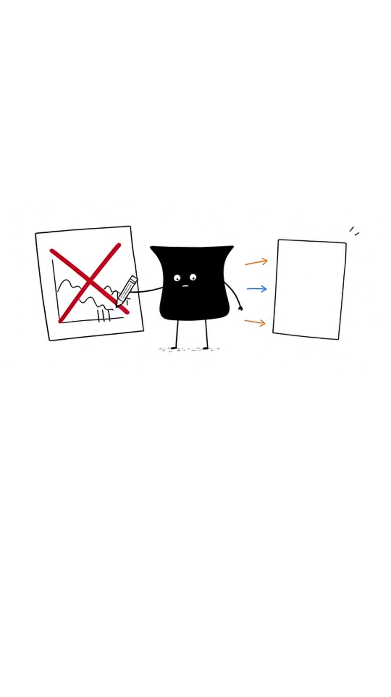</p>
- **Original image prompt:** **not found.**
- **Original animation prompt:** **not found.**

**Opening prompt (5 s) — paste — NEW - written for MJ:**

```
he holds the crossed-out chart still and turns slightly toward the blank page, both pages stay in his hands, one-way motion only, no freeze, locked-off camera, Ian Xiaohei ink style, pure white background, thin wobbly black lines, no text, no letters, no captions --motion low --raw
```

**Extend prompt (~4 s) — paste — NEW - written for MJ:**

```
he settles facing the blank page, the crossed-out chart stays in the other hand, no new objects, one-way motion only, no freeze, locked-off camera, Ian Xiaohei ink style, pure white background, thin wobbly black lines, no text, no letters, no captions --motion low --raw
```

## Scene 7

- **Narration:** Then came the big insight: a bird does not just fly — it controls itself in the air.
- **Length plan:** 9 s (5 s + one Extend). Speech 6.30 s.
- **Start Frame:** [`first-airplane-images/scene07_start.jpg`](first-airplane-images/scene07_start.jpg) (in this repo; source on the box: `/workspace/xiaohei-scenes/scene-birds.png`, letterboxed to 9:16 (no title))
- **End Frame (`--end`):** [`first-airplane-images/scene07_end.jpg`](first-airplane-images/scene07_end.jpg) (in this repo; **extracted from clip** — last frame of `/workspace/sketch2_v6/clips/clip07.mp4`, with burned-in title, page number, and any captions removed)

<p>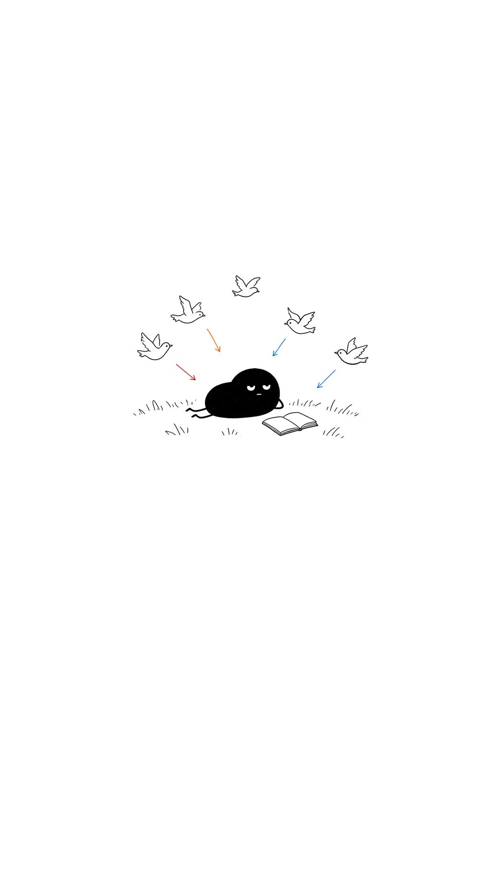 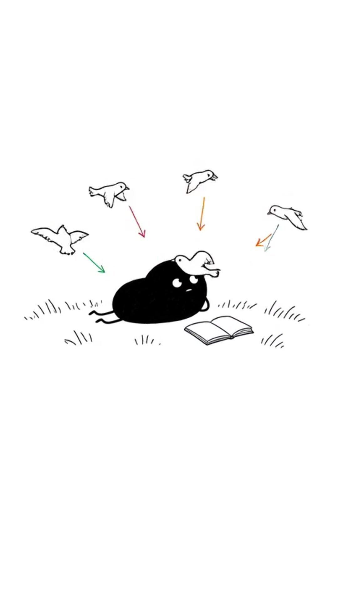</p>
- **Original image prompt:** **not found.**
- **Original animation prompt:** **not found.**

**Opening prompt (5 s) — paste — NEW - written for MJ:**

```
he lies still in the grass, the birds drift slowly one way above him, one-way motion only, no freeze, locked-off camera, Ian Xiaohei ink style, pure white background, thin wobbly black lines, no text, no letters, no captions --motion low --raw
```

**Extend prompt (~4 s) — paste — NEW - written for MJ:**

```
the birds settle their drift, he stays lying in the grass, no looping, no new objects, one-way motion only, no freeze, locked-off camera, Ian Xiaohei ink style, pure white background, thin wobbly black lines, no text, no letters, no captions --motion low --raw
```

## Scene 8

- **Narration:** The brothers built gliders, flew them more than a thousand times, and learned to warp the wings slightly to roll, lift the nose, and turn — control in three axes, just like a modern airplane.
- **Length plan:** 9 s (5 s + one Extend). Speech 12.35 s. The original published clip is 13.26 s, longer than one Extend; only one Extend is used, as requested.
- **Start Frame:** [`first-airplane-images/scene08_start.jpg`](first-airplane-images/scene08_start.jpg) (in this repo; source on the box: `/workspace/xiaohei-scenes/scene2.png`, letterboxed to 9:16 (no title) — glider; this clip then cuts to wing-warping)
- **End Frame (`--end`):** [`first-airplane-images/scene08_end.jpg`](first-airplane-images/scene08_end.jpg) (in this repo; **extracted from clip** — last frame of `/workspace/sketch2_v6/clips/clip08.mp4`, with burned-in title, page number, and any captions removed)

<p>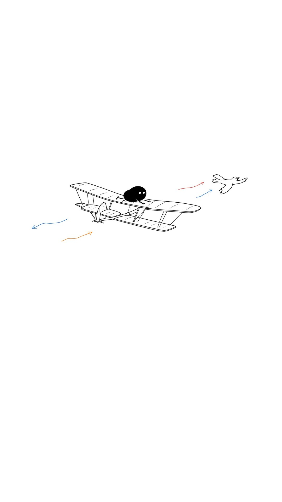 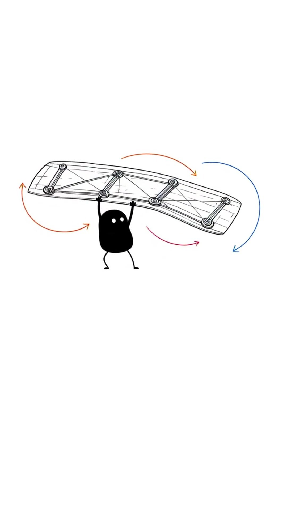</p>
- **Original image prompt:** **not found.**
- **Original animation prompt:** **not found.**

This published clip concatenates two shots (glider, then wing-warping). The end frame is the wing-warp shot. MID Extend rules say no new objects on Extend; that pose is already in the end frame. Alternatively, set --end on the opening 5 s. The original clip was 13.26 s; use only one Extend (9 s).

**Opening prompt (5 s) — paste — NEW - written for MJ:**

```
he rides the glider, the glider drifts slowly one way, the bird flies slowly ahead, colored motion arrows stay constant, one-way motion only, no freeze, locked-off camera, Ian Xiaohei ink style, pure white background, thin wobbly black lines, no text, no letters, no captions --motion low --raw
```

**Extend prompt (~4 s) — paste — NEW - written for MJ:**

```
the scene settles into the wing-warping end frame: he stands holding the wing as it bends in a one-way twist, no looping, one-way motion only, no freeze, locked-off camera, Ian Xiaohei ink style, pure white background, thin wobbly black lines, no text, no letters, no captions --motion low --raw
```

## Scene 9

- **Narration:** Only after control worked did they add a light engine and propellers, designed like small rotating wings. Every part was built by hand — no factory, no big budget.
- **Length plan:** 9 s (5 s + one Extend). Speech 11.77 s. The original published clip is 12.69 s, longer than one Extend; only one Extend is used, as requested.
- **Start Frame:** [`first-airplane-images/scene09_start.jpg`](first-airplane-images/scene09_start.jpg) (in this repo; source on the box: `/workspace/xiaohei-scenes/scene-engine.png`, letterboxed to 9:16 (no title) — this clip then cuts to the propeller)
- **End Frame (`--end`):** [`first-airplane-images/scene09_end.jpg`](first-airplane-images/scene09_end.jpg) (in this repo; **extracted from clip** — last frame of `/workspace/sketch2_v6/clips/clip09.mp4`, with burned-in title, page number, and any captions removed)

<p>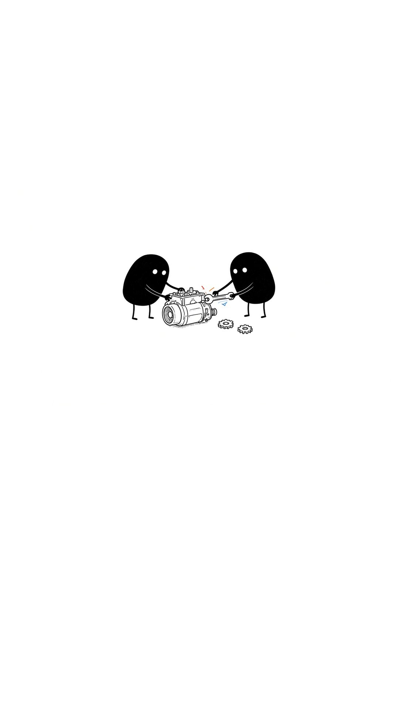 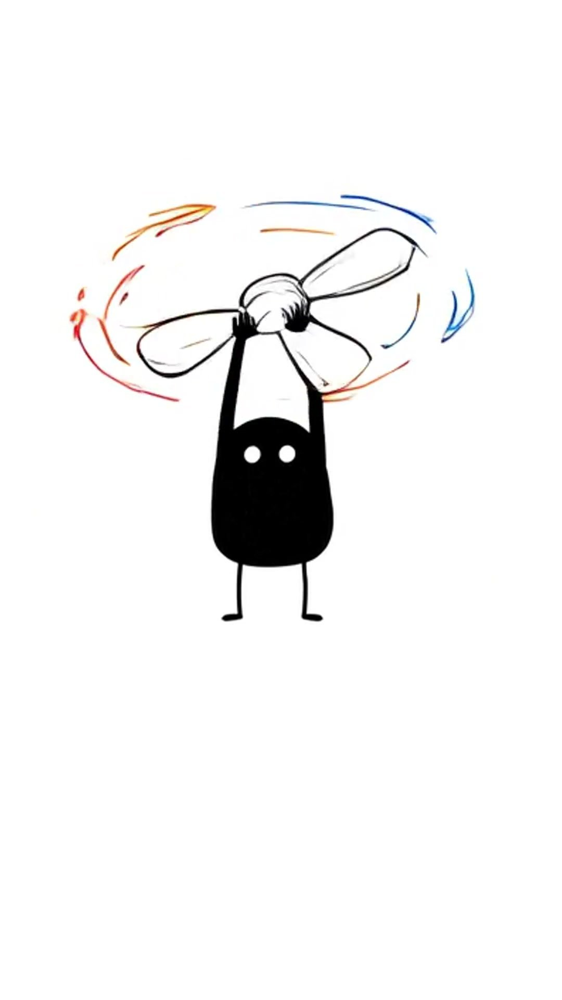</p>
- **Original image prompt:** **not found.**
- **Original animation prompt:** **not found.**

This published clip concatenates two shots (engine, then propeller). The end frame is the propeller shot. Do not write a looping spin. The original clip was 12.69 s; use only one Extend (9 s).

**Opening prompt (5 s) — paste — NEW - written for MJ:**

```
the two figures work slowly on the small engine on the ground, the engine and loose gears stay in place, one-way motion only, no freeze, locked-off camera, Ian Xiaohei ink style, pure white background, thin wobbly black lines, no text, no letters, no captions --motion low --raw
```

**Extend prompt (~4 s) — paste — NEW - written for MJ:**

```
the scene settles into the propeller end frame: he holds the propeller overhead, the blades make a slow one-way turn and settle, colored motion trails stay as drawn, do not keep spinning, one-way motion only, no freeze, locked-off camera, Ian Xiaohei ink style, pure white background, thin wobbly black lines, no text, no letters, no captions --motion low --raw
```

## Scene 10

- **Narration:** On December 17, 1903, on the sands of Kitty Hawk, Orville climbed onto the machine.
- **Length plan:** 9 s (5 s + one Extend). Speech 7.16 s.
- **Start Frame:** [`first-airplane-images/scene10_start.jpg`](first-airplane-images/scene10_start.jpg) (in this repo; source on the box: `/workspace/xiaohei-scenes/scene4.png`, letterboxed to 9:16 (no title))
- **End Frame (`--end`):** [`first-airplane-images/scene10_end.jpg`](first-airplane-images/scene10_end.jpg) (in this repo; **extracted from clip** — last frame of `/workspace/sketch2_v6/clips/clip10.mp4`, with burned-in title, page number, and any captions removed)

<p>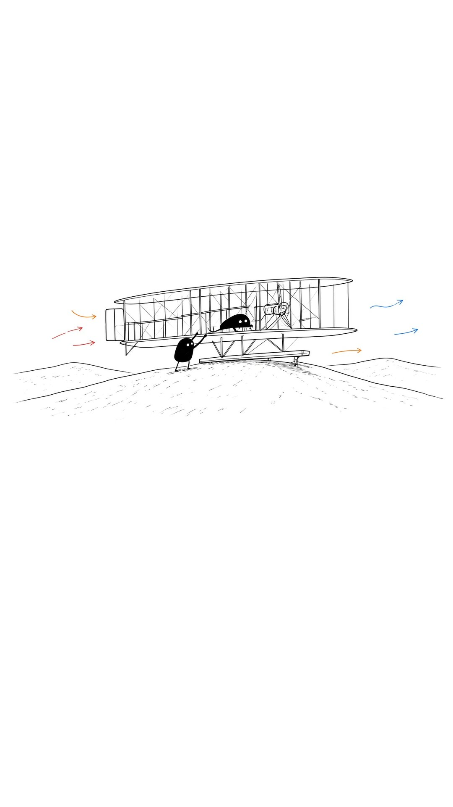 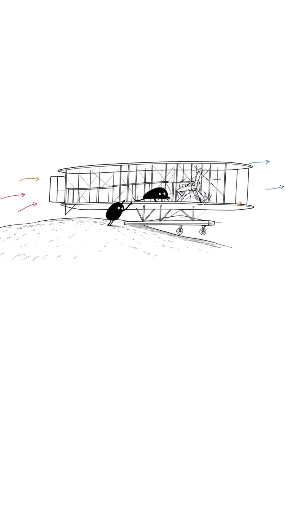</p>
- **Original image prompt:** **not found.**
- **Original animation prompt:** **not found.**

**Opening prompt (5 s) — paste — NEW - written for MJ:**

```
the flyer begins to move slowly forward along the rail on the sand, the person at the rear gives a short one-way push, the hills stay fixed, one-way motion only, no freeze, locked-off camera, Ian Xiaohei ink style, pure white background, thin wobbly black lines, no text, no letters, no captions --motion low --raw
```

**Extend prompt (~4 s) — paste — NEW - written for MJ:**

```
the flyer settles a little farther along the rail, both figures stay with the machine, the hills stay fixed, no new objects, one-way motion only, no freeze, locked-off camera, Ian Xiaohei ink style, pure white background, thin wobbly black lines, no text, no letters, no captions --motion low --raw
```

## Scene 11

- **Narration:** The first flight lasted only twelve seconds, over thirty-six metres — shorter than a modern passenger jet.
- **Length plan:** 9 s (5 s + one Extend). Speech 7.16 s.
- **Start Frame:** [`first-airplane-images/scene11_start.jpg`](first-airplane-images/scene11_start.jpg) (in this repo; source on the box: `/workspace/xiaohei-scenes/scene5.png`, letterboxed to 9:16 (no title))
- **End Frame (`--end`):** [`first-airplane-images/scene11_end.jpg`](first-airplane-images/scene11_end.jpg) (in this repo; **extracted from clip** — last frame of `/workspace/sketch2_v6/clips/clip11.mp4`, with burned-in title, page number, and any captions removed)

<p>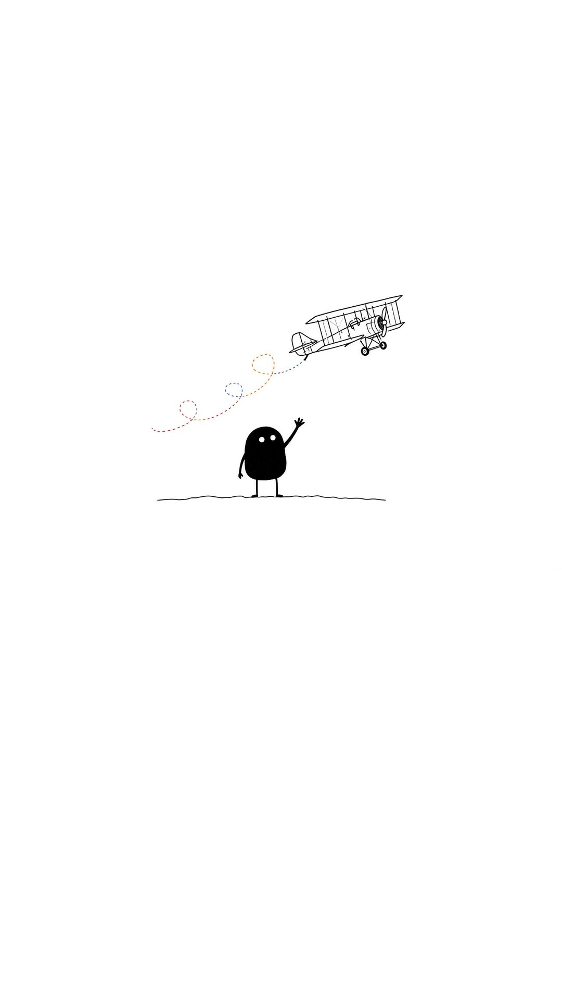 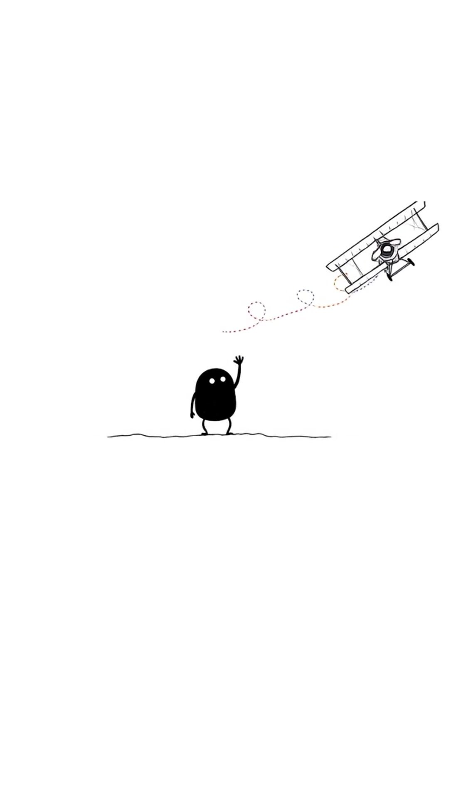</p>
- **Original image prompt:** **not found.**
- **Original animation prompt:** **not found.**

**Opening prompt (5 s) — paste — NEW - written for MJ:**

```
the biplane drifts slowly along the dashed path, he stands on the ground and waves, the ground line stays fixed, one-way motion only, no freeze, locked-off camera, Ian Xiaohei ink style, pure white background, thin wobbly black lines, no text, no letters, no captions --motion low --raw
```

**Extend prompt (~4 s) — paste — NEW - written for MJ:**

```
the plane settles farther along the path, he stays in place waving, the ground stays fixed, no looping, no new objects, one-way motion only, no freeze, locked-off camera, Ian Xiaohei ink style, pure white background, thin wobbly black lines, no text, no letters, no captions --motion low --raw
```

## Scene 12

- **Narration:** But that morning they flew three more times, and the last flight lasted fifty-nine seconds.
- **Length plan:** 9 s (5 s + one Extend). Speech 6.10 s.
- **Start Frame:** [`first-airplane-images/scene12_start.jpg`](first-airplane-images/scene12_start.jpg) (in this repo; source on the box: `/workspace/xiaohei-scenes/scene5.png`, letterboxed to 9:16 (no title) (same takeoff still as scene 11))
- **End Frame (`--end`):** [`first-airplane-images/scene12_end.jpg`](first-airplane-images/scene12_end.jpg) (in this repo; **extracted from clip** — last frame of `/workspace/sketch2_v6/clips/clip12.mp4`, with burned-in title, page number, and any captions removed)

<p> 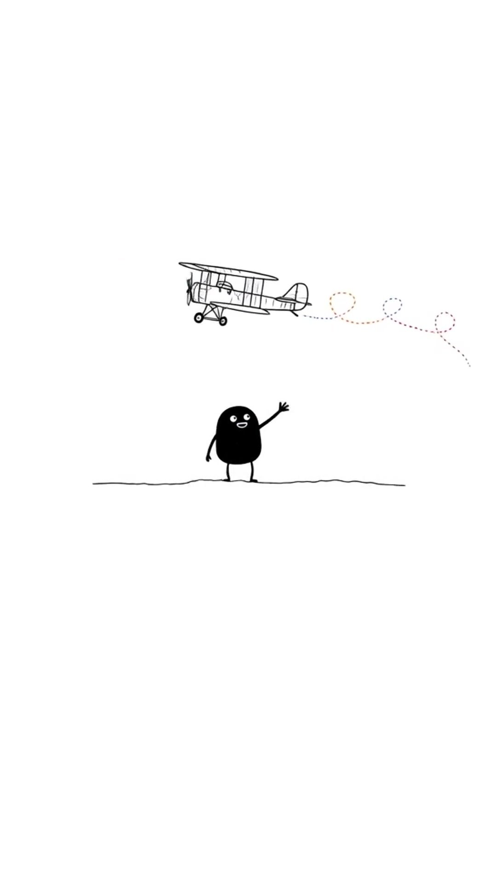</p>
- **Original image prompt:** **not found.**
- **Original animation prompt:** **not found.**

The published clip reused the later-flights / takeoff-steady source (a loop in the original assembly). Do not use --loop.

**Opening prompt (5 s) — paste — NEW - written for MJ:**

```
the biplane continues slowly along the dashed path, he stands and waves, the ground line stays fixed, one-way motion only, no freeze, locked-off camera, Ian Xiaohei ink style, pure white background, thin wobbly black lines, no text, no letters, no captions --motion low --raw
```

**Extend prompt (~4 s) — paste — NEW - written for MJ:**

```
the plane settles, he stays in place, no looping, no new objects, one-way motion only, no freeze, locked-off camera, Ian Xiaohei ink style, pure white background, thin wobbly black lines, no text, no letters, no captions --motion low --raw
```

## Scene 13

- **Narration:** The world barely noticed. But those twelve seconds proved it was possible — and once something is possible, it never stops. From a small bicycle shop began the age of crossing skies and oceans. It all started with two brothers who did not just try to fly. First, they learned how to control.
- **Length plan:** 9 s (5 s + one Extend). Speech 21.29 s. The original published clip is 22.68 s, longer than one Extend; only one Extend is used, as requested.
- **Start Frame:** [`first-airplane-images/scene13_start.jpg`](first-airplane-images/scene13_start.jpg) (in this repo; source on the box: `/workspace/xiaohei-scenes/scene-worldflies.png`, letterboxed to 9:16 (no title))
- **End Frame (`--end`):** [`first-airplane-images/scene13_end.jpg`](first-airplane-images/scene13_end.jpg) (in this repo; **extracted from clip** — last frame of `/workspace/sketch2_v6/clips/clip13.mp4`, with burned-in title, page number, and any captions removed)

<p>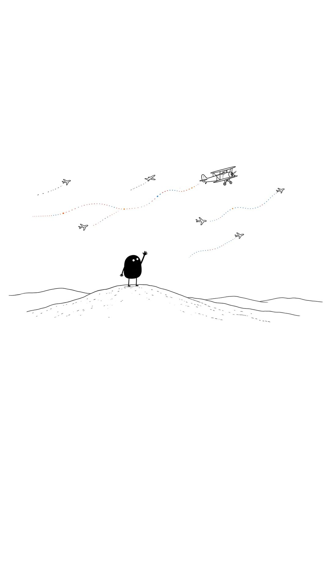 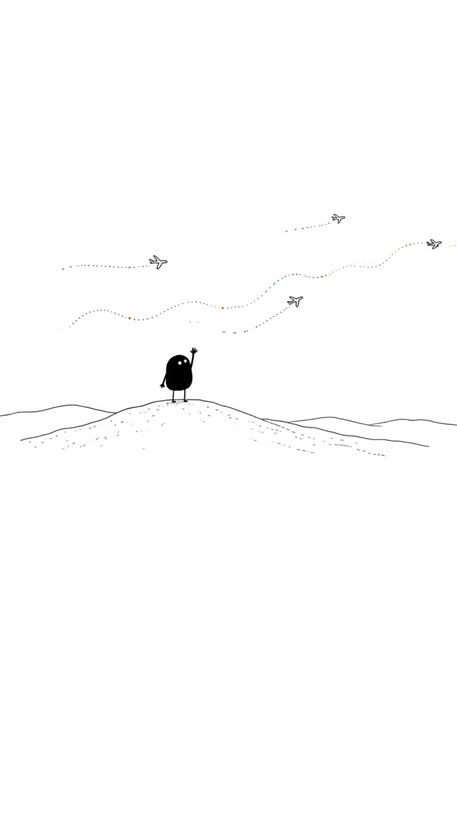</p>
- **Original image prompt:** **not found.**
- **Original animation prompt:** **not found.**

The original published clip was 22.68 s and used a looped source. Use only one Extend (9 s). Do not use --loop.

**Opening prompt (5 s) — paste — NEW - written for MJ:**

```
he stands on the hill and waves, the planes drift slowly one way along their dotted trails, the hill stays fixed, one-way motion only, no freeze, locked-off camera, Ian Xiaohei ink style, pure white background, thin wobbly black lines, no text, no letters, no captions --motion low --raw
```

**Extend prompt (~4 s) — paste — NEW - written for MJ:**

```
the planes settle along their trails, he stays on the hill waving, no looping, no new objects, one-way motion only, no freeze, locked-off camera, Ian Xiaohei ink style, pure white background, thin wobbly black lines, no text, no letters, no captions --motion low --raw
```
