# The First Airplane (Wright brothers)

- **YouTube title:** The First Airplane Flew for Just 12 Seconds
- **Status:** Published via Buffer (status: sent, snapshot 2026-11-09)
- **Publish / schedule time:** 2026-10-19 21:33 Israel time (Asia/Jerusalem)
- **Final version / length:** sketch-2 v6, 130.0 s
- **Narration method (from `examples/README.md`):** edge-tts `en-US-ChristopherNeural` −5%, 7 segment files (`seg1`–`seg7`). The examples README notes there is no generator script on the box, so the voice is from the channel notes.
- **Completeness:** partial — narration found; image and clip prompts not found
- **Primary sources:** `examples/first-airplane/` (scripts and `buffer_metadata.md`). Publish times are from that Buffer snapshot, not re-queried here.

Nothing in this file was invented. Missing prompt classes are marked **not found**.

## Script / narration
English narration was recorded from these seven segment files:

### `seg1.txt`

Source: `history-storyteller/examples/first-airplane/seg1.txt`

```
For thousands of years, people watched the birds and dreamed of flying. Many tried, with feathered wings and strange machines — and almost all of them fell. The problem was not only how to get into the air. It was how to stay there, and not crash.
```


### `seg2.txt`

Source: `history-storyteller/examples/first-airplane/seg2.txt`

```
Then came two brothers from Ohio: Wilbur and Orville Wright. They were not famous scientists, and they were not rich — they built and repaired bicycles. But bicycles taught them the secret: an unstable machine can be balanced and controlled while it moves.
```


### `seg3.txt`

Source: `history-storyteller/examples/first-airplane/seg3.txt`

```
They read everything written about flight, built a small wind tunnel in their shop, and tested hundreds of wing shapes inside it. When they found that the old data everyone trusted was simply wrong, they wrote it again themselves.
```


### `seg4.txt`

Source: `history-storyteller/examples/first-airplane/seg4.txt`

```
Then came the big insight: a bird does not just fly — it controls itself in the air. The brothers built gliders, flew them more than a thousand times, and learned to warp the wings slightly to roll, lift the nose, and turn — control in three axes, just like a modern airplane.
```


### `seg5.txt`

Source: `history-storyteller/examples/first-airplane/seg5.txt`

```
Only after control worked did they add a light engine and propellers, designed like small rotating wings. Every part was built by hand — no factory, no big budget.
```


### `seg6.txt`

Source: `history-storyteller/examples/first-airplane/seg6.txt`

```
On December 17, 1903, on the sands of Kitty Hawk, Orville climbed onto the machine. The first flight lasted only twelve seconds, over thirty-six metres — shorter than a modern passenger jet. But that morning they flew three more times, and the last flight lasted fifty-nine seconds.
```


### `seg7.txt`

Source: `history-storyteller/examples/first-airplane/seg7.txt`

```
The world barely noticed. But those twelve seconds proved it was possible — and once something is possible, it never stops. From a small bicycle shop began the age of crossing skies and oceans. It all started with two brothers who did not just try to fly. First, they learned how to control.
```


### Hebrew approval script

**not found.** A Hebrew script file exists in the examples folder only for Garbo and Lustig (`examples/README.md`).

### Notes

First channel video.

## Per-scene image and animation prompts

One row per production scene (sentence, segment, or part). Prompts are copied verbatim only when a source file or transcript call was found.

### Scene 1 (seg1.txt)

- **Image / sketch prompt:** **not found.** No GenerateImage / still-sketch prompt was saved for this scene, and none was found in the transcripts or project files searched for this update.
- **Animation / clip prompt:** **not found.** No GenerateVideo / animation / transition prompt was saved for this scene, and none was found in the transcripts or project files searched for this update.

### Scene 2 (seg2.txt)

- **Image / sketch prompt:** **not found.** No GenerateImage / still-sketch prompt was saved for this scene, and none was found in the transcripts or project files searched for this update.
- **Animation / clip prompt:** **not found.** No GenerateVideo / animation / transition prompt was saved for this scene, and none was found in the transcripts or project files searched for this update.

### Scene 3 (seg3.txt)

- **Image / sketch prompt:** **not found.** No GenerateImage / still-sketch prompt was saved for this scene, and none was found in the transcripts or project files searched for this update.
- **Animation / clip prompt:** **not found.** No GenerateVideo / animation / transition prompt was saved for this scene, and none was found in the transcripts or project files searched for this update.

### Scene 4 (seg4.txt)

- **Image / sketch prompt:** **not found.** No GenerateImage / still-sketch prompt was saved for this scene, and none was found in the transcripts or project files searched for this update.
- **Animation / clip prompt:** **not found.** No GenerateVideo / animation / transition prompt was saved for this scene, and none was found in the transcripts or project files searched for this update.

### Scene 5 (seg5.txt)

- **Image / sketch prompt:** **not found.** No GenerateImage / still-sketch prompt was saved for this scene, and none was found in the transcripts or project files searched for this update.
- **Animation / clip prompt:** **not found.** No GenerateVideo / animation / transition prompt was saved for this scene, and none was found in the transcripts or project files searched for this update.

### Scene 6 (seg6.txt)

- **Image / sketch prompt:** **not found.** No GenerateImage / still-sketch prompt was saved for this scene, and none was found in the transcripts or project files searched for this update.
- **Animation / clip prompt:** **not found.** No GenerateVideo / animation / transition prompt was saved for this scene, and none was found in the transcripts or project files searched for this update.

### Scene 7 (seg7.txt)

- **Image / sketch prompt:** **not found.** No GenerateImage / still-sketch prompt was saved for this scene, and none was found in the transcripts or project files searched for this update.
- **Animation / clip prompt:** **not found.** No GenerateVideo / animation / transition prompt was saved for this scene, and none was found in the transcripts or project files searched for this update.

## Published sketch-2 v6 stills (13 visual clips)

The published Short (`sketch-2 v6`, 130 s) was assembled as **13 clips**, not seven stills. Narration remains the seven `seg1`–`seg7` files above. `/workspace/sketch2_v6/static/` is only the title and page-number overlay, not the scene art. Captioned verify grabs were not used. Original image and animation prompts for these clips were **not found**.

### Visual clip 1 (seg1)

- **Image / sketch prompt:** **not found.**
- **Animation / clip prompt:** **not found.**

Start still: clean original, letterboxed to 9:16 (source: `/workspace/xiaohei-scenes/scene-dream.png`). End still is **extracted from clip** (last frame of `/workspace/sketch2_v6/clips/clip01.mp4`, with burned-in title, page number, and any captions removed):

<p>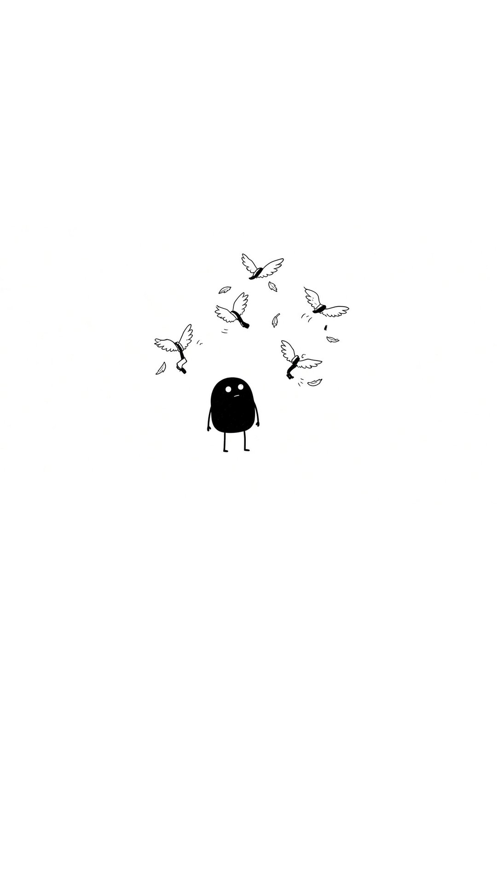 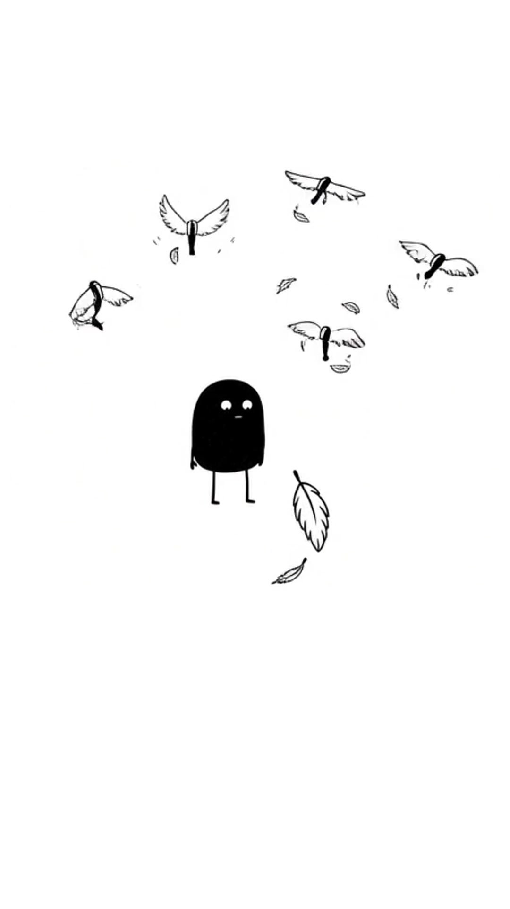</p>

### Visual clip 2 (seg1)

- **Image / sketch prompt:** **not found.**
- **Animation / clip prompt:** **not found.**

Start still: **extracted from source** (no dedicated still for this falling-phase clip), letterboxed to 9:16 (source: `/workspace/sketch2_v3/pingpong/dream_pp.mp4 at t=12.04s`). End still is **extracted from clip** (last frame of `/workspace/sketch2_v6/clips/clip02.mp4`, with burned-in title, page number, and any captions removed):

<p>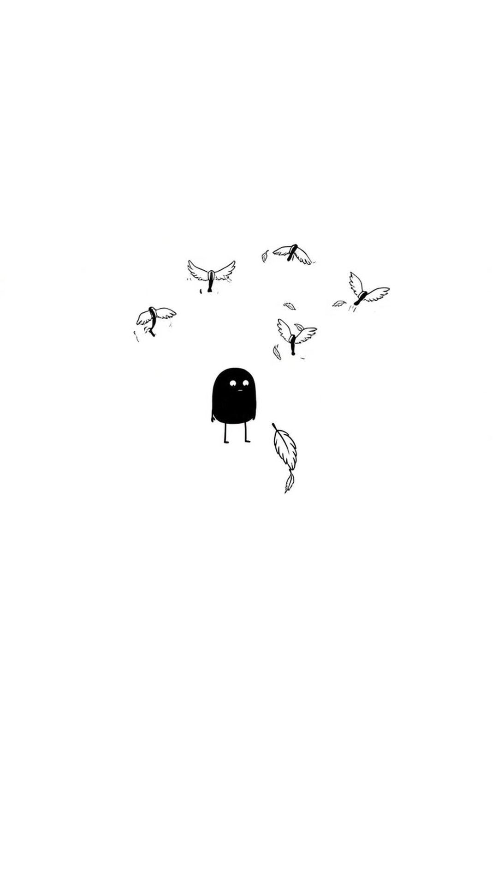 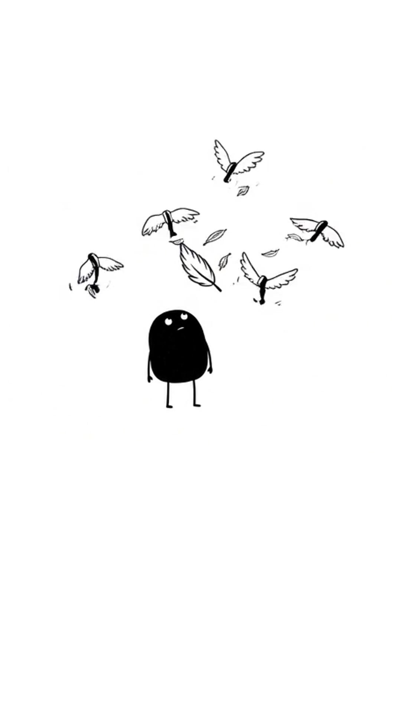</p>

### Visual clip 3 (seg2)

- **Image / sketch prompt:** **not found.**
- **Animation / clip prompt:** **not found.**

Start still: clean original, letterboxed to 9:16 (source: `/workspace/xiaohei-scenes/scene1.png`). End still is **extracted from clip** (last frame of `/workspace/sketch2_v6/clips/clip03.mp4`, with burned-in title, page number, and any captions removed):

<p>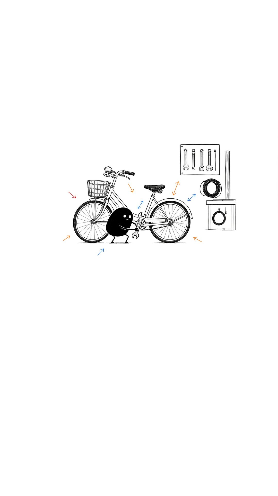 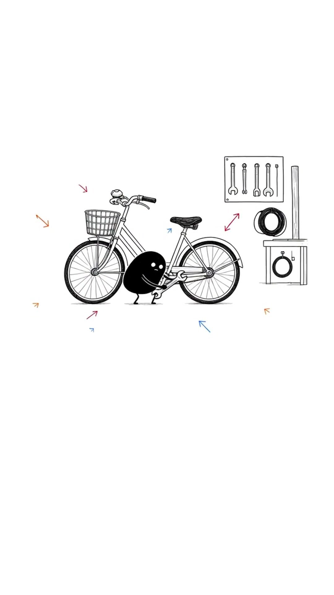</p>

### Visual clip 4 (seg2)

- **Image / sketch prompt:** **not found.**
- **Animation / clip prompt:** **not found.**

Start still: clean original, letterboxed to 9:16 (source: `/workspace/xiaohei-scenes/scene-balance.png`). End still is **extracted from clip** (last frame of `/workspace/sketch2_v6/clips/clip04.mp4`, with burned-in title, page number, and any captions removed):

<p>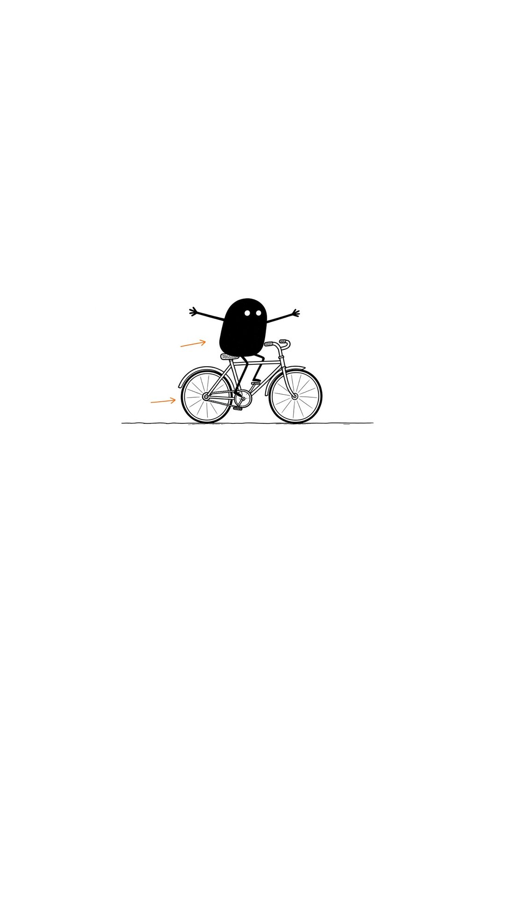 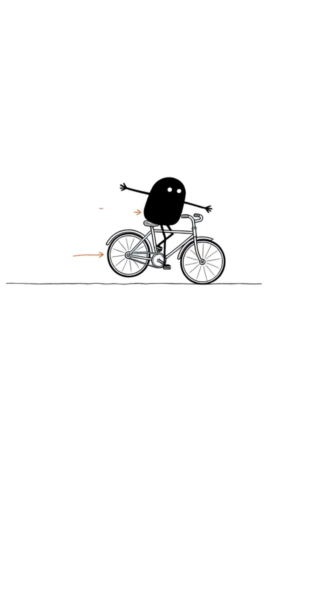</p>

### Visual clip 5 (seg3)

- **Image / sketch prompt:** **not found.**
- **Animation / clip prompt:** **not found.**

Start still: clean original, letterboxed to 9:16 (clip then goes to the wind tunnel) (source: `/workspace/xiaohei-scenes/scene-read.png`). End still is **extracted from clip** (last frame of `/workspace/sketch2_v6/clips/clip05.mp4`, with burned-in title, page number, and any captions removed):

<p>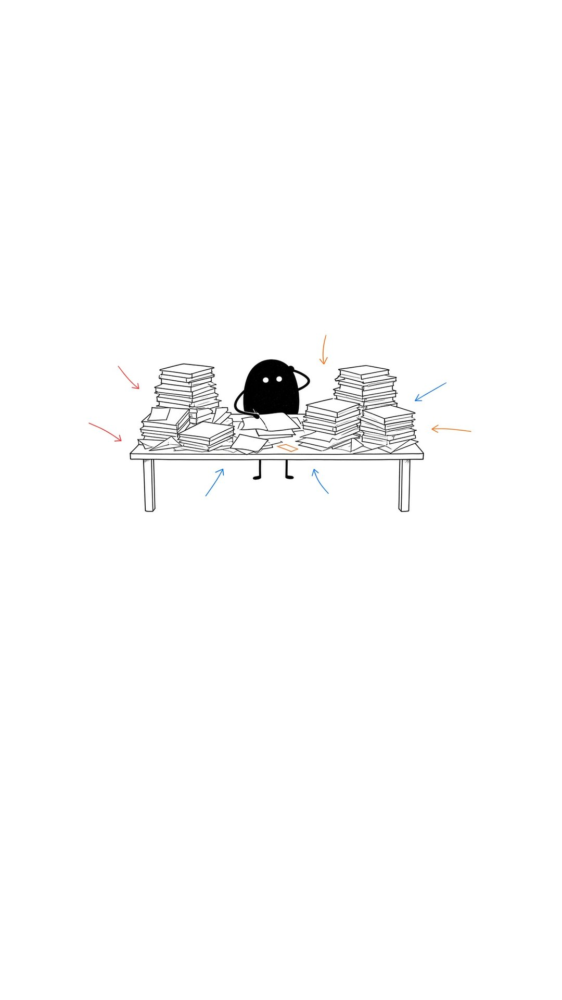 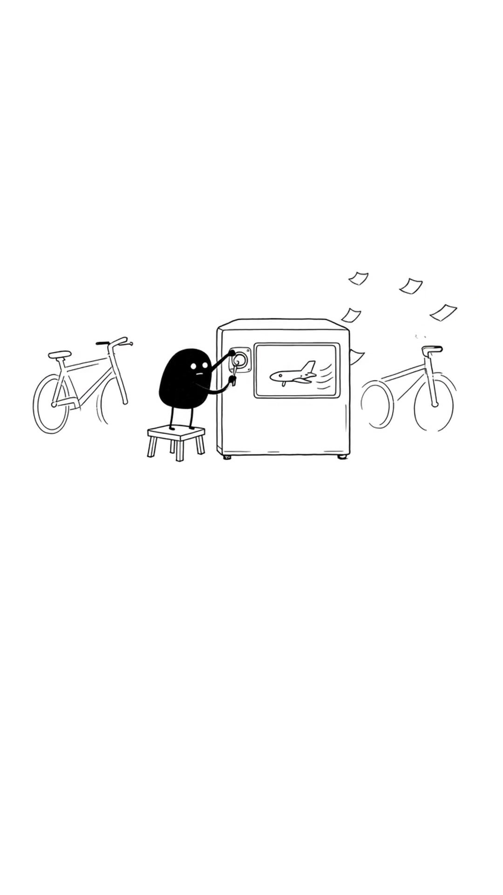</p>

### Visual clip 6 (seg3)

- **Image / sketch prompt:** **not found.**
- **Animation / clip prompt:** **not found.**

Start still: clean original, letterboxed to 9:16 (source: `/workspace/xiaohei-scenes/scene-wrongdata.png`). End still is **extracted from clip** (last frame of `/workspace/sketch2_v6/clips/clip06.mp4`, with burned-in title, page number, and any captions removed):

<p>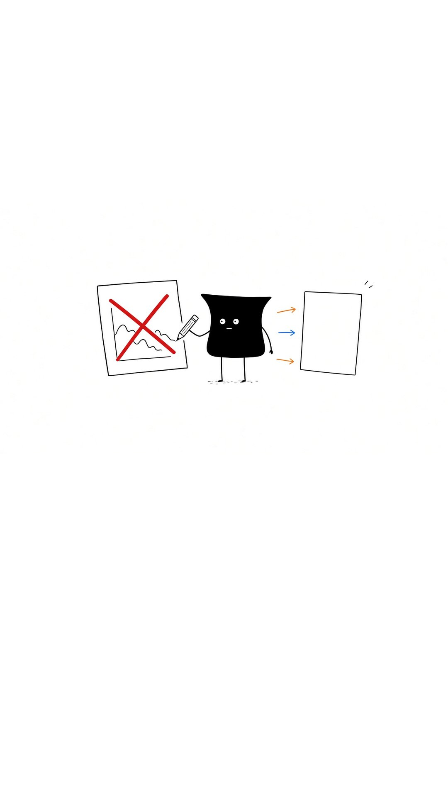 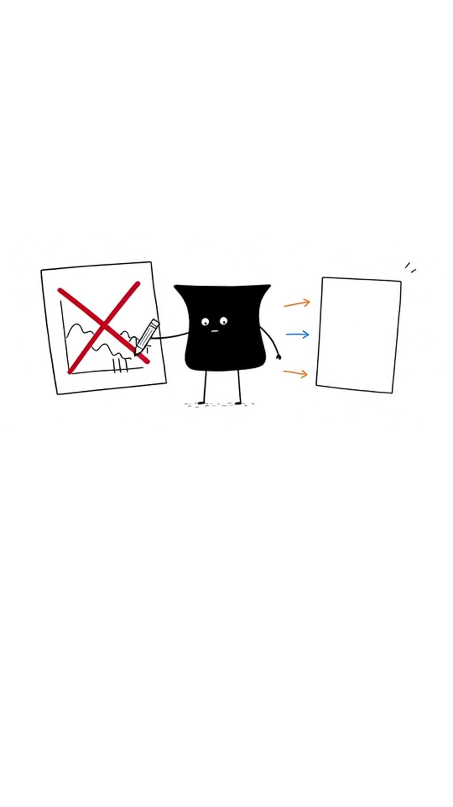</p>

### Visual clip 7 (seg4)

- **Image / sketch prompt:** **not found.**
- **Animation / clip prompt:** **not found.**

Start still: clean original, letterboxed to 9:16 (source: `/workspace/xiaohei-scenes/scene-birds.png`). End still is **extracted from clip** (last frame of `/workspace/sketch2_v6/clips/clip07.mp4`, with burned-in title, page number, and any captions removed):

<p>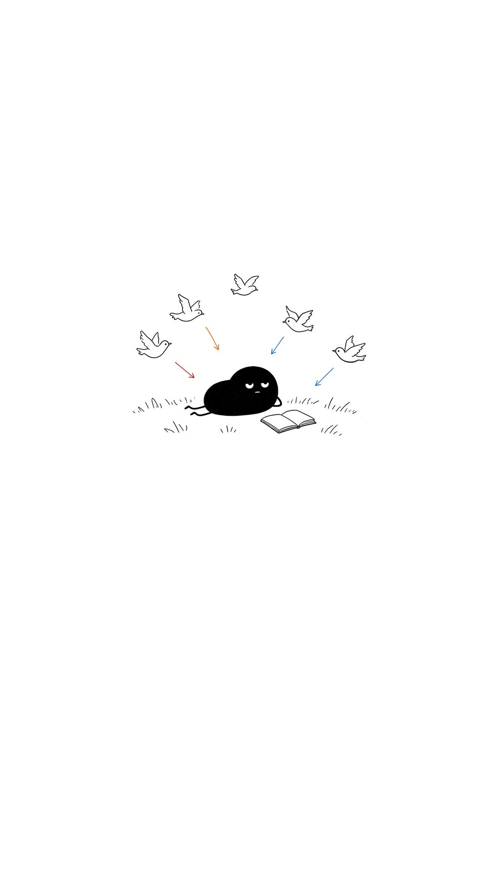 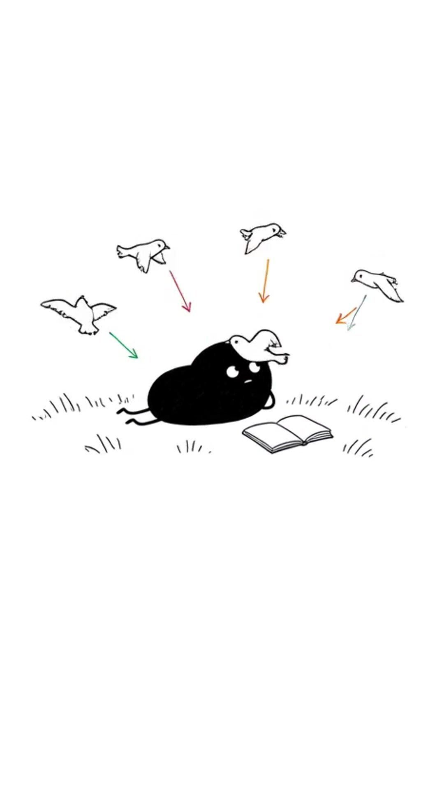</p>

### Visual clip 8 (seg4)

- **Image / sketch prompt:** **not found.**
- **Animation / clip prompt:** **not found.**

Start still: clean original, letterboxed to 9:16 (glider; clip then goes to wing-warping) (source: `/workspace/xiaohei-scenes/scene2.png`). End still is **extracted from clip** (last frame of `/workspace/sketch2_v6/clips/clip08.mp4`, with burned-in title, page number, and any captions removed):

<p>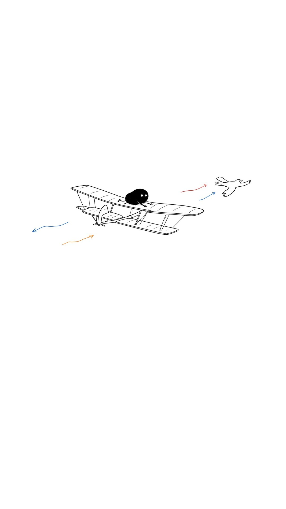 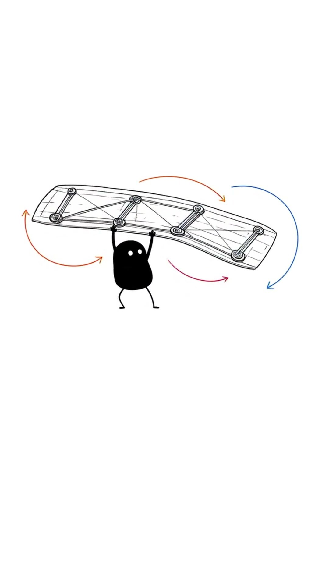</p>

### Visual clip 9 (seg5)

- **Image / sketch prompt:** **not found.**
- **Animation / clip prompt:** **not found.**

Start still: clean original, letterboxed to 9:16 (clip then goes to the propeller) (source: `/workspace/xiaohei-scenes/scene-engine.png`). End still is **extracted from clip** (last frame of `/workspace/sketch2_v6/clips/clip09.mp4`, with burned-in title, page number, and any captions removed):

<p>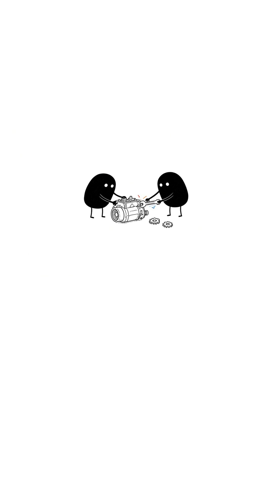 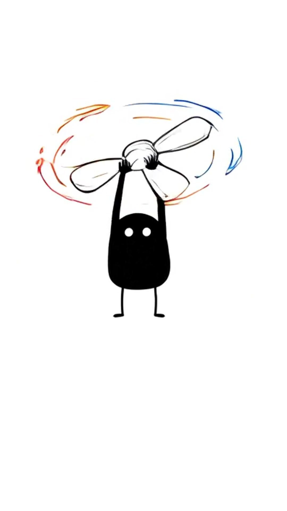</p>

### Visual clip 10 (seg6)

- **Image / sketch prompt:** **not found.**
- **Animation / clip prompt:** **not found.**

Start still: clean original, letterboxed to 9:16 (source: `/workspace/xiaohei-scenes/scene4.png`). End still is **extracted from clip** (last frame of `/workspace/sketch2_v6/clips/clip10.mp4`, with burned-in title, page number, and any captions removed):

<p>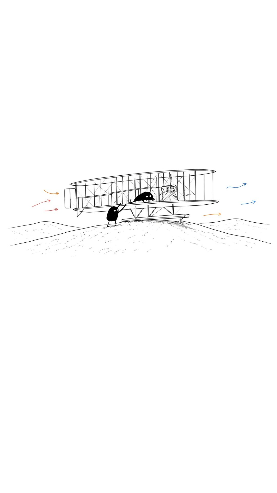 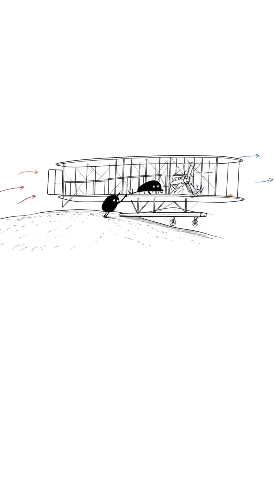</p>

### Visual clip 11 (seg6)

- **Image / sketch prompt:** **not found.**
- **Animation / clip prompt:** **not found.**

Start still: clean original, letterboxed to 9:16 (source: `/workspace/xiaohei-scenes/scene5.png`). End still is **extracted from clip** (last frame of `/workspace/sketch2_v6/clips/clip11.mp4`, with burned-in title, page number, and any captions removed):

<p>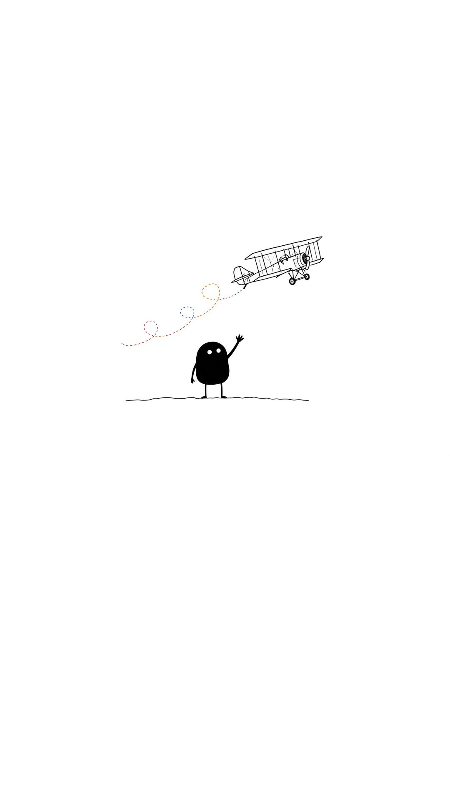 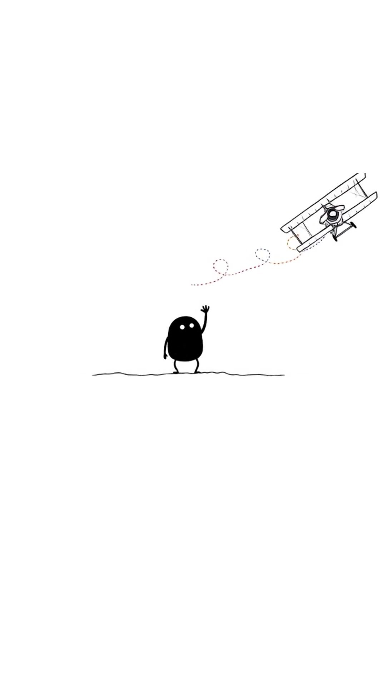</p>

### Visual clip 12 (seg6)

- **Image / sketch prompt:** **not found.**
- **Animation / clip prompt:** **not found.**

Start still: clean original, letterboxed to 9:16 (same takeoff still as scene 11) (source: `/workspace/xiaohei-scenes/scene5.png`). End still is **extracted from clip** (last frame of `/workspace/sketch2_v6/clips/clip12.mp4`, with burned-in title, page number, and any captions removed):

<p> 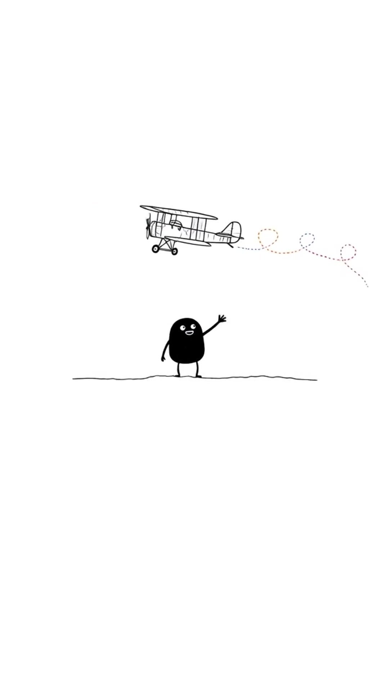</p>

### Visual clip 13 (seg7)

- **Image / sketch prompt:** **not found.**
- **Animation / clip prompt:** **not found.**

Start still: clean original, letterboxed to 9:16 (source: `/workspace/xiaohei-scenes/scene-worldflies.png`). End still is **extracted from clip** (last frame of `/workspace/sketch2_v6/clips/clip13.mp4`, with burned-in title, page number, and any captions removed):

<p>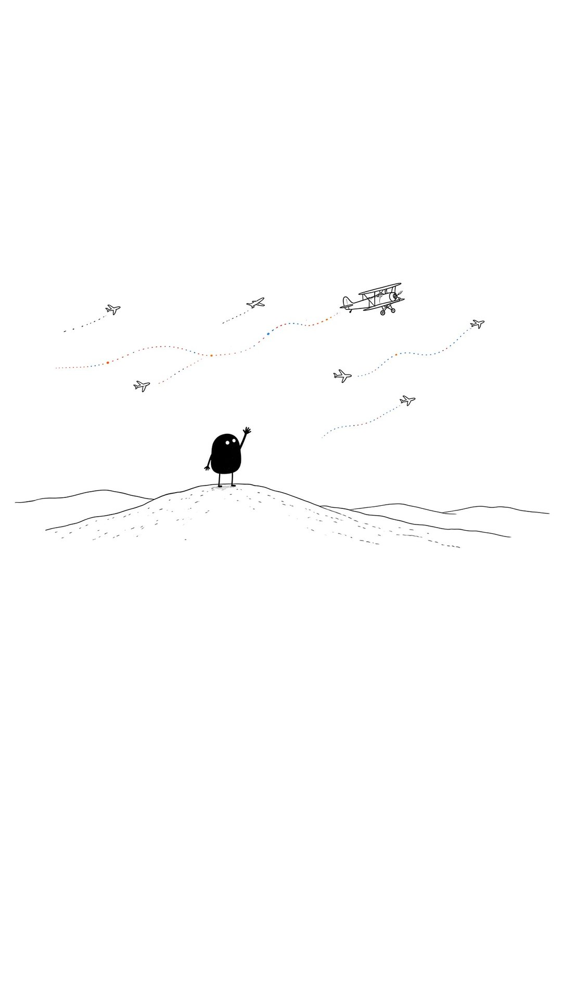 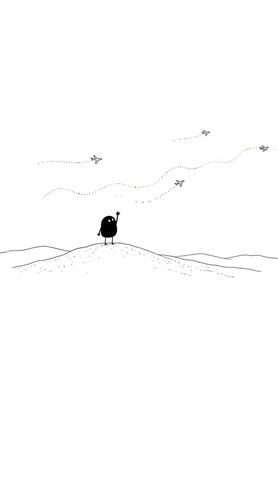</p>
