# Victor Lustig Sells the Eiffel Tower — Midjourney-adapted prompts

This file is a Midjourney Web adaptation of [`lustig.md`](lustig.md). Original image and animation prompts were **not found**. The Midjourney video prompts below are **NEW - written for MJ**, based strictly on what the real start stills and extracted end frames show. They are not original GenerateImage or GenerateVideo text.

Conventions followed (from `MID/` in this repo and `.github/instructions/mid.instructions.md`):

- **Locked-off camera.** Do not use `push-in`, `zoom`, `dolly`, or `move closer`. No pan.
- **One-way motion only.** Do not use `--loop`, and do not write looping motion (`keeps turning`, `continues to tick`, reverse, ping-pong).
- Valid Midjourney video parameters used here: `--motion low` (MID default), `--raw`. `--loop` is valid in Midjourney but **must not be used** for this channel. `--end` is the End Frame control (upload the end still; see each scene).
- A first clip is **5 s**. Each manual Extend adds **~4 s**. Maximum length is **21 s**. This file uses **at most one** extension per scene, and only when the scene's narration is longer than 5 s.
- When a start still is set, Midjourney matches its aspect (these stills are 9:16; the UI often shows `--ar 171:256`). Per MID QA, **do not type `--ar`** when a Start Frame is uploaded.
- Describe **only what moves**. The start still is already frame zero.
- Style anchors: Ian Xiaohei ink, white background, thin wobbly black lines, no text. Do not add photoreal / push-in language from the MID cat example.

**Original image / sketch prompts:** **not found** for every scene (same as [`lustig.md`](lustig.md)).
**Original animation / clip prompts:** **not found** for every scene.

## Frames

The eleven start stills were copied from `/workspace/lustig/scenes/scene1.jpg`–`scene11.jpg` and letterboxed to 9:16 in [`lustig-images/`](lustig-images/).

All end frames were **extracted from the last frame** of the real production clip. Those clips have a burned-in title, a page number, and sometimes captions, so those overlays were removed (filled with white) to leave a clean illustration. The end stills are labeled **extracted from clip** below. Start stills are the real production scene images, letterboxed onto a 9:16 white canvas with no title or captions.

## How to paste (Midjourney Web)

1. Imagine → add the **Start Frame** still → Switch to video.
2. Set **End Frame** (`--end`) to that scene's end still. Leave **Loop off**. Motion **Low**.
3. Paste the prompt, including `--motion low --raw`. Do not add `--loop`. Do not add `--ar`.
4. For a 9 s scene: run the **opening** prompt first (5 s). After a clean take, **Extend manually** once (~+4 s → ~9 s), replace the prefilled text with the **extend** prompt, Loop off, Motion Low, and keep `--end` aimed at the same end still if the plan says so. Split prompts follow the MID rule: the first 5 s is not packed, and the extend continues the same one-way action.

## Narration length vs 5 s or 9 s

Measured from `/workspace/lustig/audio_timing.json` (final v8). “Speech” is last word minus first word in that scene. A scene gets one Extend only when speech is longer than 5 s.

| Scene | Speech | Part slot | 5 s clip? | Plan |
|---|---:|---:|---|---|
| 1 | 4.88 s | 5.59 s | Yes | **5 s** only |
| 2 | 4.75 s | 5.16 s | Yes | **5 s** only |
| 3 | 7.31 s | 7.77 s | No — speech is longer than 5 s | One Extend (**9 s**) |
| 4 | 4.56 s | 5.02 s | Yes | **5 s** only |
| 5 | 2.92 s | 3.41 s | Yes | **5 s** only |
| 6 | 2.21 s | 2.66 s | Yes | **5 s** only |
| 7 | 3.49 s | 3.95 s | Yes | **5 s** only |
| 8 | 5.66 s | 6.12 s | No — speech is longer than 5 s | One Extend (**9 s**) |
| 9 | 2.92 s | 3.45 s | Yes | **5 s** only |
| 10 | 3.93 s | 4.41 s | Yes | **5 s** only |
| 11 | 3.66 s | 4.05 s | Yes | **5 s** only |

### Frame files

| Scene | Start Frame (in repo) | End Frame (`--end`, in repo) | Original box source |
|---|---|---|---|
| 1 | [`lustig-images/scene1_start.jpg`](lustig-images/scene1_start.jpg) | [`lustig-images/scene1_end.jpg`](lustig-images/scene1_end.jpg) | `/workspace/lustig/scenes/scene1.jpg` → start; last frame of `clip01.mp4` → end (overlays removed) |
| 2 | [`lustig-images/scene2_start.jpg`](lustig-images/scene2_start.jpg) | [`lustig-images/scene2_end.jpg`](lustig-images/scene2_end.jpg) | `/workspace/lustig/scenes/scene2.jpg` → start; last frame of `clip02.mp4` → end (overlays removed) |
| 3 | [`lustig-images/scene3_start.jpg`](lustig-images/scene3_start.jpg) | [`lustig-images/scene3_end.jpg`](lustig-images/scene3_end.jpg) | `/workspace/lustig/scenes/scene3.jpg` → start; last frame of `clip03.mp4` → end (overlays removed) |
| 4 | [`lustig-images/scene4_start.jpg`](lustig-images/scene4_start.jpg) | [`lustig-images/scene4_end.jpg`](lustig-images/scene4_end.jpg) | `/workspace/lustig/scenes/scene4.jpg` → start; last frame of `clip04.mp4` → end (overlays removed) |
| 5 | [`lustig-images/scene5_start.jpg`](lustig-images/scene5_start.jpg) | [`lustig-images/scene5_end.jpg`](lustig-images/scene5_end.jpg) | `/workspace/lustig/scenes/scene5.jpg` → start; last frame of `clip05.mp4` → end (overlays removed) |
| 6 | [`lustig-images/scene6_start.jpg`](lustig-images/scene6_start.jpg) | [`lustig-images/scene6_end.jpg`](lustig-images/scene6_end.jpg) | `/workspace/lustig/scenes/scene6.jpg` → start; last frame of `clip06.mp4` → end (overlays removed) |
| 7 | [`lustig-images/scene7_start.jpg`](lustig-images/scene7_start.jpg) | [`lustig-images/scene7_end.jpg`](lustig-images/scene7_end.jpg) | `/workspace/lustig/scenes/scene7.jpg` → start; last frame of `clip07.mp4` → end (overlays removed) |
| 8 | [`lustig-images/scene8_start.jpg`](lustig-images/scene8_start.jpg) | [`lustig-images/scene8_end.jpg`](lustig-images/scene8_end.jpg) | `/workspace/lustig/scenes/scene8.jpg` → start; last frame of `clip08.mp4` → end (overlays removed) |
| 9 | [`lustig-images/scene9_start.jpg`](lustig-images/scene9_start.jpg) | [`lustig-images/scene9_end.jpg`](lustig-images/scene9_end.jpg) | `/workspace/lustig/scenes/scene9.jpg` → start; last frame of `clip09.mp4` → end (overlays removed) |
| 10 | [`lustig-images/scene10_start.jpg`](lustig-images/scene10_start.jpg) | [`lustig-images/scene10_end.jpg`](lustig-images/scene10_end.jpg) | `/workspace/lustig/scenes/scene10.jpg` → start; last frame of `clip10.mp4` → end (overlays removed) |
| 11 | [`lustig-images/scene11_start.jpg`](lustig-images/scene11_start.jpg) | [`lustig-images/scene11_end.jpg`](lustig-images/scene11_end.jpg) | `/workspace/lustig/scenes/scene11.jpg` → start; last frame of `clip11.mp4` → end (overlays removed) |

## Scene 1

- **Narration:** In 1925, a con man sold the Eiffel Tower. It was never his to sell.
- **Length plan:** **5 s** only. Speech 4.88 s fits 5 s; the part slot is 5.59 s.
- **Start Frame:** [`lustig-images/scene1_start.jpg`](lustig-images/scene1_start.jpg) (in this repo; source on the box: `/workspace/lustig/scenes/scene1.jpg`, letterboxed to 9:16 (no title))
- **End Frame (`--end`):** [`lustig-images/scene1_end.jpg`](lustig-images/scene1_end.jpg) (in this repo; **extracted from clip** — last frame of `/workspace/lustig/clips/clip01.mp4`, with burned-in title, page number, and any captions removed)

<p>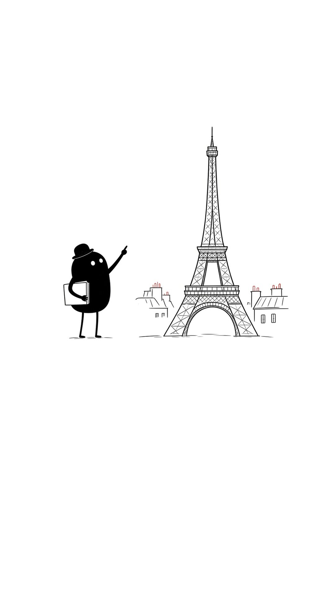 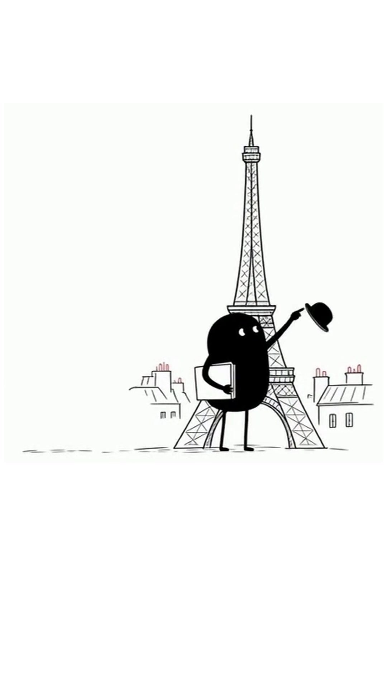</p>
- **Original image prompt:** **not found.**
- **Original animation prompt:** **not found.**

**Prompt (5 s) — paste — NEW - written for MJ:**

```
he stands by the Eiffel Tower and slowly raises the hat in his hand, the tower and rooftops stay fixed, one-way motion only, no freeze, locked-off camera, Ian Xiaohei ink style, pure white background, thin wobbly black lines, no text, no letters, no captions --motion low --raw
```

## Scene 2

- **Narration:** His name was Victor Lustig. A newspaper story about the tower's upkeep gave him an idea.
- **Length plan:** **5 s** only. Speech 4.75 s fits 5 s; the part slot is 5.16 s.
- **Start Frame:** [`lustig-images/scene2_start.jpg`](lustig-images/scene2_start.jpg) (in this repo; source on the box: `/workspace/lustig/scenes/scene2.jpg`, letterboxed to 9:16 (no title))
- **End Frame (`--end`):** [`lustig-images/scene2_end.jpg`](lustig-images/scene2_end.jpg) (in this repo; **extracted from clip** — last frame of `/workspace/lustig/clips/clip02.mp4`, with burned-in title, page number, and any captions removed)

<p>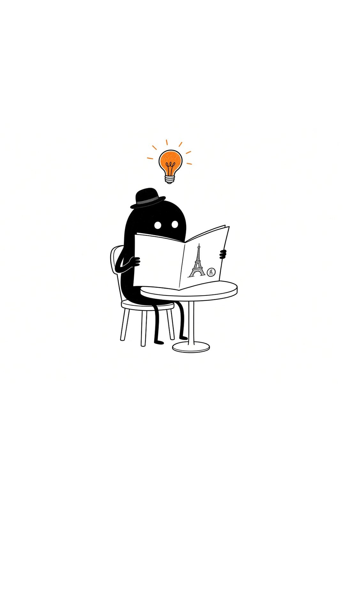 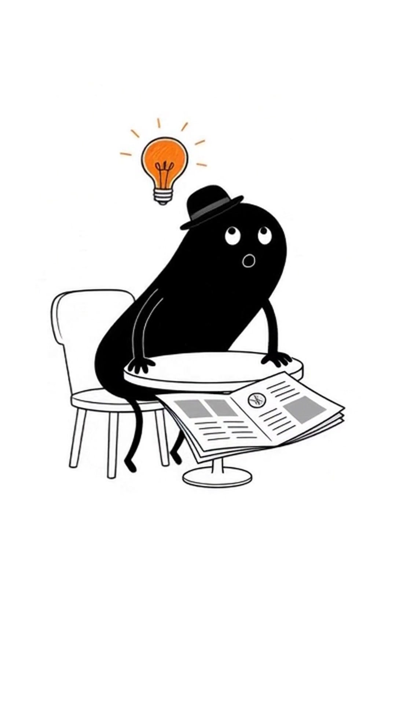</p>
- **Original image prompt:** **not found.**
- **Original animation prompt:** **not found.**

**Prompt (5 s) — paste — NEW - written for MJ:**

```
he reads the newspaper at the desk, a small idea bulb appears above his head as in the end frame, the desk stays fixed, one-way motion only, no freeze, locked-off camera, Ian Xiaohei ink style, pure white background, thin wobbly black lines, no text, no letters, no captions --motion low --raw
```

## Scene 3

- **Narration:** He posed as a government official. He forged official stationery. Then he invited scrap metal dealers to a luxury hotel in Paris.
- **Length plan:** 9 s (5 s + one Extend). Speech 7.31 s.
- **Start Frame:** [`lustig-images/scene3_start.jpg`](lustig-images/scene3_start.jpg) (in this repo; source on the box: `/workspace/lustig/scenes/scene3.jpg`, letterboxed to 9:16 (no title))
- **End Frame (`--end`):** [`lustig-images/scene3_end.jpg`](lustig-images/scene3_end.jpg) (in this repo; **extracted from clip** — last frame of `/workspace/lustig/clips/clip03.mp4`, with burned-in title, page number, and any captions removed)

<p>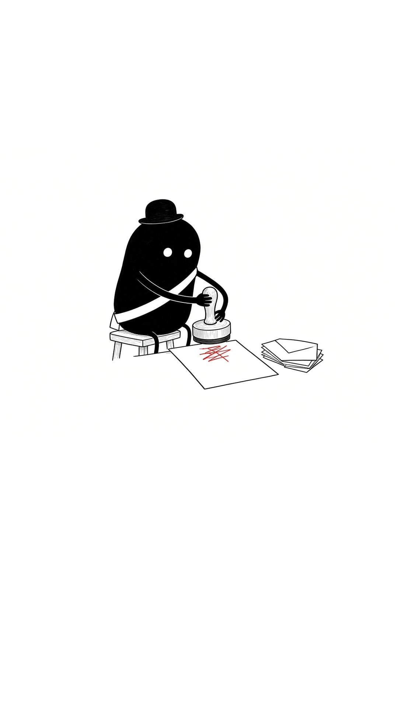 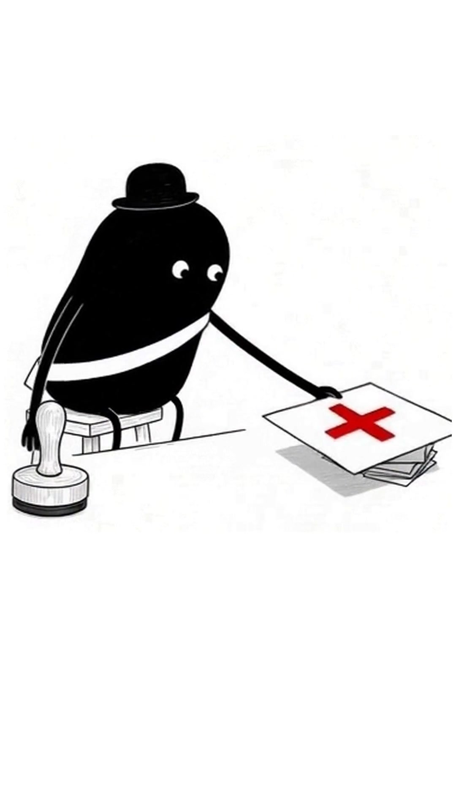</p>
- **Original image prompt:** **not found.**
- **Original animation prompt:** **not found.**

**Opening prompt (5 s) — paste — NEW - written for MJ:**

```
he sits at the desk and slowly presses a stamp onto the paper, the desk and papers stay fixed, one-way motion only, no freeze, locked-off camera, Ian Xiaohei ink style, pure white background, thin wobbly black lines, no text, no letters, no captions --motion low --raw
```

**Extend prompt (~4 s) — paste — NEW - written for MJ:**

```
he finishes the stamp and sets it down, the signed paper stays on the desk, slight living motion, no new objects, one-way motion only, no freeze, locked-off camera, Ian Xiaohei ink style, pure white background, thin wobbly black lines, no text, no letters, no captions --motion low --raw
```

## Scene 4

- **Narration:** There, he shared a secret. The government planned to tear down the tower and sell its metal.
- **Length plan:** **5 s** only (speech 4.56 s; slot 5.02 s).
- **Start Frame:** [`lustig-images/scene4_start.jpg`](lustig-images/scene4_start.jpg) (in this repo; source on the box: `/workspace/lustig/scenes/scene4.jpg`, letterboxed to 9:16 (no title))
- **End Frame (`--end`):** [`lustig-images/scene4_end.jpg`](lustig-images/scene4_end.jpg) (in this repo; **extracted from clip** — last frame of `/workspace/lustig/clips/clip04.mp4`, with burned-in title, page number, and any captions removed)

<p>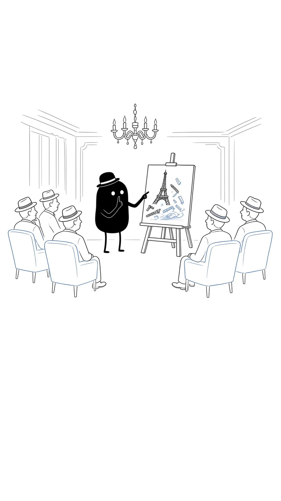 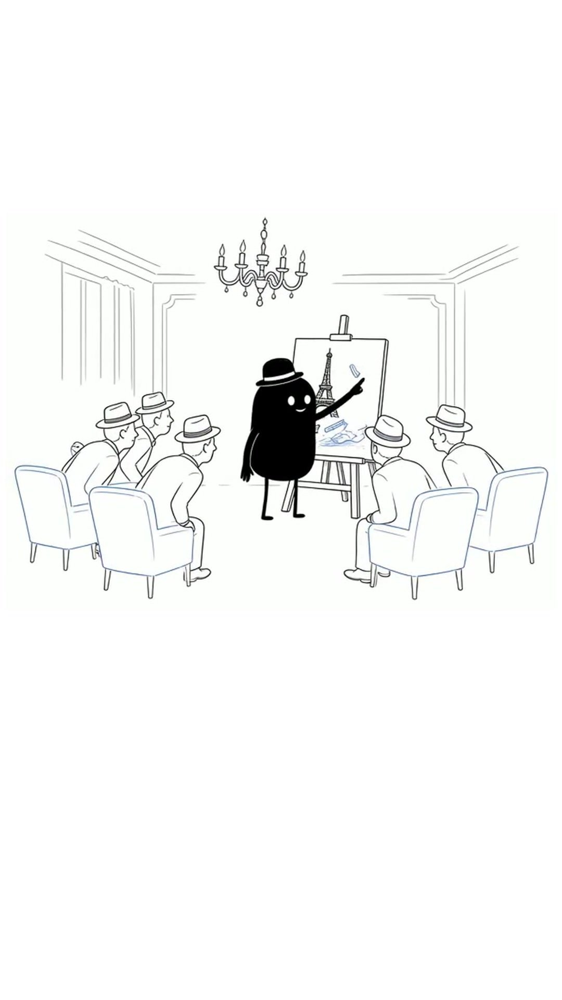</p>
- **Original image prompt:** **not found.**
- **Original animation prompt:** **not found.**

**Prompt (5 s) — paste — NEW - written for MJ:**

```
he stands at the board and makes a small one-way presenting gesture, the seated dealers stay in their chairs with slight living motion, the room stays fixed, one-way motion only, no freeze, locked-off camera, Ian Xiaohei ink style, pure white background, thin wobbly black lines, no text, no letters, no captions --motion low --raw
```

## Scene 5

- **Narration:** One dealer, André Poisson, wanted the deal badly.
- **Length plan:** **5 s** only (speech 2.92 s; slot 3.41 s).
- **Start Frame:** [`lustig-images/scene5_start.jpg`](lustig-images/scene5_start.jpg) (in this repo; source on the box: `/workspace/lustig/scenes/scene5.jpg`, letterboxed to 9:16 (no title))
- **End Frame (`--end`):** [`lustig-images/scene5_end.jpg`](lustig-images/scene5_end.jpg) (in this repo; **extracted from clip** — last frame of `/workspace/lustig/clips/clip05.mp4`, with burned-in title, page number, and any captions removed)

<p>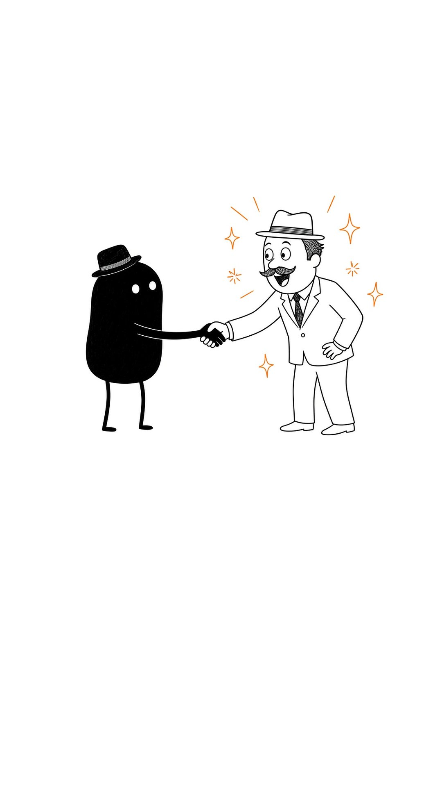 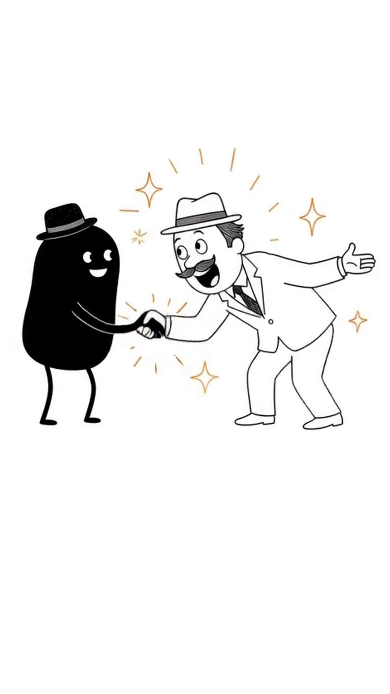</p>
- **Original image prompt:** **not found.**
- **Original animation prompt:** **not found.**

**Prompt (5 s) — paste — NEW - written for MJ:**

```
the two figures complete a slow handshake, both stay in the same place, the background stays fixed, one-way motion only, no freeze, locked-off camera, Ian Xiaohei ink style, pure white background, thin wobbly black lines, no text, no letters, no captions --motion low --raw
```

## Scene 6

- **Narration:** But Lustig wanted more than the price of the tower.
- **Length plan:** **5 s** only (speech 2.21 s; slot 2.66 s).
- **Start Frame:** [`lustig-images/scene6_start.jpg`](lustig-images/scene6_start.jpg) (in this repo; source on the box: `/workspace/lustig/scenes/scene6.jpg`, letterboxed to 9:16 (no title))
- **End Frame (`--end`):** [`lustig-images/scene6_end.jpg`](lustig-images/scene6_end.jpg) (in this repo; **extracted from clip** — last frame of `/workspace/lustig/clips/clip06.mp4`, with burned-in title, page number, and any captions removed)

<p>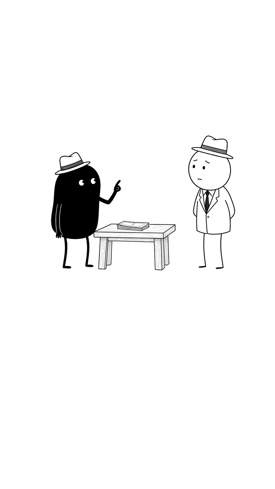 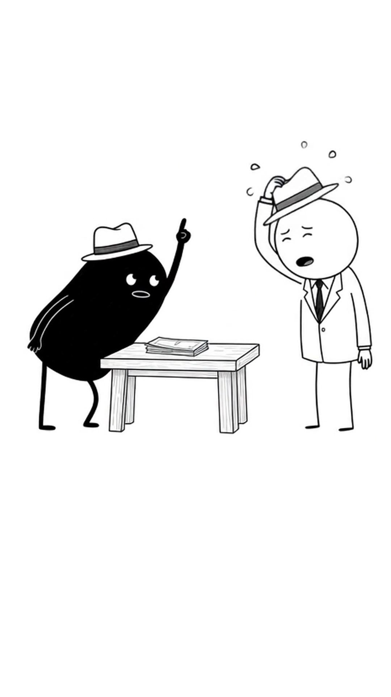</p>
- **Original image prompt:** **not found.**
- **Original animation prompt:** **not found.**

**Prompt (5 s) — paste — NEW - written for MJ:**

```
the figure at the table makes a small one-way gesture, the other man stays in place, the table stays fixed, one-way motion only, no freeze, locked-off camera, Ian Xiaohei ink style, pure white background, thin wobbly black lines, no text, no letters, no captions --motion low --raw
```

## Scene 7

- **Narration:** He hinted that he was a corrupt official. He expected a bribe, too.
- **Length plan:** **5 s** only (speech 3.49 s; slot 3.95 s).
- **Start Frame:** [`lustig-images/scene7_start.jpg`](lustig-images/scene7_start.jpg) (in this repo; source on the box: `/workspace/lustig/scenes/scene7.jpg`, letterboxed to 9:16 (no title))
- **End Frame (`--end`):** [`lustig-images/scene7_end.jpg`](lustig-images/scene7_end.jpg) (in this repo; **extracted from clip** — last frame of `/workspace/lustig/clips/clip07.mp4`, with burned-in title, page number, and any captions removed)

<p>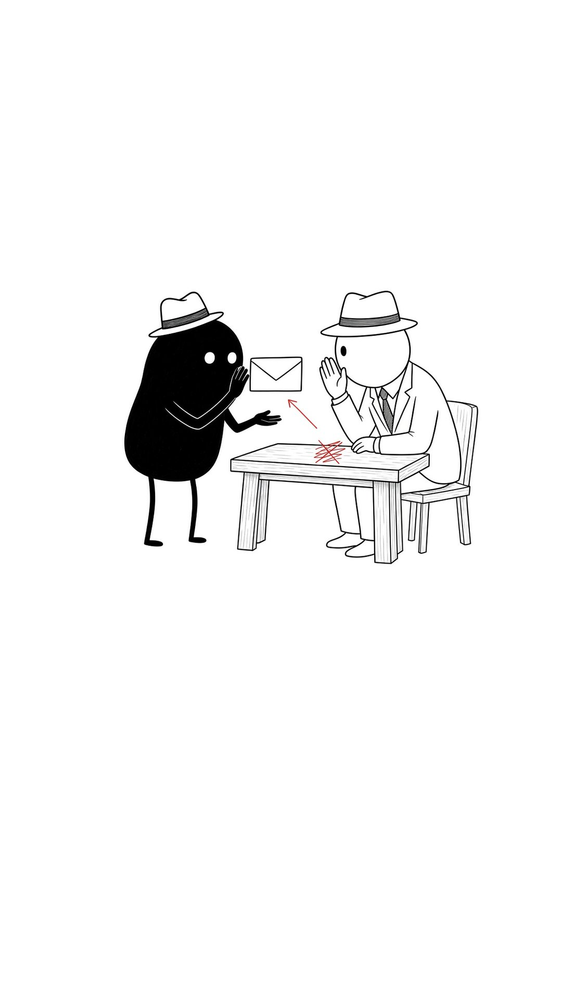 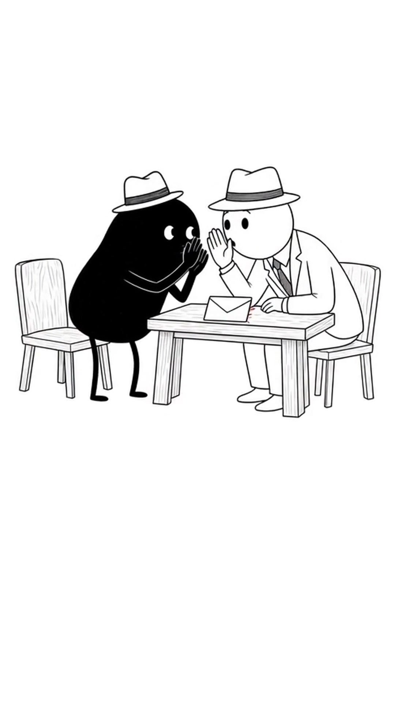</p>
- **Original image prompt:** **not found.**
- **Original animation prompt:** **not found.**

**Prompt (5 s) — paste — NEW - written for MJ:**

```
the two figures lean in slightly over the papers on the table, the table and chairs stay fixed, one-way motion only, no freeze, locked-off camera, Ian Xiaohei ink style, pure white background, thin wobbly black lines, no text, no letters, no captions --motion low --raw
```

## Scene 8

- **Narration:** Strangely, that made the scam more convincing. Now there was a reason the deal happened behind closed doors.
- **Length plan:** 9 s (5 s + one Extend). Speech 5.66 s.
- **Start Frame:** [`lustig-images/scene8_start.jpg`](lustig-images/scene8_start.jpg) (in this repo; source on the box: `/workspace/lustig/scenes/scene8.jpg`, letterboxed to 9:16 (no title))
- **End Frame (`--end`):** [`lustig-images/scene8_end.jpg`](lustig-images/scene8_end.jpg) (in this repo; **extracted from clip** — last frame of `/workspace/lustig/clips/clip08.mp4`, with burned-in title, page number, and any captions removed)

<p>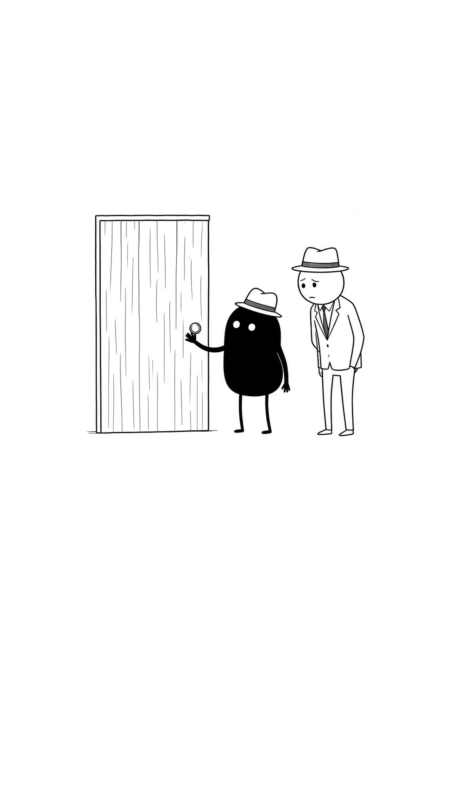 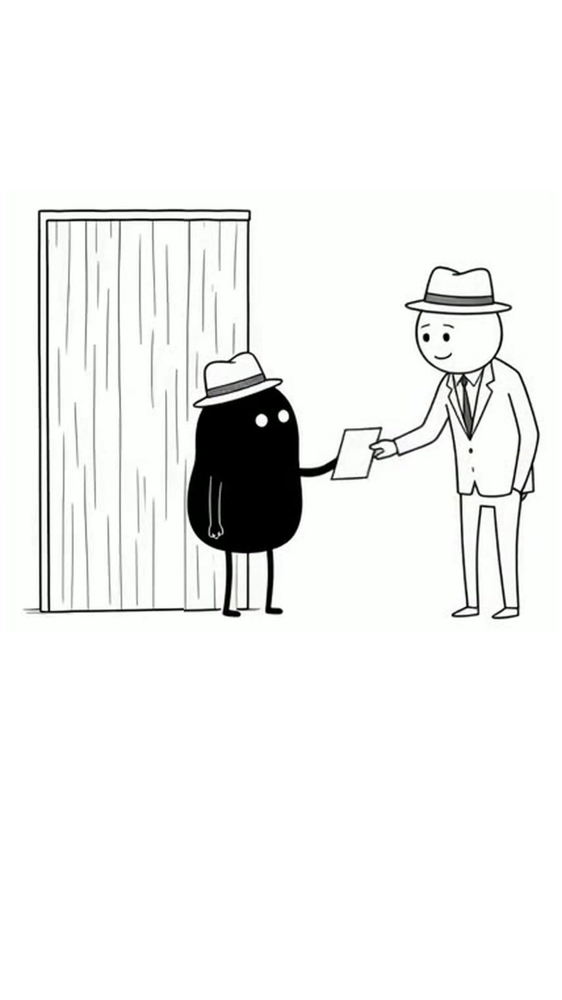</p>
- **Original image prompt:** **not found.**
- **Original animation prompt:** **not found.**

**Opening prompt (5 s) — paste — NEW - written for MJ:**

```
the two figures stand by the closed door with slight living motion, the door stays closed and fixed, one-way motion only, no freeze, locked-off camera, Ian Xiaohei ink style, pure white background, thin wobbly black lines, no text, no letters, no captions --motion low --raw
```

**Extend prompt (~4 s) — paste — NEW - written for MJ:**

```
they settle in place by the still-closed door, slight living motion, no new objects, one-way motion only, no freeze, locked-off camera, Ian Xiaohei ink style, pure white background, thin wobbly black lines, no text, no letters, no captions --motion low --raw
```

## Scene 9

- **Narration:** Poisson paid. Lustig took the money and fled to Austria.
- **Length plan:** **5 s** only (speech 2.92 s; slot 3.45 s).
- **Start Frame:** [`lustig-images/scene9_start.jpg`](lustig-images/scene9_start.jpg) (in this repo; source on the box: `/workspace/lustig/scenes/scene9.jpg`, letterboxed to 9:16 (no title))
- **End Frame (`--end`):** [`lustig-images/scene9_end.jpg`](lustig-images/scene9_end.jpg) (in this repo; **extracted from clip** — last frame of `/workspace/lustig/clips/clip09.mp4`, with burned-in title, page number, and any captions removed)

<p>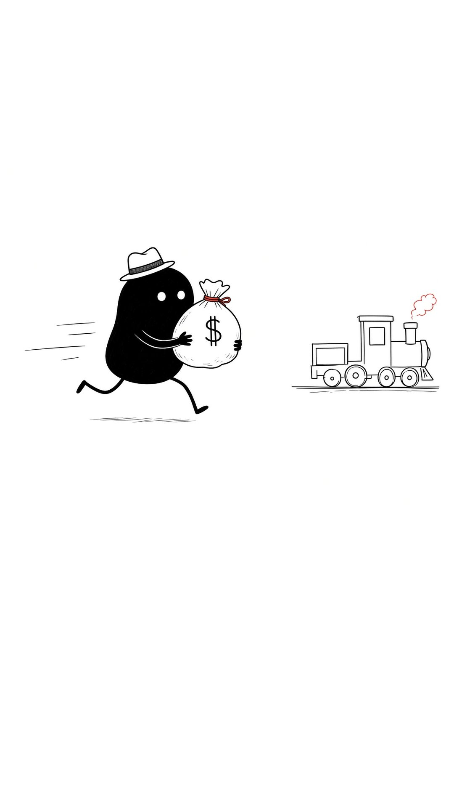 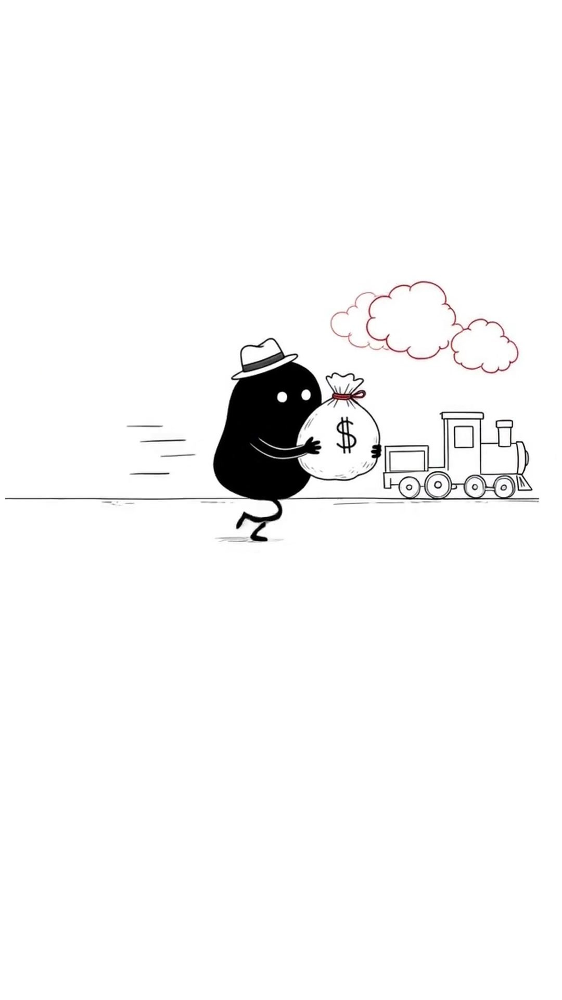</p>
- **Original image prompt:** **not found.**
- **Original animation prompt:** **not found.**

**Prompt (5 s) — paste — NEW - written for MJ:**

```
he walks quickly to the right with the bag, the train stays on the track, no other new objects, one-way motion only, no freeze, locked-off camera, Ian Xiaohei ink style, pure white background, thin wobbly black lines, no text, no letters, no captions --motion low --raw
```

## Scene 10

- **Narration:** When Poisson realized he had been fooled, he was too embarrassed to go to the police.
- **Length plan:** **5 s** only (speech 3.93 s; slot 4.41 s).
- **Start Frame:** [`lustig-images/scene10_start.jpg`](lustig-images/scene10_start.jpg) (in this repo; source on the box: `/workspace/lustig/scenes/scene10.jpg`, letterboxed to 9:16 (no title))
- **End Frame (`--end`):** [`lustig-images/scene10_end.jpg`](lustig-images/scene10_end.jpg) (in this repo; **extracted from clip** — last frame of `/workspace/lustig/clips/clip10.mp4`, with burned-in title, page number, and any captions removed)

<p>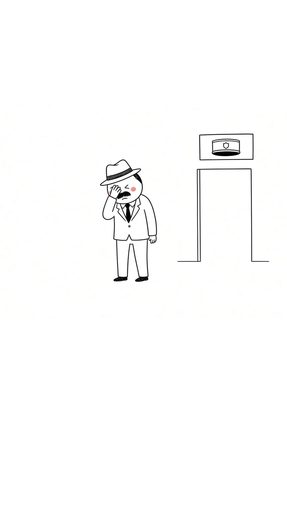 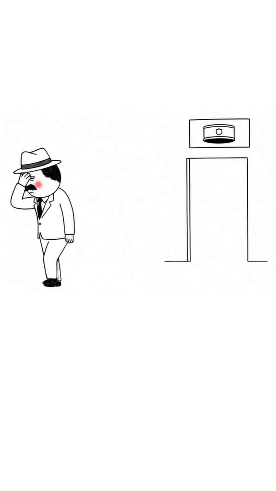</p>
- **Original image prompt:** **not found.**
- **Original animation prompt:** **not found.**

**Prompt (5 s) — paste — NEW - written for MJ:**

```
he stands in the doorway with a small one-way shift, the door frame stays fixed, one-way motion only, no freeze, locked-off camera, Ian Xiaohei ink style, pure white background, thin wobbly black lines, no text, no letters, no captions --motion low --raw
```

## Scene 11

- **Narration:** The Eiffel Tower stayed right where it was. Poisson's money did not.
- **Length plan:** **5 s** only (speech 3.66 s; slot 4.05 s).
- **Start Frame:** [`lustig-images/scene11_start.jpg`](lustig-images/scene11_start.jpg) (in this repo; source on the box: `/workspace/lustig/scenes/scene11.jpg`, letterboxed to 9:16 (no title))
- **End Frame (`--end`):** [`lustig-images/scene11_end.jpg`](lustig-images/scene11_end.jpg) (in this repo; **extracted from clip** — last frame of `/workspace/lustig/clips/clip11.mp4`, with burned-in title, page number, and any captions removed)

<p>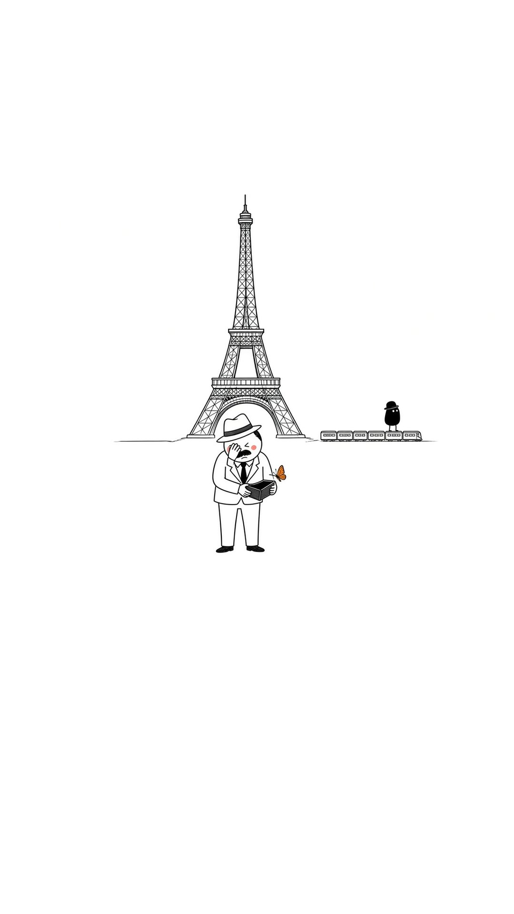 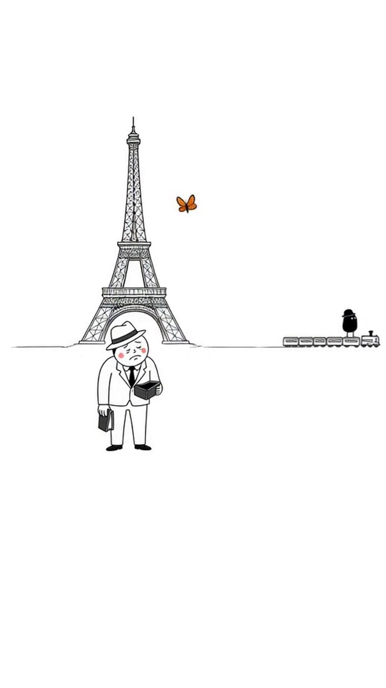</p>
- **Original image prompt:** **not found.**
- **Original animation prompt:** **not found.**

**Prompt (5 s) — paste — NEW - written for MJ:**

```
the Eiffel Tower stays completely still, a small figure walks away to the right, the rooftops stay fixed, one-way motion only, no freeze, locked-off camera, Ian Xiaohei ink style, pure white background, thin wobbly black lines, no text, no letters, no captions --motion low --raw
```
