# Victor Lustig Sells the Eiffel Tower

- **YouTube title:** He Sold the Eiffel Tower. It Was Never for Sale
- **Status:** Scheduled via Buffer for 2026-11-10 18:47 Israel time (Asia/Jerusalem), per the Buffer metadata snapshot of 2026-11-09 (status: scheduled). This documentation pass did not re-query Buffer, so later sent/published status is not confirmed here.
- **Publish / schedule time:** Scheduled 2026-11-10 18:47 Israel time (Asia/Jerusalem) (snapshot 2026-11-09)
- **Final version / length:** v8, 51.6 s
- **Narration method (from `examples/README.md`):** Chatterbox am_eric, seed 7, exaggeration 0.6, cfg 0.45 (approved setting), single full pass (`gen7f.py`)
- **Completeness:** partial — narration found (English final + v1 English/Hebrew/sources); Xiaohei image and clip prompts for the published Short not found. An earlier unused 16:9 Vox-style experiment is archived in a clearly labeled section.
- **Primary sources:** `examples/lustig/` (scripts and `buffer_metadata.md`). Publish times are from that Buffer snapshot, not re-queried here.

Nothing in this file was invented. Missing prompt classes are marked **not found**.

## Script / narration
Final English narration (`script_final_en.txt`):

### `script_final_en.txt`

Source: `history-storyteller/examples/lustig/script_final_en.txt`

```
In 1925, a con man sold the Eiffel Tower. It was never his to sell. His name was Victor Lustig. A newspaper story about the tower's upkeep gave him an idea. He posed as a government official. He forged official stationery. Then he invited scrap metal dealers to a luxury hotel in Paris. There, he shared a secret. The government planned to tear down the tower and sell its metal. One dealer, André Poisson, wanted the deal badly. But Lustig wanted more than the price of the tower. He hinted that he was a corrupt official. He expected a bribe, too. Strangely, that made the scam more convincing. Now there was a reason the deal happened behind closed doors. Poisson paid. Lustig took the money and fled to Austria. When Poisson realized he had been fooled, he was too embarrassed to go to the police. The Eiffel Tower stayed right where it was. Poisson's money did not. 
```


Sentence units (`sentences.txt`):

### `sentences.txt`

Source: `history-storyteller/examples/lustig/sentences.txt`

```
In 1925, a con man sold the Eiffel Tower. It was never his to sell.
His name was Victor Lustig. A newspaper story about the tower's upkeep gave him an idea.
He posed as a government official. He forged official stationery. Then he invited scrap metal dealers to a luxury hotel in Paris.
There, he shared a secret. The government planned to tear down the tower and sell its metal.
One dealer, André Poisson, wanted the deal badly.
But Lustig wanted more than the price of the tower.
He hinted that he was a corrupt official. He expected a bribe, too.
Strangely, that made the scam more convincing. Now there was a reason the deal happened behind closed doors.
Poisson paid. Lustig took the money and fled to Austria.
When Poisson realized he had been fooled, he was too embarrassed to go to the police.
The Eiffel Tower stayed right where it was. Poisson's money did not.
```


v1 English + Hebrew approval text and sources (`script_v1_en_he_sources.md`), copied in full:

### `script_v1_en_he_sources.md`

Source: `history-storyteller/examples/lustig/script_v1_en_he_sources.md`

```markdown
# Victor Lustig – script v1 (awaiting Hebrew approval)
## English (~100 words)
In 1925, Paris had a problem: the Eiffel Tower was costly to maintain, and newspapers said so.
A con man named Victor Lustig read those stories and saw an opportunity.
Posing as a government official, he used forged official stationery to invite scrap-metal dealers to a luxury hotel.
He told them, in secret, that the tower would be torn down and sold for scrap.
One dealer, André Poisson, wanted it badly.
Lustig hinted he was a corrupt official, so Poisson paid him the money and a bribe on top.
Then Lustig fled to Austria.
And Poisson? Too embarrassed to go to the police.
Lustig had sold a monument that was never for sale.

## Hebrew
ב־1925 לפריז הייתה בעיה: תחזוקת מגדל אייפל עלתה הון, והעיתונים כתבו על כך.
נוכל בשם ויקטור לוסטיג קרא את הכתבות וראה הזדמנות.
הוא התחזה לפקיד ממשלתי, ובנייר מכתבים רשמי מזויף הזמין סוחרי גרוטאות למלון יוקרה.
שם גילה להם, בסוד, שהמגדל יפורק וימכר כגרוטאות.
סוחר אחד, אנדרה פואסון, רצה אותו מאוד.
לוסטיג רמז שהוא פקיד מושחת, ופואסון שילם לו את הכסף ועוד שוחד מעליו.
ואז לוסטיג ברח לאוסטריה.
ופואסון? היה נבוך מכדי לפנות למשטרה.
לוסטיג מכר אנדרטה שמעולם לא עמדה למכירה.

## Sources
- https://www.toureiffel.paris/en/news/history-and-culture/who-sold-eiffel-tower
- https://www.smithsonianmag.com/history/man-who-sold-eiffel-tower-twice-180958370/
- https://www.lepoint.fr/culture/13-mars-1925-l-arnaque-du-siecle-un-escroc-vend-la-tour-eiffel-13-03-2012-1440607_3.php
Caveats: story rests largely on Secret Service agent James Johnson's memoir; exact sum unknown (official Eiffel site: "unknown sum"; ~70,000 francs on Wikipedia is unverified) – omitted. Second attempt exists in sources but omitted. Hotel = Crillon (named in Smithsonian/Le Point), kept generic.
```

## Per-scene image and animation prompts

One row per production scene (sentence, segment, or part). Prompts are copied verbatim only when a source file or transcript call was found.

### Scene 1 — In 1925, a con man sold the Eiffel Tower. It…

- **Image / sketch prompt:** **not found.** No GenerateImage / still-sketch prompt was saved for this scene, and none was found in the transcripts or project files searched for this update.


Start still is the real production scene image, letterboxed to 9:16 (source: `/workspace/lustig/scenes/scene1.jpg`). End still is **extracted from clip** (last frame of `/workspace/lustig/clips/clip01.mp4`, with burned-in title, page number, and any captions removed):

<p>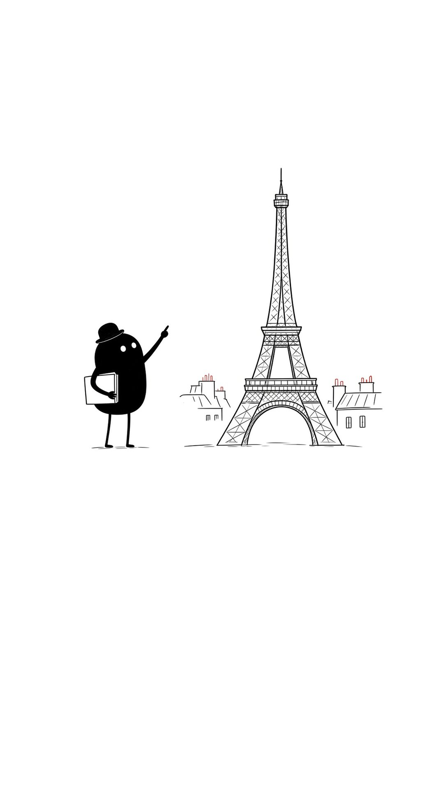 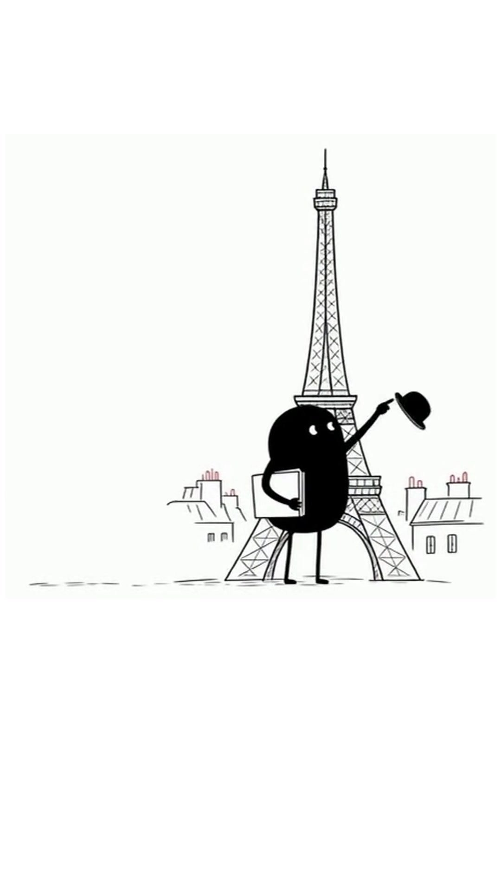</p>
- **Animation / clip prompt:** **not found.** No GenerateVideo / animation / transition prompt was saved for this scene, and none was found in the transcripts or project files searched for this update.

### Scene 2 — His name was Victor Lustig. A newspaper story about the…

- **Image / sketch prompt:** **not found.** No GenerateImage / still-sketch prompt was saved for this scene, and none was found in the transcripts or project files searched for this update.


Start still is the real production scene image, letterboxed to 9:16 (source: `/workspace/lustig/scenes/scene2.jpg`). End still is **extracted from clip** (last frame of `/workspace/lustig/clips/clip02.mp4`, with burned-in title, page number, and any captions removed):

<p>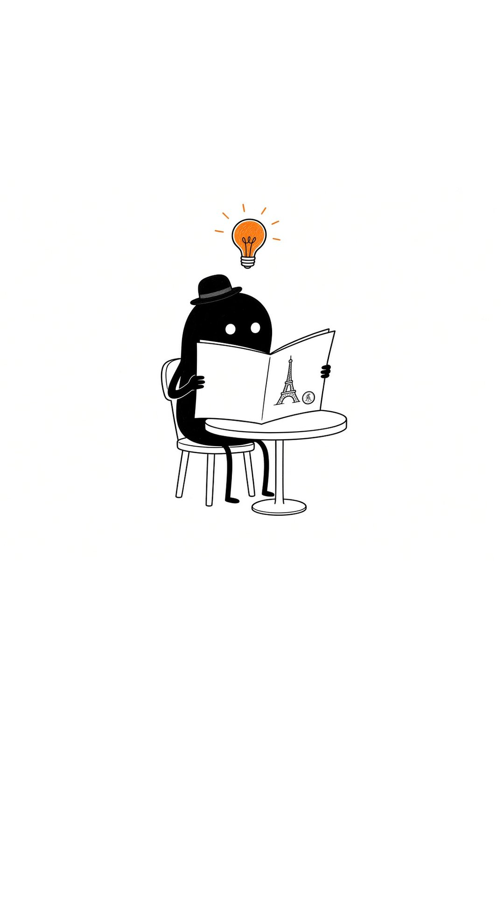 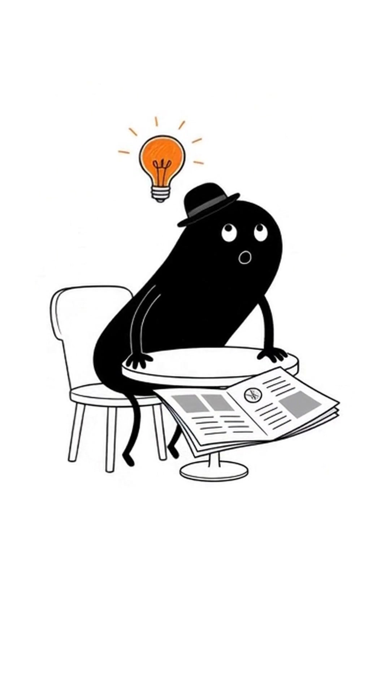</p>
- **Animation / clip prompt:** **not found.** No GenerateVideo / animation / transition prompt was saved for this scene, and none was found in the transcripts or project files searched for this update.

### Scene 3 — He posed as a government official. He forged official stationery.…

- **Image / sketch prompt:** **not found.** No GenerateImage / still-sketch prompt was saved for this scene, and none was found in the transcripts or project files searched for this update.


Start still is the real production scene image, letterboxed to 9:16 (source: `/workspace/lustig/scenes/scene3.jpg`). End still is **extracted from clip** (last frame of `/workspace/lustig/clips/clip03.mp4`, with burned-in title, page number, and any captions removed):

<p>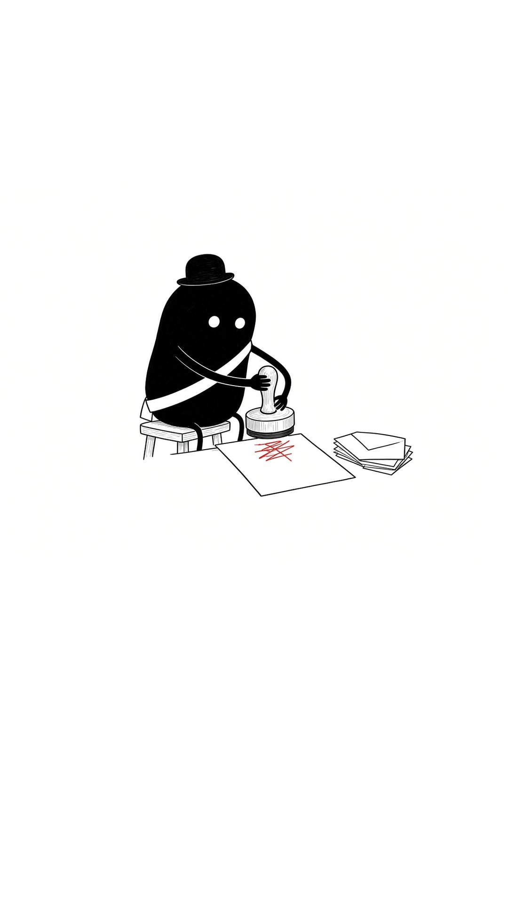 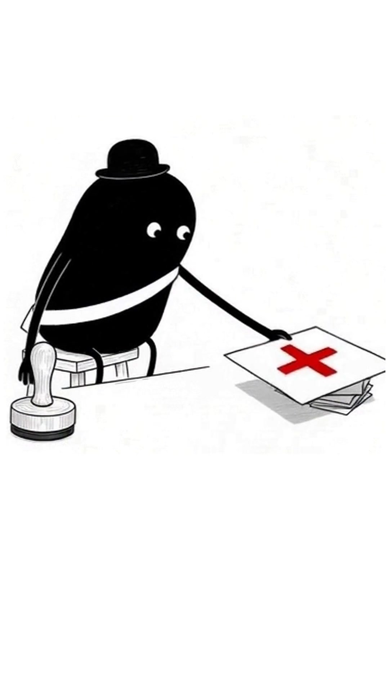</p>
- **Animation / clip prompt:** **not found.** No GenerateVideo / animation / transition prompt was saved for this scene, and none was found in the transcripts or project files searched for this update.

### Scene 4 — There, he shared a secret. The government planned to tear…

- **Image / sketch prompt:** **not found.** No GenerateImage / still-sketch prompt was saved for this scene, and none was found in the transcripts or project files searched for this update.


Start still is the real production scene image, letterboxed to 9:16 (source: `/workspace/lustig/scenes/scene4.jpg`). End still is **extracted from clip** (last frame of `/workspace/lustig/clips/clip04.mp4`, with burned-in title, page number, and any captions removed):

<p>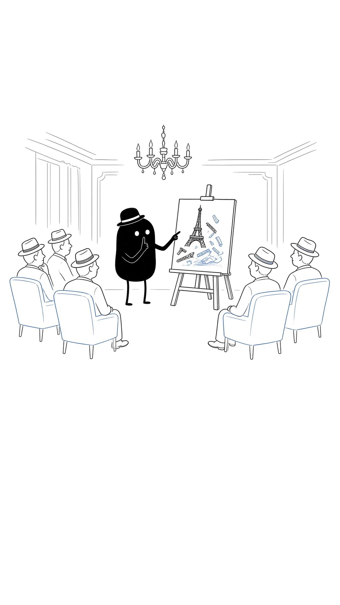 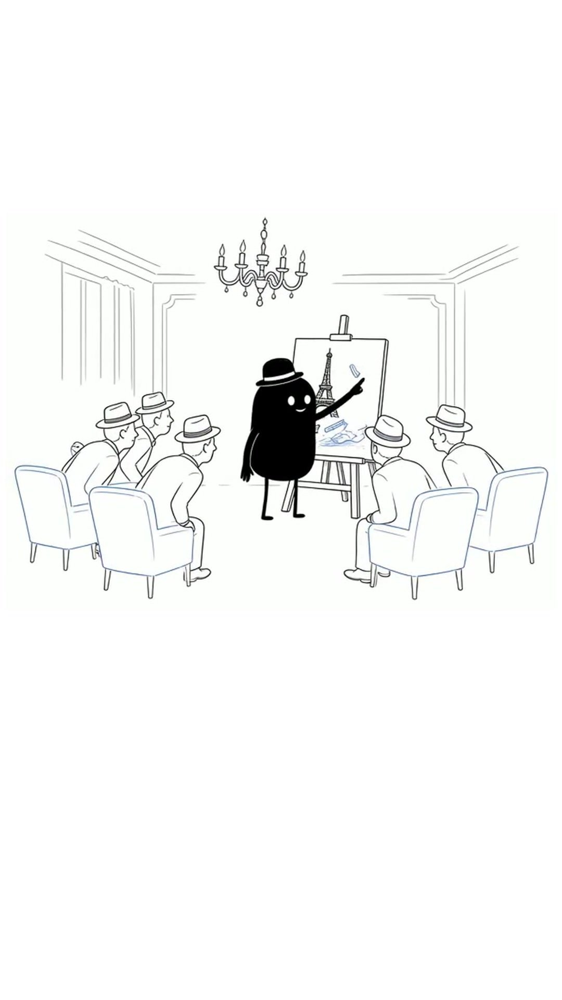</p>
- **Animation / clip prompt:** **not found.** No GenerateVideo / animation / transition prompt was saved for this scene, and none was found in the transcripts or project files searched for this update.

### Scene 5 — One dealer, André Poisson, wanted the deal badly.

- **Image / sketch prompt:** **not found.** No GenerateImage / still-sketch prompt was saved for this scene, and none was found in the transcripts or project files searched for this update.


Start still is the real production scene image, letterboxed to 9:16 (source: `/workspace/lustig/scenes/scene5.jpg`). End still is **extracted from clip** (last frame of `/workspace/lustig/clips/clip05.mp4`, with burned-in title, page number, and any captions removed):

<p>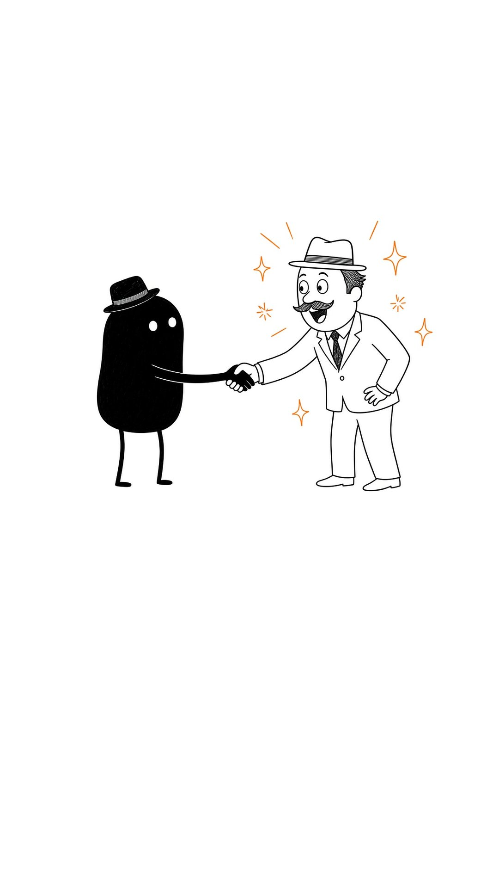 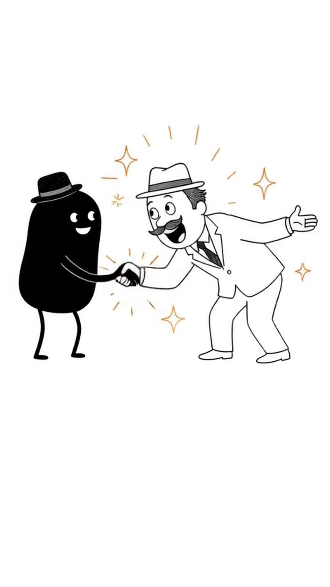</p>
- **Animation / clip prompt:** **not found.** No GenerateVideo / animation / transition prompt was saved for this scene, and none was found in the transcripts or project files searched for this update.

### Scene 6 — But Lustig wanted more than the price of the tower.

- **Image / sketch prompt:** **not found.** No GenerateImage / still-sketch prompt was saved for this scene, and none was found in the transcripts or project files searched for this update.


Start still is the real production scene image, letterboxed to 9:16 (source: `/workspace/lustig/scenes/scene6.jpg`). End still is **extracted from clip** (last frame of `/workspace/lustig/clips/clip06.mp4`, with burned-in title, page number, and any captions removed):

<p>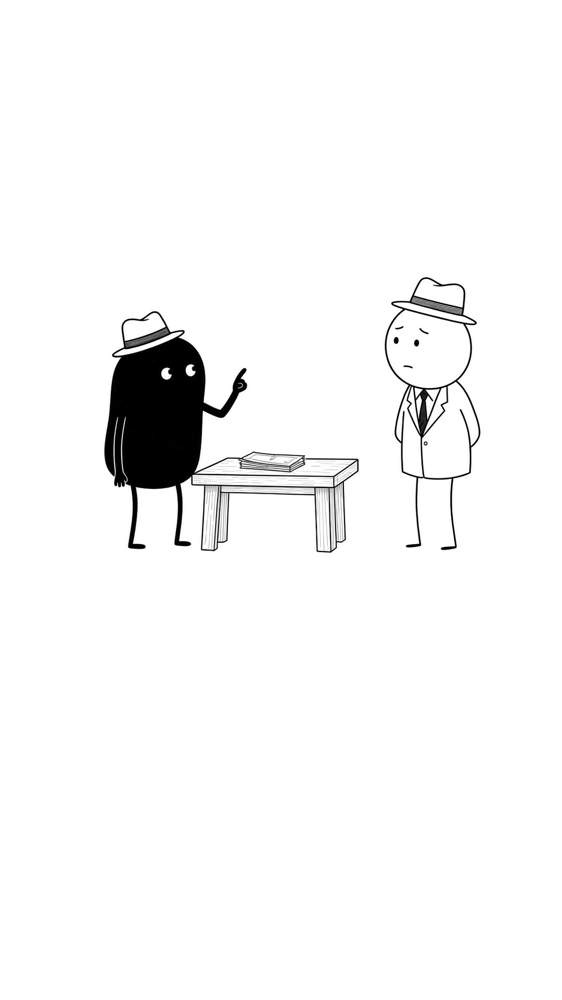 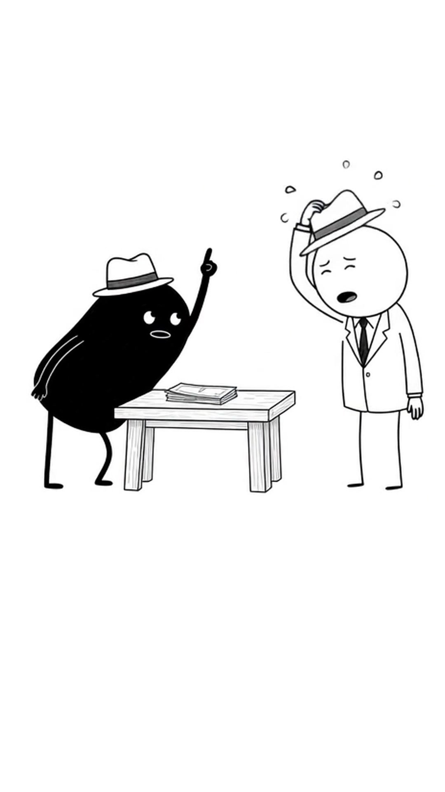</p>
- **Animation / clip prompt:** **not found.** No GenerateVideo / animation / transition prompt was saved for this scene, and none was found in the transcripts or project files searched for this update.

### Scene 7 — He hinted that he was a corrupt official. He expected…

- **Image / sketch prompt:** **not found.** No GenerateImage / still-sketch prompt was saved for this scene, and none was found in the transcripts or project files searched for this update.


Start still is the real production scene image, letterboxed to 9:16 (source: `/workspace/lustig/scenes/scene7.jpg`). End still is **extracted from clip** (last frame of `/workspace/lustig/clips/clip07.mp4`, with burned-in title, page number, and any captions removed):

<p>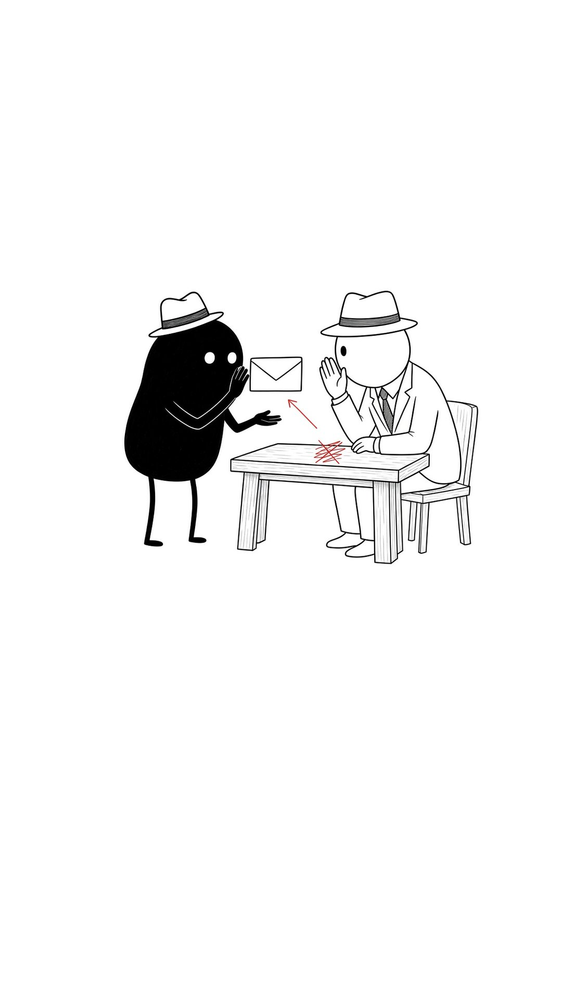 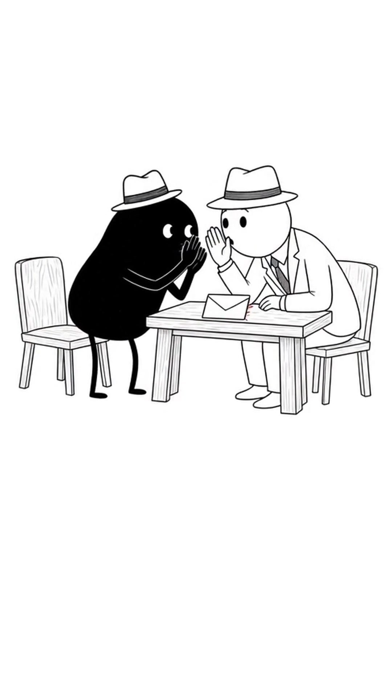</p>
- **Animation / clip prompt:** **not found.** No GenerateVideo / animation / transition prompt was saved for this scene, and none was found in the transcripts or project files searched for this update.

### Scene 8 — Strangely, that made the scam more convincing. Now there was…

- **Image / sketch prompt:** **not found.** No GenerateImage / still-sketch prompt was saved for this scene, and none was found in the transcripts or project files searched for this update.


Start still is the real production scene image, letterboxed to 9:16 (source: `/workspace/lustig/scenes/scene8.jpg`). End still is **extracted from clip** (last frame of `/workspace/lustig/clips/clip08.mp4`, with burned-in title, page number, and any captions removed):

<p>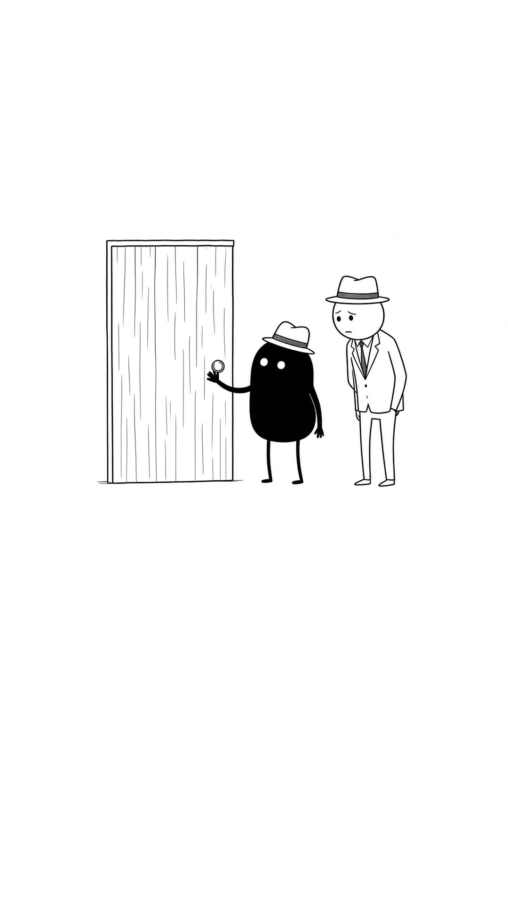 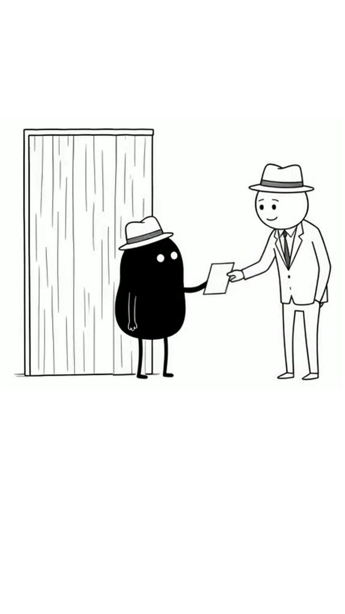</p>
- **Animation / clip prompt:** **not found.** No GenerateVideo / animation / transition prompt was saved for this scene, and none was found in the transcripts or project files searched for this update.

### Scene 9 — Poisson paid. Lustig took the money and fled to Austria.

- **Image / sketch prompt:** **not found.** No GenerateImage / still-sketch prompt was saved for this scene, and none was found in the transcripts or project files searched for this update.


Start still is the real production scene image, letterboxed to 9:16 (source: `/workspace/lustig/scenes/scene9.jpg`). End still is **extracted from clip** (last frame of `/workspace/lustig/clips/clip09.mp4`, with burned-in title, page number, and any captions removed):

<p>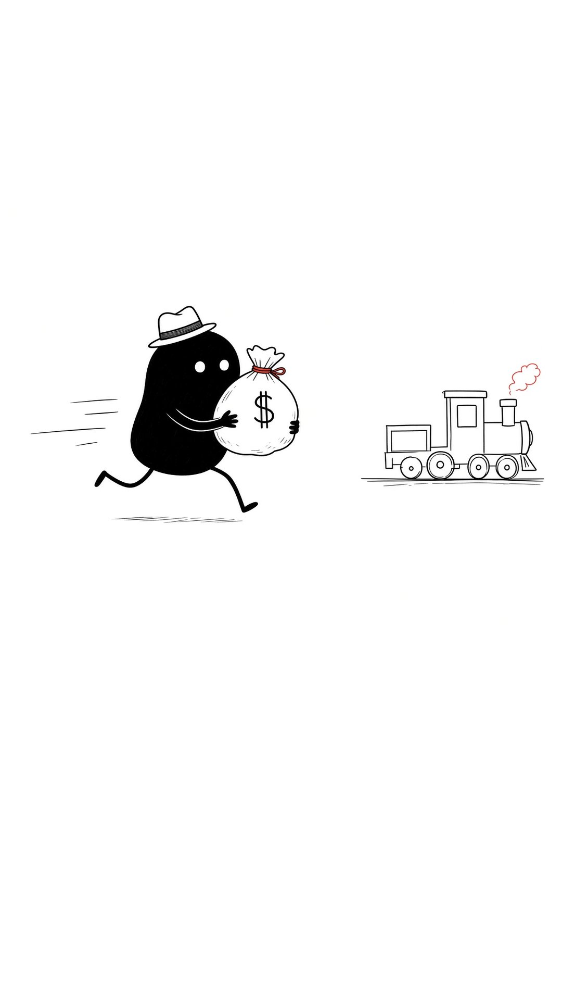 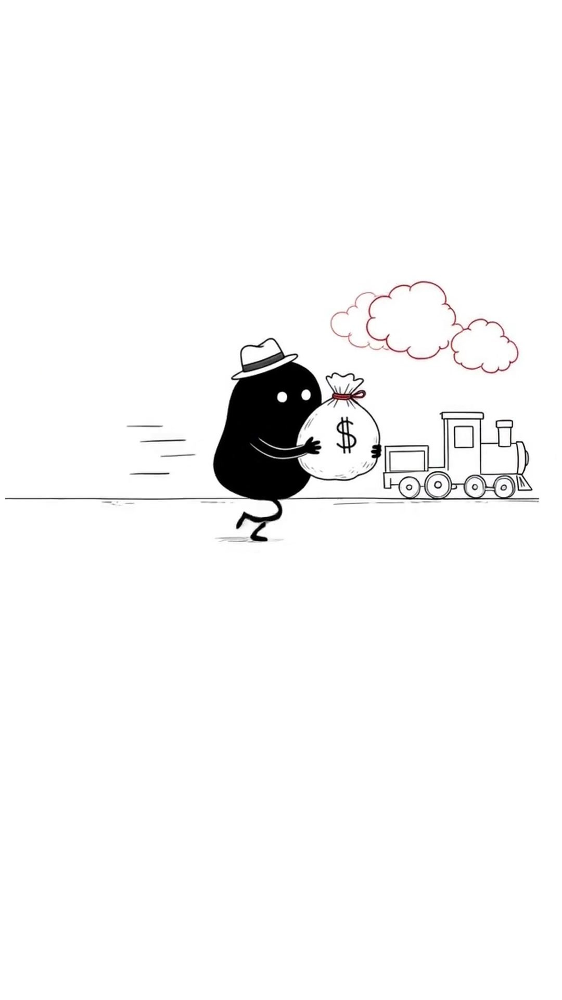</p>
- **Animation / clip prompt:** **not found.** No GenerateVideo / animation / transition prompt was saved for this scene, and none was found in the transcripts or project files searched for this update.

### Scene 10 — When Poisson realized he had been fooled, he was too…

- **Image / sketch prompt:** **not found.** No GenerateImage / still-sketch prompt was saved for this scene, and none was found in the transcripts or project files searched for this update.


Start still is the real production scene image, letterboxed to 9:16 (source: `/workspace/lustig/scenes/scene10.jpg`). End still is **extracted from clip** (last frame of `/workspace/lustig/clips/clip10.mp4`, with burned-in title, page number, and any captions removed):

<p>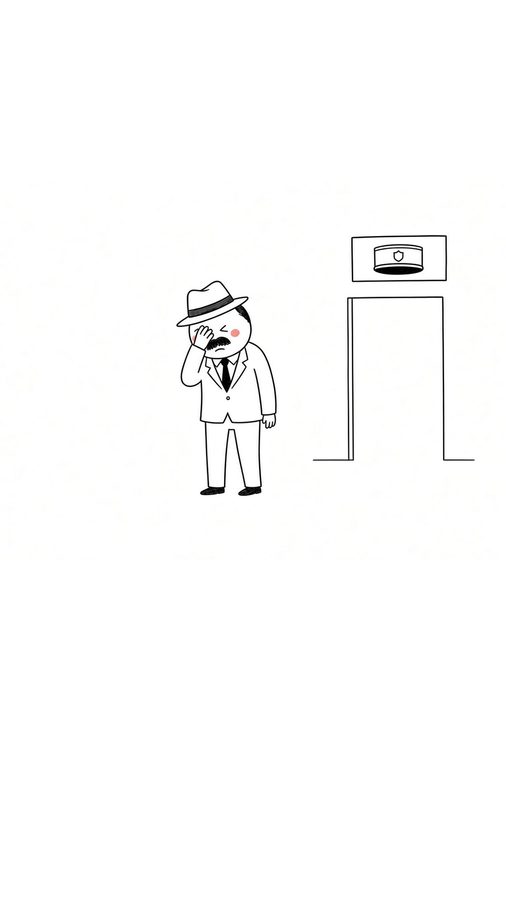 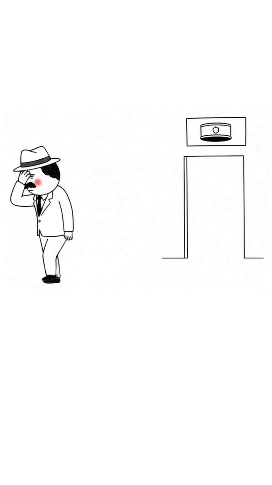</p>
- **Animation / clip prompt:** **not found.** No GenerateVideo / animation / transition prompt was saved for this scene, and none was found in the transcripts or project files searched for this update.

### Scene 11 — The Eiffel Tower stayed right where it was. Poisson's money…

- **Image / sketch prompt:** **not found.** No GenerateImage / still-sketch prompt was saved for this scene, and none was found in the transcripts or project files searched for this update.


Start still is the real production scene image, letterboxed to 9:16 (source: `/workspace/lustig/scenes/scene11.jpg`). End still is **extracted from clip** (last frame of `/workspace/lustig/clips/clip11.mp4`, with burned-in title, page number, and any captions removed):

<p>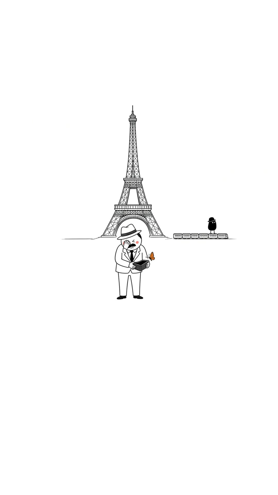 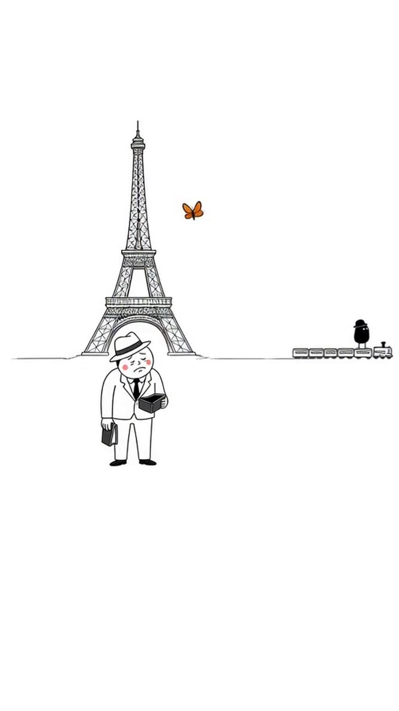</p>
- **Animation / clip prompt:** **not found.** No GenerateVideo / animation / transition prompt was saved for this scene, and none was found in the transcripts or project files searched for this update.

## Earlier unused 16:9 Vox-style experiment (not the published Short)

These files were found in `/workspace/vox-pipeline/prompts/`. They are a 16:9 Vox-style paper-cut documentary treatment of the Lustig story, not the Ian Xiaohei 9:16 Short that was scheduled. Two `GenerateImage` calls matching scenes 01–02 appear in an on-disk transcript; empty follow-up calls were also present. They are included because they are real prompts found on the box, and are **not** the prompts of the published/scheduled Xiaohei video.

### `script.txt`

Source: `/workspace/vox-pipeline/prompts/script.txt`

```
May, 1925. Paris.
A well-dressed man reads a newspaper story about the Eiffel Tower rusting and costing a fortune to maintain. His name is Victor Lustig.
He has an idea.
Days later, forged government stationery in hand, he invites five scrap metal dealers to a private suite at the Hotel de Crillon.
He calls himself a deputy director of the Ministry of Posts. The city, he explains, can no longer afford the tower. It will be sold for scrap. Quietly, to avoid public outcry.
He picks the most eager dealer, a man named Andre Poisson.
He takes the payment and a bribe on top of it.
Then he boards a train to Vienna.
Poisson, too ashamed to admit he was fooled, never goes to the police.
So, one month later, Lustig returns to Paris.
He gathers a new group of dealers.
He sells the tower again.
```

### `image_prompts.txt`

Source: `/workspace/vox-pipeline/prompts/image_prompts.txt`

```
Vox-style paper-cut documentary collage, vintage newspaper textures, layered cutout illustrations, muted cream and sepia palette with bold red accent string, cinematic flat lighting, high detail, 16:9, no photoreal people faces unless illustrated cutout style. Scene 01: Wide Paris 1925 skyline as layered paper cutouts, Eiffel Tower silhouette center, cream paper sky, vintage map texture, bold date text MAY 1925 floating as cutout letters
Vox-style paper-cut documentary collage, vintage newspaper textures, layered cutout illustrations, muted cream and sepia palette with bold red accent string, cinematic flat lighting, high detail, 16:9, no photoreal people faces unless illustrated cutout style. Scene 02: Paper-cut rainy Paris street, umbrellas as cutouts, hotel facades, soft sepia, small PARIS label in red type
Vox-style paper-cut documentary collage, vintage newspaper textures, layered cutout illustrations, muted cream and sepia palette with bold red accent string, cinematic flat lighting, high detail, 16:9, no photoreal people faces unless illustrated cutout style. Scene 03: Illustrated paper-cut man in 1920s suit reading a large newspaper, sitting in cafe, layered collage, Eiffel Tower tiny in background through window
Vox-style paper-cut documentary collage, vintage newspaper textures, layered cutout illustrations, muted cream and sepia palette with bold red accent string, cinematic flat lighting, high detail, 16:9, no photoreal people faces unless illustrated cutout style. Scene 04: Close-up of vintage newspaper headline collage about Eiffel Tower rusting and costly maintenance, red underlines, paper tears
Vox-style paper-cut documentary collage, vintage newspaper textures, layered cutout illustrations, muted cream and sepia palette with bold red accent string, cinematic flat lighting, high detail, 16:9, no photoreal people faces unless illustrated cutout style. Scene 05: Portrait cutout of sly 1920s con man Victor Lustig, nameplate VICTOR LUSTIG, vintage dossier aesthetic, red string pin
Vox-style paper-cut documentary collage, vintage newspaper textures, layered cutout illustrations, muted cream and sepia palette with bold red accent string, cinematic flat lighting, high detail, 16:9, no photoreal people faces unless illustrated cutout style. Scene 06: Lustig cutout with thought bubble of Eiffel Tower made of scrap metal coins, red string connecting idea, documentary motion graphic still
Vox-style paper-cut documentary collage, vintage newspaper textures, layered cutout illustrations, muted cream and sepia palette with bold red accent string, cinematic flat lighting, high detail, 16:9, no photoreal people faces unless illustrated cutout style. Scene 07: Close-up forged French ministry letterhead on aged paper, official stamps, fountain pen, subtle forged watermark look, paper collage
Vox-style paper-cut documentary collage, vintage newspaper textures, layered cutout illustrations, muted cream and sepia palette with bold red accent string, cinematic flat lighting, high detail, 16:9, no photoreal people faces unless illustrated cutout style. Scene 08: Elegant Hotel de Crillon exterior paper cutout, invitation envelope floating, five silhouettes of dealers approaching
Vox-style paper-cut documentary collage, vintage newspaper textures, layered cutout illustrations, muted cream and sepia palette with bold red accent string, cinematic flat lighting, high detail, 16:9, no photoreal people faces unless illustrated cutout style. Scene 09: Five scrap dealers around a polished table in luxury suite, paper-cut figures, chandelier, secret meeting mood
Vox-style paper-cut documentary collage, vintage newspaper textures, layered cutout illustrations, muted cream and sepia palette with bold red accent string, cinematic flat lighting, high detail, 16:9, no photoreal people faces unless illustrated cutout style. Scene 10: Lustig presenting forged credentials, Ministry of Posts badge cutout, dealers leaning in, documentary collage
Vox-style paper-cut documentary collage, vintage newspaper textures, layered cutout illustrations, muted cream and sepia palette with bold red accent string, cinematic flat lighting, high detail, 16:9, no photoreal people faces unless illustrated cutout style. Scene 11: Diagram collage: Eiffel Tower with money bags draining, Paris city seal, arrows showing costly upkeep
Vox-style paper-cut documentary collage, vintage newspaper textures, layered cutout illustrations, muted cream and sepia palette with bold red accent string, cinematic flat lighting, high detail, 16:9, no photoreal people faces unless illustrated cutout style. Scene 12: Eiffel Tower made of scrap metal pieces, quiet auction gavel, hush finger icon, muted tones with red accent
Vox-style paper-cut documentary collage, vintage newspaper textures, layered cutout illustrations, muted cream and sepia palette with bold red accent string, cinematic flat lighting, high detail, 16:9, no photoreal people faces unless illustrated cutout style. Scene 13: Crowds of Paris citizens as tiny cutouts with speech bubbles X'd out, secrecy theme, paper layers
Vox-style paper-cut documentary collage, vintage newspaper textures, layered cutout illustrations, muted cream and sepia palette with bold red accent string, cinematic flat lighting, high detail, 16:9, no photoreal people faces unless illustrated cutout style. Scene 14: Spotlight on eager dealer Andre Poisson cutout, nameplate ANDRE POISSON, Lustig pointing, other dealers dimmed
Vox-style paper-cut documentary collage, vintage newspaper textures, layered cutout illustrations, muted cream and sepia palette with bold red accent string, cinematic flat lighting, high detail, 16:9, no photoreal people faces unless illustrated cutout style. Scene 15: Hands exchanging thick envelope of cash on table, paper money texture, luxury suite background soft
Vox-style paper-cut documentary collage, vintage newspaper textures, layered cutout illustrations, muted cream and sepia palette with bold red accent string, cinematic flat lighting, high detail, 16:9, no photoreal people faces unless illustrated cutout style. Scene 16: Extra smaller envelope labeled POURBOIRE / BRIBE as cutout sticker, wink icon, red string tie
Vox-style paper-cut documentary collage, vintage newspaper textures, layered cutout illustrations, muted cream and sepia palette with bold red accent string, cinematic flat lighting, high detail, 16:9, no photoreal people faces unless illustrated cutout style. Scene 17: 1920s train departing Paris station, Lustig silhouette boarding, suitcase, destination plaque VIENNA
Vox-style paper-cut documentary collage, vintage newspaper textures, layered cutout illustrations, muted cream and sepia palette with bold red accent string, cinematic flat lighting, high detail, 16:9, no photoreal people faces unless illustrated cutout style. Scene 18: Poisson alone in dark room, head in hands, newspaper ignored, shame mood, desaturated collage
Vox-style paper-cut documentary collage, vintage newspaper textures, layered cutout illustrations, muted cream and sepia palette with bold red accent string, cinematic flat lighting, high detail, 16:9, no photoreal people faces unless illustrated cutout style. Scene 19: Police station door with CLOSED / NO REPORT stamp over it, Poisson walking away, documentary graphic
Vox-style paper-cut documentary collage, vintage newspaper textures, layered cutout illustrations, muted cream and sepia palette with bold red accent string, cinematic flat lighting, high detail, 16:9, no photoreal people faces unless illustrated cutout style. Scene 20: Calendar page flipping to one month later, Paris stamp, simple bold typography paper cut
Vox-style paper-cut documentary collage, vintage newspaper textures, layered cutout illustrations, muted cream and sepia palette with bold red accent string, cinematic flat lighting, high detail, 16:9, no photoreal people faces unless illustrated cutout style. Scene 21: Train arriving back in Paris, Lustig stepping off confidently, Eiffel Tower distant silhouette
Vox-style paper-cut documentary collage, vintage newspaper textures, layered cutout illustrations, muted cream and sepia palette with bold red accent string, cinematic flat lighting, high detail, 16:9, no photoreal people faces unless illustrated cutout style. Scene 22: New circle of scrap dealers around table again, same suite vibe, fresh faces cutouts
Vox-style paper-cut documentary collage, vintage newspaper textures, layered cutout illustrations, muted cream and sepia palette with bold red accent string, cinematic flat lighting, high detail, 16:9, no photoreal people faces unless illustrated cutout style. Scene 23: Second handshake over Eiffel Tower scrap contract, twin contracts stamped SOLD AGAIN, ironic documentary punchline
Vox-style paper-cut documentary collage, vintage newspaper textures, layered cutout illustrations, muted cream and sepia palette with bold red accent string, cinematic flat lighting, high detail, 16:9, no photoreal people faces unless illustrated cutout style. Scene 24: Wide paper-cut Eiffel Tower still standing tall over Paris, ironic end card, subtle red string underline
```

### `video_prompt.txt`

Source: `/workspace/vox-pipeline/prompts/video_prompt.txt`

```
Animate this Vox-style paper-cut documentary still with subtle 5-second camera drift, gentle parallax on layered cutouts, soft paper rustle motion, keep composition intact, no morphing faces, cinematic documentary feel.
```

### `beats.md`

Source: `/workspace/vox-pipeline/prompts/beats.md`

```
- 01 May 1925 title card over Paris skyline paper cutouts
- 02 Paris label and rainy streets collage
- 03 Well-dressed man reading newspaper
- 04 Newspaper story about Eiffel Tower rusting
- 05 Victor Lustig name reveal
- 06 Idea lightbulb moment
- 07 Forged government stationery
- 08 Hotel de Crillon private suite invite
- 09 Five scrap metal dealers in suite
- 10 Lustig as deputy director of Ministry of Posts
- 11 City cannot afford the tower explanation
- 12 Sold for scrap quietly
- 13 Avoid public outcry
- 14 Picks eager dealer Andre Poisson
- 15 Payment handed over
- 16 Bribe on top
- 17 Boards train to Vienna
- 18 Poisson too ashamed
- 19 Never goes to the police
- 20 One month later title
- 21 Lustig returns to Paris
- 22 New group of dealers gathered
- 23 Sells the tower again
- 24 Final wide shot Eiffel Tower still standing
```

On-disk transcript `GenerateImage` descriptions actually submitted (16:9), copied from the tool call input — scene 01 and 02 only:

```
Vox-style paper-cut documentary collage, vintage newspaper textures, layered cutout illustrations, muted cream and sepia palette with bold red accent string, cinematic flat lighting, high detail. Wide Paris 1925 skyline as layered paper cutouts, Eiffel Tower silhouette center, cream paper sky, vintage map texture, bold date text MAY 1925 floating as cutout letters. No photoreal faces.

Vox-style paper-cut documentary collage, vintage newspaper textures, layered cutout illustrations, muted cream and sepia palette with bold red accent string. Paper-cut rainy Paris street, umbrellas as cutouts, hotel facades, soft sepia, small PARIS label in red type. No photoreal faces.
```

Additional `GenerateImage` descriptions actually submitted, recovered from New Bot conversation-blobs (on-disk transcript store), scenes 03 and 04 — still part of the unused 16:9 Vox-style experiment, not the Xiaohei Short:

Source: session transcript / `conversation-blobs.db` of agent 9eeee5d1 (New Bot), blob `f57f4a3c9d1e…`, tool `GenerateImage`.

### scene-03-man-newspaper.png (16:9)

```
Vox-style paper-cut documentary collage, vintage newspaper textures, layered cutout illustrations, muted cream and sepia with bold red accent. Illustrated paper-cut man in 1920s suit reading a large newspaper in a cafe, layered collage, tiny Eiffel Tower through window. Illustrated cutout style only, no photoreal face.
```
### scene-04-newspaper.png (16:9)

```
Vox-style paper-cut documentary collage. Close-up of vintage newspaper headline collage about the Eiffel Tower rusting and costly maintenance, red underlines, paper tears, sepia and cream tones.
```
