# Marie Curie and Radium — Midjourney-adapted prompts

This file is a Midjourney Web adaptation of [`marie-curie.md`](marie-curie.md). Original image and animation prompts were **not found**. The Midjourney video prompts below are **NEW - written for MJ**, based strictly on what the real start stills and extracted end frames show. They are not original GenerateImage or GenerateVideo text.

Conventions followed (from `MID/` in this repo and `.github/instructions/mid.instructions.md`):

- **Locked-off camera.** Do not use `push-in`, `zoom`, `dolly`, or `move closer`. No pan.
- **One-way motion only.** Do not use `--loop`, and do not write looping motion (`keeps turning`, `continues to tick`, reverse, ping-pong).
- Valid Midjourney video parameters used here: `--motion low` (MID default), `--raw`. `--loop` is valid in Midjourney but **must not be used** for this channel. `--end` is the End Frame control (upload the end still; see each scene).
- A first clip is **5 s**. Each manual Extend adds **~4 s**. Maximum length is **21 s**. This file uses **at most one** extension per scene, and only when the scene's narration is longer than 5 s.
- When a start still is set, Midjourney matches its aspect (these stills are 9:16; the UI often shows `--ar 171:256`). Per MID QA, **do not type `--ar`** when a Start Frame is uploaded.
- Describe **only what moves**. The start still is already frame zero.
- Style anchors: Ian Xiaohei ink, white background, thin wobbly black lines, no text. Do not add photoreal / push-in language from the MID cat example.

**Original image / sketch prompts:** **not found** for every scene (same as [`marie-curie.md`](marie-curie.md)).
**Original animation / clip prompts:** **not found** for every scene.

## Frames

The nine start stills were copied from `/workspace/curie/scenes/scene1.jpg`–`scene9.jpg` and letterboxed to 9:16 in [`marie-curie-images/`](marie-curie-images/).

All end frames were **extracted from the last frame** of the real production clip. Those clips have a burned-in title, a page number, and sometimes captions, so those overlays were removed (filled with white) to leave a clean illustration. The end stills are labeled **extracted from clip** below. Start stills are the real production scene images, letterboxed onto a 9:16 white canvas with no title or captions.

## How to paste (Midjourney Web)

1. Imagine → add the **Start Frame** still → Switch to video.
2. Set **End Frame** (`--end`) to that scene's end still. Leave **Loop off**. Motion **Low**.
3. Paste the prompt, including `--motion low --raw`. Do not add `--loop`. Do not add `--ar`.
4. For a 9 s scene: run the **opening** prompt first (5 s). After a clean take, **Extend manually** once (~+4 s → ~9 s), replace the prefilled text with the **extend** prompt, Loop off, Motion Low, and keep `--end` aimed at the same end still if the plan says so. Split prompts follow the MID rule: the first 5 s is not packed, and the extend continues the same one-way action.

## Narration length vs 5 s or 9 s

Measured from `/workspace/curie/audio_timing.json`. “Speech” is last word minus first word in that scene. A scene gets one Extend only when speech is longer than 5 s. Prompts stay gentle: they describe only visible living motion and do not emphasize death, injury, or harm (especially scenes 7–9).

| Scene | Speech | Part slot | 5 s clip? | Plan |
|---|---:|---:|---|---|
| 1 | 5.75 s | 6.15 s | No — speech is longer than 5 s | One Extend (**9 s**) |
| 2 | 4.11 s | 4.51 s | Yes | **5 s** only |
| 3 | 5.07 s | 5.46 s | No — speech is longer than 5 s | One Extend (**9 s**) |
| 4 | 5.72 s | 6.12 s | No — speech is longer than 5 s | One Extend (**9 s**) |
| 5 | 5.64 s | 6.04 s | No — speech is longer than 5 s | One Extend (**9 s**) |
| 6 | 4.79 s | 5.19 s | Yes | **5 s** only |
| 7 | 5.22 s | 5.62 s | No — speech is longer than 5 s | One Extend (**9 s**) |
| 8 | 5.17 s | 5.57 s | No — speech is longer than 5 s | One Extend (**9 s**) |
| 9 | 4.73 s | 5.08 s | Yes | **5 s** only |

### Frame files

| Scene | Start Frame (in repo) | End Frame (`--end`, in repo) | Original box source |
|---|---|---|---|
| 1 | [`marie-curie-images/scene1_start.jpg`](marie-curie-images/scene1_start.jpg) | [`marie-curie-images/scene1_end.jpg`](marie-curie-images/scene1_end.jpg) | `/workspace/curie/scenes/scene1.jpg` → start; last frame of `clip01.mp4` → end (overlays removed) |
| 2 | [`marie-curie-images/scene2_start.jpg`](marie-curie-images/scene2_start.jpg) | [`marie-curie-images/scene2_end.jpg`](marie-curie-images/scene2_end.jpg) | `/workspace/curie/scenes/scene2.jpg` → start; last frame of `clip02.mp4` → end (overlays removed) |
| 3 | [`marie-curie-images/scene3_start.jpg`](marie-curie-images/scene3_start.jpg) | [`marie-curie-images/scene3_end.jpg`](marie-curie-images/scene3_end.jpg) | `/workspace/curie/scenes/scene3.jpg` → start; last frame of `clip03.mp4` → end (overlays removed) |
| 4 | [`marie-curie-images/scene4_start.jpg`](marie-curie-images/scene4_start.jpg) | [`marie-curie-images/scene4_end.jpg`](marie-curie-images/scene4_end.jpg) | `/workspace/curie/scenes/scene4.jpg` → start; last frame of `clip04.mp4` → end (overlays removed) |
| 5 | [`marie-curie-images/scene5_start.jpg`](marie-curie-images/scene5_start.jpg) | [`marie-curie-images/scene5_end.jpg`](marie-curie-images/scene5_end.jpg) | `/workspace/curie/scenes/scene5.jpg` → start; last frame of `clip05.mp4` → end (overlays removed) |
| 6 | [`marie-curie-images/scene6_start.jpg`](marie-curie-images/scene6_start.jpg) | [`marie-curie-images/scene6_end.jpg`](marie-curie-images/scene6_end.jpg) | `/workspace/curie/scenes/scene6.jpg` → start; last frame of `clip06.mp4` → end (overlays removed) |
| 7 | [`marie-curie-images/scene7_start.jpg`](marie-curie-images/scene7_start.jpg) | [`marie-curie-images/scene7_end.jpg`](marie-curie-images/scene7_end.jpg) | `/workspace/curie/scenes/scene7.jpg` → start; last frame of `clip07.mp4` → end (overlays removed) |
| 8 | [`marie-curie-images/scene8_start.jpg`](marie-curie-images/scene8_start.jpg) | [`marie-curie-images/scene8_end.jpg`](marie-curie-images/scene8_end.jpg) | `/workspace/curie/scenes/scene8.jpg` → start; last frame of `clip08.mp4` → end (overlays removed) |
| 9 | [`marie-curie-images/scene9_start.jpg`](marie-curie-images/scene9_start.jpg) | [`marie-curie-images/scene9_end.jpg`](marie-curie-images/scene9_end.jpg) | `/workspace/curie/scenes/scene9.jpg` → start; last frame of `clip09.mp4` → end (overlays removed) |

## Scene 1

- **Narration:** In 1891, a young Polish woman named Maria arrived in Paris with almost no money.
- **Length plan:** 9 s (5 s + one Extend). Speech 5.75 s.
- **Start Frame:** [`marie-curie-images/scene1_start.jpg`](marie-curie-images/scene1_start.jpg) (in this repo; source on the box: `/workspace/curie/scenes/scene1.jpg`, letterboxed to 9:16 (no title))
- **End Frame (`--end`):** [`marie-curie-images/scene1_end.jpg`](marie-curie-images/scene1_end.jpg) (in this repo; **extracted from clip** — last frame of `/workspace/curie/clips/clip01.mp4`, with burned-in title, page number, and any captions removed)

<p>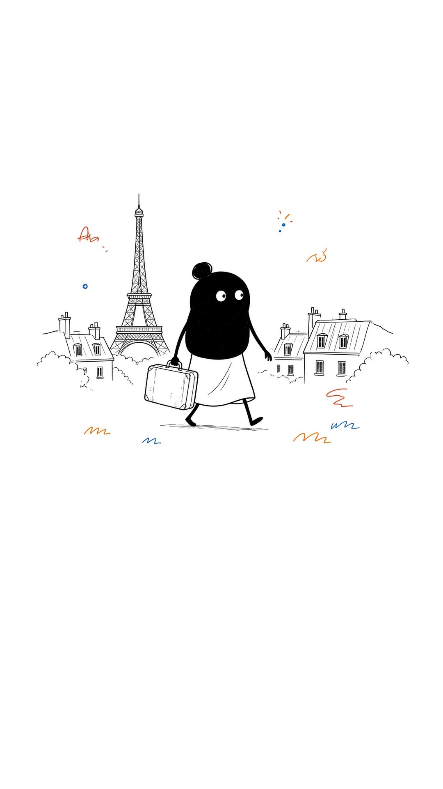 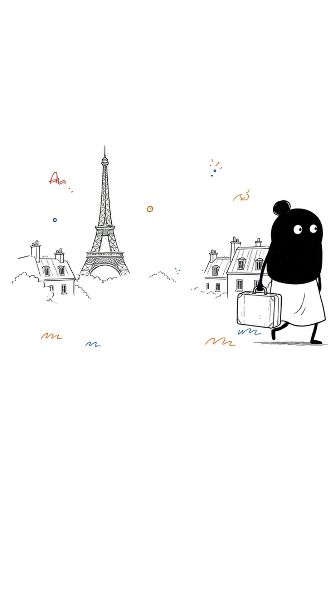</p>
- **Original image prompt:** **not found.**
- **Original animation prompt:** **not found.**

**Opening prompt (5 s) — paste — NEW - written for MJ:**

```
she walks slowly to the right with the suitcase, the Eiffel Tower and the houses stay fixed, one-way motion only, no freeze, locked-off camera, Ian Xiaohei ink style, pure white background, thin wobbly black lines, no text, no letters, no captions --motion low --raw
```

**Extend prompt (~4 s) — paste — NEW - written for MJ:**

```
she continues a few steps right and settles, the tower and houses stay fixed, no new objects, one-way motion only, no freeze, locked-off camera, Ian Xiaohei ink style, pure white background, thin wobbly black lines, no text, no letters, no captions --motion low --raw
```

## Scene 2

- **Narration:** In a freezing little room, she dreamed of understanding how nature works.
- **Length plan:** **5 s** only (speech 4.11 s; slot 4.51 s).
- **Start Frame:** [`marie-curie-images/scene2_start.jpg`](marie-curie-images/scene2_start.jpg) (in this repo; source on the box: `/workspace/curie/scenes/scene2.jpg`, letterboxed to 9:16 (no title))
- **End Frame (`--end`):** [`marie-curie-images/scene2_end.jpg`](marie-curie-images/scene2_end.jpg) (in this repo; **extracted from clip** — last frame of `/workspace/curie/clips/clip02.mp4`, with burned-in title, page number, and any captions removed)

<p>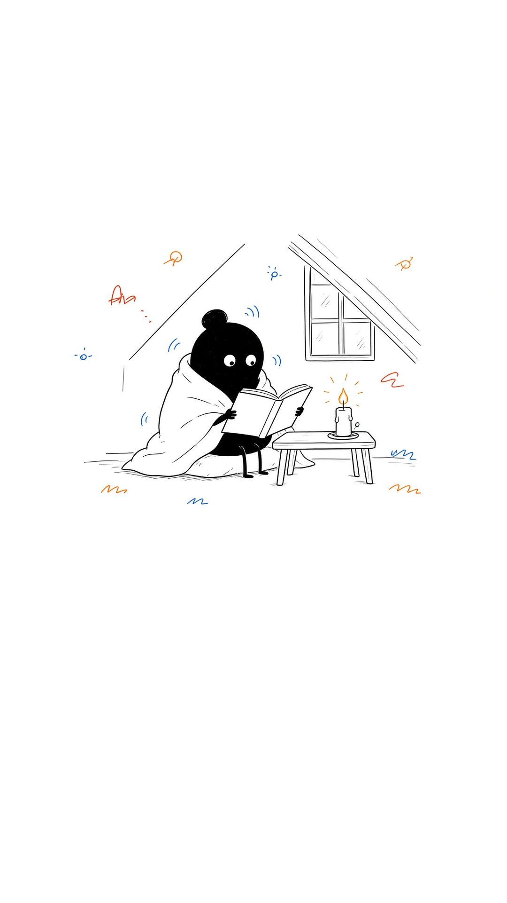 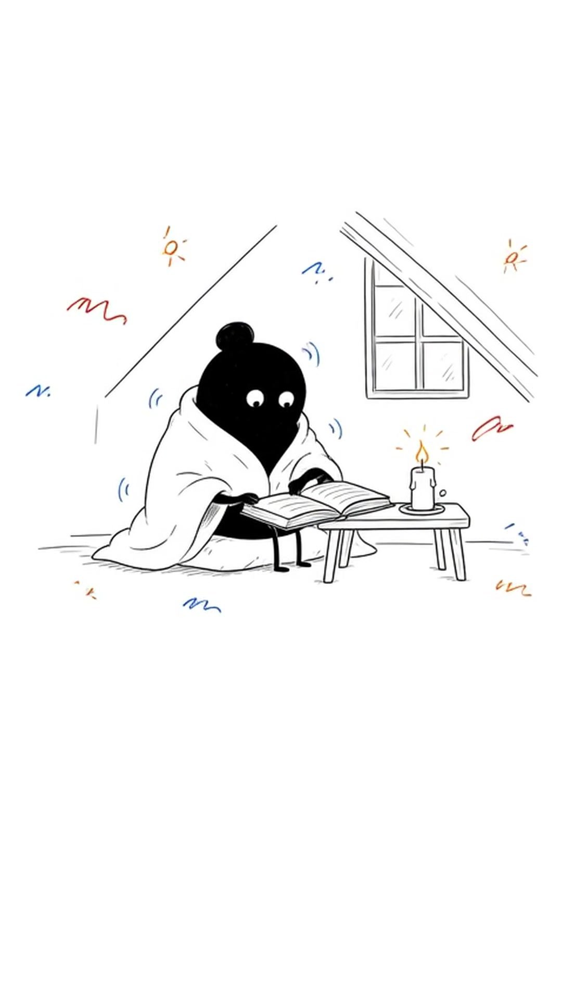</p>
- **Original image prompt:** **not found.**
- **Original animation prompt:** **not found.**

**Prompt (5 s) — paste — NEW - written for MJ:**

```
she sits under the blanket with a small shift, the candle flame flickers slightly, the window, bed, and room stay fixed, one-way motion only, no freeze, locked-off camera, Ian Xiaohei ink style, pure white background, thin wobbly black lines, no text, no letters, no captions --motion low --raw
```

## Scene 3

- **Narration:** She heard of mysterious rays coming from uranium, and gave them a name: radioactivity.
- **Length plan:** 9 s (5 s + one Extend). Speech 5.07 s.
- **Start Frame:** [`marie-curie-images/scene3_start.jpg`](marie-curie-images/scene3_start.jpg) (in this repo; source on the box: `/workspace/curie/scenes/scene3.jpg`, letterboxed to 9:16 (no title))
- **End Frame (`--end`):** [`marie-curie-images/scene3_end.jpg`](marie-curie-images/scene3_end.jpg) (in this repo; **extracted from clip** — last frame of `/workspace/curie/clips/clip03.mp4`, with burned-in title, page number, and any captions removed)

<p>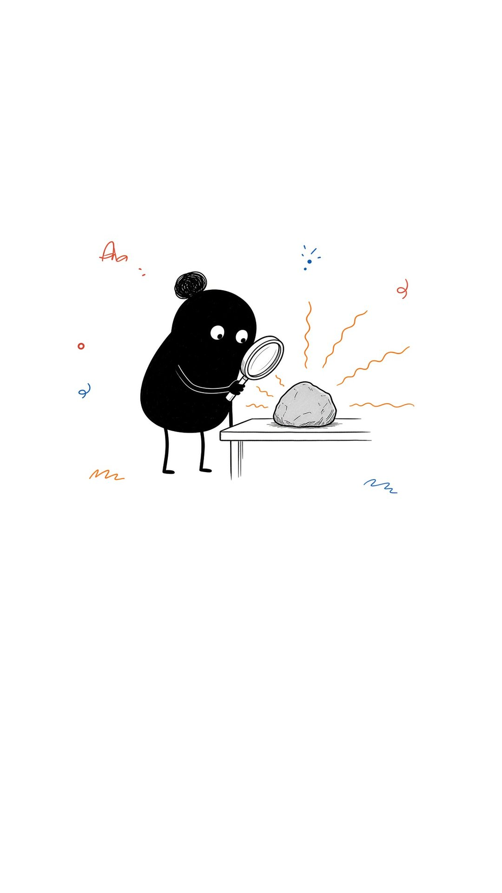 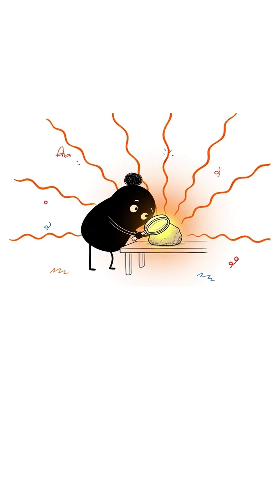</p>
- **Original image prompt:** **not found.**
- **Original animation prompt:** **not found.**

**Opening prompt (5 s) — paste — NEW - written for MJ:**

```
faint rays slowly brighten around the sample on the table, she stays at the table, the table stays fixed, one-way motion only, no freeze, locked-off camera, Ian Xiaohei ink style, pure white background, thin wobbly black lines, no text, no letters, no captions --motion low --raw
```

**Extend prompt (~4 s) — paste — NEW - written for MJ:**

```
the rays settle to a steady glow, she stays in place, no new objects, one-way motion only, no freeze, locked-off camera, Ian Xiaohei ink style, pure white background, thin wobbly black lines, no text, no letters, no captions --motion low --raw
```

## Scene 4

- **Narration:** With her husband Pierre, she worked in a leaky shed, stirring tons of boiling ore for years.
- **Length plan:** 9 s (5 s + one Extend). Speech 5.72 s.
- **Start Frame:** [`marie-curie-images/scene4_start.jpg`](marie-curie-images/scene4_start.jpg) (in this repo; source on the box: `/workspace/curie/scenes/scene4.jpg`, letterboxed to 9:16 (no title))
- **End Frame (`--end`):** [`marie-curie-images/scene4_end.jpg`](marie-curie-images/scene4_end.jpg) (in this repo; **extracted from clip** — last frame of `/workspace/curie/clips/clip04.mp4`, with burned-in title, page number, and any captions removed)

<p>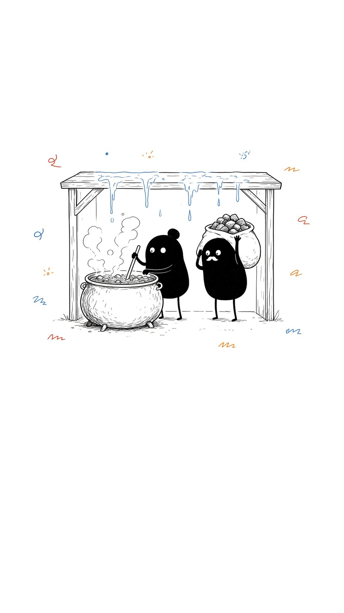 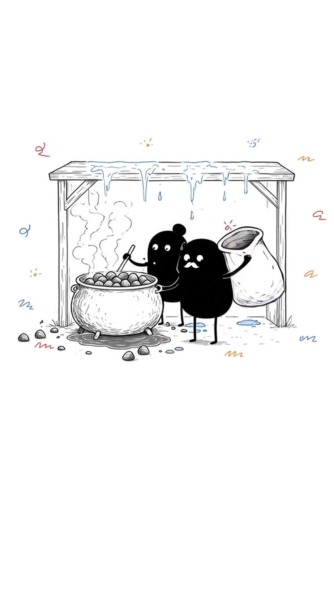</p>
- **Original image prompt:** **not found.**
- **Original animation prompt:** **not found.**

**Opening prompt (5 s) — paste — NEW - written for MJ:**

```
the two figures slowly stir the pot, soft steam rises, the shed frame stays fixed, one-way motion only, no freeze, locked-off camera, Ian Xiaohei ink style, pure white background, thin wobbly black lines, no text, no letters, no captions --motion low --raw
```

**Extend prompt (~4 s) — paste — NEW - written for MJ:**

```
they finish a stir and settle, steam thins, the shed stays fixed, no new objects, one-way motion only, no freeze, locked-off camera, Ian Xiaohei ink style, pure white background, thin wobbly black lines, no text, no letters, no captions --motion low --raw
```

## Scene 5

- **Narration:** One night in 1898, they saw a tiny substance glowing in the dark: radium.
- **Length plan:** 9 s (5 s + one Extend). Speech 5.64 s.
- **Start Frame:** [`marie-curie-images/scene5_start.jpg`](marie-curie-images/scene5_start.jpg) (in this repo; source on the box: `/workspace/curie/scenes/scene5.jpg`, letterboxed to 9:16 (no title))
- **End Frame (`--end`):** [`marie-curie-images/scene5_end.jpg`](marie-curie-images/scene5_end.jpg) (in this repo; **extracted from clip** — last frame of `/workspace/curie/clips/clip05.mp4`, with burned-in title, page number, and any captions removed)

<p>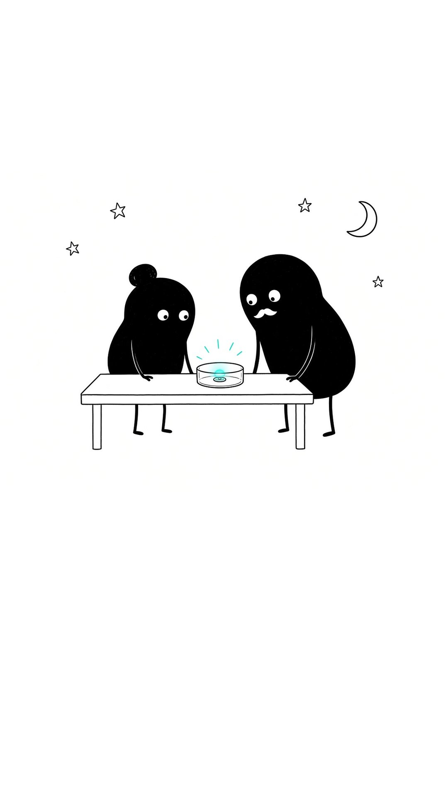 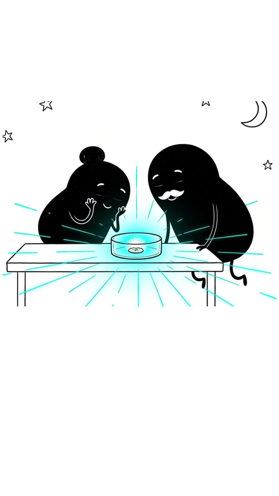</p>
- **Original image prompt:** **not found.**
- **Original animation prompt:** **not found.**

**Opening prompt (5 s) — paste — NEW - written for MJ:**

```
the glow on the table slowly brightens, the two figures lean in slightly, the table stays fixed, one-way motion only, no freeze, locked-off camera, Ian Xiaohei ink style, pure white background, thin wobbly black lines, no text, no letters, no captions --motion low --raw
```

**Extend prompt (~4 s) — paste — NEW - written for MJ:**

```
the glow settles to a soft steady light, they stay at the table, no new objects, one-way motion only, no freeze, locked-off camera, Ian Xiaohei ink style, pure white background, thin wobbly black lines, no text, no letters, no captions --motion low --raw
```

## Scene 6

- **Narration:** In 1903, Marie became the first woman ever to win a Nobel Prize.
- **Length plan:** **5 s** only. Speech 4.79 s fits 5 s; the part slot is 5.19 s.
- **Start Frame:** [`marie-curie-images/scene6_start.jpg`](marie-curie-images/scene6_start.jpg) (in this repo; source on the box: `/workspace/curie/scenes/scene6.jpg`, letterboxed to 9:16 (no title))
- **End Frame (`--end`):** [`marie-curie-images/scene6_end.jpg`](marie-curie-images/scene6_end.jpg) (in this repo; **extracted from clip** — last frame of `/workspace/curie/clips/clip06.mp4`, with burned-in title, page number, and any captions removed)

<p>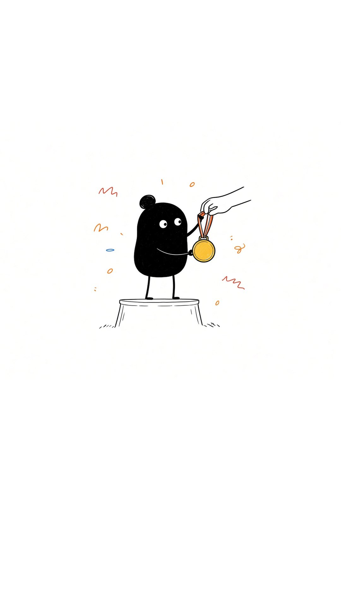 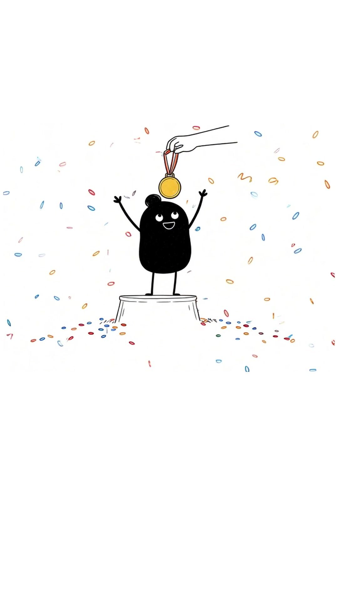</p>
- **Original image prompt:** **not found.**
- **Original animation prompt:** **not found.**

**Prompt (5 s) — paste — NEW - written for MJ:**

```
she stands still with the medal, tiny sparkles drift one way and fade, the ground stays fixed, one-way motion only, no freeze, locked-off camera, Ian Xiaohei ink style, pure white background, thin wobbly black lines, no text, no letters, no captions --motion low --raw
```

## Scene 7

- **Narration:** Then Pierre was killed in an accident, but she kept going alone and won a second Nobel.
- **Length plan:** 9 s (5 s + one Extend). Speech 5.22 s.
- **Start Frame:** [`marie-curie-images/scene7_start.jpg`](marie-curie-images/scene7_start.jpg) (in this repo; source on the box: `/workspace/curie/scenes/scene7.jpg`, letterboxed to 9:16 (no title))
- **End Frame (`--end`):** [`marie-curie-images/scene7_end.jpg`](marie-curie-images/scene7_end.jpg) (in this repo; **extracted from clip** — last frame of `/workspace/curie/clips/clip07.mp4`, with burned-in title, page number, and any captions removed)

<p>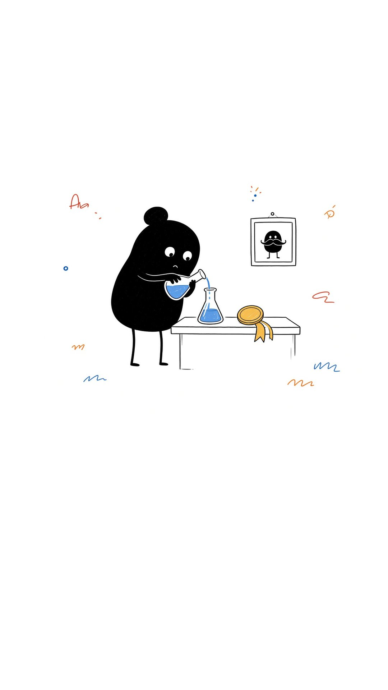 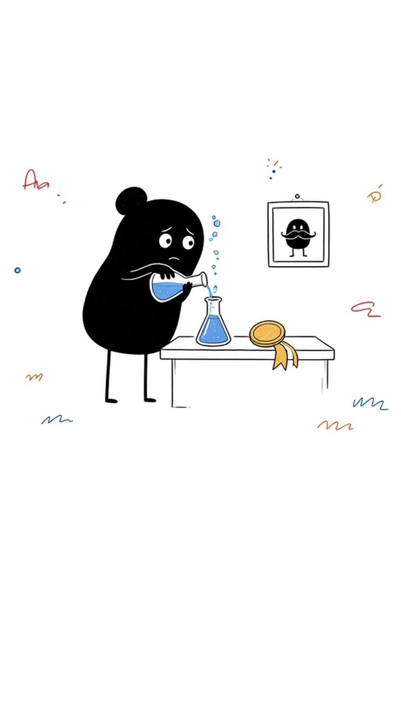</p>
- **Original image prompt:** **not found.**
- **Original animation prompt:** **not found.**

**Opening prompt (5 s) — paste — NEW - written for MJ:**

```
she works slowly at the table with the flask, the portrait on the wall stays fixed, the table stays still, one-way motion only, no freeze, locked-off camera, Ian Xiaohei ink style, pure white background, thin wobbly black lines, no text, no letters, no captions --motion low --raw
```

**Extend prompt (~4 s) — paste — NEW - written for MJ:**

```
she settles at the table, the flask and portrait stay in place, no new objects, one-way motion only, no freeze, locked-off camera, Ian Xiaohei ink style, pure white background, thin wobbly black lines, no text, no letters, no captions --motion low --raw
```

## Scene 8

- **Narration:** In World War One, she drove X-ray units to the front, saving wounded soldiers.
- **Length plan:** 9 s (5 s + one Extend). Speech 5.17 s.
- **Start Frame:** [`marie-curie-images/scene8_start.jpg`](marie-curie-images/scene8_start.jpg) (in this repo; source on the box: `/workspace/curie/scenes/scene8.jpg`, letterboxed to 9:16 (no title))
- **End Frame (`--end`):** [`marie-curie-images/scene8_end.jpg`](marie-curie-images/scene8_end.jpg) (in this repo; **extracted from clip** — last frame of `/workspace/curie/clips/clip08.mp4`, with burned-in title, page number, and any captions removed)

<p>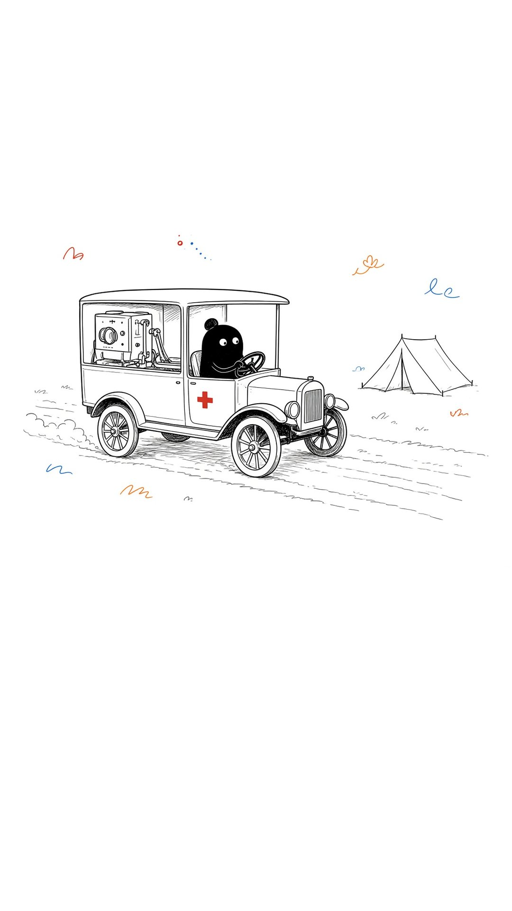 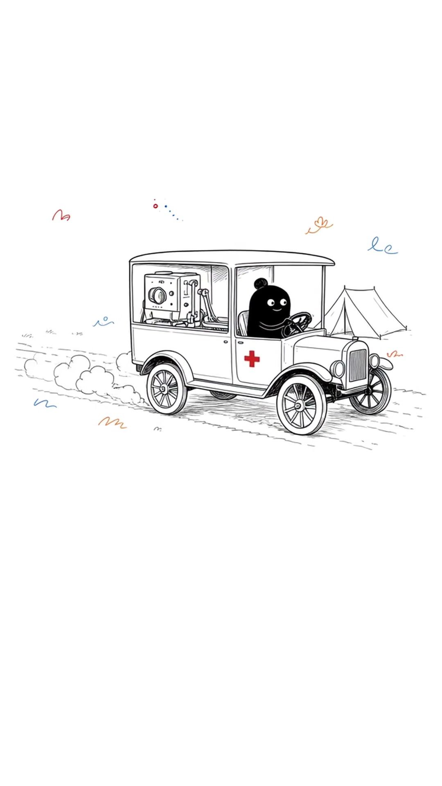</p>
- **Original image prompt:** **not found.**
- **Original animation prompt:** **not found.**

**Opening prompt (5 s) — paste — NEW - written for MJ:**

```
the van rolls slowly to the right, she holds the wheel, the tent stays fixed, one-way motion only, no freeze, locked-off camera, Ian Xiaohei ink style, pure white background, thin wobbly black lines, no text, no letters, no captions --motion low --raw
```

**Extend prompt (~4 s) — paste — NEW - written for MJ:**

```
the van settles, the tent stays fixed, no new objects, one-way motion only, no freeze, locked-off camera, Ian Xiaohei ink style, pure white background, thin wobbly black lines, no text, no letters, no captions --motion low --raw
```

## Scene 9

- **Narration:** The glow she loved harmed her in the end, but her notebooks are still radioactive today.
- **Length plan:** **5 s** only. Speech 4.73 s fits 5 s; the part slot is 5.08 s.
- **Start Frame:** [`marie-curie-images/scene9_start.jpg`](marie-curie-images/scene9_start.jpg) (in this repo; source on the box: `/workspace/curie/scenes/scene9.jpg`, letterboxed to 9:16 (no title))
- **End Frame (`--end`):** [`marie-curie-images/scene9_end.jpg`](marie-curie-images/scene9_end.jpg) (in this repo; **extracted from clip** — last frame of `/workspace/curie/clips/clip09.mp4`, with burned-in title, page number, and any captions removed)

<p>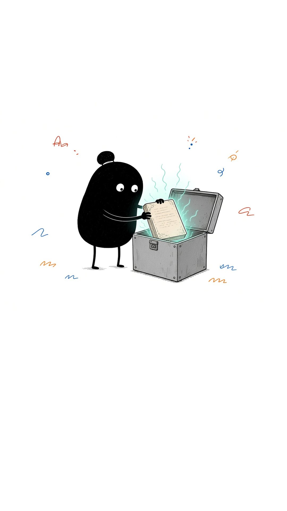 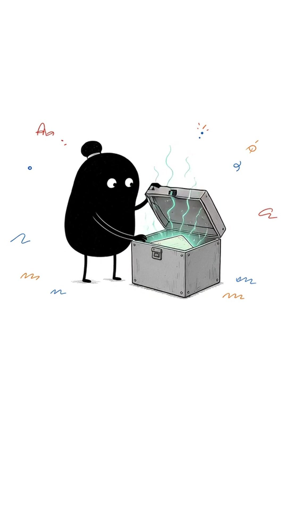</p>
- **Original image prompt:** **not found.**
- **Original animation prompt:** **not found.**

**Prompt (5 s) — paste — NEW - written for MJ:**

```
she opens the chest a little more, a faint glow stays in the notebooks, the chest and floor stay fixed, one-way motion only, no freeze, locked-off camera, Ian Xiaohei ink style, pure white background, thin wobbly black lines, no text, no letters, no captions --motion low --raw
```
