# Marie Curie and Radium

- **YouTube title:** Her Notebooks Are Still Radioactive Today
- **Status:** Published via Buffer (status: sent, snapshot 2026-11-09)
- **Publish / schedule time:** 2026-10-23 19:00 Israel time (Asia/Jerusalem)
- **Final version / length:** v2, 49.9 s
- **Narration method (from `examples/README.md`):** edge-tts ChristopherNeural −5%, single pass with semicolons (`script_tts_semicolons.txt`). Displayed subtitles keep normal punctuation.
- **Completeness:** partial — narration found; image and clip prompts not found
- **Primary sources:** `examples/marie-curie/` (scripts and `buffer_metadata.md`). Publish times are from that Buffer snapshot, not re-queried here.

Nothing in this file was invented. Missing prompt classes are marked **not found**.

## Script / narration
TTS input used periods replaced by semicolons. Displayed subtitles keep normal punctuation.

### `script_tts_semicolons.txt`

Source: `history-storyteller/examples/marie-curie/script_tts_semicolons.txt`

```
In 1891, a young Polish woman named Maria arrived in Paris with almost no money; In a freezing little room, she dreamed of understanding how nature works; She heard of mysterious rays coming from uranium, and gave them a name: radioactivity; With her husband Pierre, she worked in a leaky shed, stirring tons of boiling ore for years; One night in 1898, they saw a tiny substance glowing in the dark: radium; In 1903, Marie became the first woman ever to win a Nobel Prize; Then Pierre was killed in an accident, but she kept going alone and won a second Nobel; In World War One, she drove X-ray units to the front, saving wounded soldiers; The glow she loved harmed her in the end, but her notebooks are still radioactive today.
```


Sentence units (`sentences.txt`):

### `sentences.txt`

Source: `history-storyteller/examples/marie-curie/sentences.txt`

```
In 1891, a young Polish woman named Maria arrived in Paris with almost no money.
In a freezing little room, she dreamed of understanding how nature works.
She heard of mysterious rays coming from uranium, and gave them a name: radioactivity.
With her husband Pierre, she worked in a leaky shed, stirring tons of boiling ore for years.
One night in 1898, they saw a tiny substance glowing in the dark: radium.
In 1903, Marie became the first woman ever to win a Nobel Prize.
Then Pierre was killed in an accident, but she kept going alone and won a second Nobel.
In World War One, she drove X-ray units to the front, saving wounded soldiers.
The glow she loved harmed her in the end, but her notebooks are still radioactive today.
```


### Hebrew approval script

**not found.** A Hebrew script file exists in the examples folder only for Garbo and Lustig (`examples/README.md`).

## Per-scene image and animation prompts

One row per production scene (sentence, segment, or part). Prompts are copied verbatim only when a source file or transcript call was found.

### Scene 1 — In 1891, a young Polish woman named Maria arrived in…

- **Image / sketch prompt:** **not found.** No GenerateImage / still-sketch prompt was saved for this scene, and none was found in the transcripts or project files searched for this update.


Start still is the real production scene image, letterboxed to 9:16 (source: `/workspace/curie/scenes/scene1.jpg`). End still is **extracted from clip** (last frame of `/workspace/curie/clips/clip01.mp4`, with burned-in title, page number, and any captions removed):

<p>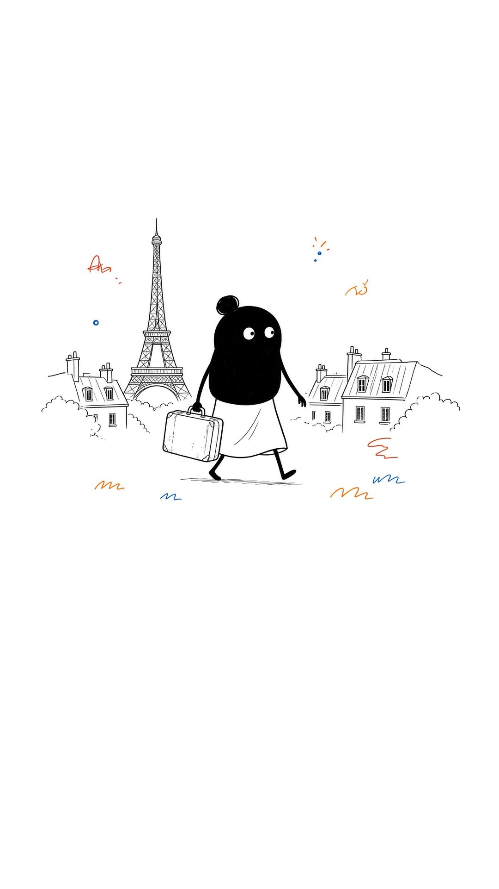 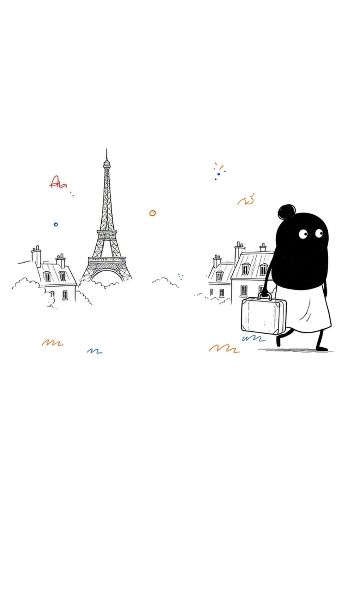</p>
- **Animation / clip prompt:** **not found.** No GenerateVideo / animation / transition prompt was saved for this scene, and none was found in the transcripts or project files searched for this update.

### Scene 2 — In a freezing little room, she dreamed of understanding how…

- **Image / sketch prompt:** **not found.** No GenerateImage / still-sketch prompt was saved for this scene, and none was found in the transcripts or project files searched for this update.


Start still is the real production scene image, letterboxed to 9:16 (source: `/workspace/curie/scenes/scene2.jpg`). End still is **extracted from clip** (last frame of `/workspace/curie/clips/clip02.mp4`, with burned-in title, page number, and any captions removed):

<p>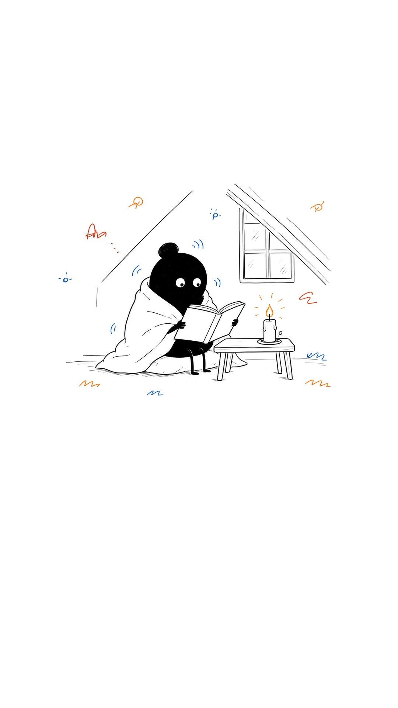 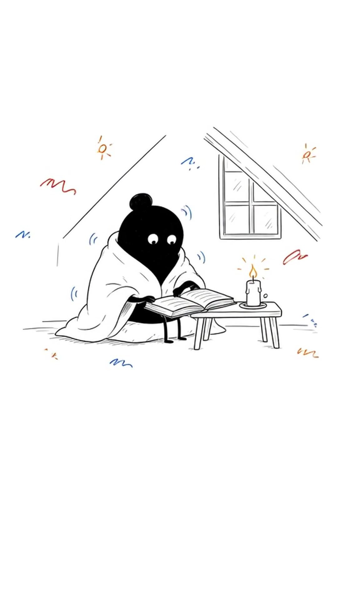</p>
- **Animation / clip prompt:** **not found.** No GenerateVideo / animation / transition prompt was saved for this scene, and none was found in the transcripts or project files searched for this update.

### Scene 3 — She heard of mysterious rays coming from uranium, and gave…

- **Image / sketch prompt:** **not found.** No GenerateImage / still-sketch prompt was saved for this scene, and none was found in the transcripts or project files searched for this update.


Start still is the real production scene image, letterboxed to 9:16 (source: `/workspace/curie/scenes/scene3.jpg`). End still is **extracted from clip** (last frame of `/workspace/curie/clips/clip03.mp4`, with burned-in title, page number, and any captions removed):

<p>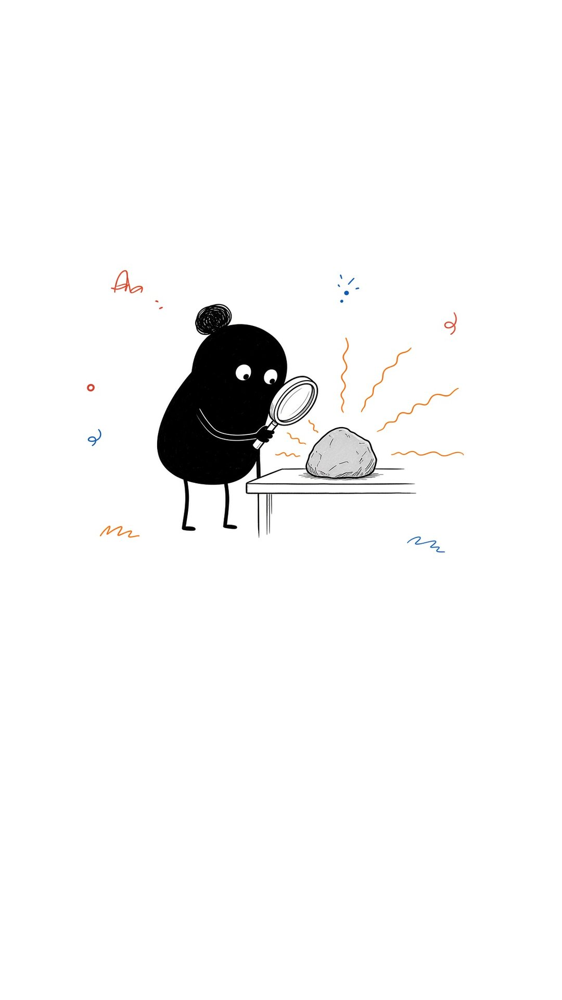 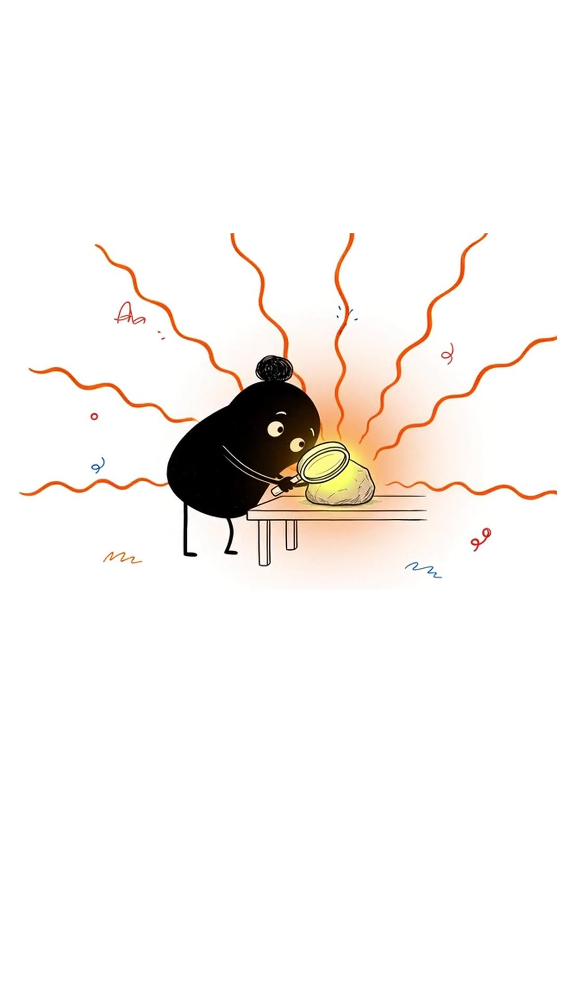</p>
- **Animation / clip prompt:** **not found.** No GenerateVideo / animation / transition prompt was saved for this scene, and none was found in the transcripts or project files searched for this update.

### Scene 4 — With her husband Pierre, she worked in a leaky shed,…

- **Image / sketch prompt:** **not found.** No GenerateImage / still-sketch prompt was saved for this scene, and none was found in the transcripts or project files searched for this update.


Start still is the real production scene image, letterboxed to 9:16 (source: `/workspace/curie/scenes/scene4.jpg`). End still is **extracted from clip** (last frame of `/workspace/curie/clips/clip04.mp4`, with burned-in title, page number, and any captions removed):

<p>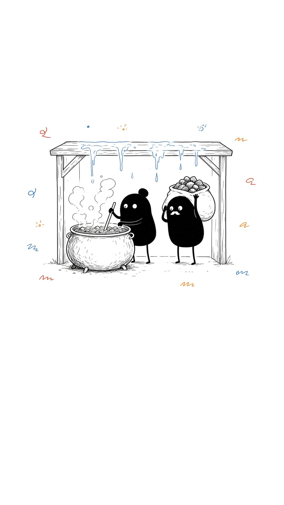 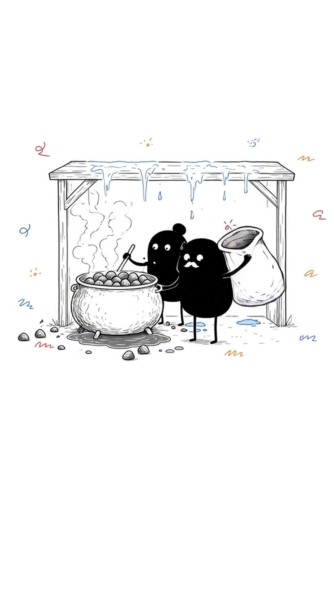</p>
- **Animation / clip prompt:** **not found.** No GenerateVideo / animation / transition prompt was saved for this scene, and none was found in the transcripts or project files searched for this update.

### Scene 5 — One night in 1898, they saw a tiny substance glowing…

- **Image / sketch prompt:** **not found.** No GenerateImage / still-sketch prompt was saved for this scene, and none was found in the transcripts or project files searched for this update.


Start still is the real production scene image, letterboxed to 9:16 (source: `/workspace/curie/scenes/scene5.jpg`). End still is **extracted from clip** (last frame of `/workspace/curie/clips/clip05.mp4`, with burned-in title, page number, and any captions removed):

<p>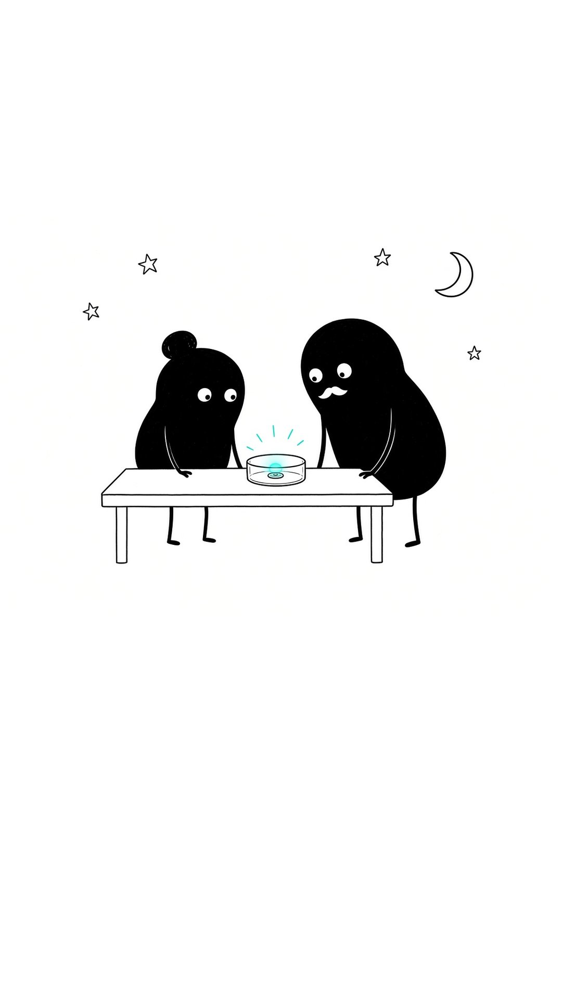 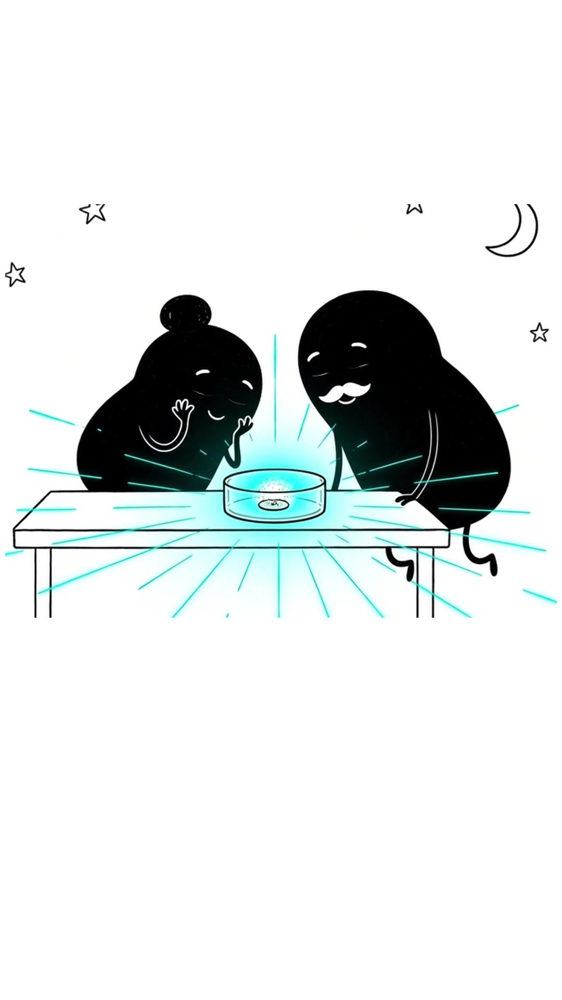</p>
- **Animation / clip prompt:** **not found.** No GenerateVideo / animation / transition prompt was saved for this scene, and none was found in the transcripts or project files searched for this update.

### Scene 6 — In 1903, Marie became the first woman ever to win…

- **Image / sketch prompt:** **not found.** No GenerateImage / still-sketch prompt was saved for this scene, and none was found in the transcripts or project files searched for this update.


Start still is the real production scene image, letterboxed to 9:16 (source: `/workspace/curie/scenes/scene6.jpg`). End still is **extracted from clip** (last frame of `/workspace/curie/clips/clip06.mp4`, with burned-in title, page number, and any captions removed):

<p>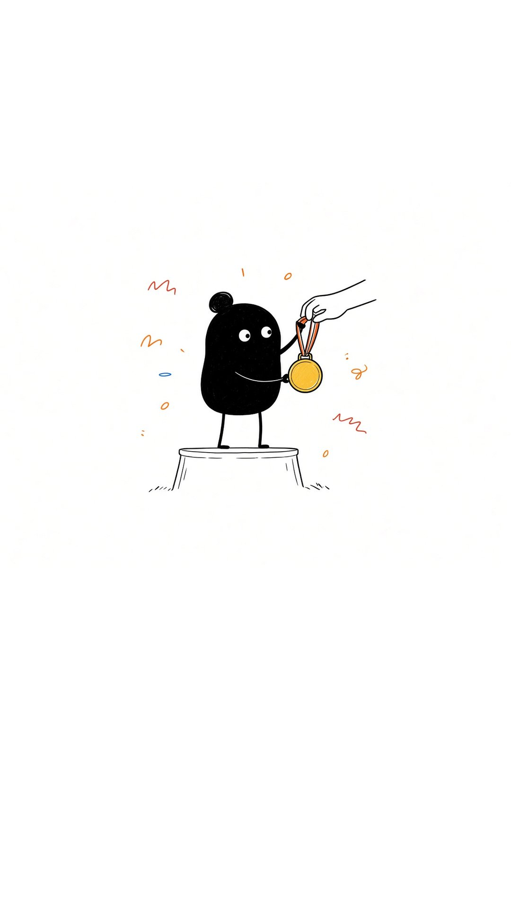 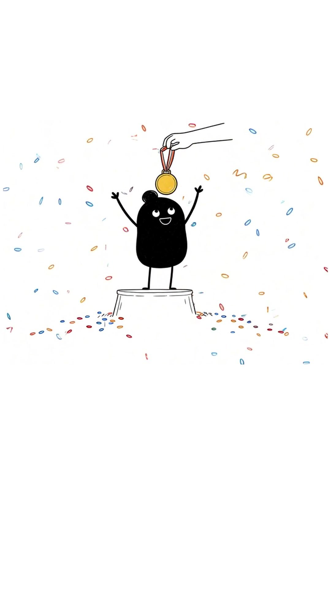</p>
- **Animation / clip prompt:** **not found.** No GenerateVideo / animation / transition prompt was saved for this scene, and none was found in the transcripts or project files searched for this update.

### Scene 7 — Then Pierre was killed in an accident, but she kept…

- **Image / sketch prompt:** **not found.** No GenerateImage / still-sketch prompt was saved for this scene, and none was found in the transcripts or project files searched for this update.


Start still is the real production scene image, letterboxed to 9:16 (source: `/workspace/curie/scenes/scene7.jpg`). End still is **extracted from clip** (last frame of `/workspace/curie/clips/clip07.mp4`, with burned-in title, page number, and any captions removed):

<p>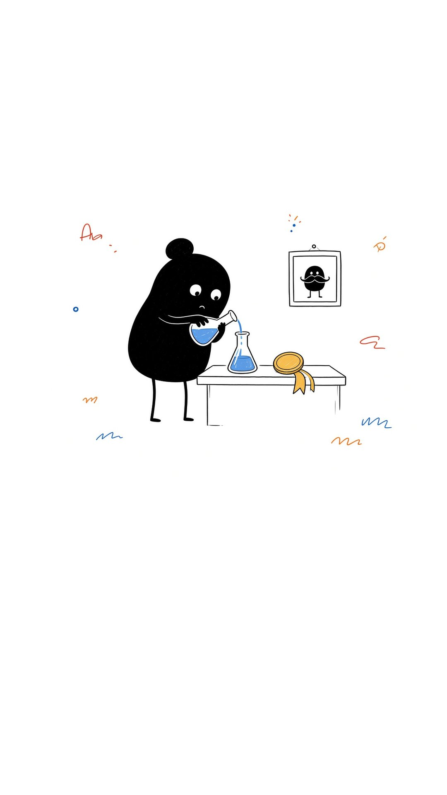 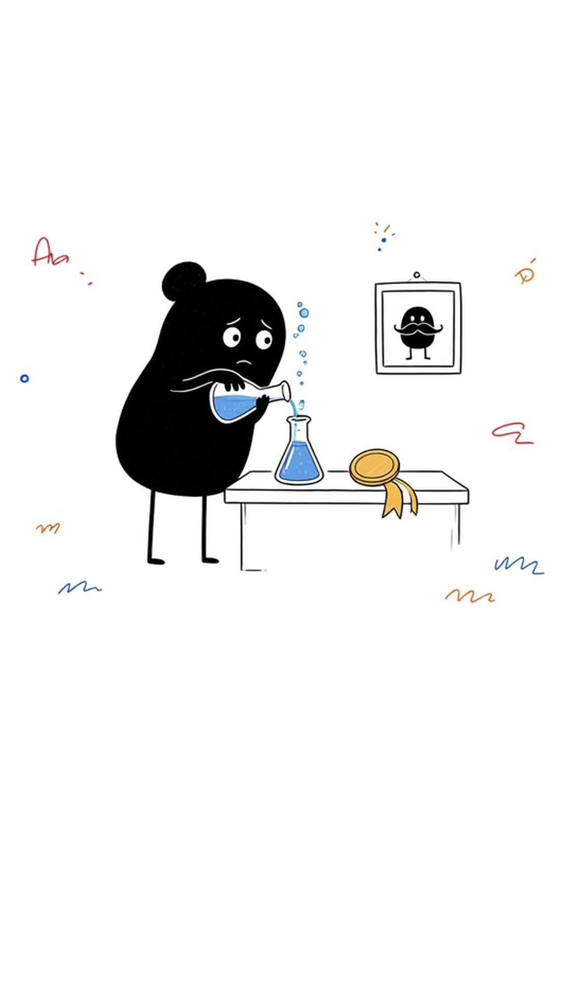</p>
- **Animation / clip prompt:** **not found.** No GenerateVideo / animation / transition prompt was saved for this scene, and none was found in the transcripts or project files searched for this update.

### Scene 8 — In World War One, she drove X-ray units to the…

- **Image / sketch prompt:** **not found.** No GenerateImage / still-sketch prompt was saved for this scene, and none was found in the transcripts or project files searched for this update.


Start still is the real production scene image, letterboxed to 9:16 (source: `/workspace/curie/scenes/scene8.jpg`). End still is **extracted from clip** (last frame of `/workspace/curie/clips/clip08.mp4`, with burned-in title, page number, and any captions removed):

<p>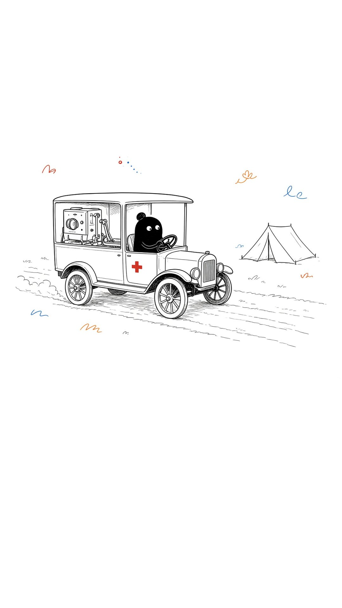 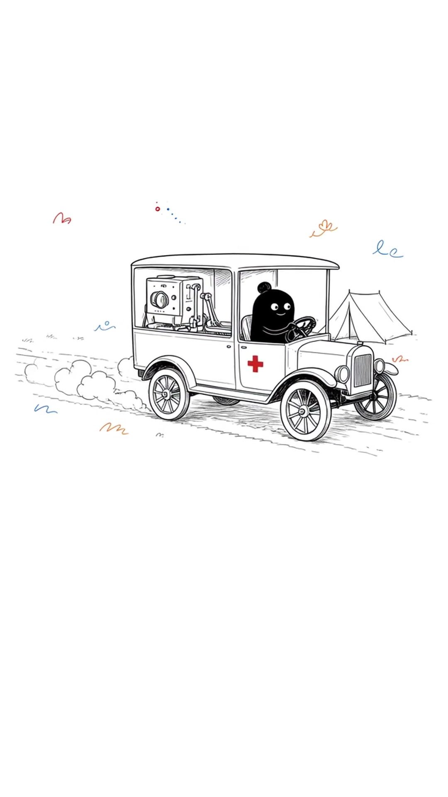</p>
- **Animation / clip prompt:** **not found.** No GenerateVideo / animation / transition prompt was saved for this scene, and none was found in the transcripts or project files searched for this update.

### Scene 9 — The glow she loved harmed her in the end, but…

- **Image / sketch prompt:** **not found.** No GenerateImage / still-sketch prompt was saved for this scene, and none was found in the transcripts or project files searched for this update.


Start still is the real production scene image, letterboxed to 9:16 (source: `/workspace/curie/scenes/scene9.jpg`). End still is **extracted from clip** (last frame of `/workspace/curie/clips/clip09.mp4`, with burned-in title, page number, and any captions removed):

<p>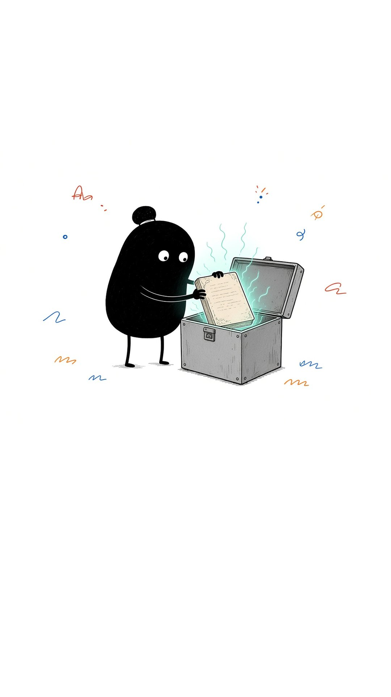 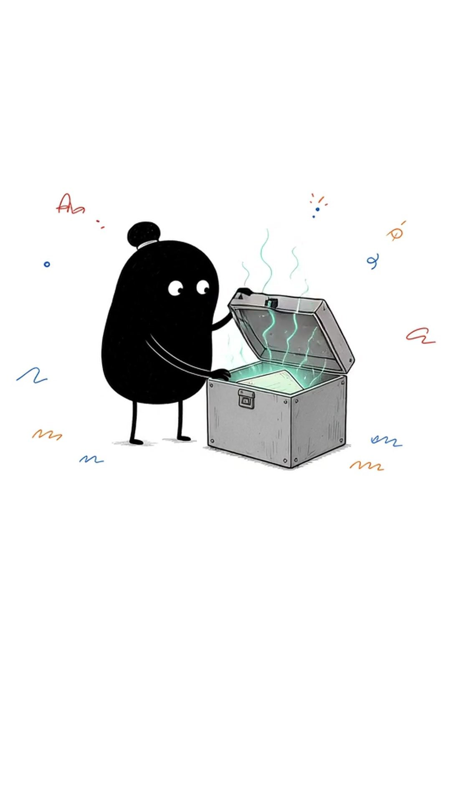</p>
- **Animation / clip prompt:** **not found.** No GenerateVideo / animation / transition prompt was saved for this scene, and none was found in the transcripts or project files searched for this update.
