# Stanley Meyer's Water Car — Midjourney-adapted prompts

This file is a Midjourney Web adaptation of [`stanley-meyer.md`](stanley-meyer.md). Original image and animation prompts were **not found**. The Midjourney video prompts below are **NEW - written for MJ**, based strictly on what the real start stills and extracted end frames show. They are not original GenerateImage or GenerateVideo text.

Conventions followed (from `MID/` in this repo and `.github/instructions/mid.instructions.md`):

- **Locked-off camera.** Do not use `push-in`, `zoom`, `dolly`, or `move closer`. No pan.
- **One-way motion only.** Do not use `--loop`, and do not write looping motion (`keeps turning`, `continues to tick`, reverse, ping-pong).
- Valid Midjourney video parameters used here: `--motion low` (MID default), `--raw`. `--loop` is valid in Midjourney but **must not be used** for this channel. `--end` is the End Frame control (upload the end still; see each scene).
- A first clip is **5 s**. Each manual Extend adds **~4 s**. Maximum length is **21 s**. This file uses **at most one** extension per scene, and only when the scene's narration is longer than 5 s.
- When a start still is set, Midjourney matches its aspect (these stills are 9:16; the UI often shows `--ar 171:256`). Per MID QA, **do not type `--ar`** when a Start Frame is uploaded.
- Describe **only what moves**. The start still is already frame zero.
- Style anchors: Ian Xiaohei ink, white background, thin wobbly black lines, no text. Do not add photoreal / push-in language from the MID cat example.

**Original image / sketch prompts:** **not found** for every scene (same as [`stanley-meyer.md`](stanley-meyer.md)).
**Original animation / clip prompts:** **not found** for every scene.

## Frames

The ten start stills were copied from `/workspace/meyer/scenes/scene1.jpg`–`scene10.jpg` (not `scene10_v2.jpg`) and letterboxed to 9:16 in [`stanley-meyer-images/`](stanley-meyer-images/).

All end frames were **extracted from the last frame** of the real production clip. Those clips have a burned-in title, a page number, and sometimes captions, so those overlays were removed (filled with white) to leave a clean illustration. The end stills are labeled **extracted from clip** below. Start stills are the real production scene images, letterboxed onto a 9:16 white canvas with no title or captions.

## How to paste (Midjourney Web)

1. Imagine → add the **Start Frame** still → Switch to video.
2. Set **End Frame** (`--end`) to that scene's end still. Leave **Loop off**. Motion **Low**.
3. Paste the prompt, including `--motion low --raw`. Do not add `--loop`. Do not add `--ar`.
4. For a 9 s scene: run the **opening** prompt first (5 s). After a clean take, **Extend manually** once (~+4 s → ~9 s), replace the prefilled text with the **extend** prompt, Loop off, Motion Low, and keep `--end` aimed at the same end still if the plan says so. Split prompts follow the MID rule: the first 5 s is not packed, and the extend continues the same one-way action.

## Narration length vs 5 s or 9 s

Measured from `/workspace/meyer/audio_timing.json`. “Speech” is last word minus first word in that scene. A scene gets one Extend only when speech is longer than 5 s. Prompts stay gentle: they describe only what is visible and do not emphasize death, collapse, or injury (especially scenes 8–9).

| Scene | Speech | Part slot | 5 s clip? | Plan |
|---|---:|---:|---|---|
| 1 | 7.38 s | 7.94 s | No — speech is longer than 5 s | One Extend (**9 s**) |
| 2 | 4.64 s | 5.08 s | Yes | **5 s** only |
| 3 | 4.74 s | 5.18 s | Yes | **5 s** only |
| 4 | 2.24 s | 2.84 s | Yes | **5 s** only |
| 5 | 7.06 s | 7.32 s | No — speech is longer than 5 s | One Extend (**9 s**) |
| 6 | 4.94 s | 5.15 s | Yes | **5 s** only |
| 7 | 4.82 s | 5.44 s | Yes | **5 s** only |
| 8 | 5.86 s | 6.46 s | No — speech is longer than 5 s | One Extend (**9 s**) |
| 9 | 3.38 s | 3.85 s | Yes | **5 s** only |
| 10 | 4.34 s | 4.66 s | Yes | **5 s** only |

### Frame files

| Scene | Start Frame (in repo) | End Frame (`--end`, in repo) | Original box source |
|---|---|---|---|
| 1 | [`stanley-meyer-images/scene1_start.jpg`](stanley-meyer-images/scene1_start.jpg) | [`stanley-meyer-images/scene1_end.jpg`](stanley-meyer-images/scene1_end.jpg) | `/workspace/meyer/scenes/scene1.jpg` → start; last frame of `clip01.mp4` → end (overlays removed) |
| 2 | [`stanley-meyer-images/scene2_start.jpg`](stanley-meyer-images/scene2_start.jpg) | [`stanley-meyer-images/scene2_end.jpg`](stanley-meyer-images/scene2_end.jpg) | `/workspace/meyer/scenes/scene2.jpg` → start; last frame of `clip02.mp4` → end (overlays removed) |
| 3 | [`stanley-meyer-images/scene3_start.jpg`](stanley-meyer-images/scene3_start.jpg) | [`stanley-meyer-images/scene3_end.jpg`](stanley-meyer-images/scene3_end.jpg) | `/workspace/meyer/scenes/scene3.jpg` → start; last frame of `clip03.mp4` → end (overlays removed) |
| 4 | [`stanley-meyer-images/scene4_start.jpg`](stanley-meyer-images/scene4_start.jpg) | [`stanley-meyer-images/scene4_end.jpg`](stanley-meyer-images/scene4_end.jpg) | `/workspace/meyer/scenes/scene4.jpg` → start; last frame of `clip04.mp4` → end (overlays removed) |
| 5 | [`stanley-meyer-images/scene5_start.jpg`](stanley-meyer-images/scene5_start.jpg) | [`stanley-meyer-images/scene5_end.jpg`](stanley-meyer-images/scene5_end.jpg) | `/workspace/meyer/scenes/scene5.jpg` → start; last frame of `clip05.mp4` → end (overlays removed) |
| 6 | [`stanley-meyer-images/scene6_start.jpg`](stanley-meyer-images/scene6_start.jpg) | [`stanley-meyer-images/scene6_end.jpg`](stanley-meyer-images/scene6_end.jpg) | `/workspace/meyer/scenes/scene6.jpg` → start; last frame of `clip06.mp4` → end (overlays removed) |
| 7 | [`stanley-meyer-images/scene7_start.jpg`](stanley-meyer-images/scene7_start.jpg) | [`stanley-meyer-images/scene7_end.jpg`](stanley-meyer-images/scene7_end.jpg) | `/workspace/meyer/scenes/scene7.jpg` → start; last frame of `clip07.mp4` → end (overlays removed) |
| 8 | [`stanley-meyer-images/scene8_start.jpg`](stanley-meyer-images/scene8_start.jpg) | [`stanley-meyer-images/scene8_end.jpg`](stanley-meyer-images/scene8_end.jpg) | `/workspace/meyer/scenes/scene8.jpg` → start; last frame of `clip08.mp4` → end (overlays removed) |
| 9 | [`stanley-meyer-images/scene9_start.jpg`](stanley-meyer-images/scene9_start.jpg) | [`stanley-meyer-images/scene9_end.jpg`](stanley-meyer-images/scene9_end.jpg) | `/workspace/meyer/scenes/scene9.jpg` → start; last frame of `clip09.mp4` → end (overlays removed) |
| 10 | [`stanley-meyer-images/scene10_start.jpg`](stanley-meyer-images/scene10_start.jpg) | [`stanley-meyer-images/scene10_end.jpg`](stanley-meyer-images/scene10_end.jpg) | `/workspace/meyer/scenes/scene10.jpg` → start; last frame of `clip10.mp4` → end (overlays removed) |

## Scene 1

- **Narration:** In the nineteen eighties, an inventor from Ohio named Stanley Meyer built a small dune buggy, and claimed it ran on nothing but water.
- **Length plan:** 9 s (5 s + one Extend). Speech 7.38 s.
- **Start Frame:** [`stanley-meyer-images/scene1_start.jpg`](stanley-meyer-images/scene1_start.jpg) (in this repo; source on the box: `/workspace/meyer/scenes/scene1.jpg`, letterboxed to 9:16 (no title))
- **End Frame (`--end`):** [`stanley-meyer-images/scene1_end.jpg`](stanley-meyer-images/scene1_end.jpg) (in this repo; **extracted from clip** — last frame of `/workspace/meyer/clips/clip01.mp4`, with burned-in title, page number, and any captions removed)

<p>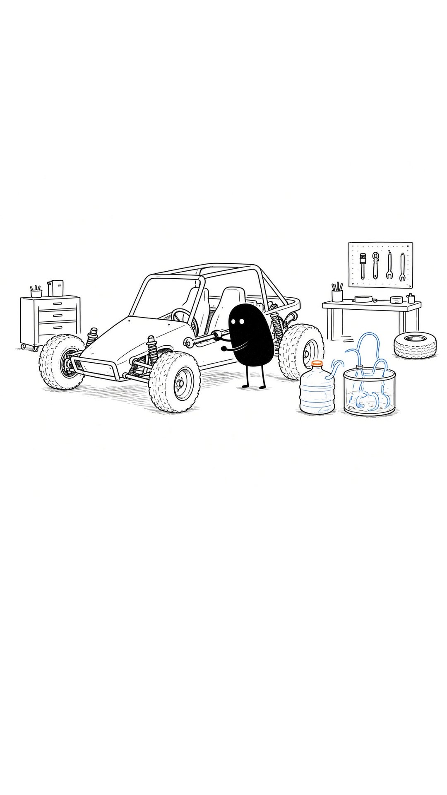 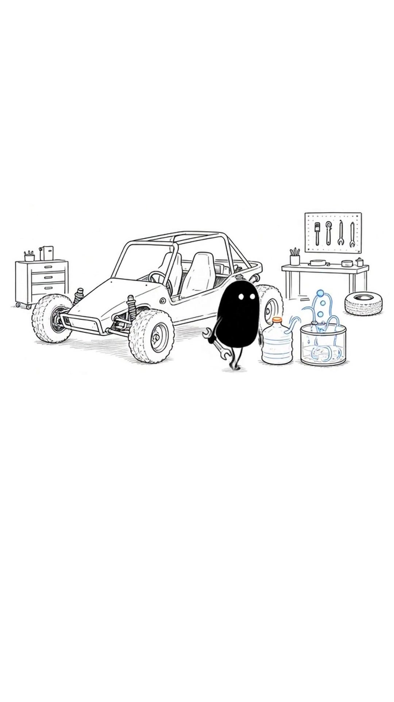</p>
- **Original image prompt:** **not found.**
- **Original animation prompt:** **not found.**

**Opening prompt (5 s) — paste — NEW - written for MJ:**

```
he stands by the dune buggy and makes a small adjustment with the wrench, the car, water jug, and workshop stay fixed, one-way motion only, no freeze, locked-off camera, Ian Xiaohei ink style, pure white background, thin wobbly black lines, no text, no letters, no captions --motion low --raw
```

**Extend prompt (~4 s) — paste — NEW - written for MJ:**

```
he finishes the adjustment and settles, the car and workshop stay fixed, no new objects, one-way motion only, no freeze, locked-off camera, Ian Xiaohei ink style, pure white background, thin wobbly black lines, no text, no letters, no captions --motion low --raw
```

## Scene 2

- **Narration:** He said his 'water fuel cell' split water into hydrogen and oxygen, and burned them as fuel.
- **Length plan:** **5 s** only. Speech 4.64 s fits 5 s; the part slot is 5.08 s.
- **Start Frame:** [`stanley-meyer-images/scene2_start.jpg`](stanley-meyer-images/scene2_start.jpg) (in this repo; source on the box: `/workspace/meyer/scenes/scene2.jpg`, letterboxed to 9:16 (no title))
- **End Frame (`--end`):** [`stanley-meyer-images/scene2_end.jpg`](stanley-meyer-images/scene2_end.jpg) (in this repo; **extracted from clip** — last frame of `/workspace/meyer/clips/clip02.mp4`, with burned-in title, page number, and any captions removed)

<p>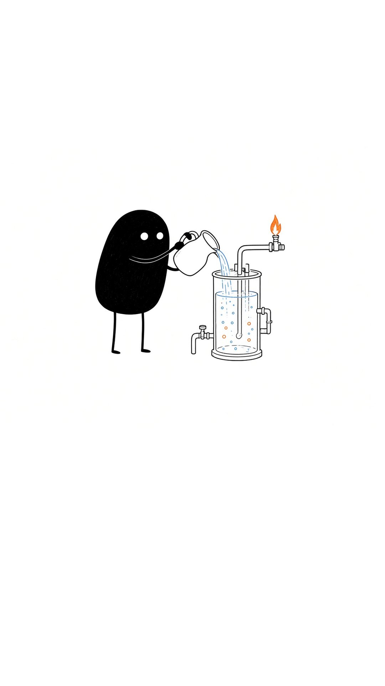 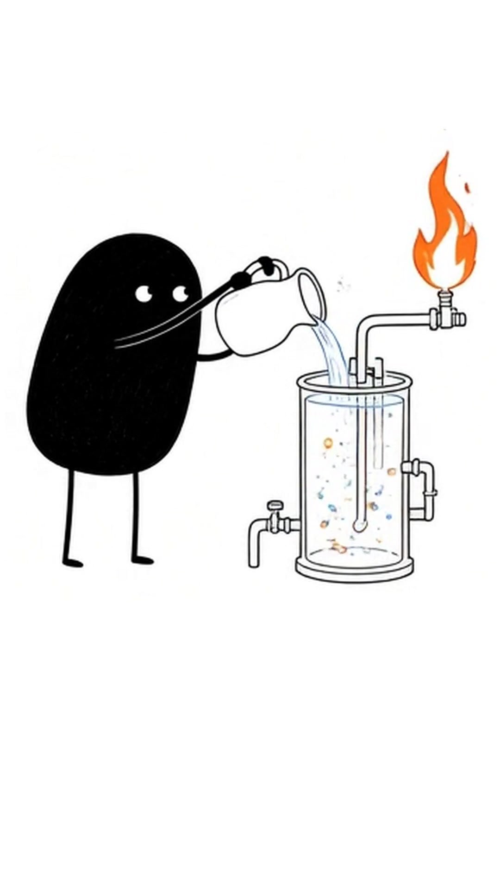</p>
- **Original image prompt:** **not found.**
- **Original animation prompt:** **not found.**

**Prompt (5 s) — paste — NEW - written for MJ:**

```
a small glow begins in the fuel cell he holds, he stays in place, the background stays fixed, one-way motion only, no freeze, locked-off camera, Ian Xiaohei ink style, pure white background, thin wobbly black lines, no text, no letters, no captions --motion low --raw
```

## Scene 3

- **Narration:** He claimed the car could drive from Los Angeles to New York on just twenty-two gallons of water.
- **Length plan:** **5 s** only. Speech 4.74 s fits 5 s; the part slot is 5.18 s.
- **Start Frame:** [`stanley-meyer-images/scene3_start.jpg`](stanley-meyer-images/scene3_start.jpg) (in this repo; source on the box: `/workspace/meyer/scenes/scene3.jpg`, letterboxed to 9:16 (no title))
- **End Frame (`--end`):** [`stanley-meyer-images/scene3_end.jpg`](stanley-meyer-images/scene3_end.jpg) (in this repo; **extracted from clip** — last frame of `/workspace/meyer/clips/clip03.mp4`, with burned-in title, page number, and any captions removed)

<p>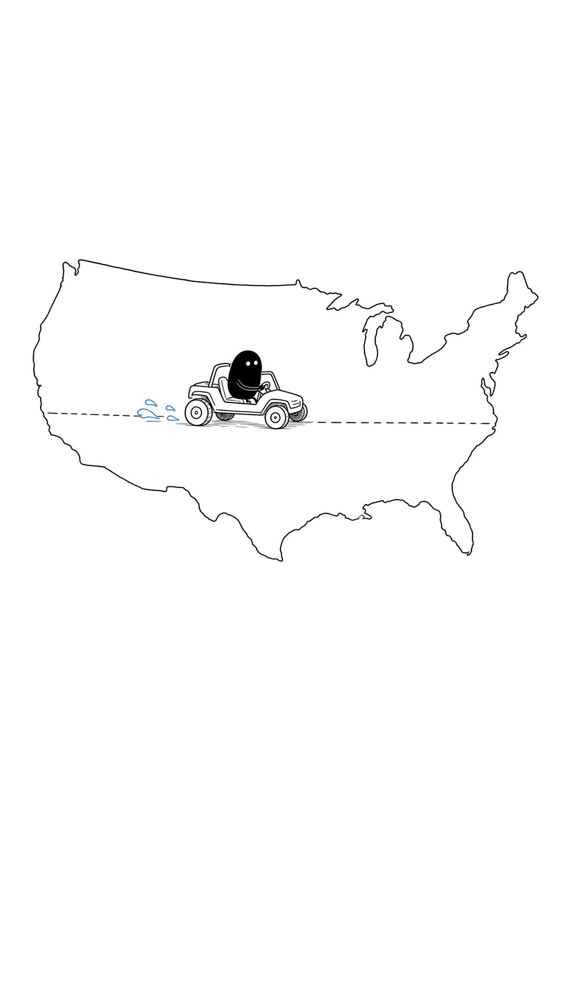 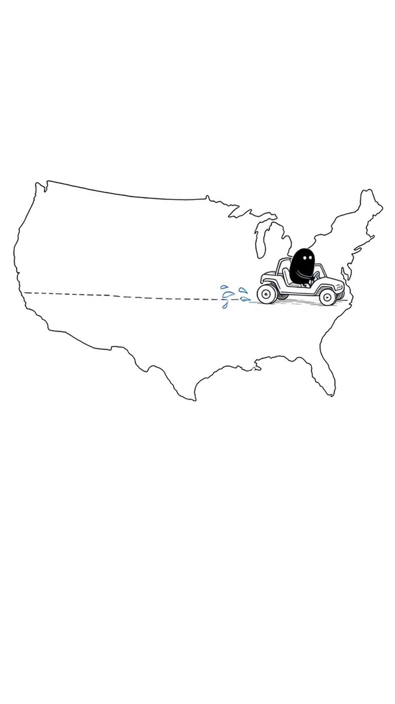</p>
- **Original image prompt:** **not found.**
- **Original animation prompt:** **not found.**

**Prompt (5 s) — paste — NEW - written for MJ:**

```
a small dotted path draws slowly one way across the map from west to east, the map outline stays fixed, one-way motion only, no freeze, locked-off camera, Ian Xiaohei ink style, pure white background, thin wobbly black lines, no text, no letters, no captions --motion low --raw
```

## Scene 4

- **Narration:** Investors believed him, and handed him their money.
- **Length plan:** **5 s** only (speech 2.24 s; slot 2.84 s).
- **Start Frame:** [`stanley-meyer-images/scene4_start.jpg`](stanley-meyer-images/scene4_start.jpg) (in this repo; source on the box: `/workspace/meyer/scenes/scene4.jpg`, letterboxed to 9:16 (no title))
- **End Frame (`--end`):** [`stanley-meyer-images/scene4_end.jpg`](stanley-meyer-images/scene4_end.jpg) (in this repo; **extracted from clip** — last frame of `/workspace/meyer/clips/clip04.mp4`, with burned-in title, page number, and any captions removed)

<p>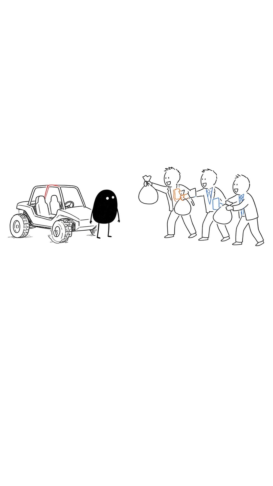 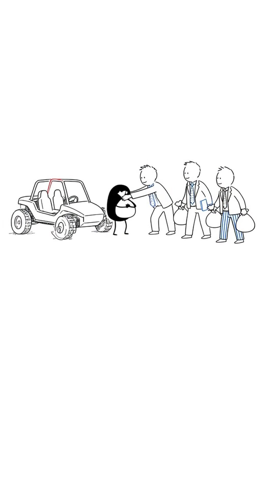</p>
- **Original image prompt:** **not found.**
- **Original animation prompt:** **not found.**

**Prompt (5 s) — paste — NEW - written for MJ:**

```
the group makes a small one-way handoff of money, everyone stays in the same place, the ground stays fixed, one-way motion only, no freeze, locked-off camera, Ian Xiaohei ink style, pure white background, thin wobbly black lines, no text, no letters, no captions --motion low --raw
```

## Scene 5

- **Narration:** In nineteen ninety-six, expert witnesses examined his fuel cell for an Ohio court, and found nothing revolutionary at all.
- **Length plan:** 9 s (5 s + one Extend). Speech 7.06 s.
- **Start Frame:** [`stanley-meyer-images/scene5_start.jpg`](stanley-meyer-images/scene5_start.jpg) (in this repo; source on the box: `/workspace/meyer/scenes/scene5.jpg`, letterboxed to 9:16 (no title))
- **End Frame (`--end`):** [`stanley-meyer-images/scene5_end.jpg`](stanley-meyer-images/scene5_end.jpg) (in this repo; **extracted from clip** — last frame of `/workspace/meyer/clips/clip05.mp4`, with burned-in title, page number, and any captions removed)

<p>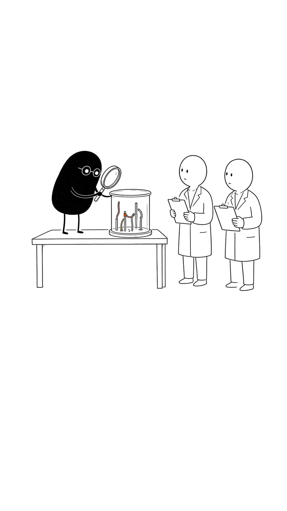 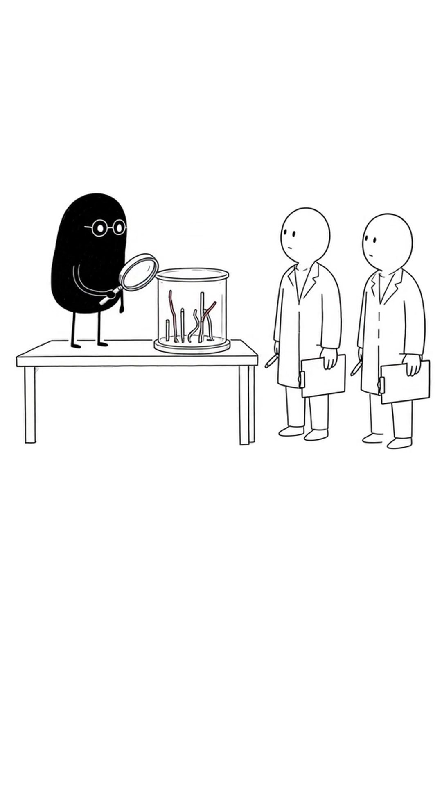</p>
- **Original image prompt:** **not found.**
- **Original animation prompt:** **not found.**

**Opening prompt (5 s) — paste — NEW - written for MJ:**

```
the people at the table look at the fuel cell with slight living motion, the table and cell stay in place, one-way motion only, no freeze, locked-off camera, Ian Xiaohei ink style, pure white background, thin wobbly black lines, no text, no letters, no captions --motion low --raw
```

**Extend prompt (~4 s) — paste — NEW - written for MJ:**

```
they settle at the table, the fuel cell stays put, no new objects, one-way motion only, no freeze, locked-off camera, Ian Xiaohei ink style, pure white background, thin wobbly black lines, no text, no letters, no captions --motion low --raw
```

## Scene 6

- **Narration:** The court ruled it was 'gross and egregious fraud', and ordered him to pay the investors back.
- **Length plan:** **5 s** only. Speech 4.94 s fits 5 s; the part slot is 5.15 s.
- **Start Frame:** [`stanley-meyer-images/scene6_start.jpg`](stanley-meyer-images/scene6_start.jpg) (in this repo; source on the box: `/workspace/meyer/scenes/scene6.jpg`, letterboxed to 9:16 (no title))
- **End Frame (`--end`):** [`stanley-meyer-images/scene6_end.jpg`](stanley-meyer-images/scene6_end.jpg) (in this repo; **extracted from clip** — last frame of `/workspace/meyer/clips/clip06.mp4`, with burned-in title, page number, and any captions removed)

<p>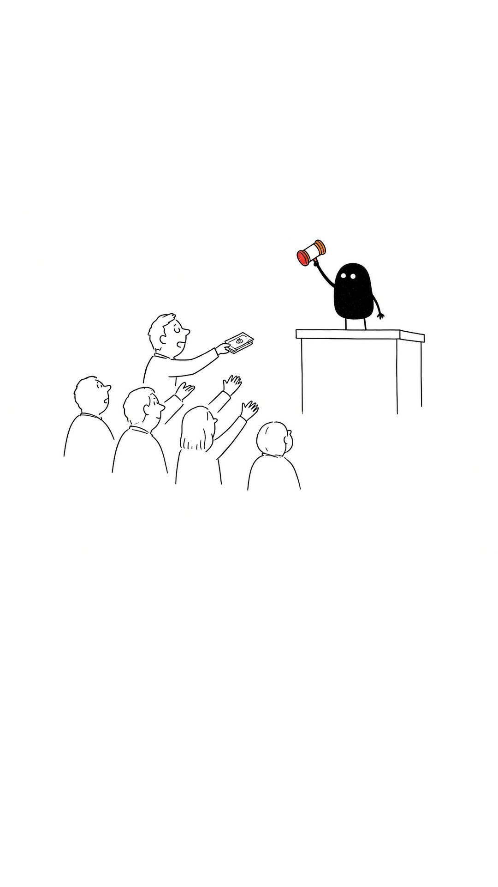 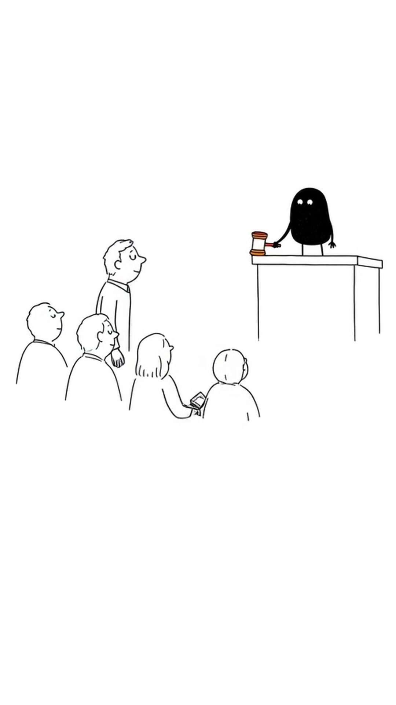</p>
- **Original image prompt:** **not found.**
- **Original animation prompt:** **not found.**

**Prompt (5 s) — paste — NEW - written for MJ:**

```
the official at the desk makes a small one-way motion, the papers and desk stay fixed, one-way motion only, no freeze, locked-off camera, Ian Xiaohei ink style, pure white background, thin wobbly black lines, no text, no letters, no captions --motion low --raw
```

## Scene 7

- **Narration:** Physics agrees: splitting water takes more energy than you ever get back by burning the hydrogen.
- **Length plan:** **5 s** only. Speech 4.82 s fits 5 s; the part slot is 5.44 s.
- **Start Frame:** [`stanley-meyer-images/scene7_start.jpg`](stanley-meyer-images/scene7_start.jpg) (in this repo; source on the box: `/workspace/meyer/scenes/scene7.jpg`, letterboxed to 9:16 (no title))
- **End Frame (`--end`):** [`stanley-meyer-images/scene7_end.jpg`](stanley-meyer-images/scene7_end.jpg) (in this repo; **extracted from clip** — last frame of `/workspace/meyer/clips/clip07.mp4`, with burned-in title, page number, and any captions removed)

<p>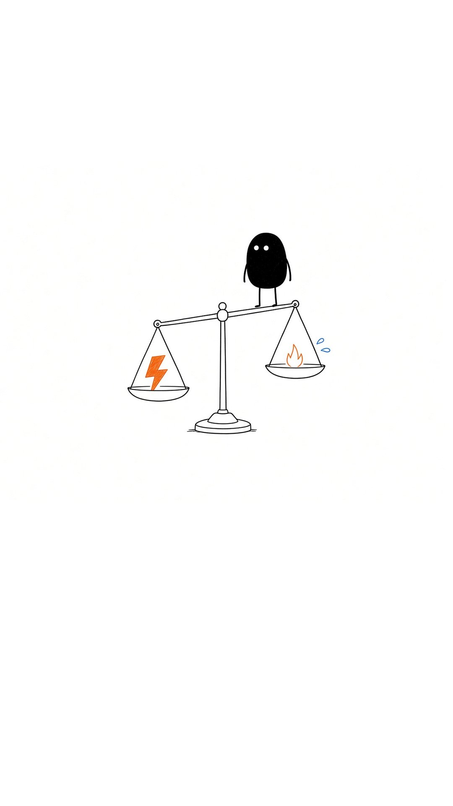 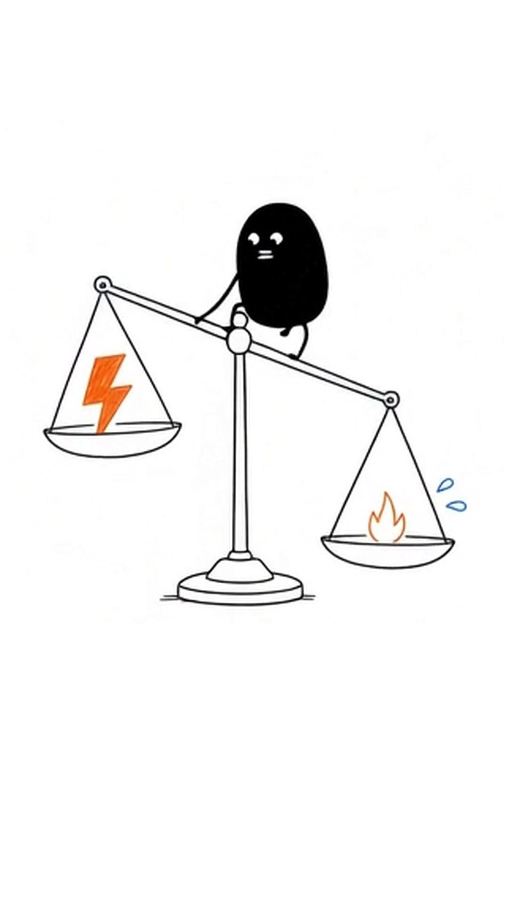</p>
- **Original image prompt:** **not found.**
- **Original animation prompt:** **not found.**

**Prompt (5 s) — paste — NEW - written for MJ:**

```
the balance scale tips slowly one way, the beam and pans stay on the stand, one-way motion only, no freeze, locked-off camera, Ian Xiaohei ink style, pure white background, thin wobbly black lines, no text, no letters, no captions --motion low --raw
```

## Scene 8

- **Narration:** In nineteen ninety-eight, Meyer collapsed at a restaurant, and witnesses said he cried, 'They poisoned me.'
- **Length plan:** 9 s (5 s + one Extend). Speech 5.86 s.
- **Start Frame:** [`stanley-meyer-images/scene8_start.jpg`](stanley-meyer-images/scene8_start.jpg) (in this repo; source on the box: `/workspace/meyer/scenes/scene8.jpg`, letterboxed to 9:16 (no title))
- **End Frame (`--end`):** [`stanley-meyer-images/scene8_end.jpg`](stanley-meyer-images/scene8_end.jpg) (in this repo; **extracted from clip** — last frame of `/workspace/meyer/clips/clip08.mp4`, with burned-in title, page number, and any captions removed)

<p>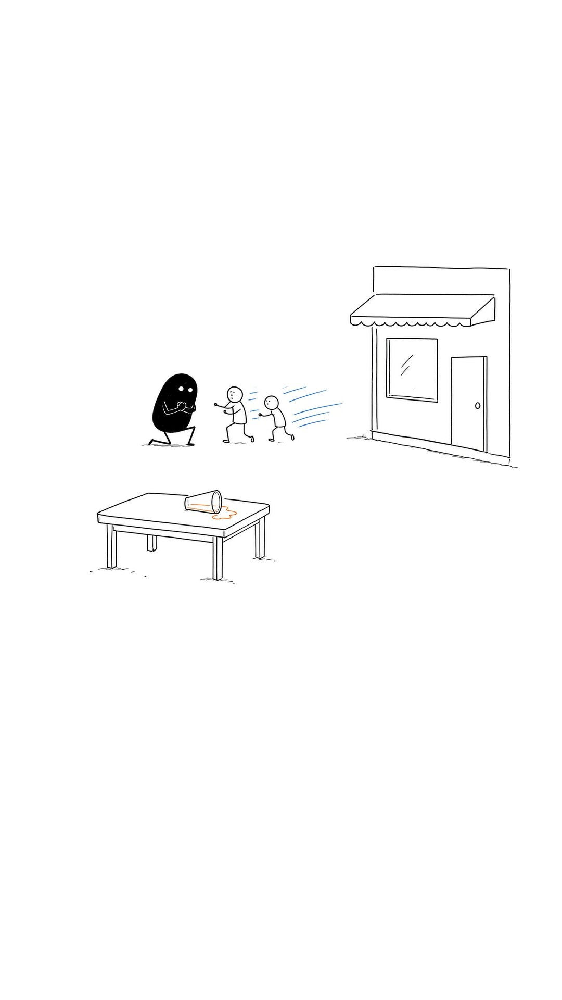 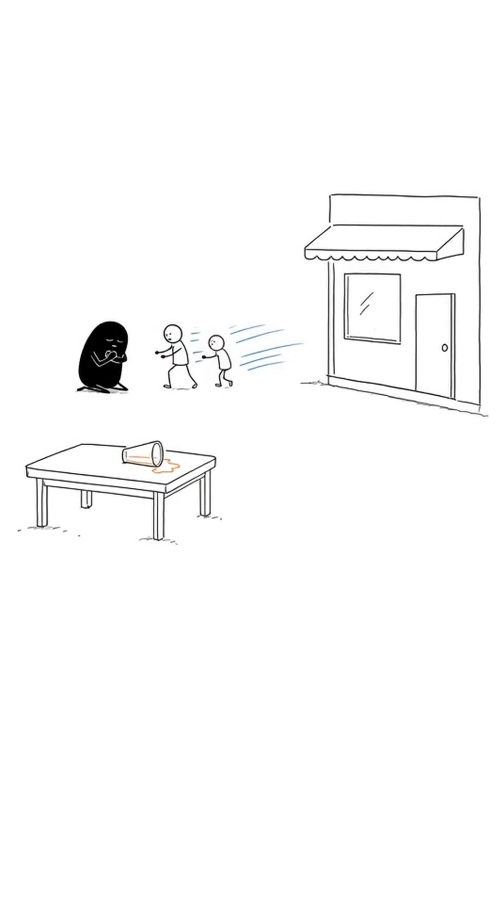</p>
- **Original image prompt:** **not found.**
- **Original animation prompt:** **not found.**

**Opening prompt (5 s) — paste — NEW - written for MJ:**

```
two people walk away to the right, he stays kneeling by the table, the cup stays on the table, the shop front stays fixed, one-way motion only, no freeze, locked-off camera, Ian Xiaohei ink style, pure white background, thin wobbly black lines, no text, no letters, no captions --motion low --raw
```

**Extend prompt (~4 s) — paste — NEW - written for MJ:**

```
the two people finish walking out of the way, he stays kneeling, the table and cup stay fixed, no new objects, one-way motion only, no freeze, locked-off camera, Ian Xiaohei ink style, pure white background, thin wobbly black lines, no text, no letters, no captions --motion low --raw
```

## Scene 9

- **Narration:** But the coroner found he died of a brain aneurysm, from natural causes.
- **Length plan:** **5 s** only (speech 3.38 s; slot 3.85 s).
- **Start Frame:** [`stanley-meyer-images/scene9_start.jpg`](stanley-meyer-images/scene9_start.jpg) (in this repo; source on the box: `/workspace/meyer/scenes/scene9.jpg`, letterboxed to 9:16 (no title))
- **End Frame (`--end`):** [`stanley-meyer-images/scene9_end.jpg`](stanley-meyer-images/scene9_end.jpg) (in this repo; **extracted from clip** — last frame of `/workspace/meyer/clips/clip09.mp4`, with burned-in title, page number, and any captions removed)

<p>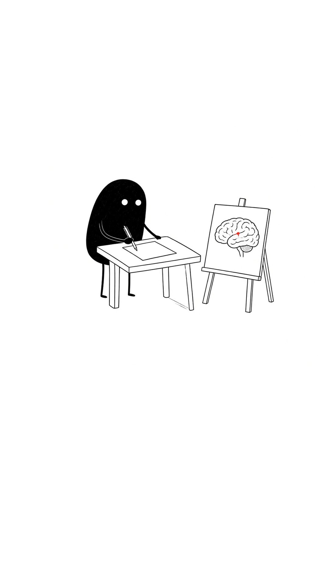 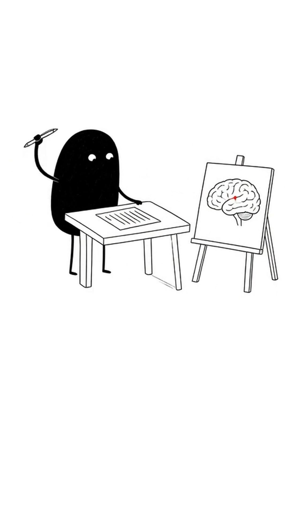</p>
- **Original image prompt:** **not found.**
- **Original animation prompt:** **not found.**

**Prompt (5 s) — paste — NEW - written for MJ:**

```
he writes slowly on the paper, the diagram on the easel stays fixed, the chair and table stay still, one-way motion only, no freeze, locked-off camera, Ian Xiaohei ink style, pure white background, thin wobbly black lines, no text, no letters, no captions --motion low --raw
```

## Scene 10

- **Narration:** Still, to this day, some people believe his water car was hidden from the world.
- **Length plan:** **5 s** only (speech 4.34 s; slot 4.66 s).
- **Start Frame:** [`stanley-meyer-images/scene10_start.jpg`](stanley-meyer-images/scene10_start.jpg) (in this repo; source on the box: `/workspace/meyer/scenes/scene10.jpg`, letterboxed to 9:16 (no title))
- **End Frame (`--end`):** [`stanley-meyer-images/scene10_end.jpg`](stanley-meyer-images/scene10_end.jpg) (in this repo; **extracted from clip** — last frame of `/workspace/meyer/clips/clip10.mp4`, with burned-in title, page number, and any captions removed)

<p>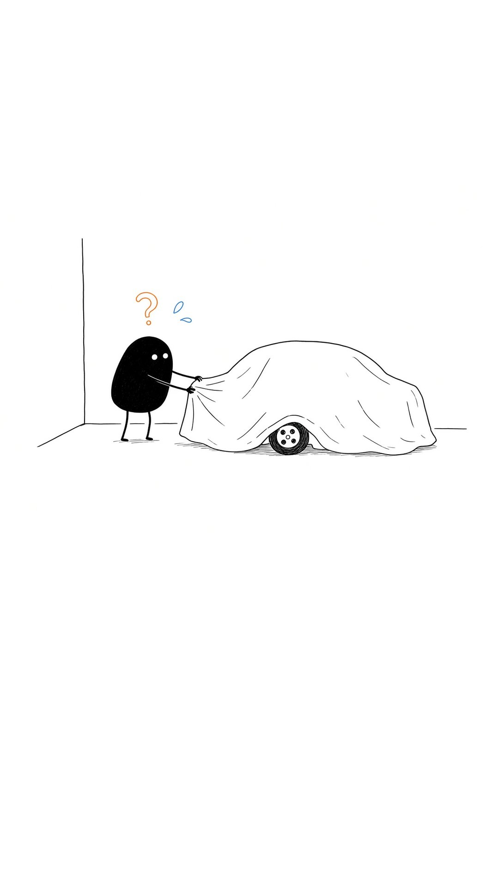 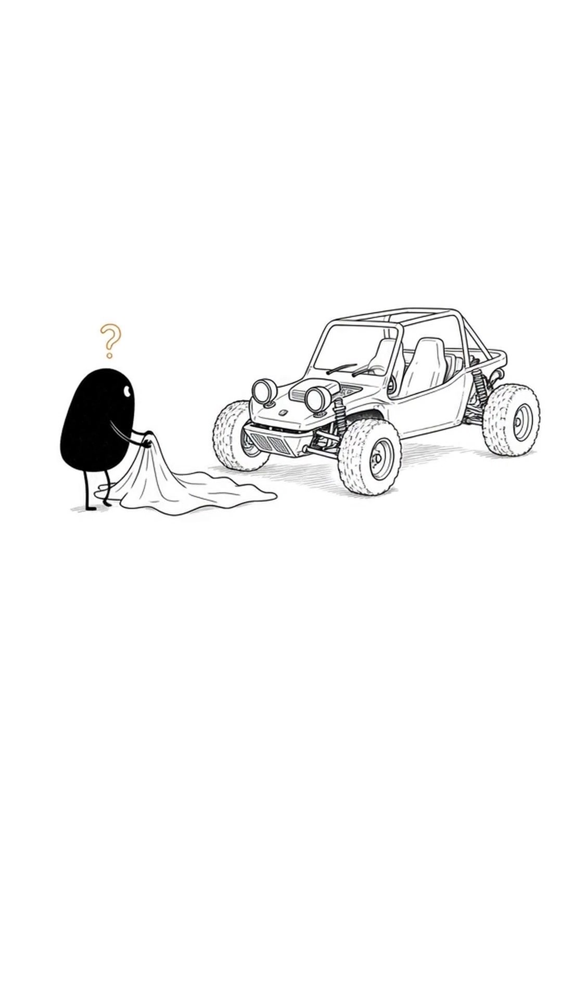</p>
- **Original image prompt:** **not found.**
- **Original animation prompt:** **not found.**

**Prompt (5 s) — paste — NEW - written for MJ:**

```
he lifts the cover on the car a little, the car stays in place, the wall stays fixed, one-way motion only, no freeze, locked-off camera, Ian Xiaohei ink style, pure white background, thin wobbly black lines, no text, no letters, no captions --motion low --raw
```
