# Stanley Meyer's Water Car

- **YouTube title:** He Said His Car Ran on Water. A Court Called It Fraud.
- **Status:** Published via Buffer (status: sent, snapshot 2026-11-09)
- **Publish / schedule time:** 2026-11-01 17:47 Israel time (Asia/Jerusalem)
- **Final version / length:** v2, 53.9 s
- **Narration method (from `examples/README.md`):** Chatterbox am_eric, seed 7, exaggeration 0.75, cfg 0.4, 3 paragraphs (`p1`–`p3`)
- **Completeness:** partial — narration found; image and clip prompts not found
- **Primary sources:** `examples/stanley-meyer/` (scripts and `buffer_metadata.md`). Publish times are from that Buffer snapshot, not re-queried here.

Nothing in this file was invented. Missing prompt classes are marked **not found**.

## Script / narration
Final English script:

### `script_en.txt`

Source: `history-storyteller/examples/stanley-meyer/script_en.txt`

```
In the nineteen eighties, an inventor from Ohio named Stanley Meyer built a small dune buggy, and claimed it ran on nothing but water. He said his water fuel cell split water into hydrogen and oxygen, and burned them as fuel. He claimed the car could drive from Los Angeles to New York on just twenty-two gallons of water. Investors believed him, and handed him their money.

In nineteen ninety-six, expert witnesses examined his fuel cell for an Ohio court, and found nothing revolutionary at all. The court ruled it was gross and egregious fraud, and ordered him to pay the investors back. Physics agrees: splitting water takes more energy than you ever get back by burning the hydrogen.

In nineteen ninety-eight, Meyer collapsed at a restaurant, and witnesses said he cried, They poisoned me! But the coroner found he died of a brain aneurysm, from natural causes. Still, to this day, some people believe his water car was hidden from the world.
```


Paragraph files used for TTS:

### `p1.txt`

Source: `history-storyteller/examples/stanley-meyer/p1.txt`

```
In the nineteen eighties, an inventor from Ohio named Stanley Meyer built a small dune buggy, and claimed it ran on nothing but water. He said his water fuel cell split water into hydrogen and oxygen, and burned them as fuel. He claimed the car could drive from Los Angeles to New York on just twenty-two gallons of water. Investors believed him, and handed him their money.
```


### `p2.txt`

Source: `history-storyteller/examples/stanley-meyer/p2.txt`

```
In nineteen ninety-six, expert witnesses examined his fuel cell for an Ohio court, and found nothing revolutionary at all. The court ruled it was gross and egregious fraud, and ordered him to pay the investors back. Physics agrees: splitting water takes more energy than you ever get back by burning the hydrogen.
```


### `p3.txt`

Source: `history-storyteller/examples/stanley-meyer/p3.txt`

```
In nineteen ninety-eight, Meyer collapsed at a restaurant, and witnesses said he cried, They poisoned me! But the coroner found he died of a brain aneurysm, from natural causes. Still, to this day, some people believe his water car was hidden from the world.
```


### Hebrew approval script

**not found.** A Hebrew script file exists in the examples folder only for Garbo and Lustig (`examples/README.md`).

## Per-scene image and animation prompts
The examples folder stores the script as three paragraphs (`p1`–`p3`). The published Short was built as **ten** clips, one per sentence in `/workspace/meyer/audio_timing.json`. The section below follows those ten production scenes. Prompts are copied verbatim only when a source file or transcript call was found.
### Scene 1 — In the nineteen eighties, an inventor from Ohio named Stanley Meyer built a s…
- **Image / sketch prompt:** **not found.** No GenerateImage / still-sketch prompt was saved for this scene, and none was found in the transcripts or project files searched for this update.
Start still is the real production scene image, letterboxed to 9:16 (source: `/workspace/meyer/scenes/scene1.jpg`). End still is **extracted from clip** (last frame of `/workspace/meyer/clips/clip01.mp4`, with burned-in title, page number, and any captions removed):

<p>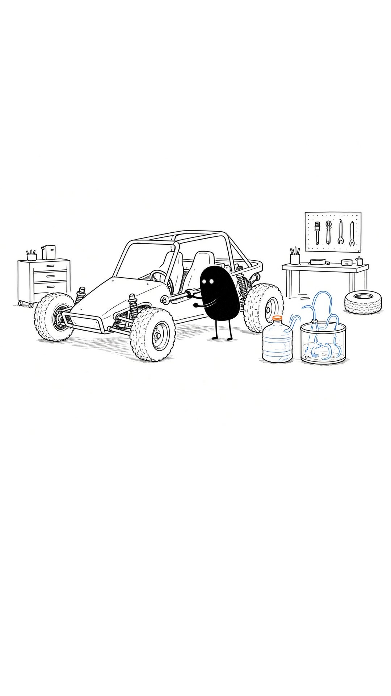 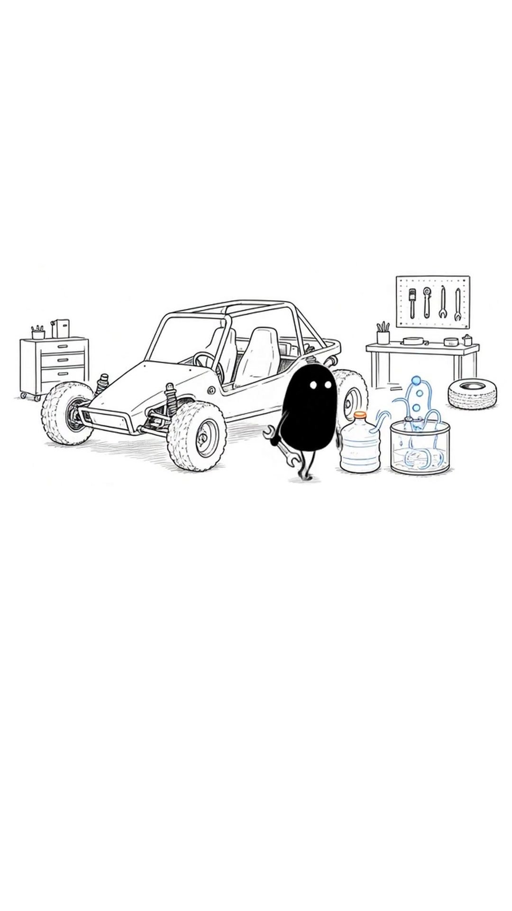</p>
- **Animation / clip prompt:** **not found.** No GenerateVideo / animation / transition prompt was saved for this scene, and none was found in the transcripts or project files searched for this update.
### Scene 2 — He said his 'water fuel cell' split water into hydrogen and oxygen, and burne…
- **Image / sketch prompt:** **not found.** No GenerateImage / still-sketch prompt was saved for this scene, and none was found in the transcripts or project files searched for this update.
Start still is the real production scene image, letterboxed to 9:16 (source: `/workspace/meyer/scenes/scene2.jpg`). End still is **extracted from clip** (last frame of `/workspace/meyer/clips/clip02.mp4`, with burned-in title, page number, and any captions removed):

<p>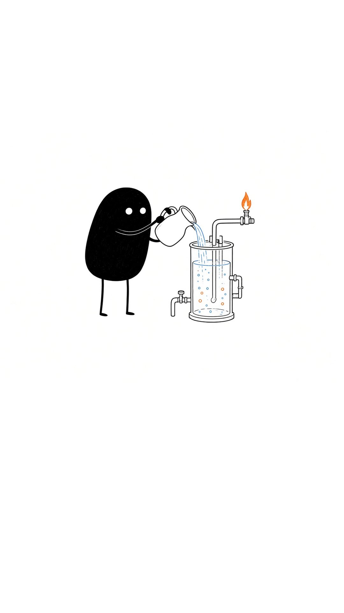 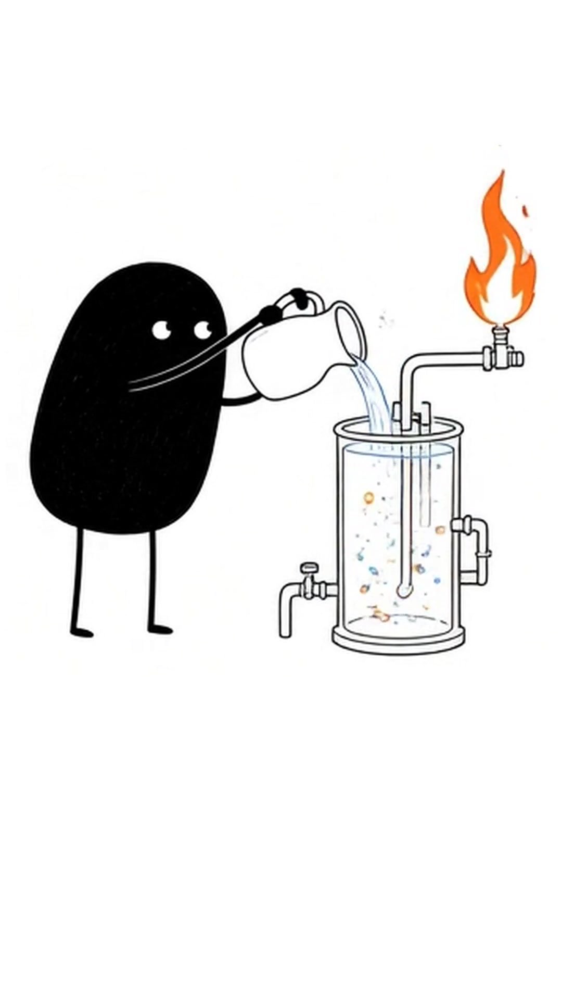</p>
- **Animation / clip prompt:** **not found.** No GenerateVideo / animation / transition prompt was saved for this scene, and none was found in the transcripts or project files searched for this update.
### Scene 3 — He claimed the car could drive from Los Angeles to New York on just twenty-tw…
- **Image / sketch prompt:** **not found.** No GenerateImage / still-sketch prompt was saved for this scene, and none was found in the transcripts or project files searched for this update.
Start still is the real production scene image, letterboxed to 9:16 (source: `/workspace/meyer/scenes/scene3.jpg`). End still is **extracted from clip** (last frame of `/workspace/meyer/clips/clip03.mp4`, with burned-in title, page number, and any captions removed):

<p>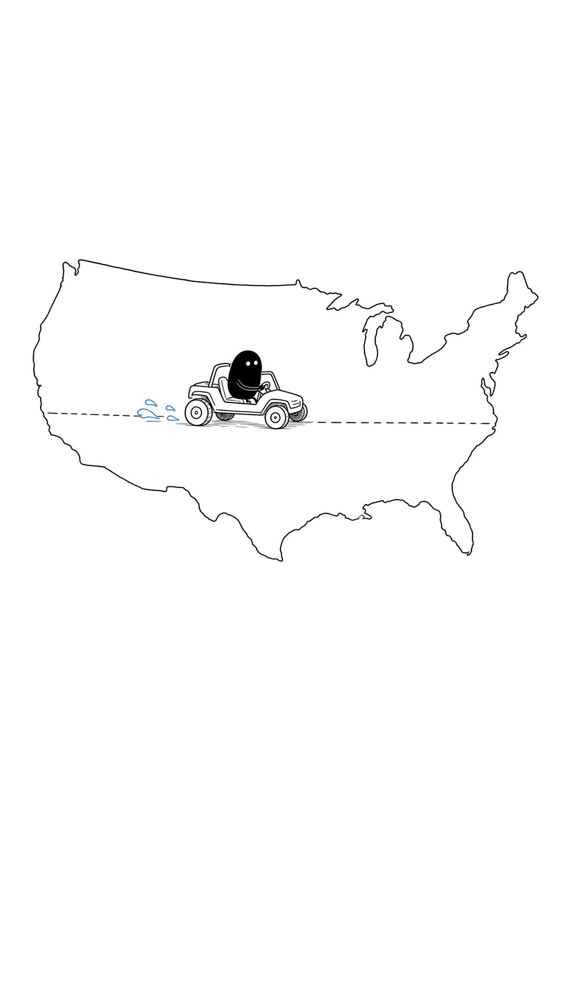 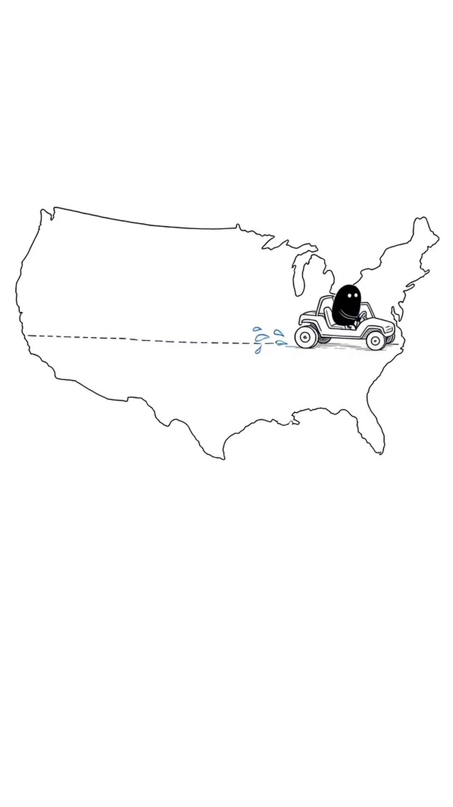</p>
- **Animation / clip prompt:** **not found.** No GenerateVideo / animation / transition prompt was saved for this scene, and none was found in the transcripts or project files searched for this update.
### Scene 4 — Investors believed him, and handed him their money.
- **Image / sketch prompt:** **not found.** No GenerateImage / still-sketch prompt was saved for this scene, and none was found in the transcripts or project files searched for this update.
Start still is the real production scene image, letterboxed to 9:16 (source: `/workspace/meyer/scenes/scene4.jpg`). End still is **extracted from clip** (last frame of `/workspace/meyer/clips/clip04.mp4`, with burned-in title, page number, and any captions removed):

<p>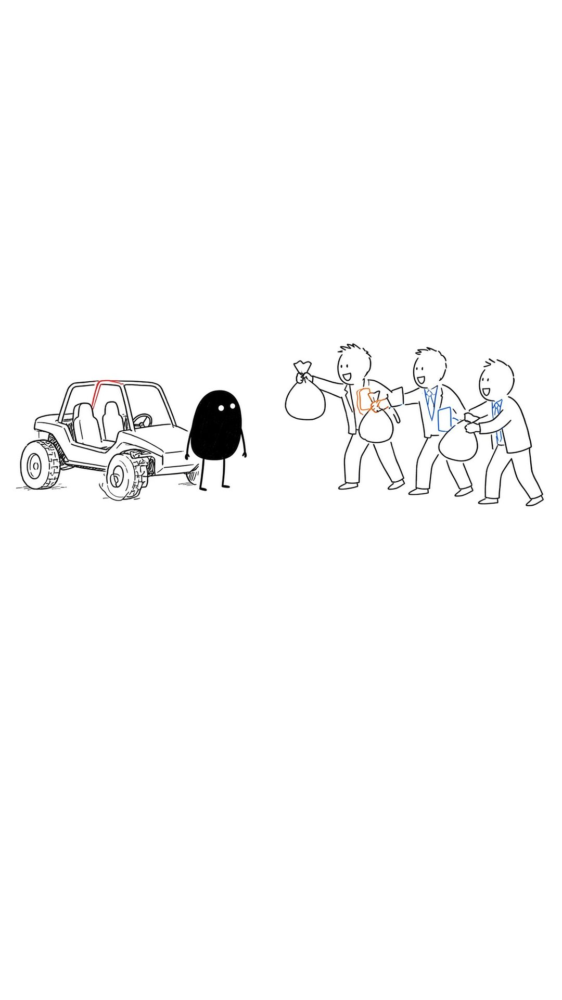 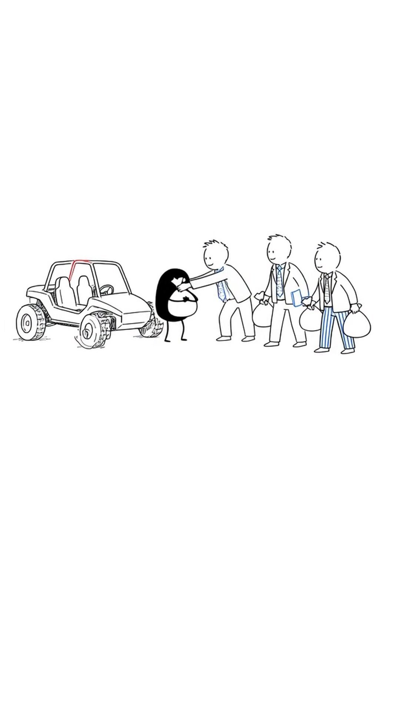</p>
- **Animation / clip prompt:** **not found.** No GenerateVideo / animation / transition prompt was saved for this scene, and none was found in the transcripts or project files searched for this update.
### Scene 5 — In nineteen ninety-six, expert witnesses examined his fuel cell for an Ohio c…
- **Image / sketch prompt:** **not found.** No GenerateImage / still-sketch prompt was saved for this scene, and none was found in the transcripts or project files searched for this update.
Start still is the real production scene image, letterboxed to 9:16 (source: `/workspace/meyer/scenes/scene5.jpg`). End still is **extracted from clip** (last frame of `/workspace/meyer/clips/clip05.mp4`, with burned-in title, page number, and any captions removed):

<p>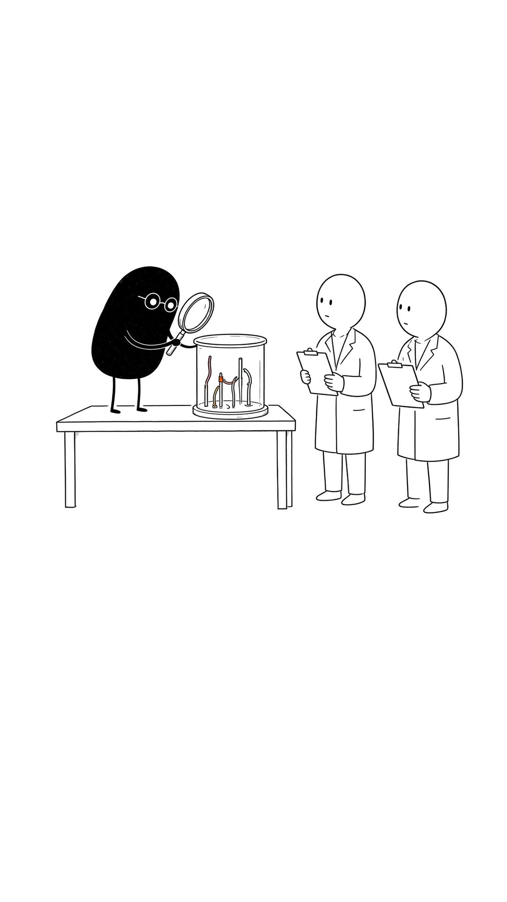 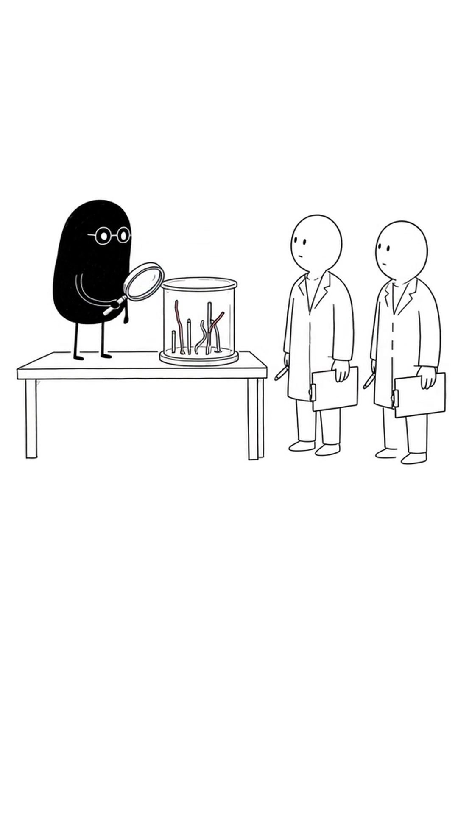</p>
- **Animation / clip prompt:** **not found.** No GenerateVideo / animation / transition prompt was saved for this scene, and none was found in the transcripts or project files searched for this update.
### Scene 6 — The court ruled it was 'gross and egregious fraud', and ordered him to pay th…
- **Image / sketch prompt:** **not found.** No GenerateImage / still-sketch prompt was saved for this scene, and none was found in the transcripts or project files searched for this update.
Start still is the real production scene image, letterboxed to 9:16 (source: `/workspace/meyer/scenes/scene6.jpg`). End still is **extracted from clip** (last frame of `/workspace/meyer/clips/clip06.mp4`, with burned-in title, page number, and any captions removed):

<p>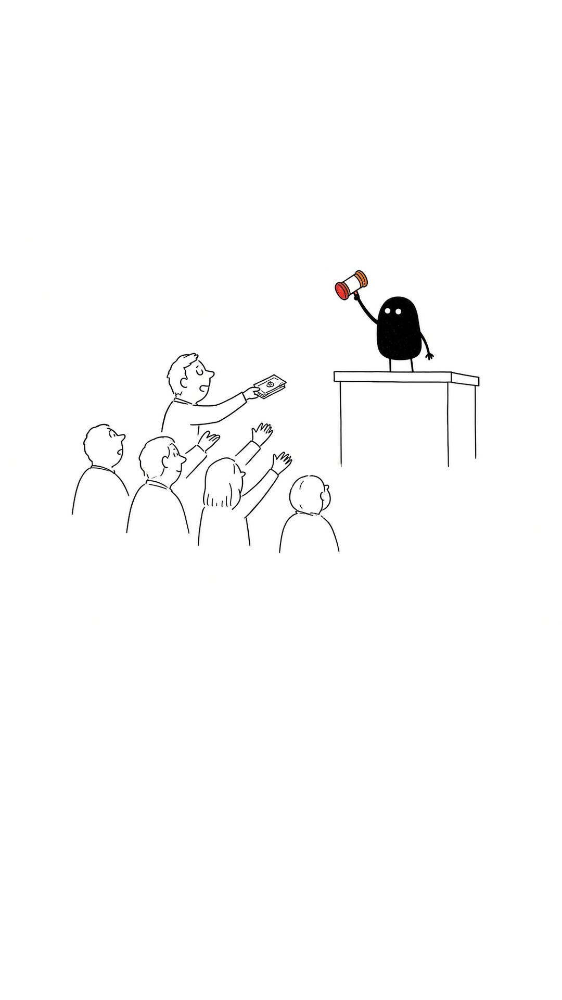 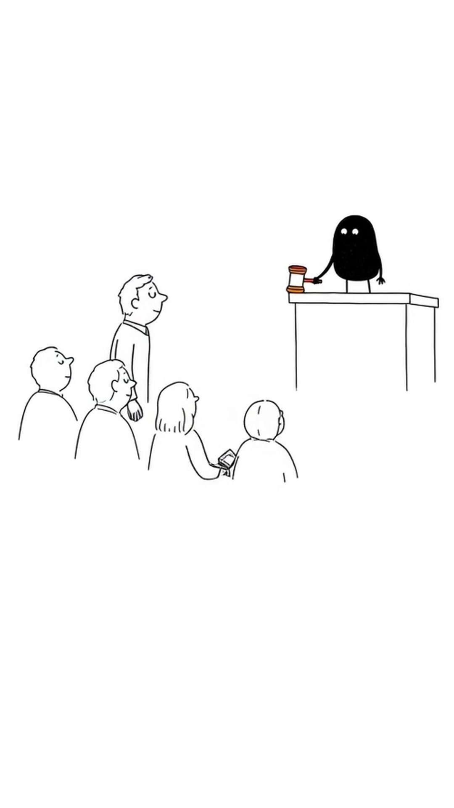</p>
- **Animation / clip prompt:** **not found.** No GenerateVideo / animation / transition prompt was saved for this scene, and none was found in the transcripts or project files searched for this update.
### Scene 7 — Physics agrees: splitting water takes more energy than you ever get back by b…
- **Image / sketch prompt:** **not found.** No GenerateImage / still-sketch prompt was saved for this scene, and none was found in the transcripts or project files searched for this update.
Start still is the real production scene image, letterboxed to 9:16 (source: `/workspace/meyer/scenes/scene7.jpg`). End still is **extracted from clip** (last frame of `/workspace/meyer/clips/clip07.mp4`, with burned-in title, page number, and any captions removed):

<p>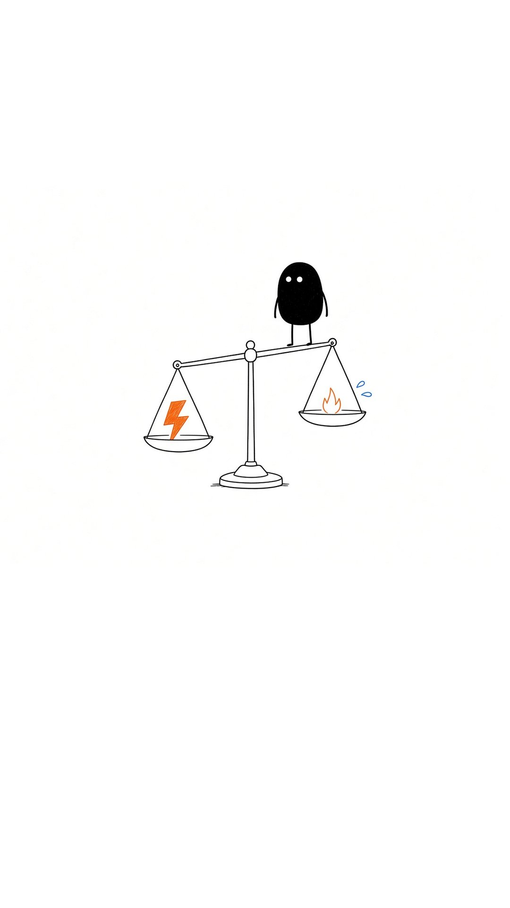 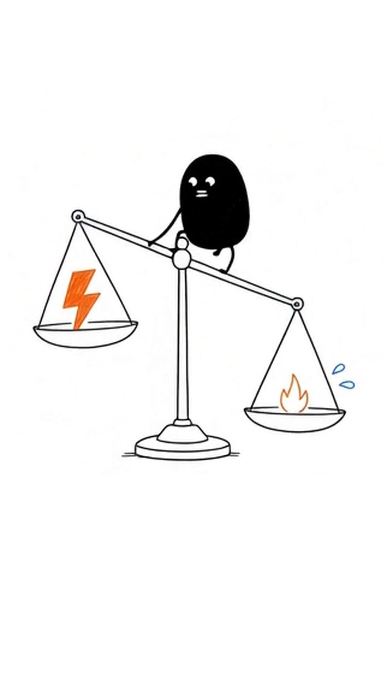</p>
- **Animation / clip prompt:** **not found.** No GenerateVideo / animation / transition prompt was saved for this scene, and none was found in the transcripts or project files searched for this update.
### Scene 8 — In nineteen ninety-eight, Meyer collapsed at a restaurant, and witnesses said…
- **Image / sketch prompt:** **not found.** No GenerateImage / still-sketch prompt was saved for this scene, and none was found in the transcripts or project files searched for this update.
Start still is the real production scene image, letterboxed to 9:16 (source: `/workspace/meyer/scenes/scene8.jpg`). End still is **extracted from clip** (last frame of `/workspace/meyer/clips/clip08.mp4`, with burned-in title, page number, and any captions removed):

<p>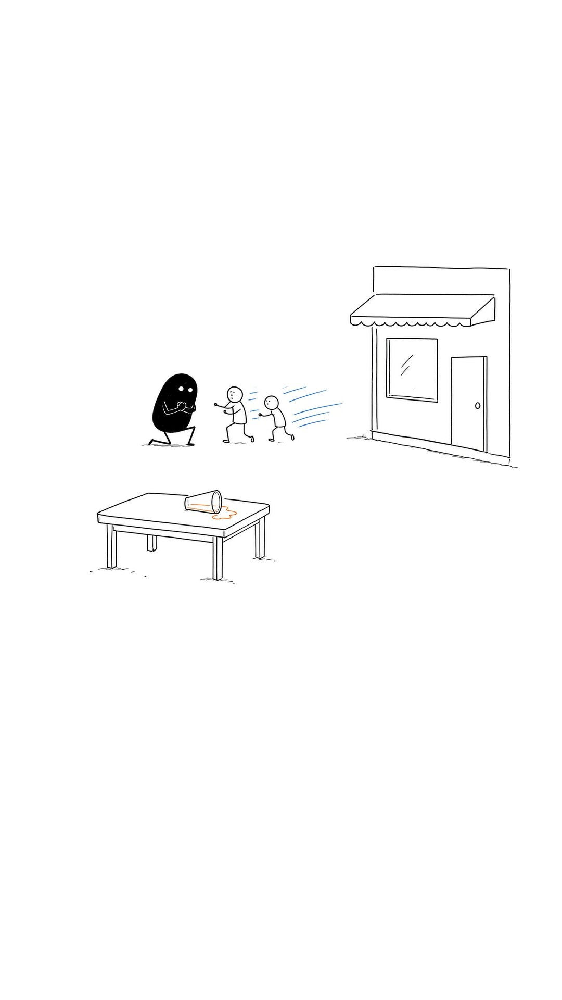 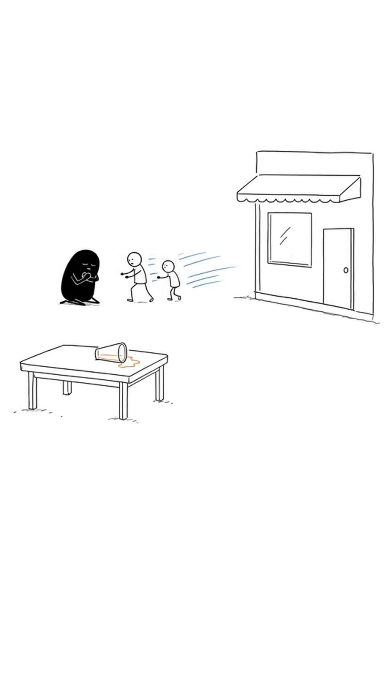</p>
- **Animation / clip prompt:** **not found.** No GenerateVideo / animation / transition prompt was saved for this scene, and none was found in the transcripts or project files searched for this update.
### Scene 9 — But the coroner found he died of a brain aneurysm, from natural causes.
- **Image / sketch prompt:** **not found.** No GenerateImage / still-sketch prompt was saved for this scene, and none was found in the transcripts or project files searched for this update.
Start still is the real production scene image, letterboxed to 9:16 (source: `/workspace/meyer/scenes/scene9.jpg`). End still is **extracted from clip** (last frame of `/workspace/meyer/clips/clip09.mp4`, with burned-in title, page number, and any captions removed):

<p>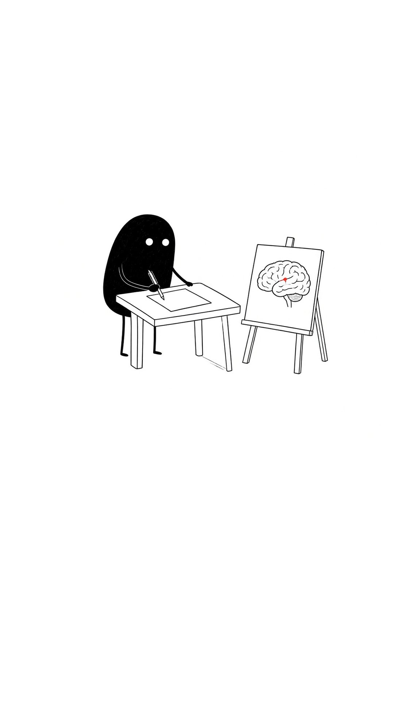 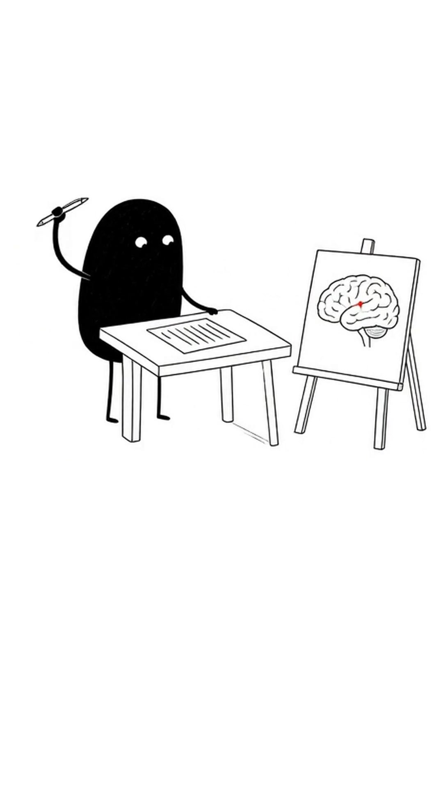</p>
- **Animation / clip prompt:** **not found.** No GenerateVideo / animation / transition prompt was saved for this scene, and none was found in the transcripts or project files searched for this update.
### Scene 10 — Still, to this day, some people believe his water car was hidden from the wor…
- **Image / sketch prompt:** **not found.** No GenerateImage / still-sketch prompt was saved for this scene, and none was found in the transcripts or project files searched for this update.
Start still is the real production scene image, letterboxed to 9:16 (source: `/workspace/meyer/scenes/scene10.jpg`). End still is **extracted from clip** (last frame of `/workspace/meyer/clips/clip10.mp4`, with burned-in title, page number, and any captions removed):

<p>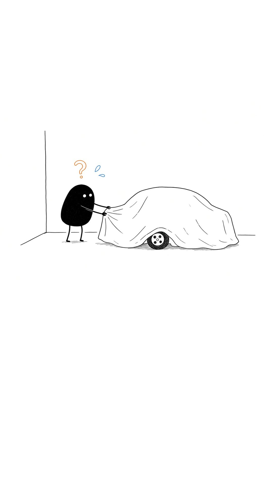 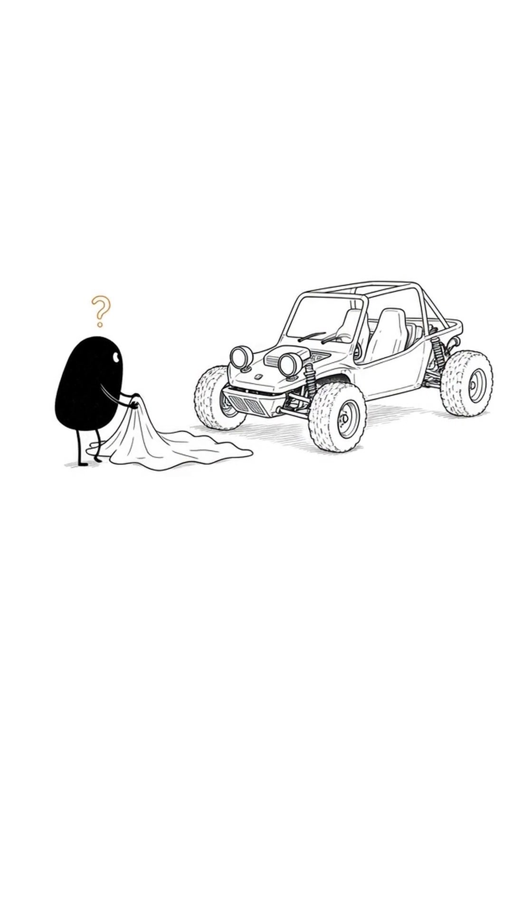</p>
- **Animation / clip prompt:** **not found.** No GenerateVideo / animation / transition prompt was saved for this scene, and none was found in the transcripts or project files searched for this update.
