# Tesla's Wardenclyffe Tower

- **YouTube title:** Tesla Built a Tower to Power the World. It Was Blown Up
- **Status:** Published via Buffer (status: sent, snapshot 2026-11-09)
- **Publish / schedule time:** 2026-11-05 18:43 Israel time (Asia/Jerusalem)
- **Final version / length:** v3, 45.3 s
- **Narration method (from `examples/README.md`):** Chatterbox am_eric, seed 7, exaggeration 0.75, cfg 0.4, single full pass
- **Completeness:** partial — narration found; image and clip prompts not found
- **Primary sources:** `examples/tesla/` (scripts and `buffer_metadata.md`). Publish times are from that Buffer snapshot, not re-queried here.

Nothing in this file was invented. Missing prompt classes are marked **not found**.

## Script / narration
Final English script:

### `script_en.txt`

Source: `history-storyteller/examples/tesla/script_en.txt`

```
In 1901, Nikola Tesla began building a giant tower on Long Island, New York. His dream was to send messages, and even electricity, through the air to the whole world. It was paid for by J.P. Morgan, the most powerful banker in America. But in December 1901, Marconi sent a radio signal across the Atlantic, using far cheaper equipment. Tesla then asked Morgan for more money. His real dream was sending power through the air. Morgan refused to give him another cent. Tesla begged other investors for help, but no one would pay. By 1906, work on the tower stopped, and Tesla's hotel bills kept growing. In 1917, the tower was blown up and sold for scrap to help pay his hotel debts. Tesla's tower never powered the world, but his dream of wireless energy lives on. A true story.
```


Sentence units (`sentences.txt`):

### `sentences.txt`

Source: `history-storyteller/examples/tesla/sentences.txt`

```
In 1901, Nikola Tesla began building a giant tower on Long Island, New York.
His dream was to send messages, and even electricity, through the air to the whole world.
It was paid for by J.P. Morgan, the most powerful banker in America.
But in December 1901, Marconi sent a radio signal across the Atlantic, using far cheaper equipment.
Tesla then asked Morgan for more money. His real dream was sending power through the air.
Morgan refused to give him another cent.
Tesla begged other investors for help, but no one would pay.
By 1906, work on the tower stopped, and Tesla's hotel bills kept growing.
In 1917, the tower was blown up and sold for scrap to help pay his hotel debts.
Tesla's tower never powered the world, but his dream of wireless energy lives on. A true story.
```


### Hebrew approval script

**not found.** A Hebrew script file exists in the examples folder only for Garbo and Lustig (`examples/README.md`).

## Per-scene image and animation prompts

One row per production scene (sentence, segment, or part). Prompts are copied verbatim only when a source file or transcript call was found.

### Scene 1 — In 1901, Nikola Tesla began building a giant tower on…

- **Image / sketch prompt:** **not found.** No GenerateImage / still-sketch prompt was saved for this scene, and none was found in the transcripts or project files searched for this update.


Start still is the real production scene image, letterboxed to 9:16 (source: `/workspace/tesla/scenes/scene1.jpg`). End still is **extracted from clip** (last frame of `/workspace/tesla/clips/clip01.mp4`, with burned-in title, page number, and any captions removed):

<p>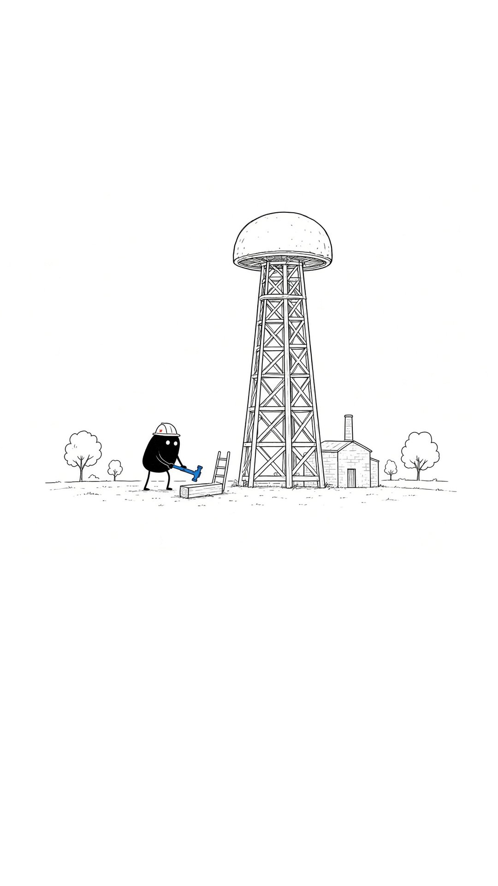 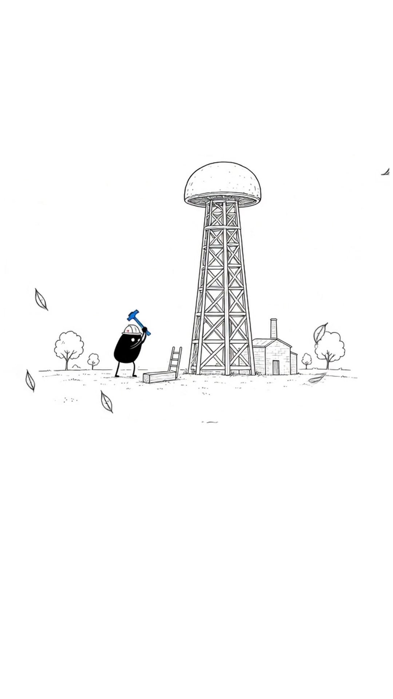</p>
- **Animation / clip prompt:** **not found.** No GenerateVideo / animation / transition prompt was saved for this scene, and none was found in the transcripts or project files searched for this update.

### Scene 2 — His dream was to send messages, and even electricity, through…

- **Image / sketch prompt:** **not found.** No GenerateImage / still-sketch prompt was saved for this scene, and none was found in the transcripts or project files searched for this update.


Start still is the real production scene image, letterboxed to 9:16 (source: `/workspace/tesla/scenes/scene2.jpg`). End still is **extracted from clip** (last frame of `/workspace/tesla/clips/clip02.mp4`, with burned-in title, page number, and any captions removed):

<p>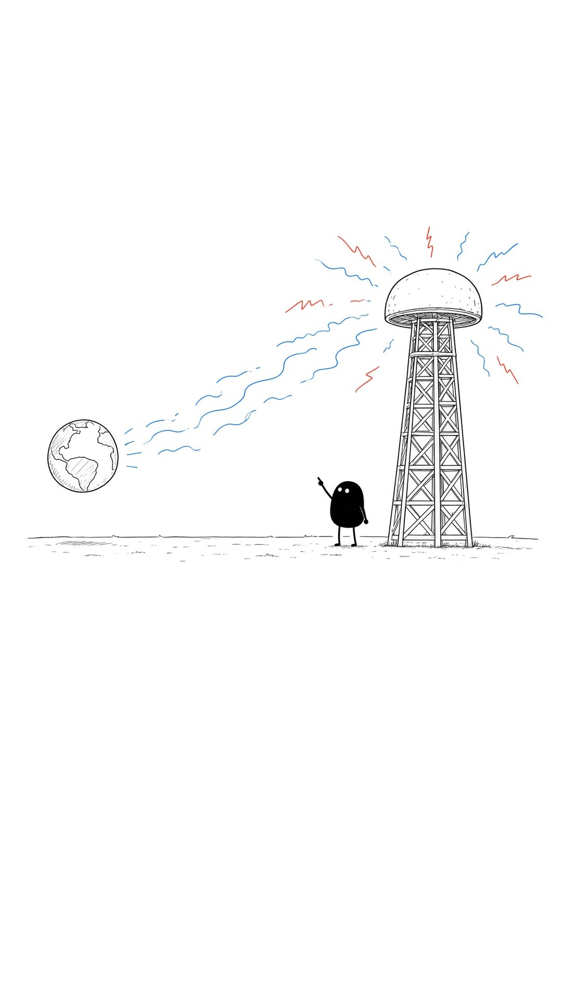 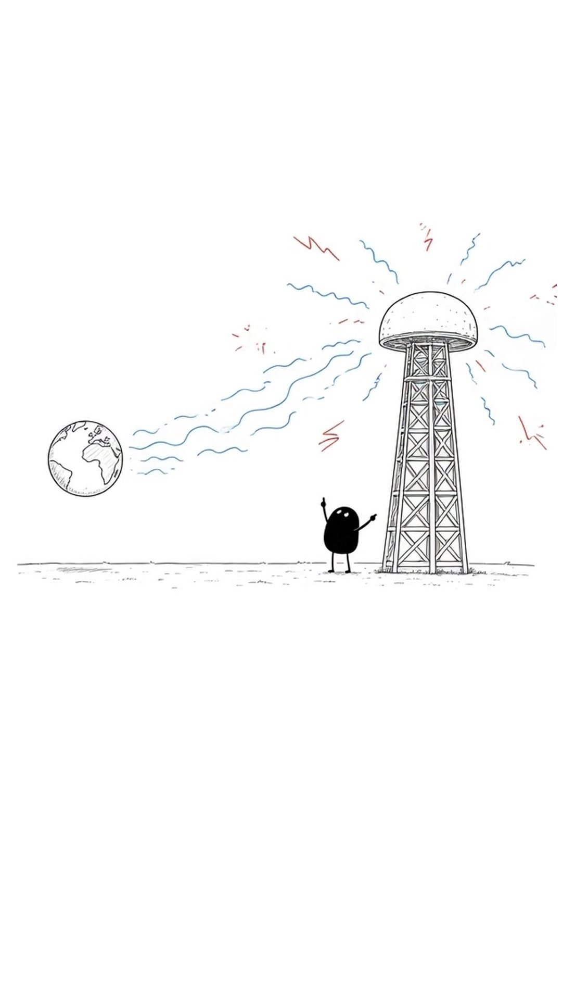</p>
- **Animation / clip prompt:** **not found.** No GenerateVideo / animation / transition prompt was saved for this scene, and none was found in the transcripts or project files searched for this update.

### Scene 3 — It was paid for by J.P. Morgan, the most powerful…

- **Image / sketch prompt:** **not found.** No GenerateImage / still-sketch prompt was saved for this scene, and none was found in the transcripts or project files searched for this update.


Start still is the real production scene image, letterboxed to 9:16 (source: `/workspace/tesla/scenes/scene3.jpg`). End still is **extracted from clip** (last frame of `/workspace/tesla/clips/clip03.mp4`, with burned-in title, page number, and any captions removed):

<p>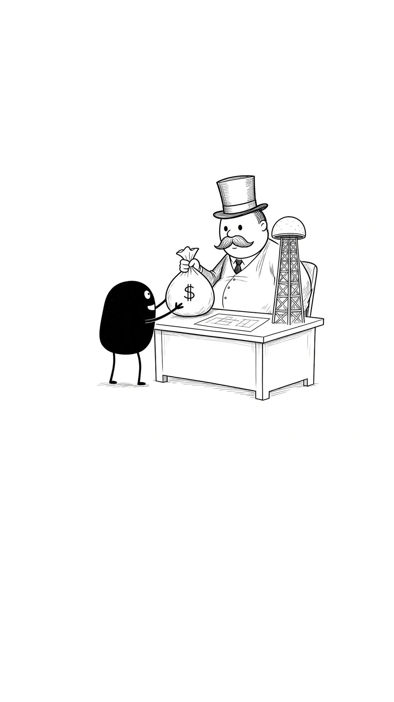 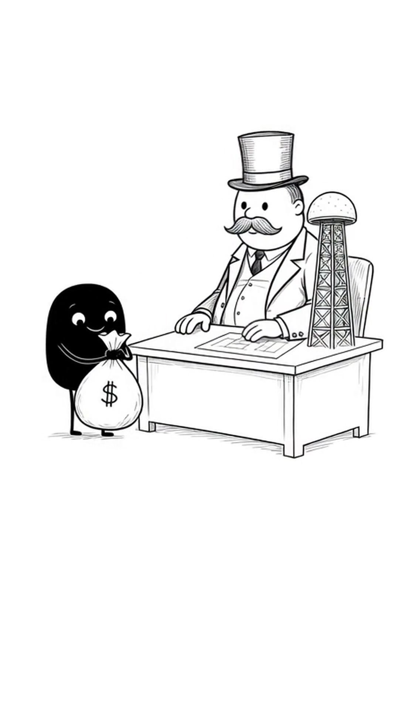</p>
- **Animation / clip prompt:** **not found.** No GenerateVideo / animation / transition prompt was saved for this scene, and none was found in the transcripts or project files searched for this update.

### Scene 4 — But in December 1901, Marconi sent a radio signal across…

- **Image / sketch prompt:** **not found.** No GenerateImage / still-sketch prompt was saved for this scene, and none was found in the transcripts or project files searched for this update.


Start still is the real production scene image, letterboxed to 9:16 (source: `/workspace/tesla/scenes/scene4.jpg`). End still is **extracted from clip** (last frame of `/workspace/tesla/clips/clip04.mp4`, with burned-in title, page number, and any captions removed):

<p>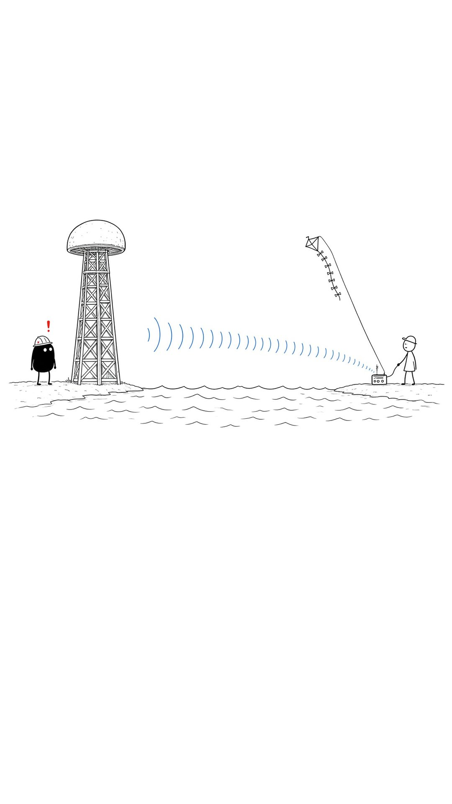 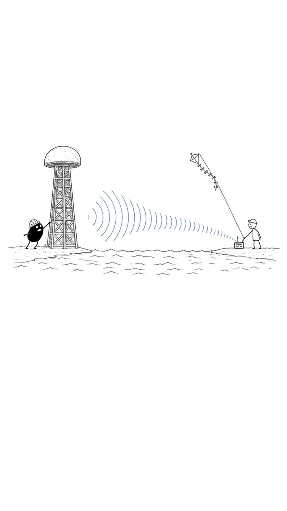</p>
- **Animation / clip prompt:** **not found.** No GenerateVideo / animation / transition prompt was saved for this scene, and none was found in the transcripts or project files searched for this update.

### Scene 5 — Tesla then asked Morgan for more money. His real dream…

- **Image / sketch prompt:** **not found.** No GenerateImage / still-sketch prompt was saved for this scene, and none was found in the transcripts or project files searched for this update.


Start still is the real production scene image, letterboxed to 9:16 (source: `/workspace/tesla/scenes/scene5.jpg`). End still is **extracted from clip** (last frame of `/workspace/tesla/clips/clip05.mp4`, with burned-in title, page number, and any captions removed):

<p>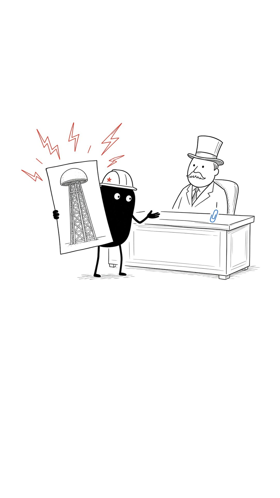 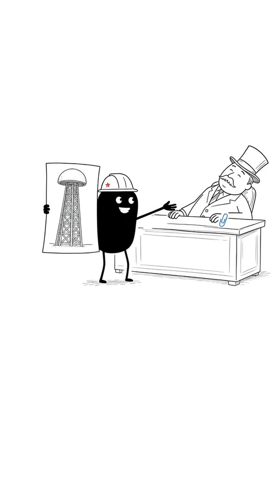</p>
- **Animation / clip prompt:** **not found.** No GenerateVideo / animation / transition prompt was saved for this scene, and none was found in the transcripts or project files searched for this update.

### Scene 6 — Morgan refused to give him another cent.

- **Image / sketch prompt:** **not found.** No GenerateImage / still-sketch prompt was saved for this scene, and none was found in the transcripts or project files searched for this update.


Start still is the real production scene image, letterboxed to 9:16 (source: `/workspace/tesla/scenes/scene6.jpg`). End still is **extracted from clip** (last frame of `/workspace/tesla/clips/clip06.mp4`, with burned-in title, page number, and any captions removed):

<p>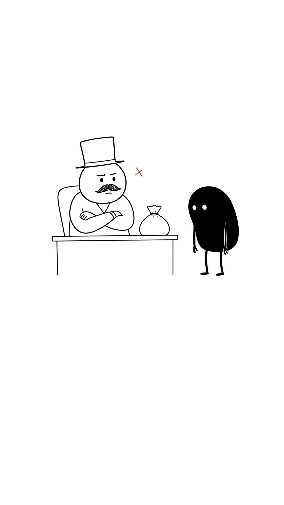 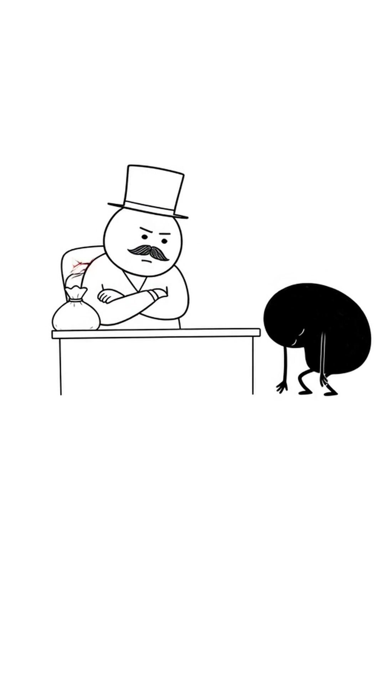</p>
- **Animation / clip prompt:** **not found.** No GenerateVideo / animation / transition prompt was saved for this scene, and none was found in the transcripts or project files searched for this update.

### Scene 7 — Tesla begged other investors for help, but no one would…

- **Image / sketch prompt:** **not found.** No GenerateImage / still-sketch prompt was saved for this scene, and none was found in the transcripts or project files searched for this update.


Start still is the real production scene image, letterboxed to 9:16 (source: `/workspace/tesla/scenes/scene7.jpg`). End still is **extracted from clip** (last frame of `/workspace/tesla/clips/clip07.mp4`, with burned-in title, page number, and any captions removed):

<p>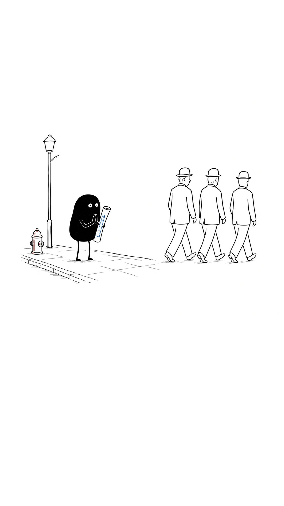 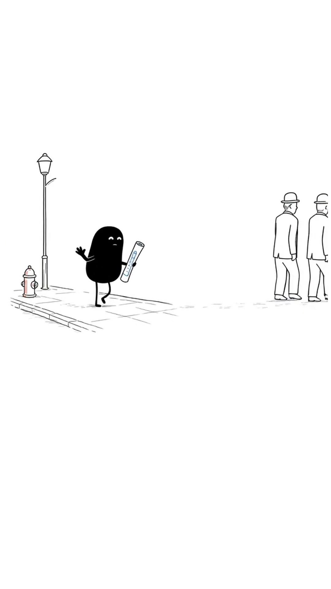</p>
- **Animation / clip prompt:** **not found.** No GenerateVideo / animation / transition prompt was saved for this scene, and none was found in the transcripts or project files searched for this update.

### Scene 8 — By 1906, work on the tower stopped, and Tesla's hotel…

- **Image / sketch prompt:** **not found.** No GenerateImage / still-sketch prompt was saved for this scene, and none was found in the transcripts or project files searched for this update.


Start still is the real production scene image, letterboxed to 9:16 (source: `/workspace/tesla/scenes/scene8.jpg`). End still is **extracted from clip** (last frame of `/workspace/tesla/clips/clip08.mp4`, with burned-in title, page number, and any captions removed):

<p>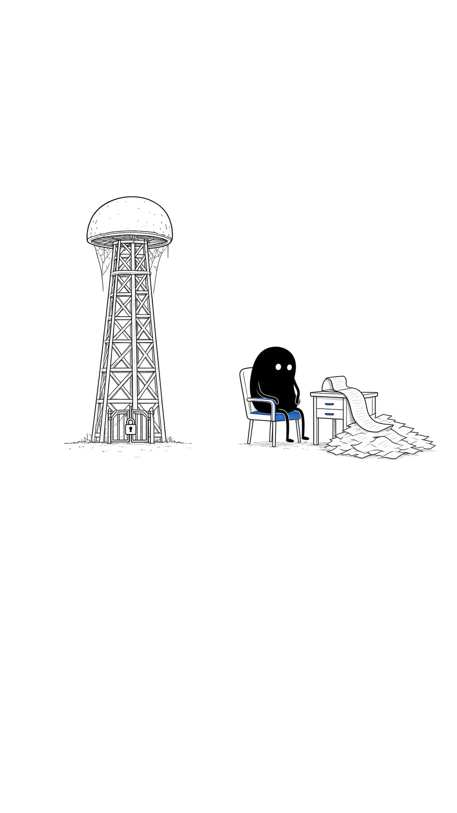 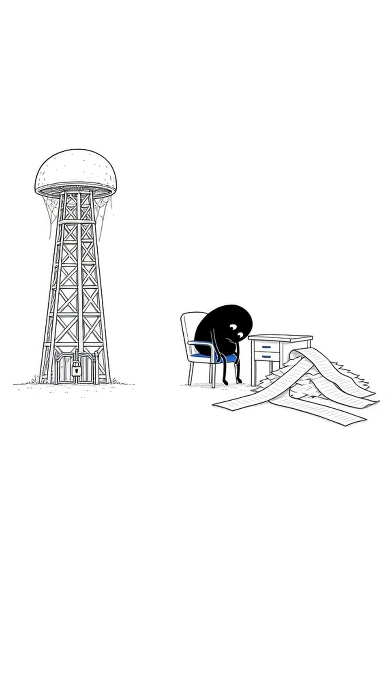</p>
- **Animation / clip prompt:** **not found.** No GenerateVideo / animation / transition prompt was saved for this scene, and none was found in the transcripts or project files searched for this update.

### Scene 9 — In 1917, the tower was blown up and sold for…

- **Image / sketch prompt:** **not found.** No GenerateImage / still-sketch prompt was saved for this scene, and none was found in the transcripts or project files searched for this update.


Start still is the real production scene image, letterboxed to 9:16 (source: `/workspace/tesla/scenes/scene9.jpg`). End still is **extracted from clip** (last frame of `/workspace/tesla/clips/clip09.mp4`, with burned-in title, page number, and any captions removed):

<p>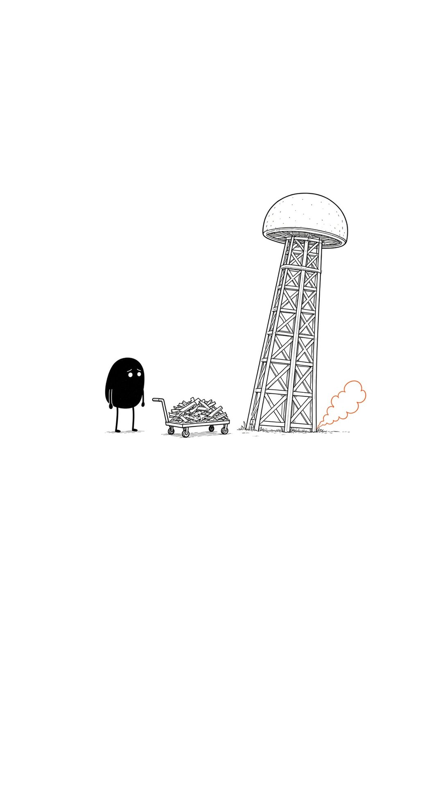 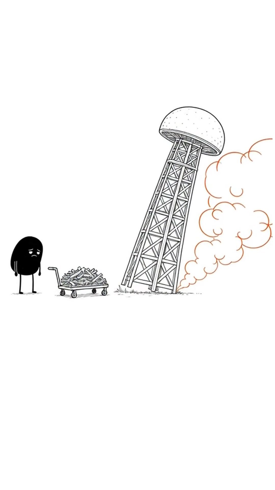</p>
- **Animation / clip prompt:** **not found.** No GenerateVideo / animation / transition prompt was saved for this scene, and none was found in the transcripts or project files searched for this update.

### Scene 10 — Tesla's tower never powered the world, but his dream of…

- **Image / sketch prompt:** **not found.** No GenerateImage / still-sketch prompt was saved for this scene, and none was found in the transcripts or project files searched for this update.


Start still is the real production scene image, letterboxed to 9:16 (source: `/workspace/tesla/scenes/scene10.jpg`). End still is **extracted from clip** (last frame of `/workspace/tesla/clips/clip10.mp4`, with burned-in title, page number, and any captions removed):

<p>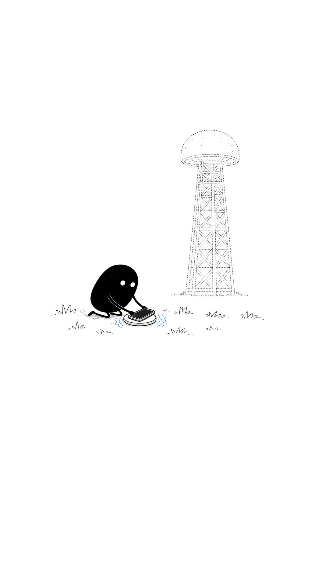 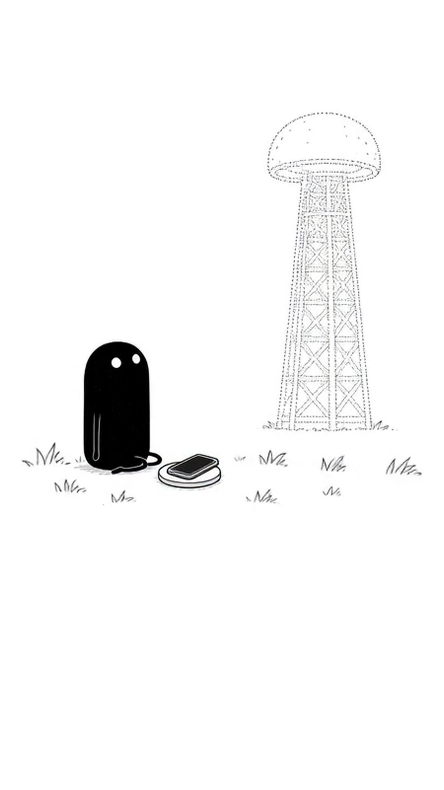</p>
- **Animation / clip prompt:** **not found.** No GenerateVideo / animation / transition prompt was saved for this scene, and none was found in the transcripts or project files searched for this update.
