# Wilma Rudolph — Midjourney-adapted prompts

This file is a Midjourney Web adaptation of [`wilma-rudolph.md`](wilma-rudolph.md). Original image and animation prompts were **not found**. The Midjourney video prompts below are **NEW - written for MJ**, based strictly on what the real start stills and extracted end frames show. They are not original GenerateImage or GenerateVideo text.

Conventions followed (from `MID/` in this repo and `.github/instructions/mid.instructions.md`):

- **Locked-off camera.** Do not use `push-in`, `zoom`, `dolly`, or `move closer`. No pan.
- **One-way motion only.** Do not use `--loop`, and do not write looping motion (`keeps turning`, `continues to tick`, reverse, ping-pong).
- Valid Midjourney video parameters used here: `--motion low` (MID default), `--raw`. `--loop` is valid in Midjourney but **must not be used** for this channel. `--end` is the End Frame control (upload the end still; see each scene).
- A first clip is **5 s**. Each manual Extend adds **~4 s**. Maximum length is **21 s**. This file uses **at most one** extension per scene, and only when the scene's narration is longer than 5 s.
- When a start still is set, Midjourney matches its aspect (these stills are 9:16; the UI often shows `--ar 171:256`). Per MID QA, **do not type `--ar`** when a Start Frame is uploaded.
- Describe **only what moves**. The start still is already frame zero.
- Style anchors: Ian Xiaohei ink, white background, thin wobbly black lines, no text. Do not add photoreal / push-in language from the MID cat example.

**Original image / sketch prompts:** **not found** for every scene (same as [`wilma-rudolph.md`](wilma-rudolph.md)).
**Original animation / clip prompts:** **not found** for every scene.

## Frames

The seven start stills were copied from `/workspace/wilma/scenes/scene1.jpg`–`scene7.jpg` and letterboxed to 9:16 in [`wilma-rudolph-images/`](wilma-rudolph-images/).

All end frames were **extracted from the last frame** of the real production clip. Those clips have a burned-in title, a page number, and sometimes captions, so those overlays were removed (filled with white) to leave a clean illustration. The end stills are labeled **extracted from clip** below. Start stills are the real production scene images, letterboxed onto a 9:16 white canvas with no title or captions.

## How to paste (Midjourney Web)

1. Imagine → add the **Start Frame** still → Switch to video.
2. Set **End Frame** (`--end`) to that scene's end still. Leave **Loop off**. Motion **Low**.
3. Paste the prompt, including `--motion low --raw`. Do not add `--loop`. Do not add `--ar`.
4. For a 9 s scene: run the **opening** prompt first (5 s). After a clean take, **Extend manually** once (~+4 s → ~9 s), replace the prefilled text with the **extend** prompt, Loop off, Motion Low, and keep `--end` aimed at the same end still if the plan says so. Split prompts follow the MID rule: the first 5 s is not packed, and the extend continues the same one-way action.

## Narration length vs 5 s or 9 s

Measured from `/workspace/wilma/audio_timing.json`. “Speech” is last word minus first word in that scene. A scene gets one Extend only when speech is longer than 5 s. Prompts stay gentle and describe only visible living motion. They do not emphasize illness.

| Scene | Speech | Part slot | 5 s clip? | Plan |
|---|---:|---:|---|---|
| 1 | 7.57 s | 7.97 s | No — speech is longer than 5 s | One Extend (**9 s**) |
| 2 | 6.12 s | 6.52 s | No — speech is longer than 5 s | One Extend (**9 s**) |
| 3 | 8.04 s | 8.44 s | No — speech is longer than 5 s | One Extend (**9 s**) |
| 4 | 5.42 s | 5.82 s | No — speech is longer than 5 s | One Extend (**9 s**) |
| 5 | 5.53 s | 5.93 s | No — speech is longer than 5 s | One Extend (**9 s**) |
| 6 | 6.82 s | 7.22 s | No — speech is longer than 5 s | One Extend (**9 s**) |
| 7 | 6.78 s | 7.13 s | No — speech is longer than 5 s | One Extend (**9 s**) |

### Frame files

| Scene | Start Frame (in repo) | End Frame (`--end`, in repo) | Original box source |
|---|---|---|---|
| 1 | [`wilma-rudolph-images/scene1_start.jpg`](wilma-rudolph-images/scene1_start.jpg) | [`wilma-rudolph-images/scene1_end.jpg`](wilma-rudolph-images/scene1_end.jpg) | `/workspace/wilma/scenes/scene1.jpg` → start; last frame of `clip01.mp4` → end (overlays removed) |
| 2 | [`wilma-rudolph-images/scene2_start.jpg`](wilma-rudolph-images/scene2_start.jpg) | [`wilma-rudolph-images/scene2_end.jpg`](wilma-rudolph-images/scene2_end.jpg) | `/workspace/wilma/scenes/scene2.jpg` → start; last frame of `clip02.mp4` → end (overlays removed) |
| 3 | [`wilma-rudolph-images/scene3_start.jpg`](wilma-rudolph-images/scene3_start.jpg) | [`wilma-rudolph-images/scene3_end.jpg`](wilma-rudolph-images/scene3_end.jpg) | `/workspace/wilma/scenes/scene3.jpg` → start; last frame of `clip03.mp4` → end (overlays removed) |
| 4 | [`wilma-rudolph-images/scene4_start.jpg`](wilma-rudolph-images/scene4_start.jpg) | [`wilma-rudolph-images/scene4_end.jpg`](wilma-rudolph-images/scene4_end.jpg) | `/workspace/wilma/scenes/scene4.jpg` → start; last frame of `clip04.mp4` → end (overlays removed) |
| 5 | [`wilma-rudolph-images/scene5_start.jpg`](wilma-rudolph-images/scene5_start.jpg) | [`wilma-rudolph-images/scene5_end.jpg`](wilma-rudolph-images/scene5_end.jpg) | `/workspace/wilma/scenes/scene5.jpg` → start; last frame of `clip05.mp4` → end (overlays removed) |
| 6 | [`wilma-rudolph-images/scene6_start.jpg`](wilma-rudolph-images/scene6_start.jpg) | [`wilma-rudolph-images/scene6_end.jpg`](wilma-rudolph-images/scene6_end.jpg) | `/workspace/wilma/scenes/scene6.jpg` → start; last frame of `clip06.mp4` → end (overlays removed) |
| 7 | [`wilma-rudolph-images/scene7_start.jpg`](wilma-rudolph-images/scene7_start.jpg) | [`wilma-rudolph-images/scene7_end.jpg`](wilma-rudolph-images/scene7_end.jpg) | `/workspace/wilma/scenes/scene7.jpg` → start; last frame of `clip07.mp4` → end (overlays removed) |

## Scene 1

- **Narration:** In 1940, in a small Tennessee town, Wilma Rudolph was born, the twentieth of twenty-two children in a poor family.
- **Length plan:** 9 s (5 s + one Extend). Speech 7.57 s.
- **Start Frame:** [`wilma-rudolph-images/scene1_start.jpg`](wilma-rudolph-images/scene1_start.jpg) (in this repo; source on the box: `/workspace/wilma/scenes/scene1.jpg`, letterboxed to 9:16 (no title))
- **End Frame (`--end`):** [`wilma-rudolph-images/scene1_end.jpg`](wilma-rudolph-images/scene1_end.jpg) (in this repo; **extracted from clip** — last frame of `/workspace/wilma/clips/clip01.mp4`, with burned-in title, page number, and any captions removed)

<p>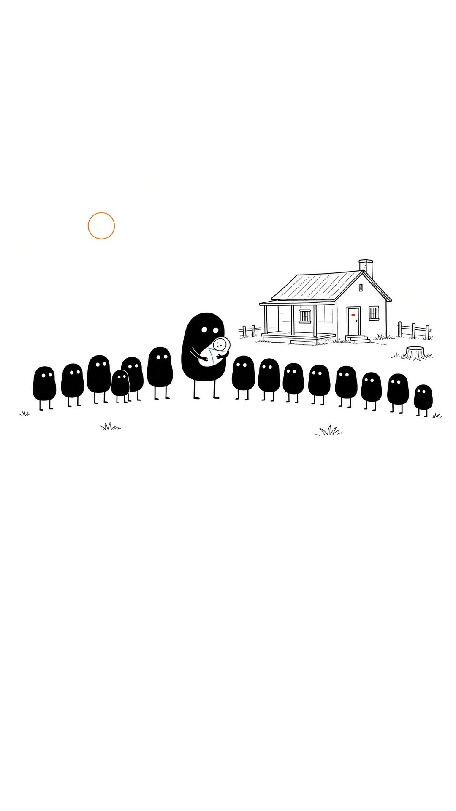 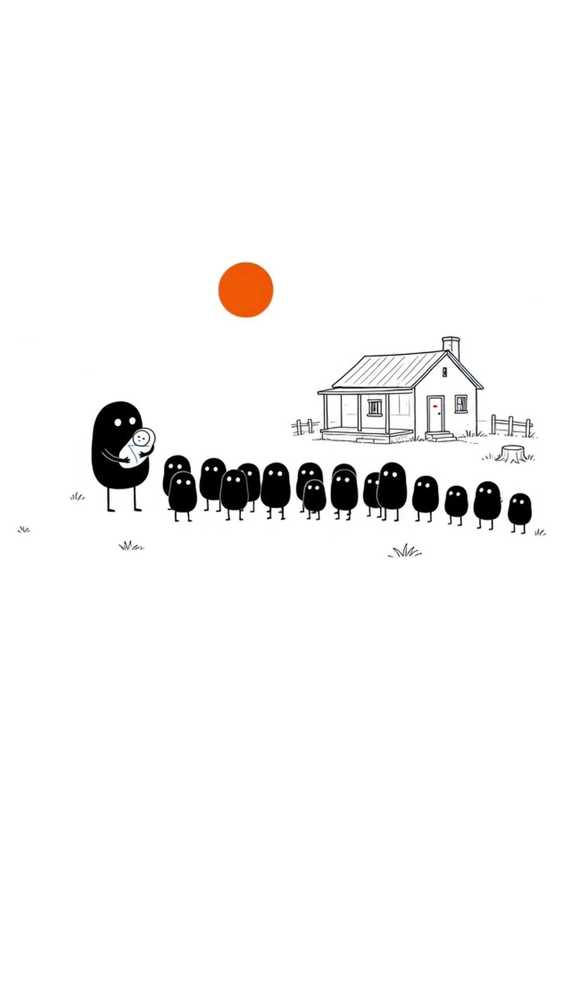</p>
- **Original image prompt:** **not found.**
- **Original animation prompt:** **not found.**

**Opening prompt (5 s) — paste — NEW - written for MJ:**

```
the parent holds the baby with a slight living shift, the line of children stands still with tiny weight shifts, the house, fence, and orange sun stay fixed, one-way motion only, no freeze, locked-off camera, Ian Xiaohei ink style, pure white background, thin wobbly black lines, no text, no letters, no captions --motion low --raw
```

**Extend prompt (~4 s) — paste — NEW - written for MJ:**

```
the family settles in place, slight living motion only, the house and sun stay fixed, no new objects, one-way motion only, no freeze, locked-off camera, Ian Xiaohei ink style, pure white background, thin wobbly black lines, no text, no letters, no captions --motion low --raw
```

## Scene 2

- **Narration:** At four, she caught polio, her left leg grew weak, and doctors said she would never walk again.
- **Length plan:** 9 s (5 s + one Extend). Speech 6.12 s.
- **Start Frame:** [`wilma-rudolph-images/scene2_start.jpg`](wilma-rudolph-images/scene2_start.jpg) (in this repo; source on the box: `/workspace/wilma/scenes/scene2.jpg`, letterboxed to 9:16 (no title))
- **End Frame (`--end`):** [`wilma-rudolph-images/scene2_end.jpg`](wilma-rudolph-images/scene2_end.jpg) (in this repo; **extracted from clip** — last frame of `/workspace/wilma/clips/clip02.mp4`, with burned-in title, page number, and any captions removed)

<p>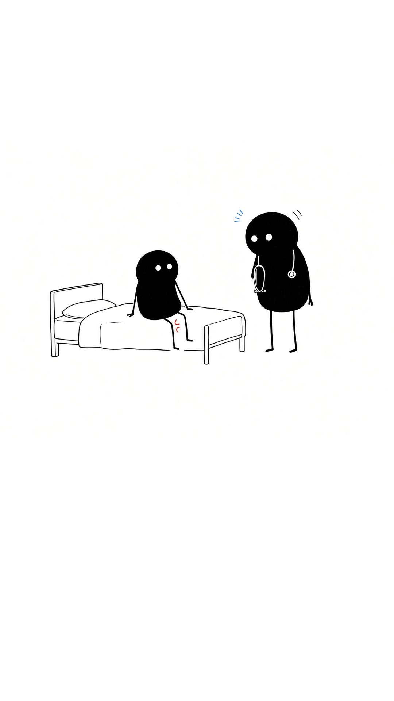 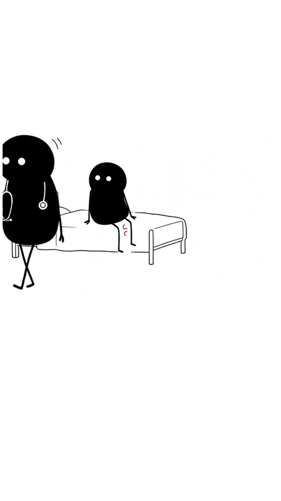</p>
- **Original image prompt:** **not found.**
- **Original animation prompt:** **not found.**

**Opening prompt (5 s) — paste — NEW - written for MJ:**

```
the child sits on the bed with a small shift, the adult stands close with slight living motion, the bed and floor stay fixed, one-way motion only, no freeze, locked-off camera, Ian Xiaohei ink style, pure white background, thin wobbly black lines, no text, no letters, no captions --motion low --raw
```

**Extend prompt (~4 s) — paste — NEW - written for MJ:**

```
they settle in place by the bed, slight living motion, no new objects, one-way motion only, no freeze, locked-off camera, Ian Xiaohei ink style, pure white background, thin wobbly black lines, no text, no letters, no captions --motion low --raw
```

## Scene 3

- **Narration:** Her mother refused to give up, taking her by bus every week to a hospital in Nashville, while her brothers and sisters rubbed her leg every day.
- **Length plan:** 9 s (5 s + one Extend). Speech 8.04 s.
- **Start Frame:** [`wilma-rudolph-images/scene3_start.jpg`](wilma-rudolph-images/scene3_start.jpg) (in this repo; source on the box: `/workspace/wilma/scenes/scene3.jpg`, letterboxed to 9:16 (no title))
- **End Frame (`--end`):** [`wilma-rudolph-images/scene3_end.jpg`](wilma-rudolph-images/scene3_end.jpg) (in this repo; **extracted from clip** — last frame of `/workspace/wilma/clips/clip03.mp4`, with burned-in title, page number, and any captions removed)

<p>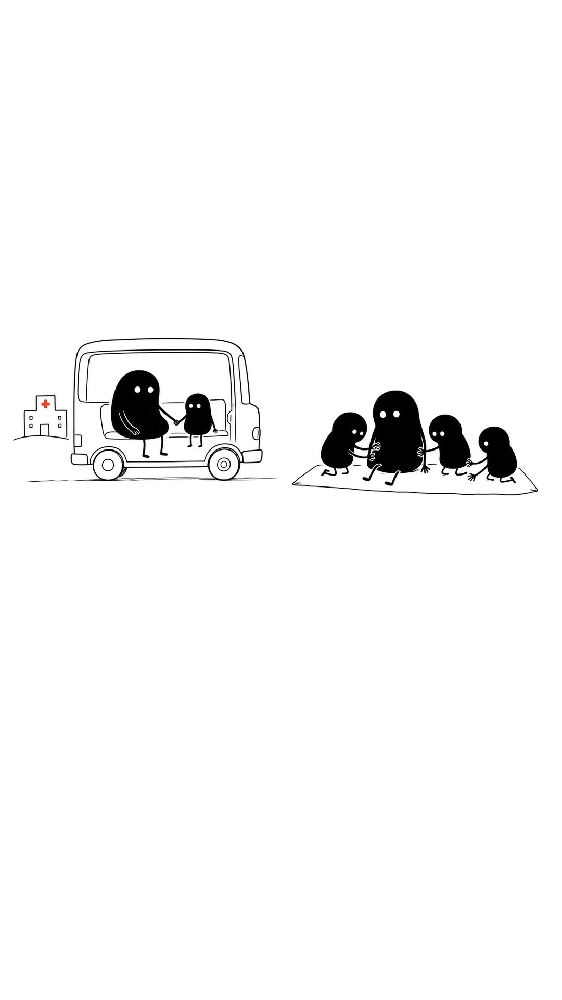 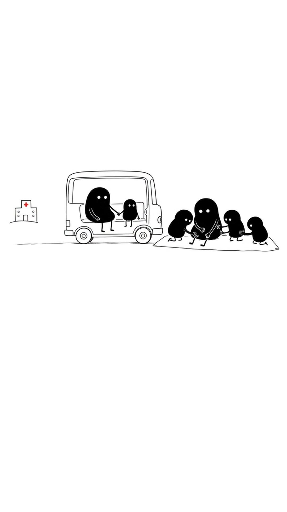</p>
- **Original image prompt:** **not found.**
- **Original animation prompt:** **not found.**

**Opening prompt (5 s) — paste — NEW - written for MJ:**

```
the small group stands by the bus with slight living motion, the bus stays in place, one-way motion only, no freeze, locked-off camera, Ian Xiaohei ink style, pure white background, thin wobbly black lines, no text, no letters, no captions --motion low --raw
```

**Extend prompt (~4 s) — paste — NEW - written for MJ:**

```
the group settles by the still bus, slight living motion, no new objects, one-way motion only, no freeze, locked-off camera, Ian Xiaohei ink style, pure white background, thin wobbly black lines, no text, no letters, no captions --motion low --raw
```

## Scene 4

- **Narration:** For years she wore a metal brace, until at twelve, she took it off and played basketball.
- **Length plan:** 9 s (5 s + one Extend). Speech 5.42 s.
- **Start Frame:** [`wilma-rudolph-images/scene4_start.jpg`](wilma-rudolph-images/scene4_start.jpg) (in this repo; source on the box: `/workspace/wilma/scenes/scene4.jpg`, letterboxed to 9:16 (no title))
- **End Frame (`--end`):** [`wilma-rudolph-images/scene4_end.jpg`](wilma-rudolph-images/scene4_end.jpg) (in this repo; **extracted from clip** — last frame of `/workspace/wilma/clips/clip04.mp4`, with burned-in title, page number, and any captions removed)

<p>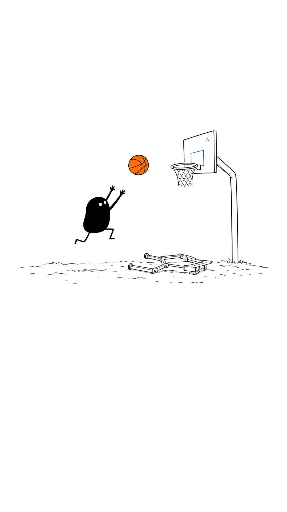 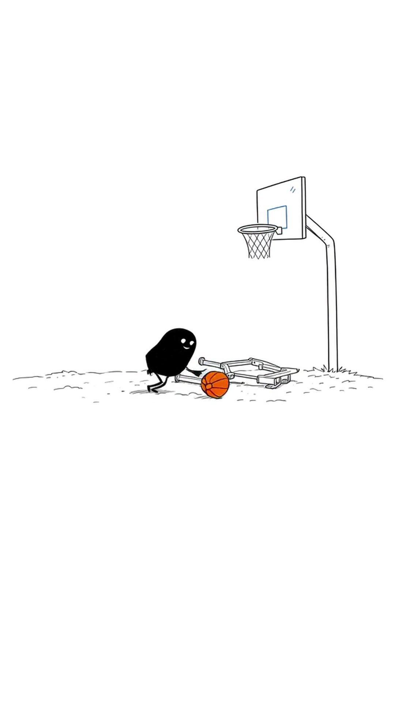</p>
- **Original image prompt:** **not found.**
- **Original animation prompt:** **not found.**

**Opening prompt (5 s) — paste — NEW - written for MJ:**

```
she sends the basketball in a short one-way arc toward the hoop, the hoop and ground stay fixed, one-way motion only, no freeze, locked-off camera, Ian Xiaohei ink style, pure white background, thin wobbly black lines, no text, no letters, no captions --motion low --raw
```

**Extend prompt (~4 s) — paste — NEW - written for MJ:**

```
the ball finishes its path and settles, she stays on the court, the hoop stays fixed, no new objects, one-way motion only, no freeze, locked-off camera, Ian Xiaohei ink style, pure white background, thin wobbly black lines, no text, no letters, no captions --motion low --raw
```

## Scene 5

- **Narration:** She began to run, and at just sixteen, she won an Olympic bronze medal in the relay.
- **Length plan:** 9 s (5 s + one Extend). Speech 5.53 s.
- **Start Frame:** [`wilma-rudolph-images/scene5_start.jpg`](wilma-rudolph-images/scene5_start.jpg) (in this repo; source on the box: `/workspace/wilma/scenes/scene5.jpg`, letterboxed to 9:16 (no title))
- **End Frame (`--end`):** [`wilma-rudolph-images/scene5_end.jpg`](wilma-rudolph-images/scene5_end.jpg) (in this repo; **extracted from clip** — last frame of `/workspace/wilma/clips/clip05.mp4`, with burned-in title, page number, and any captions removed)

<p>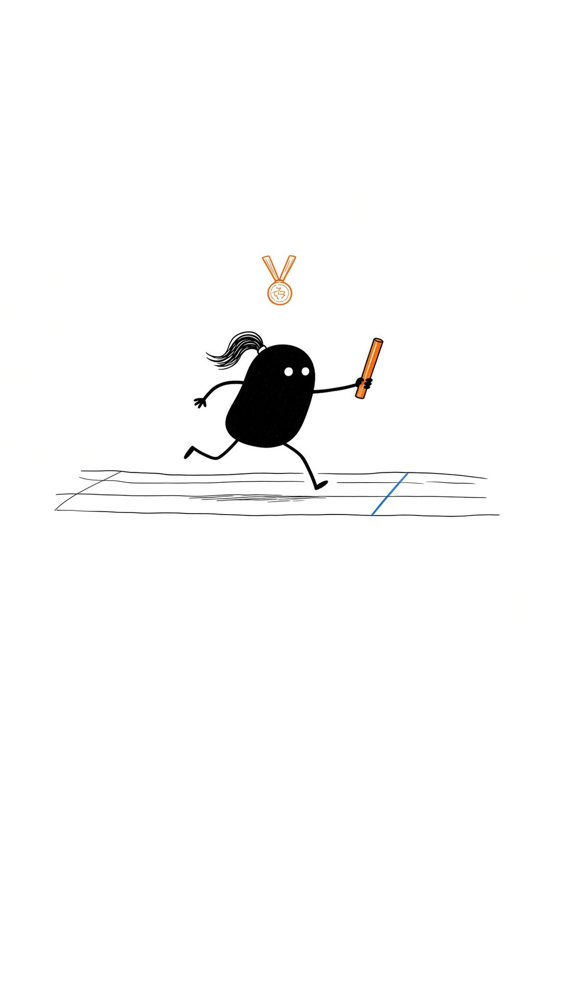 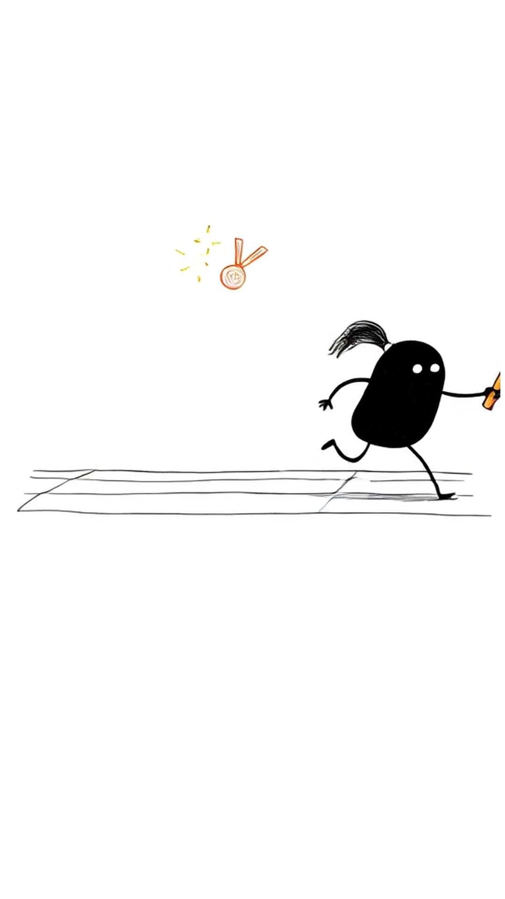</p>
- **Original image prompt:** **not found.**
- **Original animation prompt:** **not found.**

**Opening prompt (5 s) — paste — NEW - written for MJ:**

```
she runs one way to the right along the track, baton in hand, the medal stays with her, the track lines stay fixed, one-way motion only, no freeze, locked-off camera, Ian Xiaohei ink style, pure white background, thin wobbly black lines, no text, no letters, no captions --motion low --raw
```

**Extend prompt (~4 s) — paste — NEW - written for MJ:**

```
she continues a short distance right and settles her stride, the track stays fixed, no new objects, one-way motion only, no freeze, locked-off camera, Ian Xiaohei ink style, pure white background, thin wobbly black lines, no text, no letters, no captions --motion low --raw
```

## Scene 6

- **Narration:** In 1960, in Rome, she won three gold medals, and the world called her the fastest woman on Earth.
- **Length plan:** 9 s (5 s + one Extend). Speech 6.82 s.
- **Start Frame:** [`wilma-rudolph-images/scene6_start.jpg`](wilma-rudolph-images/scene6_start.jpg) (in this repo; source on the box: `/workspace/wilma/scenes/scene6.jpg`, letterboxed to 9:16 (no title))
- **End Frame (`--end`):** [`wilma-rudolph-images/scene6_end.jpg`](wilma-rudolph-images/scene6_end.jpg) (in this repo; **extracted from clip** — last frame of `/workspace/wilma/clips/clip06.mp4`, with burned-in title, page number, and any captions removed)

<p>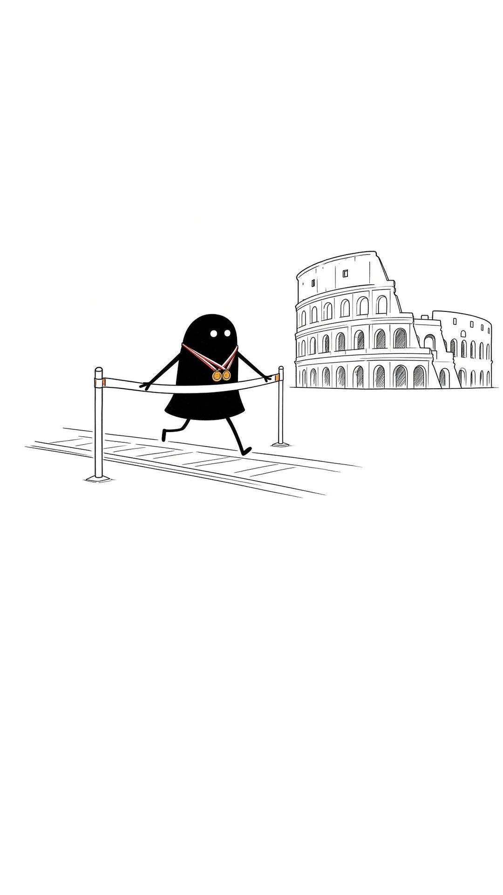 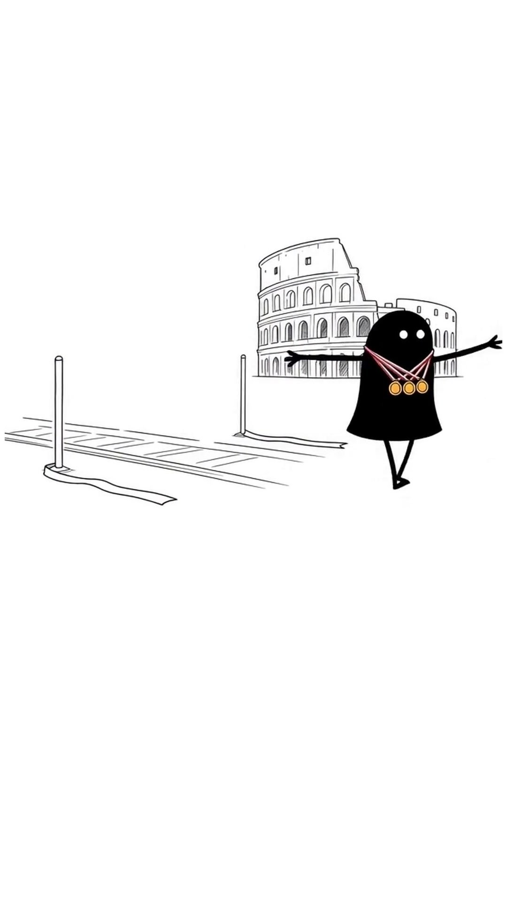</p>
- **Original image prompt:** **not found.**
- **Original animation prompt:** **not found.**

**Opening prompt (5 s) — paste — NEW - written for MJ:**

```
she stands on the track and slowly raises her arms, the three medals stay in place, the Colosseum stays fixed, one-way motion only, no freeze, locked-off camera, Ian Xiaohei ink style, pure white background, thin wobbly black lines, no text, no letters, no captions --motion low --raw
```

**Extend prompt (~4 s) — paste — NEW - written for MJ:**

```
she finishes raising her arms and settles, the Colosseum stays fixed, no new objects, one-way motion only, no freeze, locked-off camera, Ian Xiaohei ink style, pure white background, thin wobbly black lines, no text, no letters, no captions --motion low --raw
```

## Scene 7

- **Narration:** Back home, she insisted her welcome parade be open to everyone, and it became her town's first integrated event.
- **Length plan:** 9 s (5 s + one Extend). Speech 6.78 s.
- **Start Frame:** [`wilma-rudolph-images/scene7_start.jpg`](wilma-rudolph-images/scene7_start.jpg) (in this repo; source on the box: `/workspace/wilma/scenes/scene7.jpg`, letterboxed to 9:16 (no title))
- **End Frame (`--end`):** [`wilma-rudolph-images/scene7_end.jpg`](wilma-rudolph-images/scene7_end.jpg) (in this repo; **extracted from clip** — last frame of `/workspace/wilma/clips/clip07.mp4`, with burned-in title, page number, and any captions removed)

<p>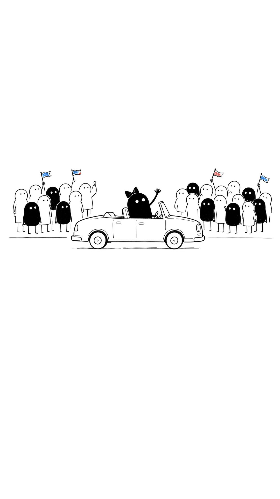 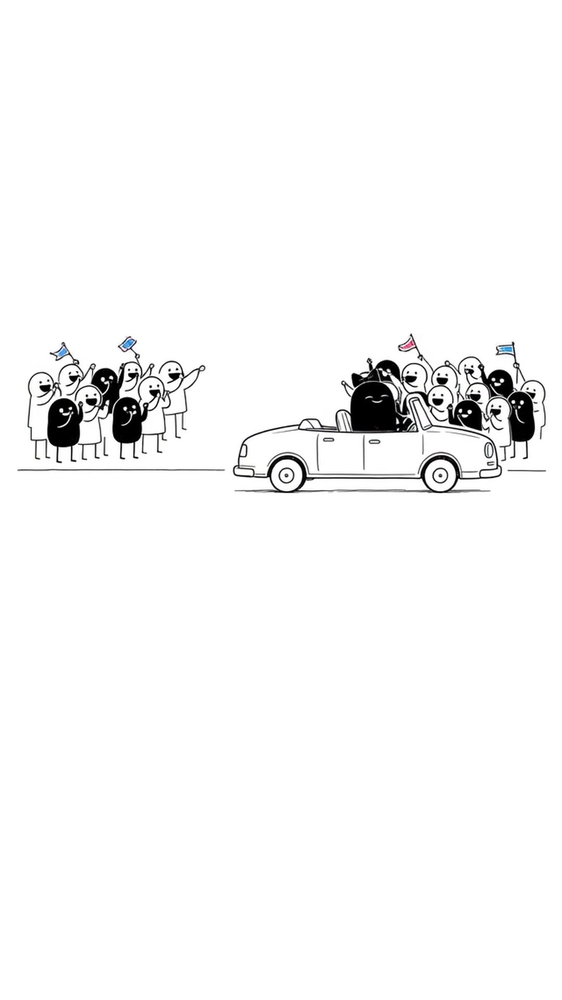</p>
- **Original image prompt:** **not found.**
- **Original animation prompt:** **not found.**

**Opening prompt (5 s) — paste — NEW - written for MJ:**

```
the open car rolls slowly to the right, she sits in the car with a small wave, the crowd stays in place with slight living motion, one-way motion only, no freeze, locked-off camera, Ian Xiaohei ink style, pure white background, thin wobbly black lines, no text, no letters, no captions --motion low --raw
```

**Extend prompt (~4 s) — paste — NEW - written for MJ:**

```
the car settles, the crowd stays in place with slight living motion, no new objects, one-way motion only, no freeze, locked-off camera, Ian Xiaohei ink style, pure white background, thin wobbly black lines, no text, no letters, no captions --motion low --raw
```
